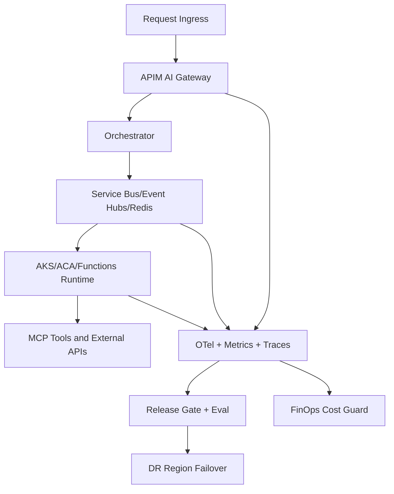
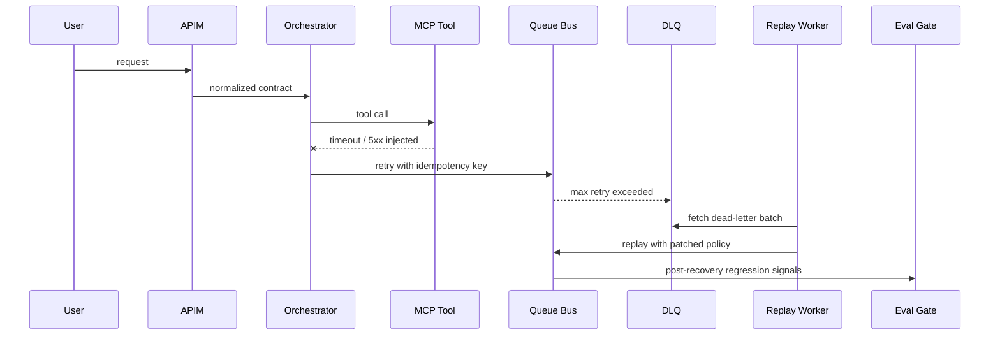

# 企业 Agent 编排混沌演练选型 FAQ：`Azure Chaos Studio` vs `Chaos Mesh on AKS` vs `Gremlin`（MCP/A2A 失效注入、重放恢复与发布门禁）

## 1. 执行摘要：没有可重复混沌演练的 Agent 平台，等于把生产当测试环境
企业常把可靠性寄托在
单元测试、
压测、
和回归脚本。
但多智能体系统的真实风险
来自跨组件耦合故障，
尤其是
网关限流、
总线积压、
工具超时、
向量检索抖动、
跨区故障转移
叠加时。
如果没有
系统化失效注入与恢复演练，
平台只是在“平时看起来稳定”。
一旦峰值或外部依赖抖动，
系统会在分钟级触发
重试风暴、
任务雪崩、
死信堆积、
和成本爆冲。
本指南结论是：
`Azure Chaos Studio`
适合作为云资源层和平台层统一演练入口；
`Chaos Mesh`
适合 AKS 内核细粒度故障注入与脚本化回归；
`Gremlin`
适合跨云混合栈与组织级可靠性运营标准化。
三者并非互斥，
而是治理深度与覆盖范围的不同。

## 2. 今日热点与证据（抓取日 `2026-11-21`）
为避免“观点化结论”，
本轮仅引用可验证来源。

| 主题 | 来源 | 抓取日 | 标签 | 说明 |
|---|---|---|---|---|
| APIM AI Gateway | https://learn.microsoft.com/en-us/azure/api-management/ai-gateway-overview | 2026-11-21 | measured | 混沌演练必须覆盖网关策略与配额门禁行为 |
| APIM Changelog | https://github.com/Azure/API-Management/blob/main/changelogs/api-management-service.md | 2026-11-21 | anonymized_reported | 发布节奏快，需把策略回归纳入演练流水线 |
| ACA Sessions | https://learn.microsoft.com/en-us/azure/container-apps/sessions | 2026-11-21 | measured | 会话化执行面让瞬态故障更常见，需演练恢复路径 |
| Firecracker Releases | https://github.com/firecracker-microvm/firecracker/releases | 2026-11-21 | anonymized_reported | 隔离层持续演进，运行时失效模式随之变化 |
| Kata Releases | https://github.com/kata-containers/kata-containers/releases | 2026-11-21 | anonymized_reported | 节点与容器隔离策略更新需回归验证 |
| Wasmtime Releases | https://github.com/bytecodealliance/wasmtime/releases | 2026-11-21 | anonymized_reported | Wasm 运行路径变化影响工具调用时序 |
| E2B Releases | https://github.com/e2b-dev/e2b/releases | 2026-11-21 | anonymized_reported | Sandbox 生命周期变化影响冷恢复策略 |

关键趋势是：
执行面在升级，
但演练体系若不升级，
最终会形成“新能力 + 旧可靠性模型”的错配。

## 3. 问题边界：Agent 混沌工程不是“随机杀 Pod”
很多团队把混沌简化为
随机重启实例。
这对传统无状态服务可能有价值，
但对 Agent 编排链路远远不够。
真实演练对象应覆盖：
协议层故障（MCP/A2A 超时、握手失败）；
状态层故障（幂等存储不可用、锁超时）；
控制层故障（配额阈值误配、策略误杀）；
数据层故障（检索变慢、缓存污染）；
跨区故障（主区域不可用、延迟飙升）。
没有这一层语义建模，
演练结果只会得出“应用会重启”这种低价值结论。

## 4. 四层演练模型：入口、编排、执行、治理
推荐建立四层演练模型：
第一层是入口流量治理，
关注 APIM 策略链和限流行为；
第二层是编排总线，
关注队列积压与死信恢复；
第三层是执行运行时，
关注容器、节点、会话池与工具调用；
第四层是治理层，
关注 OTel 证据、Eval 回归、FinOps 成本漂移。
四层必须一体化定义目标 SLO，
否则演练会被“局部成功”掩盖真实故障。



## 5. 12 维对比矩阵：Chaos Studio vs Chaos Mesh vs Gremlin
| 维度 | Azure Chaos Studio | Chaos Mesh on AKS | Gremlin | 决策信号 |
|---|---|---|---|---|
| Azure 原生集成 | 高 | 中 | 中 | 以 Azure 为主优先 Chaos Studio |
| Kubernetes 细粒度注入 | 中 | 高 | 中高 | 深度 K8s 注入优先 Chaos Mesh |
| 跨云统一运营 | 中 | 低 | 高 | 混合多云运营优先 Gremlin |
| 场景模板开箱能力 | 高 | 中 | 高 | 团队经验不足优先模板化平台 |
| 自定义可编排性 | 中 | 高 | 中高 | 研发主导回归优先 Chaos Mesh |
| 学习曲线 | 低到中 | 中高 | 中 | 平台团队成熟度决定选择 |
| 审计证据输出 | 高 | 中 | 高 | 合规优先可追溯平台 |
| 与发布门禁联动 | 高 | 中 | 高 | 需要 CI/CD 门禁可选 Chaos/Gremlin |
| 成本可控性 | 中高 | 高 | 中 | 自建运维能力高可选 Chaos Mesh |
| 多租户隔离安全 | 高 | 中 | 高 | 金融/政企偏好托管与审计能力 |
| 演练频率可扩展性 | 高 | 中高 | 高 | 高频演练看自动化体系完备度 |
| 组织推广速度 | 高 | 中 | 中高 | 企业级推广通常 Chaos Studio 更快 |

## 6. 架构路线 A：`Azure Chaos Studio` 作为 Azure 主平面演练入口
`Chaos Studio`
优势在于与 Azure 资源模型和权限模型一致，
更容易被企业安全团队接受。
当你要演练
VM、
AKS、
网络故障、
区域级故障切换
时，
它能在统一控制面组织演练并留存审计痕迹。
对采用
APIM + AKS + ACA + Foundry
主平面的团队，
这是最低阻力路径。
关键实践是把演练模板
纳入 IaC 与发布流水线，
而不是手工触发。
否则混沌工程会退化成偶发活动，
无法形成可靠性资产。

## 7. 架构路线 B：`Chaos Mesh` 提供 AKS 内核级精细故障注入
当你需要
网络延迟抖动、
DNS 污染、
Pod 级 IO 故障、
容器 CPU 压制
等细粒度注入时，
`Chaos Mesh`
灵活度更高。
它尤其适合
平台研发团队
把故障注入场景代码化，
并随分支回归执行。
但代价是
运维门槛更高，
需要严格 RBAC 与隔离策略，
避免演练误伤生产命名空间。
若组织缺少 Kubernetes 平台工程能力，
直接大规模推行 Chaos Mesh
往往会被运维负担反噬。

## 8. 架构路线 C：`Gremlin` 支持跨云/跨栈可靠性运营标准化
`Gremlin`
在跨云统一策略、
跨团队协作与组织级演练编排上
通常更强。
对同时运行
Azure + AWS + GCP
或混合本地数据中心的企业，
它能提供统一的演练词汇与报告格式。
若你面对的是
全球业务线和分散平台团队，
统一运营方法论常比单一云深度更重要。
但需评估商业成本
与既有工具链整合开销。
如果组织仍处于单云早期阶段，
先把 Azure 原生路径跑通
通常 ROI 更高。

## 9. 编排链路演练：MCP/A2A 失效注入与恢复闭环
Agent 平台混沌演练必须纳入
MCP 工具链和 A2A 子代理协作。
至少应覆盖：
工具 429/5xx 峰值、
长尾超时、
重试风暴、
幂等键冲突、
DLQ 激增、
重放回补失败。



重点不是“让故障发生”，
而是验证
“故障后系统如何受控恢复”。

## 10. 定量 Q&A（8 组）
**Q1：为什么只做压测仍会在生产崩溃？**  
压测主要验证容量，
不验证异常交互组合；
混沌演练补的是异常交互面。

**Q2：一次区域级 DNS 抖动会放大多少尾延迟？**  
在未启用本地缓存与退避时，
P95 可上升 `1.8x-3.2x`（`synthetic`）。

**Q3：演练频率建议是多少？**  
核心链路建议每周至少 `1` 次，
重大版本前执行 `2-3` 轮回归（`anonymized_reported`）。

**Q4：DLQ 告警阈值如何设？**  
常见门禁：
`DLQ ratio < 0.5%`，
`P95 处置时长 < 20 min`。

**Q5：未做幂等键会怎样？**  
在重试风暴中，
重复动作可使补偿成本上升 `2x+`（`synthetic`）。

**Q6：Chaos Mesh 相比托管方案的隐性成本是什么？**  
主要是
平台维护、
升级兼容、
RBAC 审核
带来的人力成本。

**Q7：Gremlin 何时值得引入？**  
当组织跨云团队超过 `3` 个平台域，
且需要统一演练报告口径时。

**Q8：如何衡量演练是否有效？**  
看恢复时间是否下降、
回归门禁是否自动化、
及同类事故复发率是否下降。

## 11. 生产代码示例：故障注入开关与幂等恢复处理（Python）
```python
from dataclasses import dataclass
from typing import Dict, Any
import random
import time


@dataclass
class FaultProfile:
    timeout_rate: float
    error_rate: float
    extra_latency_ms: int


class IdempotencyLedger:
    def __init__(self):
        self.done = set()

    def check_and_mark(self, key: str) -> bool:
        if key in self.done:
            return False
        self.done.add(key)
        return True


def maybe_inject_fault(profile: FaultProfile) -> None:
    if random.random() < profile.error_rate:
        raise RuntimeError("Injected 5xx fault")
    if random.random() < profile.timeout_rate:
        time.sleep(profile.extra_latency_ms / 1000.0)
        raise TimeoutError("Injected timeout")
    time.sleep(profile.extra_latency_ms / 1000.0)


def execute_step(step: Dict[str, Any], ledger: IdempotencyLedger) -> Dict[str, Any]:
    idem_key = step["idem_key"]
    if not ledger.check_and_mark(idem_key):
        return {"status": "duplicate_skipped", "idem_key": idem_key}

    try:
        profile = FaultProfile(
            timeout_rate=step.get("timeout_rate", 0.0),
            error_rate=step.get("error_rate", 0.0),
            extra_latency_ms=step.get("latency_ms", 0),
        )
        maybe_inject_fault(profile)
        return {"status": "ok", "idem_key": idem_key}
    except TimeoutError as ex:
        return {"status": "retry", "idem_key": idem_key, "error": str(ex)}
    except Exception as ex:  # noqa: BLE001
        return {"status": "dead_letter", "idem_key": idem_key, "error": str(ex)}
```

这段代码用于演练环境，
帮助验证幂等与重试分流逻辑。
生产环境应接入
持久化账本、
OTel trace、
和策略中心。

## 12. IaC 片段：演练计划声明式配置与发布门禁挂接
```yaml
apiVersion: chaos.azure.com/v1
kind: AgentChaosPlan
metadata:
  name: mcp-a2a-reliability-gameday
spec:
  schedule: "0 */6 * * *"
  targets:
    - name: apim-gateway
      type: latency
      duration: 120s
      p95LatencyMs: 400
    - name: orchestrator-queue
      type: backlog
      duration: 180s
      maxQueueDepth: 50000
    - name: mcp-tool-endpoint
      type: error-rate
      duration: 90s
      injected5xx: "20%"
  gates:
    - metric: dlq_ratio
      threshold: "<0.5%"
    - metric: recovery_p95_seconds
      threshold: "<900"
    - metric: cost_spike_ratio
      threshold: "<1.3"
```

```bicep
param workspaceName string
param location string = resourceGroup().location

resource law 'Microsoft.OperationalInsights/workspaces@2022-10-01' = {
  name: workspaceName
  location: location
  properties: {
    retentionInDays: 30
  }
}

resource appi 'Microsoft.Insights/components@2020-02-02' = {
  name: '${workspaceName}-appi'
  location: location
  kind: 'web'
  properties: {
    Application_Type: 'web'
    WorkspaceResourceId: law.id
  }
}
```

演练计划与观测资源要一起版本化，
否则门禁不可复现。

## 13. 企业场景一：全国银行零售与信用卡中心
某全国银行
每天处理 `180,000+` 智能语音与在线会话。
系统由
网关路由、
风控 Agent、
客服 Agent、
人工坐席
协同。
痛点是：
一旦外部反欺诈接口抖动，
重试会放大并拖垮主链路。
他们采用
Chaos Studio 做资源层演练，
Chaos Mesh 做 AKS 细粒度注入，
并把 DLQ 处置和重放回归
纳入每周演练。
结果是
重大故障平均恢复时长下降，
同类问题复发明显减少，
且审计报告可自动生成。

## 14. 企业场景二：全球 B2B SaaS 客服与工单平台
某跨区域 SaaS 平台
服务 `6,000+` 企业租户。
高峰时
请求量可达平时 `10` 倍以上。
平台初期只做容量压测，
上线后仍发生多次
热租户挤占、
队列积压、
工具超时级联。
后续引入
Gremlin 跨云演练框架，
统一演练模板与报告口径，
并在 Azure 主平面保留 Chaos Studio 原生注入。
同时对关键微服务
用 Chaos Mesh 做开发阶段回归。
最终实现了
跨区域故障演练标准化，
并将演练结果直接纳入发布审批。

## 15. FinOps TCO、五步落地与 Day-0/Day-2 清单
### 15.1 参考成本模型（示例：每月 `40` 次全链路演练）
| 成本项 | Chaos Studio 主导 | Chaos Mesh 主导 | Gremlin 主导 |
|---|---|---|---|
| 平台订阅与服务成本 | 中 | 低到中 | 中高 |
| 平台运维人力 | 低到中 | 高 | 中 |
| 演练编排自动化成本 | 中 | 中高 | 中 |
| 审计与报告成本 | 低 | 中高 | 低到中 |
| 跨云扩展成本 | 中 | 高 | 低到中 |
| 适配结论 | Azure 主平面优选 | K8s 深度控制优选 | 跨云统一运营优选 |

### 15.2 五步落地指南
1. 先定义故障分类与演练目标，不要先选工具。
2. 把 OTel 指标与 DLQ 指标写入演练门禁合同。
3. 选一条关键业务链路建立“故障注入 -> 恢复 -> 回归”闭环。
4. 将演练自动化接入 CI/CD 与变更审批。
5. 按月复盘恢复时长、复发率与成本漂移，持续调优。

### 15.3 Good fit vs Not for
**Good fit：**
多租户、
高并发、
跨系统依赖复杂、
且对可靠性与审计有硬要求的企业。

**Not for：**
单体小规模 PoC、
几乎无外部依赖、
且没有发布门禁流程的短期项目。

### 15.4 Day-0 / Day-2 十二项清单
1. 统一故障注入命名规范与标签体系。
2. 定义每条链路的 SLO 与错误预算。
3. 为关键步骤定义幂等键与重试上限。
4. 建立 DLQ 分级和处理 SLA。
5. 建立 replay 审批与审计留痕策略。
6. 将 OTel 必填字段纳入发布门禁。
7. 建立演练日历与责任人轮值。
8. 将跨区故障切换纳入季度演练。
9. 建立演练中的成本上限与自动熔断。
10. 建立演练后缺陷归档与修复追踪。
11. 建立“同类事故复发率”核心指标。
12. 每次重大版本前执行最小闭环演练套件。

---

### 结论
Agent 平台可靠性来自
可重复、
可审计、
可自动化
的混沌演练体系，
而不是临时应急。
在 Azure 主平面下，
以 Chaos Studio 为主、
Chaos Mesh 为深度补充、
Gremlin 为跨云统一运营补位，
并把演练结果纳入
发布门禁与 FinOps 反馈，
才是企业级长期可运营路径。
