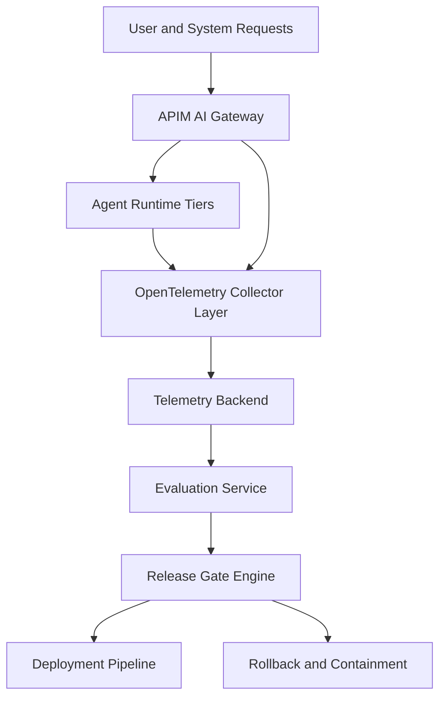
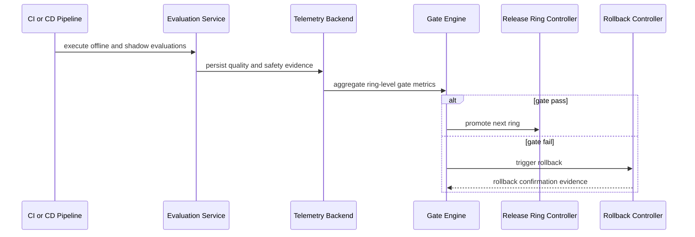

# Enterprise Agent OTel Trace and Evaluation-Closure Selection FAQ: `Azure Monitor` vs `AKS LGTM` vs `Datadog` vs `Fabric Eventhouse`

## 1. Executive Summary: Production Reliability Depends on an Observability-Evaluation-Release Loop, Not a Single Offline Score
A common enterprise mistake is treating one strong offline benchmark run as proof of production safety. In real operations, major incidents frequently happen after teams already passed offline evaluations. The reason is not always model quality degradation. The reason is usually system drift: traffic mix changes, tool-call graphs become deeper, policy versions diverge, unit economics shift, or release gates become decoupled from live telemetry. Therefore, this guide defines the real architecture problem as: how to build a durable **OpenTelemetry -> Agent evaluation -> release gate -> rollback** control loop. We compare three practical enterprise paths: an Azure-native managed loop, an open-source composable loop, and a commercial APM-centered loop. The key conclusion is straightforward: there is no universal winner, but there is a best-fit option for each organization's governance model, platform engineering maturity, and compliance obligations.

## 2. Daily Breakthrough Evidence (Fetched `2026-11-21`): Official and Release-Backed Sources First
This round uses verifiable official documentation and release-channel evidence, with retrieval date explicitly marked as `2026-11-21`. Source A: Azure API Management AI Gateway overview (`measured` capability context). Source B: Azure Container Apps sessions documentation (`anonymized_reported` runtime-session envelope context). Source C: Azure API Management changelog (`anonymized_reported` release cadence evidence). Source D: Firecracker releases (`anonymized_reported` sandbox-isolation evolution). Source E: Kata Containers releases (`anonymized_reported` VM-isolated container evolution). Source F: Wasmtime releases (`anonymized_reported` Wasm runtime maturity trend). Source G: E2B releases (`anonymized_reported` managed sandbox product cadence). Together, these signals support a broad market observation: competitive advantage is shifting from model-access breadth to operational control-loop maturity. Organizations that can bind telemetry,
evaluation,
release decisions,
rollback evidence,
and cost accountability
into one governed system
scale more safely than organizations
that only optimize model endpoints.

## 3. Problem Boundary: Observability Is Not Dashboard Density; It Is Decision Provability
Many teams build rich observability dashboards.
Yet during incident reviews,
they still cannot answer three simple questions:
why should this release be rolled back,
which tenant segment is most affected,
and whether policy bypass occurred in specific traffic paths.
The root cause is structural:
measurement systems and release systems are disconnected.
If telemetry cannot directly drive release actions,
observability remains descriptive
instead of prescriptive.
For production-grade agent systems,
observability should be treated as a four-layer contract:
collection,
semantic normalization,
evaluation,
and decision automation.
Collection answers “what happened.”
Semantics answer “how events relate.”
Evaluation answers “whether quality is acceptable.”
Decision automation answers “what action must be taken now.”
Without all four layers,
scale increases uncertainty faster than reliability.

## 4. 12-Dimension Comparison Matrix: Azure Monitor vs AKS LGTM vs Datadog vs Fabric Eventhouse
| Dimension | Azure-native (`Azure Monitor + App Insights + Managed Prometheus`) | Open-source (`AKS OTel Collector + Loki/Tempo/Mimir`) | Commercial (`Datadog APM + LLM Observability`) | Analytics closure (`Fabric Eventhouse + KQL + OneLake`) | Decision Signal |
|---|---|---|---|---|---|
| Time-to-first-governed-release | High | Medium | Medium-high | Medium | Azure estates generally reach production closure faster |
| Semantic consistency across teams | High | Medium-high (needs standards ownership) | Medium-high | High (KQL contract unification) | Semantic governance matters more than vendor choice |
| GenAI metric customization depth | Medium-high | High | Medium-high | High | Deep analytics and replay favor LGTM/Eventhouse |
| Gate automation integration effort | High | Medium-high | Medium | High | Promotion policy should be evaluation-driven |
| Tenant-level chargeback alignment | High | Medium | Medium-high | High | FinOps-heavy programs favor Azure/Eventhouse pairing |
| Operations complexity | Low-medium | High | Medium | Medium-high | Staffing profile should drive architecture decisions |
| Multi-cloud portability | Medium | High | Medium-high | Medium-high | Neutral OTel semantics improve portability |
| Data sovereignty control | High | High | Medium | High | Regulated workloads require explicit residency planning |
| Incident triage path length | Medium | Medium-high | Medium | Medium | Correlation-key discipline materially reduces MTTR |
| Audit evidence replayability | High | Medium-high | Medium-high | High | Replayable evidence should be policy-mandated |
| Cost predictability | Medium-high | Medium | Medium-high | Medium-high | Open-source requires hard sampling discipline |
| Organizational learning curve | Low-medium | Medium-high | Medium | Medium | Skills debt must be modeled in TCO |

## 5. Reference Architecture A: Unified Telemetry-Evaluation-Release Control Plane


The key architectural principle is simple:
release outcomes should not depend
on manual dashboard interpretation during pressure events.
Release gates should execute governed policy.
For example,
if `P95 TTFT` degrades beyond threshold
without corresponding task-quality uplift,
the ring should halt and rollback automatically.
That policy must be replayable in audit scenarios.

## 6. Path 1: `Azure Monitor + App Insights + Managed Prometheus` for Azure-Native Governance Closure
This path is usually the most efficient
for enterprises already operating on Azure as their primary control plane.
Identity,
policy,
monitoring,
and cost constructs align naturally.
A practical rollout pattern is:
define canonical telemetry keys first,
then map evaluation outputs to gate contracts,
then enforce promotion/rollback logic in CI/CD.
Critical canonical keys commonly include:
`workflow_id`,
`tenant_id`,
`policy_version`,
`release_ring`,
and `cost_snapshot_id`.
Without these keys,
incident triage becomes subjective
and chargeback accountability degrades quickly.
The largest implementation risk is partial adoption:
teams enabling baseline monitoring
without establishing evaluation-to-gate linkage.
That failure mode creates the illusion of readiness
while preserving manual release decisions.
High-maturity deployments therefore require
joint thresholds across latency,
quality,
safety interception,
and unit cost.

## 7. Path 2: `OTel Collector + LGTM on AKS` for Deep Customization and Multi-Cloud Portability
Open-source loops are attractive
when organizations need deep semantic control
or must maintain consistent observability across cloud boundaries.
This approach is common in federated enterprises,
M&A integration programs,
or sovereign deployments with strict platform neutrality requirements.
The primary strength is adaptability:
you can define domain-specific trace attributes,
evaluation features,
and replay schemas without vendor lock-in.
The primary risk is operating burden:
collector scaling,
retention policy design,
cold/hot data tiering,
index governance,
and incident tooling require sustained engineering ownership.
Without disciplined sampling strategy,
telemetry storage and processing costs can grow nonlinearly.
A practical baseline is tiered sampling:
full retention for critical tenants,
tail sampling for standard tenants,
and mandatory capture of all policy or safety exceptions.
Data sensitivity controls must also be explicit:
classification,
masking,
retention windows,
and deletion workflows should be policy-driven,
not team-by-team conventions.

## 8. Path 3: `Datadog APM + LLM Observability` for Fast Standardization with Governance Guardrails
Commercial APM platforms can accelerate adoption,
especially where multiple product teams need a fast common observability baseline.
Rich out-of-box visualizations and alerting
reduce initial setup time.
However,
regulated organizations must validate
residency boundaries,
field-level masking controls,
retention policies,
and export/replay compatibility
before centralizing sensitive telemetry.
A second concern is cost profile shape:
as trace volume and log payloads increase,
subscription costs may rise faster than expected.
If organizations skip schema budgets,
sampling controls,
and field allowlists,
cost drift can destabilize FinOps planning.
A robust pattern is to use commercial APM
as a visibility acceleration layer
while preserving internal ownership
of evaluation contracts and release gate logic.
That pattern lowers lock-in risk
and keeps governance decisions auditable.

## 9. Path 4: `Fabric Eventhouse + KQL + OneLake` for Long-Horizon Evaluation Closure
This path is most valuable
when organizations need more than real-time alerting,
and require durable analytics closure for governance.
Eventhouse enables
trace,
log,
evaluation output,
and cost ledger data
to be queried through one analytical contract.
Compared with alert-centric tools,
it improves
quarterly policy review,
tenant-level quality-cost reconciliation,
gate false-positive/false-negative analysis,
and threshold recalibration workflows.
A common enterprise pattern is:
keep online alerting in Azure Monitor or Datadog,
use Eventhouse for cross-team replay and trend analysis,
then write refined gate thresholds back into release policy.
That creates a durable “runtime signal -> governance insight -> gate policy update” loop.

## 10. Quantitative Q&A (8 Items)
**Q1: Why can online incidents rise when offline scores improve?**  
Because offline datasets often under-represent live tool-chain variance and tenancy skew.
**Q2: What is a typical tail-latency delta between serial and batched tool execution?**  
Serial `12`-step chains frequently reach around `480ms` tail latency, while batched orchestration can reduce this to roughly `120-190ms` (`synthetic` benchmark range).
**Q3: What happens if release gates only monitor latency?**  
Fast-but-incorrect releases can pass, causing quality and trust degradation.
**Q4: What sampling baseline is practical for regulated estates?**  
`100%` retention for exception paths, plus `5%-20%` tiered sampling for normal paths by tenant class.
**Q5: How wide should evaluation windows be for gate decisions?**  
At minimum one full business cycle (`7` days), including peak and off-peak slices.
**Q6: When should rollback be evaluated after promotion?**  
Use dual windows: a fast `15m` guard and a stability `24h` guard.
**Q7: What is the minimum telemetry-governance requirement?**  
Field classification, masking policy, and retention policy as a mandatory three-part control.
**Q8: Why does tenant-level cost attribution matter operationally?**  
Without tenant attribution, optimization responsibility is ambiguous and FinOps actions stall.

## 11. Reference Architecture B: Evaluation-Driven Promotion and Automatic Rollback


The system value is not only automation speed.
It is replayable governance.
Every gate decision should map back
to source telemetry and evaluation evidence
without manual reconstruction.

## 12. Production Examples: OTel Collector, Gate Logic, and KQL Policy View
```yaml
# OpenTelemetry Collector (simplified)
receivers:
  otlp:
    protocols:
      grpc:
      http:
processors:
  batch:
  tail_sampling:
    decision_wait: 10s
    policies:
      - name: error-priority
        type: status_code
        status_code:
          status_codes: [ERROR]
exporters:
  azuremonitor:
    connection_string: "${APPLICATIONINSIGHTS_CONNECTION_STRING}"
service:
  pipelines:
    traces:
      receivers: [otlp]
      processors: [batch, tail_sampling]
      exporters: [azuremonitor]
```

```python
# Release gate evaluator (illustrative)
def should_promote(metrics: dict) -> bool:
    p95_ttft = metrics["p95_ttft_ms"]
    success = metrics["task_success_rate"]
    safety = metrics["policy_intercept_rate"]
    unit_cost = metrics["unit_cost_usd"]
    baseline = metrics["baseline"]
    if p95_ttft > baseline["p95_ttft_ms"] * 1.12:
        return False
    if success < baseline["task_success_rate"] - 0.01:
        return False
    if safety < baseline["policy_intercept_rate"] * 0.85:
        return False
    if unit_cost > baseline["unit_cost_usd"] * 1.15:
        return False
    return True
```

```kusto
// Gate metrics by release ring and tenant
AgentEvalMetrics
| where Timestamp > ago(30m)
| summarize
    p95_ttft_ms = percentile(TtftMs, 95),
    success_rate = avg(TaskSuccess),
    intercept_rate = avg(PolicyIntercept),
    unit_cost_usd = avg(UnitCostUsd)
    by ReleaseRing, TenantId
| order by ReleaseRing asc
```

## 13. Enterprise Scenario A: National Banking Service and Transaction-Assist Agents
A national banking group
runs agent workloads across card support,
account servicing,
and advisory channels.
Regulatory constraints require
decision traceability,
sensitive-field masking,
and evidence-backed rollback capability.
The program adopted an Azure-native loop
with stricter gates for higher-risk tenant segments.
Within two quarters,
high-risk release incidents declined,
average rollback decision latency improved,
and audit preparation workload decreased materially.
The primary lesson was organizational:
once evaluation and gate policy shared the same telemetry contract,
engineering conversations shifted
from blame-oriented debugging
to evidence-driven release governance.

## 14. Enterprise Scenario B: Multi-Tenant B2B SaaS Agent Platform
A B2B SaaS provider serving `3,000+` tenant organizations
experienced long-tail traffic variability
and periodic quality regressions after feature launches.
Its initial model relied on logs and static alerts only.
That model failed to prevent broad-impact regressions.
The platform then transitioned to a full
`OTel + evaluation + release-gate` loop
with tenant-tiered gate policies.
The gating model integrated
`P95 TTFT`,
task-success rate,
policy-interception rate,
and per-task unit cost
as a combined promotion contract.
Ring-based rollout sequencing was enforced:
low-risk cohorts first,
high-risk cohorts after evidence stabilization.
As a result,
incident blast radius narrowed,
release confidence increased,
and cost optimization moved from reactive to planned operations.

## 15. TCO, Day-0/Day-2 Checklist, and Final Recommendation
### Monthly TCO Estimate
| Cost Component | Azure Monitor native closure | AKS LGTM open-source closure | Datadog commercial closure | Fabric Eventhouse analytics closure | Notes |
|---|---:|---:|---:|---:|---|
| Collection and storage plane | `$9,900` | `$8,700` | `$11,100` | `$9,200` | Open-source may start lower but can drift with growth |
| Evaluation and gate integration | `$8,100` | `$9,600` | `$8,900` | `$8,400` | Eventhouse is strong for replay and recalibration |
| Platform operations and SRE | `$8,300` | `$12,500` | `$7,800` | `$8,700` | Self-operated stacks increase staffing pressure |
| Compliance and audit operations | `$6,200` | `$7,600` | `$7,300` | `$6,400` | Residency and evidence constraints remain decisive |
| Total | `$32,500` | `$38,400` | `$35,100` | `$32,700` | Final choice should be risk-adjusted, not cost-only |

### Day-0 / Day-2 Checklist (12 Items)
- Version and publish a canonical telemetry semantic dictionary.  
- Store release-gate policy as code with mandatory peer review.  
- Maintain explicit mapping between offline eval metrics and online observability metrics.  
- Apply stricter promotion thresholds to high-risk tenant classes.  
- Enforce durable `workflow_id` to `trace_id` correlation for replayability.  
- Retain `100%` of exception-path traces and policy-failure events.  
- Use dual-window promotion criteria (fast guard + stability guard).  
- Run at least one controlled rollback drill every week.  
- Audit masking and retention policy conformance monthly.  
- Publish tenant-level unit cost and quality trend dashboards.  
- Route evaluation-failure classes to owning remediation teams.  
- Track release-gate false-positive and false-negative rates as platform KPIs.  

### Final Recommendation
If Azure is the primary operating control plane
and fast governance closure is the top priority,
start with Azure Monitor native closure.
If portability and deep semantic customization dominate,
AKS LGTM is often the best fit.
If delivery speed and unified operator UX are top priorities,
Datadog can accelerate standardization.
If your strategic objective is long-horizon governance analytics,
tenant-level replay,
and threshold optimization,
add Fabric Eventhouse as the analytical closure layer.

In large enterprises,
the most robust pattern is a two-layer operating model:
online monitoring and containment (Azure Monitor or Datadog),
plus offline governance analytics (Eventhouse/KQL),
with one OTel semantic contract across both layers.
This design preserves response speed
while increasing governance depth and audit quality.

Regardless of tool selection,
five invariants should remain non-negotiable:
semantic consistency,
automated gates,
replayable evidence,
tenant-level cost attribution,
and threshold evolvability.
Only with all five invariants enforced
can agent platforms scale safely
under high concurrency,
high compliance pressure,
and high release frequency.
