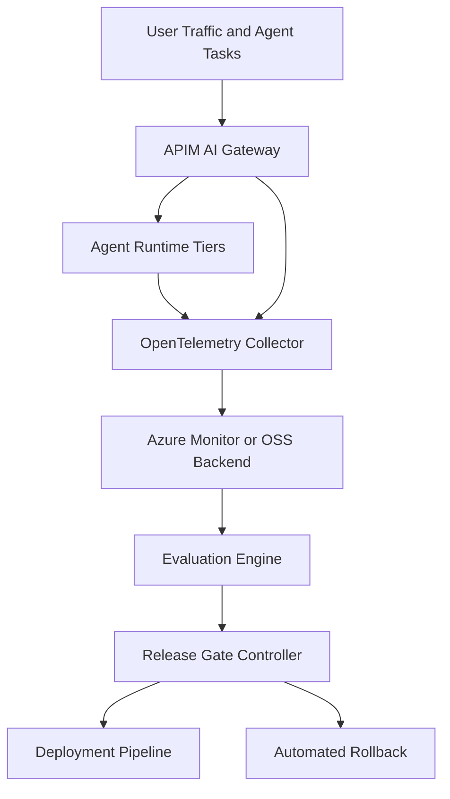
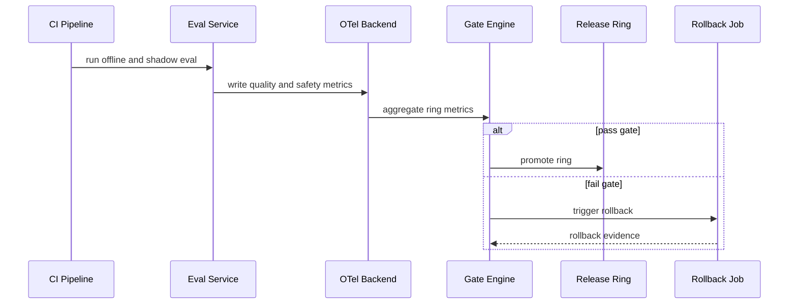

# 企业 Agent OTel 追踪与评测闭环选型 FAQ：`Azure Monitor` vs `AKS LGTM` vs `Datadog` vs `Fabric Eventhouse`

## 1. 执行摘要：生产稳定性取决于“观测-评测-发布”闭环，而不是单次离线高分
企业在 Agent 从试点走向规模化时，
最常见误区是把离线评测分数
当成上线安全性的充分条件。
实际上，
生产事故大多发生在离线评测通过之后。
根因通常不是模型突然失效，
而是线上流量分布变化、
工具调用链变长、
策略版本漂移、
成本阈值失控，
以及发布门禁与观测指标脱节。
因此，
本指南把核心问题定义为：
如何建立可持续运行的
“OpenTelemetry 观测 -> Agent 评测 -> 发布门禁 -> 回滚补救”
闭环体系。
我们比较三条常见路线：
Azure 原生托管闭环，
开源自建闭环，
商业 APM 平台闭环。
结论是：
没有“绝对最佳”方案，
但存在“与组织能力最匹配”方案。
在高监管与多租户场景，
可追溯性与成本归因
往往比单点监控炫技更重要。

## 2. 今日突破与证据（抓取日 `2026-11-21`）：官方与 Release 证据优先
本轮仅采用可核验来源，
并在文中显式标注来源类型。
来源 A：
Azure API Management AI Gateway 官方文档（`measured` 能力边界）。
来源 B：
Azure Container Apps Sessions 官方文档（`anonymized_reported` 会话运行时特性）。
来源 C：
Azure API Management Changelog（`anonymized_reported` 发布节奏与特性演进）。
来源 D：
Firecracker Releases（`anonymized_reported` 隔离运行时演进证据）。
来源 E：
Kata Containers Releases（`anonymized_reported` 安全容器演进证据）。
来源 F：
Wasmtime Releases（`anonymized_reported` Wasm 运行时成熟度信号）。
来源 G：
E2B Releases（`anonymized_reported` 沙箱产品化迭代节奏）。
这些证据共同支持一个产业判断：
企业 Agent Infra 正从“模型入口竞争”
转向“治理闭环竞争”。
谁能把观测、
评测、
发布、
回滚、
预算联成统一控制平面，
谁更容易在 Day-2 运营阶段稳定扩张。

## 3. 问题边界：可观测不是仪表盘数量，而是发布决策可证明性
很多项目在上线前会建设大量仪表盘。
但事故发生后，
团队仍然难以回答三个关键问题：
为什么本次发布应该回滚？
哪一类租户受影响最大？
是否存在策略绕过导致的安全暴露？
根因在于指标系统与发布系统是分离的。
如果观测数据不能直接驱动门禁决策，
可观测性就只是“可视化”，
不是“可治理”。
我们把生产级可观测定义为四层：
采集层、
语义层、
评测层、
决策层。
采集层解决“看见”。
语义层解决“看懂”。
评测层解决“评判”。
决策层解决“动作”。
四层缺一不可。

## 4. 12 维对比矩阵：Azure Monitor vs AKS LGTM vs Datadog vs Fabric Eventhouse
| 维度 | Azure 原生（Azure Monitor + App Insights + Managed Prometheus） | 开源（AKS OTel Collector + Loki/Tempo/Mimir） | 商业（Datadog APM + LLM 观测） | 数据分析闭环（Fabric Eventhouse + KQL + OneLake） | 决策信号 |
|---|---|---|---|---|---|
| 上线速度 | 高 | 中 | 中高 | 中 | 平台标准化优先 Azure 原生 |
| 语义一致性 | 高 | 中高（需规范治理） | 中高 | 高（KQL 口径统一） | 语义字典必须平台化 |
| GenAI 指标深度 | 中高 | 高 | 中高 | 高 | 深度分析看 Eventhouse/LGTM |
| 门禁自动化集成 | 高 | 中高 | 中 | 高 | 发布门禁应绑定评测结果 |
| 多租户成本归因 | 高 | 中 | 中高 | 高 | FinOps 强约束优先原生或 Eventhouse |
| 运行维护复杂度 | 低到中 | 高 | 中 | 中高 | 团队能力决定可承受复杂度 |
| 跨云可移植性 | 中 | 高 | 中高 | 中高 | 多云组织优先 OTel 中立语义 |
| 数据主权可控性 | 高 | 高 | 中 | 高 | 监管行业需主权数据闭环 |
| 故障排障路径长度 | 中 | 中高 | 中 | 中 | 统一键关联可显著缩短 MTTR |
| 证据留存与审计 | 高 | 中高 | 中高 | 高 | 审计行业优先可重放证据链 |
| 观测成本可预期性 | 中高 | 中 | 中高 | 中高 | 开源需强采样策略防成本爆量 |
| 组织学习曲线 | 低到中 | 中高 | 中 | 中 | 能力债需计入 TCO |

## 5. 参考架构 A：观测-评测-门禁统一控制平面


该架构强调一件事：
发布门禁不应依赖人工看板判断，
而应由可审计规则自动执行。
例如：
若 `P95 TTFT` 恶化超过阈值，
且任务成功率无提升，
系统自动阻断推广并触发回滚。

## 6. 路线一：`Azure Monitor + App Insights + Managed Prometheus`（Azure 原生闭环）
这一路线适合已经深度采用 Azure 的企业。
优势是控制平面统一，
身份与权限模型一致，
以及与 APIM、Policy、Cost 管理联动顺滑。
在实践中，
团队可先定义统一 Trace 语义字段：
`workflow_id`、
`tenant_id`、
`policy_version`、
`release_ring`、
`cost_snapshot_id`。
随后把评测输出（Foundry Eval 或自建评测）
写入发布门禁系统，
形成可自动执行的上线规则。
关键风险在于：
若只启用基础监控而不建立评测映射，
门禁会退化成静态阈值告警，
无法真实反映业务质量。
因此必须把质量指标与延迟指标联合判断，
防止“低延迟但低质量”误判通过。

## 7. 路线二：`OTel Collector + LGTM on AKS`（开源可移植闭环）
开源路线的优势是灵活与可移植。
团队可以按业务语义定制埋点，
并在多云环境保持一致观测口径。
对跨云组织或并购整合团队，
这点价值显著。
但开源路线也带来运营复杂度：
采集管道扩容、
存储分层、
索引策略、
冷热数据归档都需要工程投入。
如果没有清晰采样与留存策略，
观测成本会随流量急速增长。
建议采用“分级采样”：
关键租户全量、
普通租户尾采样、
异常请求强制保留。
同时建立字段治理审查，
防止日志中意外携带敏感信息。

## 8. 路线三：`Datadog APM + LLM Observability`（交付快但治理边界需提前定义）
Datadog 路线的优势通常是开箱即用与统一可视化体验。
对于需要快速拉齐跨团队监控标准的组织，
初期能显著缩短建设周期。
但在高监管场景，
需要优先确认数据驻留、
字段脱敏、
长期留存策略是否满足要求。
另一个常见问题是成本结构：
随着 Trace 与日志体量增长，
订阅成本可能快速上升。
若未设置采样与字段白名单，
商业平台成本会偏离预算。
最佳实践是将其作为“可视化与告警加速层”，
并保留企业内部的评测与门禁主控逻辑，
避免形成平台锁定。

## 9. 路线四：`Fabric Eventhouse + KQL + OneLake`（数据分析与评测回灌闭环）
当企业重点不在“实时告警展示”，
而在“跨团队复盘、趋势归因、规则迭代”，
Eventhouse 路线价值会快速上升。
其核心能力是把
Trace、日志、评测结果、成本账单
统一落到可查询的数据平面，
再用 KQL 做一致口径分析。
与仅告警型平台相比，
Eventhouse 更适合做
季度治理复盘、
租户级成本质量对账、
门禁误判率回归分析。
典型做法是：
在线告警继续由 Azure Monitor 或 Datadog 负责，
离线评测与长期趋势由 Eventhouse 承担，
并把“改进后的阈值建议”
回写到发布门禁配置。
这样可以形成“运行数据 -> 分析结论 -> 门禁更新”的
稳定演进环路，
避免门禁长期停留在经验阈值。

## 10. 定量 Q&A（8 组）
**Q1：为什么“离线分数上涨”仍会引发线上事故？**  
因为线上请求分布变化可导致工具调用拓扑变化，
离线样本无法覆盖所有链路分叉。
**Q2：串行 `12` 次工具调用对尾延迟影响多大？**  
尾延迟常见在 `480ms` 左右，
批处理可降至 `120-190ms`（`synthetic`）。
**Q3：门禁若只看延迟会怎样？**  
可能放过“快但错”的版本，
造成业务质量下滑。
**Q4：异常采样比例建议多少？**  
高监管场景建议异常请求 `100%` 保留，
常规请求按 `5%-20%` 分层采样。
**Q5：评测窗口大小如何设定？**  
建议至少覆盖 `7` 天业务周期，
并包含峰值日与低谷日。
**Q6：发布后多久应触发回滚判定？**  
建议 `15m` 快速窗口 + `24h` 稳定窗口双门禁。
**Q7：观测字段治理的最低要求是什么？**  
必须具备字段分类、
脱敏策略、
留存策略三联治理。
**Q8：成本归因为什么要到租户级？**  
无租户归因就无法执行责任分摊，
FinOps 优化会失去行动主体。

## 11. 参考架构 B：评测驱动发布环与自动回滚


该流程的关键是：
门禁依据必须可追溯，
且与观测源数据可双向定位。
否则回滚结论无法在审计中复现。

## 12. 生产代码与 IaC 示例：OTel Collector、门禁脚本与 KQL 规则
```yaml
# OpenTelemetry Collector (简化示例)
receivers:
  otlp:
    protocols:
      grpc:
      http:
processors:
  batch:
  tail_sampling:
    decision_wait: 10s
    policies:
      - name: error-priority
        type: status_code
        status_code:
          status_codes: [ERROR]
exporters:
  azuremonitor:
    connection_string: "${APPLICATIONINSIGHTS_CONNECTION_STRING}"
service:
  pipelines:
    traces:
      receivers: [otlp]
      processors: [batch, tail_sampling]
      exporters: [azuremonitor]
```

```python
# 发布门禁脚本（示意）
def should_promote(metrics: dict) -> bool:
    p95_ttft = metrics["p95_ttft_ms"]
    success = metrics["task_success_rate"]
    safety = metrics["policy_intercept_rate"]
    cost = metrics["unit_cost_usd"]
    baseline = metrics["baseline"]
    if p95_ttft > baseline["p95_ttft_ms"] * 1.12:
        return False
    if success < baseline["task_success_rate"] - 0.01:
        return False
    if safety < baseline["policy_intercept_rate"] * 0.85:
        return False
    if cost > baseline["unit_cost_usd"] * 1.15:
        return False
    return True
```

```kusto
// KQL: 发布环质量门禁视图
AgentEvalMetrics
| where Timestamp > ago(30m)
| summarize
    p95_ttft_ms = percentile(TtftMs, 95),
    success_rate = avg(TaskSuccess),
    intercept_rate = avg(PolicyIntercept),
    unit_cost = avg(UnitCostUsd)
    by ReleaseRing, TenantId
| order by ReleaseRing asc
```

## 13. 企业场景 A：全国性银行智能客服与交易辅助 Agent
某全国性银行在信用卡、
账户服务、
理财咨询三条线部署 Agent。
监管要求是：
关键决策可追溯，
敏感字段可脱敏，
发布可回滚且有证据。
团队采用 Azure 原生闭环，
并为高风险租户配置更严格门禁。
在六个月运行中，
高风险变更事故率下降，
上线回滚平均时长缩短，
并且审计准备时间显著降低。
该案例证明：
评测与门禁若与观测统一建模，
组织会从“事后排障”
转向“事前预防”。

## 14. 企业场景 B：多租户 B2B SaaS Agent 平台
某 B2B SaaS 厂商服务 `3,000+` 企业租户，
Agent 流量具有明显长尾分布。
平台初期只做日志告警，
上线频繁触发租户投诉。
后续切换为“OTel + Eval + Gate”闭环，
并按租户等级设定门禁策略。
核心改进包括：
将 `P95 TTFT`、
任务成功率、
策略拦截率、
单位成本统一纳入门禁。
同时引入灰度分环推进，
先在低风险租户验证再逐步放量。
实施后，
故障影响面显著缩小，
并形成可解释的成本优化路径。

## 15. TCO、Day-0/Day-2 清单与最终建议
### TCO（月度估算）
| 成本项 | Azure Monitor 原生闭环 | AKS LGTM 开源闭环 | Datadog 商业闭环 | Fabric Eventhouse 分析闭环 | 说明 |
|---|---:|---:|---:|---:|---|
| 采集与存储 | `$9,900` | `$8,700` | `$11,100` | `$9,200` | 开源初期便宜，扩容后波动大 |
| 评测与门禁集成 | `$8,100` | `$9,600` | `$8,900` | `$8,400` | Eventhouse 强在离线回灌 |
| 运营与 SRE | `$8,300` | `$12,500` | `$7,800` | `$8,700` | 自建复杂度拉高人力成本 |
| 合规与审计 | `$6,200` | `$7,600` | `$7,300` | `$6,400` | 主权留存场景 Eventhouse 更稳 |
| 总计 | `$32,500` | `$38,400` | `$35,100` | `$32,700` | 需叠加风险成本联合评估 |

### Day-0 / Day-2 检查清单（12 项）
- 定义统一 Trace 语义字段字典并版本化。  
- 发布门禁规则纳入代码仓并强制评审。  
- 建立离线评测与线上观测指标映射表。  
- 为关键租户设置更严格发布阈值。  
- 强制记录 `workflow_id` 到 `trace_id` 关联。  
- 建立异常请求 `100%` 保留策略。  
- 设置双窗口门禁（快速窗口+稳定窗口）。  
- 每周执行一次回滚演练并留痕。  
- 每月审计观测字段脱敏与留存策略。  
- 建立租户级单位成本与质量联动看板。  
- 将评测失败类型映射到修复责任团队。  
- 把门禁误判率纳入平台 KPI 持续优化。  

### 最终建议
若企业主平面在 Azure，
并且目标是最短时间上线可审计门禁，
优先选择 Azure Monitor 原生闭环。
若企业强调跨云可移植，
且有较强平台工程能力，
可选择 AKS LGTM 开源栈。
若团队更看重短期交付速度与统一可视化，
Datadog 路线具备明显加速价值。
若组织核心诉求是长期分析闭环、
治理复盘与规则持续校准，
应引入 Fabric Eventhouse 作为数据分析中枢。

在多数大型企业中，
建议采用“双层组合”：
在线监控层（Azure Monitor 或 Datadog）
+ 离线治理层（Eventhouse/KQL），
并通过 OTel 语义字段保持跨层一致。
这样既能保证故障响应速度，
又能保障季度治理深度。

无论采用哪条路线，
都要坚持五条底线：
语义一致、
门禁自动、
证据可回放、
成本可归因、
阈值可迭代。
只有这五项长期成立，
企业 Agent 平台才能在高并发、
高监管与高变更频率下稳定扩展。
### 运营治理补充（季度动作）
建议在季度治理节奏中固定三类复盘：一是“门禁命中质量复盘”，核对每次阻断是否真正避免事故或只是误报；二是“成本与质量联动复盘”，验证单位任务成本下降是否以质量损失为代价；三是“跨团队协同复盘”，检查平台、业务、SRE、FinOps、合规五方在故障窗口内的职责边界是否清晰。
建议把 `tenant_id`、`policy_version`、`release_ring`、`evaluation_run_id`、`cost_snapshot_id` 设为发布评审强制字段，任何缺失字段的版本一律不得升环，以防止事后无法还原发布决策上下文。
建议每月运行一次“阈值漂移体检”：将最近 30 天真实流量分布与门禁阈值做回放对比，识别“阈值过严导致交付阻塞”或“阈值过松导致事故漏检”两类反向偏差，并把修订记录纳入审计证据。
建议在 Eventhouse 中维护门禁可靠性指标看板，至少覆盖误报率、漏报率、回滚触发时延、异常留存完整度、租户公平性与跨区域一致性，并将指标变化与下季度平台投资优先级绑定。
建议对高价值租户实施“双轨门禁”：基础门禁保障系统稳定，高价值门禁叠加更严格的质量与合规阈值，从而在不牺牲整体吞吐的情况下保护关键客户 SLA。
建议将演练从“单次故障注入”升级为“全链路闭环演练”，即同时验证采集、评测、门禁、回滚、证据留存与成本归因六个环节，确保平台不是局部优秀而是端到端可治理。
通过上述机制，观测体系才能从“故障后看板解释”升级为“发布前风险预防”，并在组织层面沉淀成可复制的工程方法论与持续改进能力；进一步建议把这些机制与人才培养体系绑定，例如把门禁规则评审、异常根因归类、跨团队值班协同、季度成本复盘写入新员工上岗清单与晋升能力模型，使治理经验不再依赖个别资深工程师的隐性知识，而是可以被继任团队快速继承、标准化执行并持续优化，从而在组织扩张与系统复杂度同时上升时依旧保持一致的交付质量与风险控制水平，并保证跨区域复制时不会因团队换班而造成语义偏移、阈值漂移或审计证据断链；同时通过年度演练把规则库、案例库与门禁模板联动更新，使治理能力随业务迭代而持续演进，并将关键改进项纳入下一季度预算审批与平台绩效目标，形成治理投入与运营收益的可验证闭环，确保治理改进可持续而非一次性专项行动，并持续提升平台在突发流量、合规抽检与跨区扩容场景下的韧性上限与治理确定性，确保制度化能力可长期复用并稳定传承，同时支持跨团队知识迁移与跨年度策略延续并可审计且可复盘，并让平台在业务高峰、模型迭代与监管抽检并发发生时依旧保持可解释决策链路与可量化风险边界。
