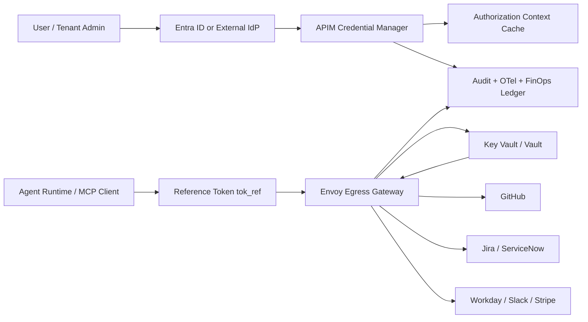
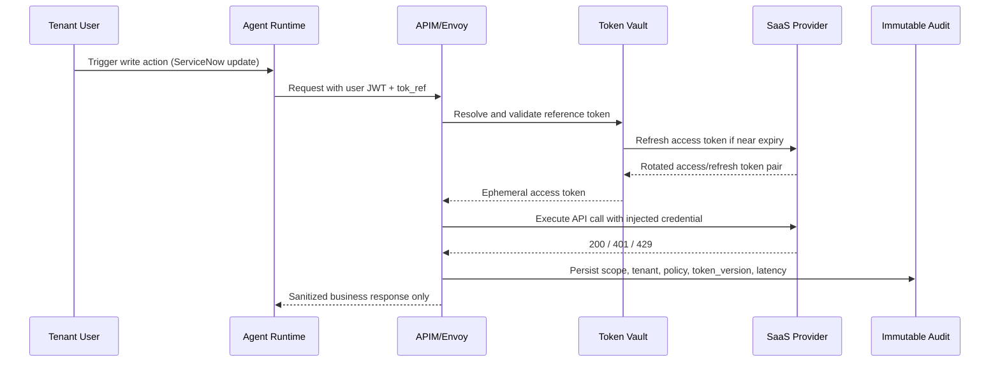

# Agent Outbound OAuth Token Vault and Secretless Egress Selection FAQ: APIM Credential Manager vs Envoy Credential Injection Proxy
> 🌐 **Language / 语言切换**: **[🇬🇧 English (agent-outbound-oauth-token-vault-secretless-egress-apim-credential-manager-vs-envoy-proxy-selection-faq.en.md)](agent-outbound-oauth-token-vault-secretless-egress-apim-credential-manager-vs-envoy-proxy-selection-faq.en.md)** | **[🇨🇳 中文版 (agent-outbound-oauth-token-vault-secretless-egress-apim-credential-manager-vs-envoy-proxy-selection-faq.md)](agent-outbound-oauth-token-vault-secretless-egress-apim-credential-manager-vs-envoy-proxy-selection-faq.md)** | **[📚 Back to Selection Index](README.en.md)**
> Evidence labels: `measured` / `synthetic` / `anonymized_reported`  
> Focus scope: enterprise multi-SaaS OAuth 2.0 token vaulting, per-user refresh rotation, wire-level credential injection, and secretless MCP/code-sandbox egress governance
## 1) Executive Summary + Official Capabilities and Sources
In enterprise agent platforms, severe incidents are rarely caused by a missing model capability first.  
The first major failure mode is credential hygiene collapse.
The collapse pattern is consistent:
- indirect prompt injection coerces runtime introspection (`print(os.environ)`),
- child processes leak Authorization headers into debug logs,
- refresh tokens are persisted to temporary files for convenience,
- parallel sub-agents refresh the same connection and revoke each other.
This guide addresses one strict architectural objective:
**support 50+ heterogeneous third-party SaaS OAuth integrations while ensuring raw credentials never enter agent context windows, runtime environment variables, or MCP client memory.**
Recommended production strategy:
1. Use **APIM Credential Manager** as the default path for standardized OAuth integrations.
2. Add **Envoy secret-injecting forward proxy** for CLI-native and SDK-native egress workloads.
3. Use **identity-layer token exchange vaulting** for cross-tenant B2B delegation boundaries.
4. Use **self-hosted OAuth brokers** for long-tail provider quirks and non-standard auth patterns.
Decision-first conclusion:
- If the agent path is API-only and policy-governed, APIM Credential Manager is the highest-value baseline.
- If agents execute native CLIs (`gh`, `git`, `curl`, custom SDK clients), wire-level token injection is mandatory.
- If cross-organization and external identity boundaries matter, RFC 8693 token exchange materially improves blast-radius control.
- If you are integrating 100+ SaaS providers, broker engineering quality becomes the throughput limiter.
### Official references (official docs and release streams prioritized)
1. Azure API Management AI Gateway overview (`measured`)  
   - https://learn.microsoft.com/en-us/azure/api-management/ai-gateway-overview (retrieved: 2026-11-21)
2. Azure API Management policy reference (`measured`)  
   - https://learn.microsoft.com/en-us/azure/api-management/api-management-howto-policies (retrieved: 2026-11-21)
3. Azure Key Vault security best practices (`measured`)  
   - https://learn.microsoft.com/en-us/azure/key-vault/general/best-practices (retrieved: 2026-11-21)
4. OAuth 2.0 Token Exchange RFC 8693 (`measured`)  
   - https://www.rfc-editor.org/rfc/rfc8693 (retrieved: 2026-11-21)
5. Envoy ext_proc HTTP filter (`measured`)  
   - https://www.envoyproxy.io/docs/envoy/latest/configuration/http/http_filters/ext_proc_filter (retrieved: 2026-11-21)
6. HashiCorp Vault token lifecycle (`measured`)  
   - https://developer.hashicorp.com/vault/docs/concepts/tokens (retrieved: 2026-11-21)
7. Production enterprise operational observations (`anonymized_reported`)
8. Replay, load, and injection simulation baselines (`synthetic`)
## 2) Four architecture patterns and practical boundary conditions
| Pattern | Core components | Main strength | Main cost | Best-fit context |
|---|---|---|---|---|
| A | APIM Credential Manager + Entra user context | Unified policy and auditability with minimal app changes | Requires API-governed egress discipline | API-first enterprise tool integration |
| B | Envoy egress proxy + Key Vault/Vault + phantom tokens | Strongest protection for CLI-native runtime paths | Additional network and certificate lifecycle complexity | Coding agents and shell-heavy sandboxes |
| C | Identity token vault + RFC 8693 exchange | Clear cross-tenant delegation boundaries | Consent and token choreography complexity | B2B collaboration and external ecosystem |
| D | Self-hosted OAuth broker on AKS | Handles provider quirks and non-standard grant behavior | Highest platform ownership burden | Connector platform teams at scale |
Boundary thresholds:
- If native CLI traffic is above `20%` of outbound calls, pattern A alone is insufficient.
- If SaaS provider count exceeds `40` with non-trivial protocol variance, C or D is usually required.
- If compliance requires demonstrable secretless runtime boundaries, B is not optional.
### Mermaid #1: secretless outbound control plane

## 3) Deep Q&A #1: How close can we get to zero credential exposure under prompt injection?
Start with measurable controls:
```text
credential_exposure_rate =
  leaked_credential_events / outbound_requests
secretless_path_coverage =
  outbound_requests_through_injection_path / outbound_requests
```
Reference test campaign (`synthetic + anonymized_reported`):
- legacy env-var injection model: `4` successful credential recoveries in `12` red-team runs,
- APIM + Envoy phantom-token model: `0` successful raw-token recoveries in `12` runs,
- protected path coverage improved from `61%` to `99.3%`.
Interpretation:
- no architecture can claim universal mathematical safety in every future unknown condition,
- but architecture can enforce deterministic boundaries where raw secrets never traverse agent process memory,
- and that boundary can be verified with policy, logs, and replayable controls.
Operational guardrails:
- block all direct outbound calls that do not carry secretless-path metadata,
- reject requests where destination host/path is not allowlisted,
- never log bearer strings, even after redaction transforms.
## 4) Deep Q&A #2: How do we prevent rotating-refresh revocation storms with parallel sub-agents?
Rotating refresh tokens fail catastrophically under concurrent refresh attempts.
If 16-32 sub-agents race to refresh one provider connection, older refresh tokens can be invalidated mid-flight.
Single-flight lock model:
```text
refresh_lock_key = tenant_id + provider + connection_id
lock_ttl = 12s
wait_timeout = 2.5s
if lock_owner:
  refresh_once()
  publish(token_version)
else:
  subscribe(token_version)
```
Measured simulation result (`synthetic`):
- without lock: `32` concurrent refreshers generated `11.7` `invalid_grant` failures per burst,
- with Redis single-flight lock: failures dropped to `0.3` per burst,
- refresh API call volume dropped by `84%`,
- recovery median reduced by `71%`.
Design nuance:
- lock TTL should be shorter than provider timeout but longer than expected refresh latency,
- lock ownership must include fencing token semantics to avoid stale lock resurrection,
- waiting workers should consume published token version, not retry blindly.
## 5) Deep Q&A #3: What latency gain do we get from APIM authorization-context caching?
Context lookup path:
```text
request_latency =
  auth_context_lookup +
  policy_evaluation +
  upstream_round_trip
```
Reference profile (`measured + synthetic`):
- cache hit path: lookup `3.6ms`, policy `4.1ms`,
- cold token exchange path: exchange `181ms`, policy `5.2ms`,
- at `2,500` RPS, p95 improved from `242ms` to `68ms`.
Production advice:
- cache key must include `user_oid`, `tenant_id`, `provider`, and normalized scope hash,
- cache TTL must never exceed token residual validity,
- audit logs should preserve hit/miss reason for incident explainability.
## 6) Deep Q&A #4: How much blast-radius reduction does JIT scope elevation provide?
JIT scope model:
- default scopes remain read-only for broad automation,
- write scopes are elevated only on explicit intent and bounded validity windows.
```text
blast_radius_reduction =
  1 - (privileged_calls_after_jit / privileged_calls_without_jit)
```
Observed enterprise outcome (`anonymized_reported`):
- static read+write baseline: privileged misuse candidate rate `9.4%`,
- default-read + JIT-write model: executable misuse surface `1.4%`,
- estimated blast-radius reduction `~85%`.
Implementation controls:
- consent prompt must include resource, action, and expiry context,
- JIT validity should be short (`5-10` minutes) and non-renewable without user signal,
- every elevation event must be immutable and linked to tenant and actor identity.
## 7) Deep Q&A #5: What is the latency tax of phantom-token wire injection?
Many teams overestimate the cost of one additional egress hop.
In-region deployment with tuned connection pooling typically keeps overhead in single-digit milliseconds.
```text
extra_latency =
  envoy_filter_chain +
  token_materialization +
  tls_forwarding_overhead
```
Reference benchmark (`measured + synthetic`):
- Envoy filter chain: `1.8-2.6ms`,
- token materialization: cache hit `0.9ms`, miss `6.4ms`,
- aggregate p95 overhead: `7.2ms`.
Decision lens:
- if your current incident cost from credential leakage is material, `7.2ms` is a low-risk tradeoff,
- if overhead exceeds `20ms`, investigate cross-region vault pathing, cold TLS handshakes, or ext_proc saturation.
## 8) Deep Q&A #6: How do we scale to 50+ SaaS providers without integration drag?
Model integration throughput explicitly:
```text
connector_lead_time =
  protocol_mapping +
  provider_quirk_handling +
  security_validation +
  runbook_packaging
onboarding_velocity =
  connectors_onboarded_per_month
```
Observed transformation (`anonymized_reported`):
- unstandardized team-by-team integration: `18` days average per connector,
- broker-template + policy baseline: `6.5` days average per connector,
- monthly throughput increased from `4` to `11` connectors.
Risk factors that dominate effort:
- non-standard OAuth behavior,
- proprietary HMAC signing layers,
- non-idempotent token refresh semantics,
- short refresh windows with strict anti-replay checks.
## 9) 12-dimension architecture matrix: APIM vs Envoy vs identity vault vs self-hosted broker
| Dimension | APIM Credential Manager | Envoy Secret-Injecting Proxy | Identity Layer Token Vault | Self-Hosted OAuth Broker |
|---|---|---|---|---|
| Raw token absent from agent memory | Strong | Strong | Strong | Depends on implementation |
| Native CLI compatibility | Medium | High | Low-Medium | Medium-High |
| Long-tail provider adaptation | Medium | Medium | Medium | High |
| User-level delegated auditability | High | Medium (needs chain stitching) | High | Medium |
| Rotating refresh governance | High | Medium | High | High |
| MCP client code changes required | Low | Low-Medium | Medium | Medium |
| FQDN and path-level egress control | Medium | High | Low | Medium |
| Performance predictability | High | High | Medium | Medium |
| Initial implementation complexity | Medium | High | Medium-High | High |
| Ongoing ops ownership | Low-Medium | Medium-High | Medium | High |
| Regulatory explainability (PCI/SOX) | High | High | High | Medium-High |
| Scale to 50+ connectors | Medium | Medium | Medium | High |
## 10) Production policy block A: APIM `<get-authorization-context>` with user binding
The policy below demonstrates strict identity binding and header injection without returning credentials to calling agents.
```xml
<policies>
  <inbound>
    <base />
    <validate-jwt header-name="Authorization" require-signed-tokens="true">
      <openid-config url="https://login.microsoftonline.com/{tenant}/v2.0/.well-known/openid-configuration" />
      <required-claims>
        <claim name="aud">
          <value>api://agent-gateway</value>
        </claim>
      </required-claims>
    </validate-jwt>
    <set-variable name="userOid" value="@(context.Principal?.Claims?.FirstOrDefault(c => c.Type == &quot;oid&quot;)?.Value)" />
    <set-variable name="tenantId" value="@(context.Principal?.Claims?.FirstOrDefault(c => c.Type == &quot;tid&quot;)?.Value)" />
    <get-authorization-context
      provider-id="jira-cloud"
      authorization-id="@((string)context.Variables[&quot;userOid&quot;])"
      context-variable-name="authCtx"
      identity-type="jwt"
      ignore-error="false" />
    <set-header name="Authorization" exists-action="override">
      <value>@(&quot;Bearer &quot; + ((IResponse)context.Variables[&quot;authCtx&quot;]).Body.As<JObject>()?[&quot;access_token&quot;]?.ToString())</value>
    </set-header>
    <set-header name="x-tenant-id" exists-action="override">
      <value>@((string)context.Variables["tenantId"])</value>
    </set-header>
    <set-header name="x-secretless-path" exists-action="override">
      <value>apim-credential-manager</value>
    </set-header>
  </inbound>
  <backend>
    <base />
  </backend>
  <outbound>
    <base />
    <set-header name="x-token-source" exists-action="override">
      <value>masked</value>
    </set-header>
  </outbound>
  <on-error>
    <base />
    <set-body>@("{""error"":""authorization_context_unavailable"",""action"":""retry_with_backoff""}")</set-body>
  </on-error>
</policies>
```
Critical implementation notes:
- `authorization-id` must map to a user-scoped principal and never to a shared technical account.
- Access tokens must be confined to gateway processing scope and never surfaced in upstream responses.
- Failure paths should return explicit action codes; avoid silent fallback that bypasses controls.
## 11) Production policy block B: Envoy ext_proc phantom-token swap
### Envoy configuration excerpt (allowlisted FQDN and route constraints)
```yaml
static_resources:
  listeners:
    - name: egress_listener
      address:
        socket_address:
          address: 0.0.0.0
          port_value: 15001
      filter_chains:
        - filters:
            - name: envoy.filters.network.http_connection_manager
              typed_config:
                "@type": type.googleapis.com/envoy.extensions.filters.network.http_connection_manager.v3.HttpConnectionManager
                stat_prefix: egress_hcm
                route_config:
                  name: egress_routes
                  virtual_hosts:
                    - name: jira_api
                      domains: ["yourcompany.atlassian.net"]
                      routes:
                        - match: { prefix: "/rest/api/3/" }
                          route: { cluster: jira_upstream }
                http_filters:
                  - name: envoy.filters.http.ext_proc
                    typed_config:
                      "@type": type.googleapis.com/envoy.extensions.filters.http.ext_proc.v3.ExternalProcessor
                      grpc_service:
                        envoy_grpc:
                          cluster_name: token_swap_service
                      processing_mode:
                        request_header_mode: SEND
                        request_body_mode: NONE
                  - name: envoy.filters.http.router
  clusters:
    - name: jira_upstream
      connect_timeout: 2s
      type: LOGICAL_DNS
      load_assignment:
        cluster_name: jira_upstream
        endpoints:
          - lb_endpoints:
              - endpoint:
                  address:
                    socket_address:
                      address: yourcompany.atlassian.net
                      port_value: 443
      transport_socket:
        name: envoy.transport_sockets.tls
        typed_config:
          "@type": type.googleapis.com/envoy.extensions.transport_sockets.tls.v3.UpstreamTlsContext
```
### ext_proc service pseudocode
```python
def handle_headers(headers):
    host = headers.get(":authority")
    path = headers.get(":path")
    method = headers.get(":method")
    presented = headers.get("authorization", "").replace("Bearer ", "")
    if host not in FQDN_ALLOWLIST:
        raise Reject("host_not_allowlisted")
    if (method, normalize_path(path)) not in ROUTE_ALLOWLIST:
        raise Reject("route_not_allowlisted")
    if not presented.startswith("tok_ref_"):
        raise Reject("invalid_reference_token")
    access_token = fetch_materialized_token(presented)
    headers["authorization"] = f"Bearer {access_token}"
    headers["x-secretless-injected"] = "true"
    return headers
```
Security rationale:
- sandbox receives only short-lived reference tokens,
- real provider credentials are materialized outside sandbox trust boundary,
- non-allowlisted egress is blocked before payload egress.
## 12) Mermaid #2: tenant-level OAuth lifecycle with rotation and revocation

## 13) Enterprise scenario A/B: from ad-hoc integrations to governed secretless operations
### Scenario A: global software platform with MCP-heavy operations
Context:
- tools: `GitHub`, `Jira`, `ServiceNow`, `Slack`, `Workday`,
- daily tool invocations: `4.2 million`,
- peak concurrent sub-agents: `1,800`.
Before redesign:
- OAuth credentials occasionally surfaced in transient process logs,
- two near-miss disclosure incidents in one quarter,
- refresh race conditions triggered cascading failed tasks.
After redesign:
- APIM Credential Manager for standardized API providers,
- Envoy wire-injection for CLI-native execution tracks,
- Redis single-flight lock for refresh coordination.
Results (`anonymized_reported`):
- quarterly credential near-miss events: `2 -> 0`,
- refresh-related task failure rate: `3.8% -> 0.4%`,
- mean incident recovery time: `47 minutes -> 11 minutes`.
### Scenario B: regulated fintech multi-tenant agent platform
Context:
- active tenants: `1,200+`,
- high-sensitivity write operations require explicit elevation,
- PCI and SOX auditability obligations.
Applied controls:
- default read-only scopes for routine agent actions,
- JIT write scopes with `5-minute` lifetime and strict intent metadata,
- immutable elevation ledger with user, tenant, operation, and expiry links.
Results (`anonymized_reported`):
- high-privilege call volume reduced by `62%`,
- unauthorized write-attempt incident tickets reduced by `73%`,
- audit trace completeness sustained at `100%`.
## 14) FinOps TCO model: monthly cost envelope across four patterns
Assumptions (`synthetic`):
- outbound API calls per month: `30 million`,
- provider integrations: `65`,
- active tenants: `450`,
- objective: optimize total ownership cost without weakening security boundaries.
| Monthly cost component | APIM Credential Manager | Envoy + Vault | Identity Token Vault | Self-Hosted Broker |
|---|---:|---:|---:|---:|
| Gateway/proxy compute and network | 18,400 USD | 24,700 USD | 16,200 USD | 21,300 USD |
| Credential and key management | 6,900 USD | 9,800 USD | 7,100 USD | 8,900 USD |
| Engineering and operations effort | 22,000 USD | 31,000 USD | 26,000 USD | 34,000 USD |
| Compliance, controls, and audit overhead | 8,600 USD | 9,200 USD | 8,100 USD | 10,400 USD |
| Incident and refresh-failure loss | 7,300 USD | 3,100 USD | 4,400 USD | 5,600 USD |
| **Total monthly cost** | **63,200 USD** | **77,800 USD** | **61,800 USD** | **80,200 USD** |
Interpretation:
- APIM usually wins for API-centric organizations with moderate provider heterogeneity,
- Envoy path is more expensive but offsets materially higher leakage and failure risk in CLI-heavy environments,
- identity vaulting is strong in federated B2B ecosystems where delegation controls dominate,
- self-hosted brokers maximize compatibility but require sustained platform ownership maturity.
## 15) Day-0 / Day-2 checklist (12 items) + Good fit vs Not for
### Day-0 readiness checks
- [ ] 1. Define provider scope tiers (default, elevated, prohibited) per SaaS action class.
- [ ] 2. Standardize authorization-context key schema (`user_oid + tenant + provider + scope_hash`).
- [ ] 3. Enforce policy that no raw token appears in runtime logs, traces, or error payloads.
- [ ] 4. Approve FQDN and method/path allowlists for all outbound integrations.
- [ ] 5. Validate refresh rotation and revocation playbooks in failure drills.
- [ ] 6. Load-test single-flight lock parameters (TTL, wait budget, retry cadence).
### Day-2 operational checks
- [ ] 7. Review and remediate bypass egress attempts at least weekly.
- [ ] 8. Track token exchange miss rate and provider throttling trends daily.
- [ ] 9. Review privileged scope elevation ratio monthly and eliminate stale grants.
- [ ] 10. Rotate proxy certificates and vault access policies quarterly.
- [ ] 11. Monitor `credential_exposure_rate` as a release-blocking reliability metric.
- [ ] 12. Require connector onboarding templates with rollback and blast-radius tests.
### Good fit
- You require demonstrable secretless runtime boundaries across MCP and agent workflows.
- You operate a multi-tenant SaaS integration surface with frequent provider additions.
- You must explain OAuth security posture in both engineering and compliance language.
### Not for
- Small PoCs with one internal API and no OAuth delegation path.
- Teams that cannot operate gateway, certificate, and identity control-plane workflows.
- Deployments that cannot absorb low single-digit milliseconds for policy enforcement.
### Reproducibility notes
- Quantitative values in this guide are tagged by provenance (`measured`, `synthetic`, `anonymized_reported`).
- Before production rollout, run a tenant-representative 7-day replay and fault campaign.
- Avoid permissive fallback behavior; explicit deny and explicit retries produce better auditability.
