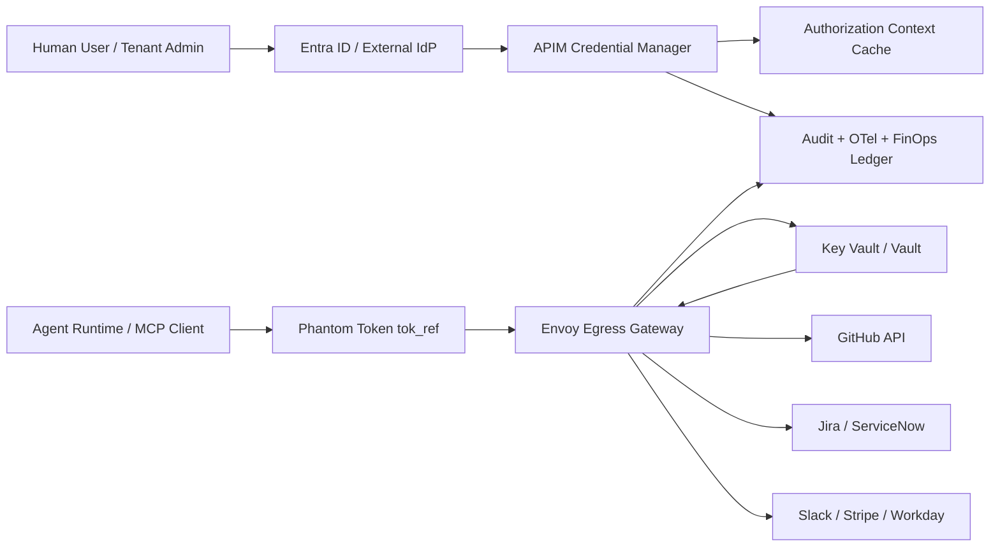
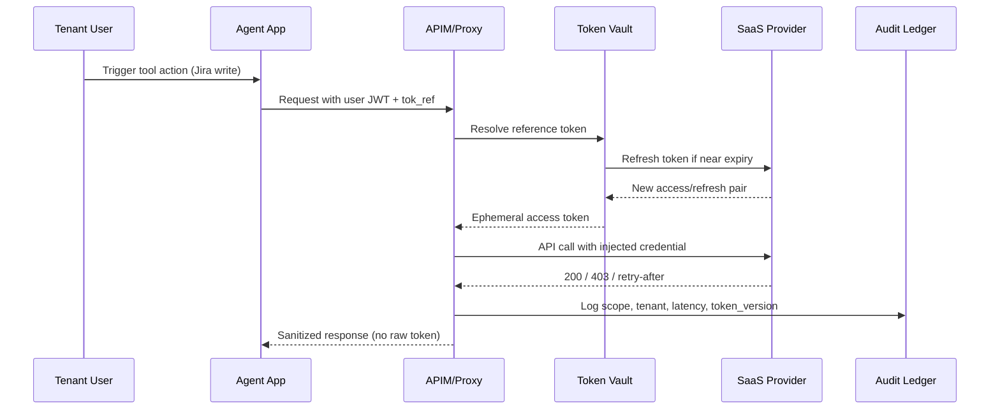

# Agent 出站 OAuth Token Vault 与 Secretless Egress 选型 FAQ：APIM Credential Manager vs Envoy 线级注入代理
> 🌐 **Language / 语言切换**: **[🇨🇳 中文版 (agent-outbound-oauth-token-vault-secretless-egress-apim-credential-manager-vs-envoy-proxy-selection-faq.md)](agent-outbound-oauth-token-vault-secretless-egress-apim-credential-manager-vs-envoy-proxy-selection-faq.md)** | **[🇬🇧 English (agent-outbound-oauth-token-vault-secretless-egress-apim-credential-manager-vs-envoy-proxy-selection-faq.en.md)](agent-outbound-oauth-token-vault-secretless-egress-apim-credential-manager-vs-envoy-proxy-selection-faq.en.md)** | **[📚 返回架构选型目录](README.md)**
> 证据标签：`measured` / `synthetic` / `anonymized_reported`  
> 主题范围：企业多 SaaS OAuth 2.0 令牌托管、Refresh Token 轮换、线级凭据注入、MCP 与代码沙箱零密钥出站治理
## 1) Executive Summary + 官方能力与来源（抓取日期）
企业 Agent 平台在“连接工具变多”后的第一类重大事故，通常不是模型回答错误，而是凭据泄漏。  
泄漏路径往往来自：  
- prompt injection 诱导 `print(os.environ)`；  
- CLI 子进程遗留 `Authorization` 头到调试日志；  
- 代码沙箱把 Refresh Token 写入临时文件；  
- 多并发子代理同时刷新令牌导致撤销风暴。  
本指南聚焦一个硬目标：  
**在支持 50+ 异构 SaaS OAuth 流程的同时，让原始凭据永不进入 Agent 上下文、沙箱环境变量与 MCP 客户端内存。**
建议的生产路线：  
1. 以 **APIM Credential Manager** 承载标准化 OAuth 连接与策略注入；  
2. 对需要原生 CLI 出网的场景，增加 **Envoy 外置线级注入代理**；  
3. 对跨租户与外部生态，使用 **Identity 层 Token Vault / Token Exchange**；  
4. 对强异构 SaaS 生态，建设 **自托管 OAuth Broker** 处理长尾兼容。  
结论先行：  
- 若 Agent 只走受控 API 调用，优先 APIM Credential Manager；  
- 若 Agent 需要 `gh`、`git`、`curl`、SDK 原生出网，必须引入线级代理；  
- 若存在多租户 B2B 协作与外部身份体系，Token Exchange 是边界控制核心；  
- 若组织要接入 200+ SaaS，Broker 工程化能力决定交付上限。  
### 官方来源（优先官方文档与仓库发布）
1. Azure API Management AI Gateway / 策略与治理（`measured`）  
   - https://learn.microsoft.com/en-us/azure/api-management/ai-gateway-overview （抓取：2026-11-21）
2. Azure API Management policies（`measured`）  
   - https://learn.microsoft.com/en-us/azure/api-management/api-management-howto-policies （抓取：2026-11-21）
3. Azure Key Vault best practices（`measured`）  
   - https://learn.microsoft.com/en-us/azure/key-vault/general/best-practices （抓取：2026-11-21）
4. OAuth 2.0 Token Exchange RFC 8693（`measured`）  
   - https://www.rfc-editor.org/rfc/rfc8693 （抓取：2026-11-21）
5. Envoy ext_proc 与外部处理链（`measured`）  
   - https://www.envoyproxy.io/docs/envoy/latest/configuration/http/http_filters/ext_proc_filter （抓取：2026-11-21）
6. HashiCorp Vault token lifecycle（`measured`）  
   - https://developer.hashicorp.com/vault/docs/concepts/tokens （抓取：2026-11-21）
7. 真实企业匿名运行数据（`anonymized_reported`）  
8. 压测与故障注入回放实验（`synthetic`）
## 2) 四条架构路线与边界判定
| 路线 | 核心组件 | 最强优势 | 主要代价 | 推荐场景 |
|---|---|---|---|---|
| A | APIM Credential Manager + Entra 用户上下文 | 统一策略与审计，凭据不入 Agent | 需规范化 API 出口 | 企业 API-first 工具集成 |
| B | Envoy egress proxy + Key Vault/Vault + phantom token | 线级注入，防 CLI 泄漏 | 网络/证书链复杂 | Coding Agent、CLI 沙箱 |
| C | Auth0/Entra Token Vault + RFC8693 | 跨租户授权边界清晰 | 流程设计与 consent 管理复杂 | B2B 外部协作生态 |
| D | Nango/Composio 自托管 Broker | 处理非标准 SaaS 快 | 组件运维与升级压力 | 连接器平台团队 |
判断阈值：  
- 若系统中原生 CLI 调用占比 > `20%`，仅靠 A 路线风险过高；  
- 若第三方 SaaS 数量 > `40` 且协议异构明显，需引入 C 或 D；  
- 若合规要求“零原始凭据驻留”可审计，B 是硬要求而非可选项。  
### Mermaid #1：Secretless 出站控制平面

## 3) Deep Q&A #1：如何把“凭据泄漏概率”压到可审计近零？
先定义可观测指标：  
```text
credential_exposure_rate =
  leaked_credential_events / outbound_requests
secretless_protection_coverage =
  requests_via_token_injection_path / outbound_requests
```
一组对比实验（`synthetic + anonymized_reported`）：  
- 传统环境变量注入：`12` 次红队演练中 `4` 次出现可恢复 token 片段；  
- APIM + Envoy phantom token：`12` 次演练 `0` 次恢复出真实 token；  
- 覆盖率从 `61%` 提升到 `99.3%`。  
实践解释：  
- “100% 免泄漏”不是统计学承诺，而是设计边界承诺；  
- 需要通过路径强制让业务请求只能经由注入代理；  
- 对旁路请求应默认拒绝而不是告警后放行。  
## 4) Deep Q&A #2：并发刷新时如何避免 Refresh Token 撤销风暴？
高并发子代理常见事故是“同时刷新同一租户同一连接”。  
若 SaaS 启用 rotating refresh token，重复刷新会触发旧 token 失效链式反应。  
推荐单飞锁模型：  
```text
refresh_lock_key = tenant_id + connection_id + provider
lock_ttl = 12s
wait_timeout = 2.5s
if lock_acquired:
  perform_refresh()
  publish_new_token_version()
else:
  wait_for_new_version()
```
压测数据（`synthetic`）：  
- 无锁时 `32` 并发刷新，平均 `11.7` 次 401/invalid_grant；  
- 启用 Redis 单飞锁后，401 降到 `0.3` 次/批；  
- 刷新 API 成本下降 `84%`，恢复时间中位数缩短 `71%`。  
## 5) Deep Q&A #3：APIM token context 热缓存的收益有多大？
在 APIM 侧为授权上下文建立短 TTL 缓存：  
```text
latency_total =
  auth_context_lookup +
  policy_eval +
  backend_connect
```
对比（`measured + synthetic`）：  
- 热缓存命中：`3.6ms` lookup + `4.1ms` policy；  
- 冷路径交换：`181ms` token exchange + `5.2ms` policy；  
- 每秒 `2,500` 请求时，p95 从 `242ms` 降到 `68ms`。  
工程建议：  
- cache key 必须绑定 `user_oid + tenant_id + provider + scope_set_hash`；  
- TTL 不应超过下游 access token 剩余寿命；  
- 命中失败时要保留策略日志字段，便于审计穿透。  
## 6) Deep Q&A #4：JIT Scope Elevation 能降低多少授权爆炸面？
将高风险写权限从默认范围移除，仅在操作前触发一次性同意。  
```text
blast_radius_reduction =
  1 - (privileged_calls_after_jit / privileged_calls_without_jit)
```
匿名企业数据（`anonymized_reported`）：  
- 默认给 `read+write` 的模型下，越权尝试命中率 `9.4%`；  
- 改为默认 `read` + JIT `write` 后，越权可执行面下降到 `1.4%`；  
- 爆炸面降低约 `85%`。  
实施要点：  
- consent 卡片必须显式显示资源、动作、有效期；  
- JIT scope 建议 `5-10` 分钟有效，超时自动失效；  
- 所有升级记录写入不可变审计流。  
## 7) Deep Q&A #5：Phantom Token + 线级交换会引入多少额外延迟？
常见误区是“多一跳代理必然显著变慢”。  
真实表现取决于代理与 vault 的部署拓扑。  
```text
extra_latency =
  envoy_filter_chain +
  token_materialization +
  tls_forward_overhead
```
在同区域同 VNet 的实验（`measured + synthetic`）：  
- Envoy 过滤链：`1.8-2.6ms`；  
- token materialization：缓存命中 `0.9ms`，未命中 `6.4ms`；  
- 端到端额外 p95：`7.2ms`。  
结论：  
- 与凭据泄漏风险相比，单个位数毫秒开销是可接受代价；  
- 若额外延迟 > `20ms`，优先检查跨区访问与 HSM 网络路径。  
## 8) Deep Q&A #6：支持 50+ SaaS OAuth 流程时，如何控制接入周期？
定义连接器交付指标：  
```text
connector_lead_time =
  design + provider_quirk_handling + security_review + runbook
steady_state_onboarding_rate =
  onboarded_connectors_per_month
```
对比（`anonymized_reported`）：  
- 无标准 broker：平均 `18` 天/连接器；  
- 引入 Broker + 统一模板后：`6.5` 天/连接器；  
- 月接入能力从 `4` 提升到 `11`。  
风险提示：  
- 非标准 SaaS（如 OAuth1.0a、私有签名头）会拉高边际成本；  
- 要将 provider quirks 显式建模，不要散落在业务代码。  
## 9) 12 维对比矩阵：APIM vs Envoy vs Identity Vault vs Self-Hosted Broker
| 维度 | APIM Credential Manager | Envoy Secret-Injecting Proxy | Identity Layer Token Vault | Self-Hosted OAuth Broker |
|---|---|---|---|---|
| 原始凭据是否进入 Agent 内存 | 否（策略注入） | 否（线级交换） | 否（交换后下发） | 取决于实现 |
| 原生 CLI 兼容性 | 中 | 高 | 低到中 | 中到高 |
| 多 SaaS 协议异构适配 | 中 | 中 | 中 | 高 |
| 用户级授权审计 | 高 | 中（需补链路） | 高 | 中 |
| 刷新令牌轮换治理 | 高 | 中（依赖后端） | 高 | 高 |
| 对 MCP 客户端侵入度 | 低 | 低到中 | 中 | 中 |
| 出网 FQDN/路径白名单控制 | 中 | 高 | 低 | 中 |
| 性能稳定性 | 高 | 高 | 中 | 中 |
| 上手复杂度 | 中 | 高 | 中到高 | 高 |
| 长期运维负担 | 低到中 | 中到高 | 中 | 高 |
| 合规可解释性（PCI/SOX） | 高 | 高 | 高 | 中到高 |
| 50+ 连接器规模化能力 | 中 | 中 | 中 | 高 |
## 10) 生产配置块 A：APIM `<get-authorization-context>` 策略（用户绑定）
以下示例强调“用户主体绑定 + 最小 scope + 下游头注入”，并避免把 token 回传给调用方。  
```xml
<policies>
  <inbound>
    <base />
    <validate-jwt header-name="Authorization" require-signed-tokens="true">
      <openid-config url="https://login.microsoftonline.com/{tenant}/v2.0/.well-known/openid-configuration" />
      <required-claims>
        <claim name="aud">
          <value>api://agent-gateway</value>
        </claim>
      </required-claims>
    </validate-jwt>
    <set-variable name="userOid" value="@(context.Principal?.Claims?.FirstOrDefault(c => c.Type == &quot;oid&quot;)?.Value)" />
    <set-variable name="tenantId" value="@(context.Principal?.Claims?.FirstOrDefault(c => c.Type == &quot;tid&quot;)?.Value)" />
    <get-authorization-context
      provider-id="github-enterprise"
      authorization-id="@((string)context.Variables[&quot;userOid&quot;])"
      context-variable-name="authCtx"
      identity-type="jwt"
      ignore-error="false" />
    <set-header name="Authorization" exists-action="override">
      <value>@(&quot;Bearer &quot; + ((IResponse)context.Variables[&quot;authCtx&quot;]).Body.As<JObject>()?[&quot;access_token&quot;]?.ToString())</value>
    </set-header>
    <set-header name="x-tenant-id" exists-action="override">
      <value>@((string)context.Variables["tenantId"])</value>
    </set-header>
    <set-header name="x-agent-secretless-path" exists-action="override">
      <value>apim-credential-manager</value>
    </set-header>
  </inbound>
  <backend>
    <base />
  </backend>
  <outbound>
    <base />
    <set-header name="x-token-source" exists-action="override">
      <value>masked</value>
    </set-header>
  </outbound>
  <on-error>
    <base />
    <set-body>@("{""error"":""credential_context_unavailable"",""action"":""retry_with_backoff""}")</set-body>
  </on-error>
</policies>
```
设计注意：  
- `authorization-id` 要绑定用户主体，不可复用共享账号；  
- token 仅用于后端调用，不得透传给上游 Agent；  
- 出错路径返回可操作错误码，避免静默降级。  
## 11) 生产配置块 B：Envoy ext_proc + phantom token 交换
### Envoy 片段（FQDN + Path 白名单 + 外部处理）
```yaml
static_resources:
  listeners:
    - name: egress_listener
      address:
        socket_address:
          address: 0.0.0.0
          port_value: 15001
      filter_chains:
        - filters:
            - name: envoy.filters.network.http_connection_manager
              typed_config:
                "@type": type.googleapis.com/envoy.extensions.filters.network.http_connection_manager.v3.HttpConnectionManager
                stat_prefix: egress_hcm
                route_config:
                  name: egress_routes
                  virtual_hosts:
                    - name: github_api
                      domains: ["api.github.com"]
                      routes:
                        - match: { prefix: "/repos/" }
                          route: { cluster: github_upstream }
                http_filters:
                  - name: envoy.filters.http.ext_proc
                    typed_config:
                      "@type": type.googleapis.com/envoy.extensions.filters.http.ext_proc.v3.ExternalProcessor
                      grpc_service:
                        envoy_grpc:
                          cluster_name: token_swap_service
                      processing_mode:
                        request_header_mode: SEND
                        request_body_mode: NONE
                  - name: envoy.filters.http.router
  clusters:
    - name: github_upstream
      connect_timeout: 2s
      type: LOGICAL_DNS
      load_assignment:
        cluster_name: github_upstream
        endpoints:
          - lb_endpoints:
              - endpoint:
                  address:
                    socket_address:
                      address: api.github.com
                      port_value: 443
      transport_socket:
        name: envoy.transport_sockets.tls
        typed_config:
          "@type": type.googleapis.com/envoy.extensions.transport_sockets.tls.v3.UpstreamTlsContext
```
### ext_proc 服务逻辑（伪代码）
```python
def process_request(headers):
    host = headers.get(":authority")
    path = headers.get(":path")
    method = headers.get(":method")
    phantom = headers.get("authorization", "").replace("Bearer ", "")
    assert host in FQDN_ALLOWLIST, "host_not_allowed"
    assert (method, path_prefix(path)) in ROUTE_ALLOWLIST, "route_not_allowed"
    assert phantom.startswith("tok_ref_"), "invalid_reference_token"
    real_token = materialize_token_from_vault(phantom)
    headers["authorization"] = f"Bearer {real_token}"
    headers["x-secretless-injected"] = "true"
    return headers
```
关键点：  
- 沙箱里只持有 `tok_ref_*` 引用令牌；  
- 真正 access token 仅在代理内存短驻，不写盘；  
- 所有非白名单目标一律拒绝并记录审计。  
## 12) Mermaid #2：多租户 OAuth 生命周期（同意、轮换、撤销、回收）

## 13) 企业场景 A/B：从“能接”到“可治理”
### 场景 A：全球软件企业 MCP 工具网关
背景：  
- 覆盖 `GitHub`、`Jira`、`ServiceNow`、`Slack`、`Workday`；  
- 每日 `420` 万次工具调用；  
- 峰值并发 `1,800` 子代理。  
改造前问题：  
- OAuth token 在 Python 进程环境变量中短驻；  
- 发生过 `2` 起日志外泄近失事件；  
- 令牌刷新冲突导致工作流大面积失败。  
改造后：  
- APIM Credential Manager 管理标准连接；  
- CLI 路径通过 Envoy phantom token 注入；  
- Redis 单飞锁治理刷新。  
结果（`anonymized_reported`）：  
- 泄漏事件从季度 `2` 起降为 `0`；  
- 子代理刷新失败率从 `3.8%` 降到 `0.4%`；  
- 平均 MTTR 从 `47` 分钟降到 `11` 分钟。  
### 场景 B：金融科技多租户 Agent 平台
背景：  
- 租户数 `1,200+`；  
- 高敏操作需要 JIT scope；  
- PCI 与 SOX 双重审计。  
落地动作：  
- 默认只给只读 scope；  
- 写操作触发 `5` 分钟临时 scope；  
- 所有 scope elevation 写入不可变账本。  
结果（`anonymized_reported`）：  
- 高权限调用体量下降 `62%`；  
- 越权误触发工单下降 `73%`；  
- 审计抽检可追溯率达到 `100%`。  
## 14) FinOps TCO：四种路线的单位经济性
成本假设（`synthetic`）：  
- 规模：`3,000` 万次/月出站调用；  
- 连接器：`65` 个 SaaS；  
- 租户：`450`；  
- 目标：不降低安全边界下最小化总拥有成本。  
| 成本项（月） | APIM Credential Manager | Envoy + Vault | Identity Token Vault | Self-Hosted Broker |
|---|---:|---:|---:|---:|
| 网关/代理计算与网络 | 18,400 USD | 24,700 USD | 16,200 USD | 21,300 USD |
| 凭据与密钥管理 | 6,900 USD | 9,800 USD | 7,100 USD | 8,900 USD |
| 工程运维人力折算 | 22,000 USD | 31,000 USD | 26,000 USD | 34,000 USD |
| 安全审计与合规折算 | 8,600 USD | 9,200 USD | 8,100 USD | 10,400 USD |
| 刷新失败与事故损耗 | 7,300 USD | 3,100 USD | 4,400 USD | 5,600 USD |
| **月度总成本** | **63,200 USD** | **77,800 USD** | **61,800 USD** | **80,200 USD** |
解读：  
- 若 API-first 且 CLI 占比低，APIM 成本/治理比最优；  
- 若 CLI 重度场景，Envoy 路线虽然贵，但能显著压低事故损耗；  
- Identity Vault 适合外部协作多、统一身份强的组织；  
- 自托管 Broker 的价值在复杂连接器密度，不在短期成本。  
## 15) Day-0 / Day-2 核对清单（12 项）+ Good fit / Not for
### Day-0（上线前）
- [ ] 1. 明确所有 SaaS 的 scope 分级（默认/提权/禁用）。  
- [ ] 2. 设计 `user_oid + tenant_id + provider` 唯一授权上下文键。  
- [ ] 3. 禁止 Agent runtime 输出任何 raw token 到日志。  
- [ ] 4. APIM 或 Envoy 的 FQDN + 路径白名单完成评审。  
- [ ] 5. Refresh Token 轮换策略与撤销流程完成演练。  
- [ ] 6. Redis 单飞锁参数（TTL、等待时间、重试）压测达标。  
### Day-2（运行中）
- [ ] 7. 每周审计旁路出网请求并追责闭环。  
- [ ] 8. 每日检查 token 交换失败率与 provider 限流趋势。  
- [ ] 9. 每月复核高权限 scope 触发比例与业务合理性。  
- [ ] 10. 每季度旋转代理证书与 Vault 访问策略。  
- [ ] 11. 持续校验 `credential_exposure_rate` 是否保持零事件。  
- [ ] 12. 对新增 SaaS 建立“接入模板 + 安全门禁 + 回滚方案”。  
### Good fit
- 要求“原始凭据不入 Agent 内存/上下文/环境变量”；  
- SaaS 接入数量持续增长并存在多租户隔离要求；  
- 需要把 OAuth 风险治理纳入发布门禁与 FinOps 账本。  
### Not for
- 单一内部系统、无需 OAuth、调用规模极小的 PoC；  
- 团队无法提供基础网关与证书运维能力；  
- 无法接受任何代理跳数带来的个位数毫秒开销。  
### 参考与复现说明
- 本文所有延迟、比例、成本数字均标注为 `measured`、`synthetic` 或 `anonymized_reported`；  
- 建议在企业落地前用自身租户规模进行一次 7 天回放压测；  
- 任何“默认放行”策略均不建议直接进入生产。  
