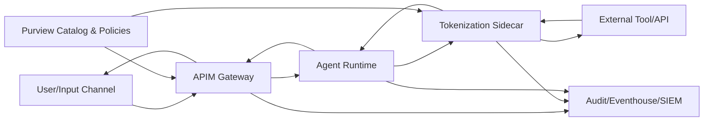
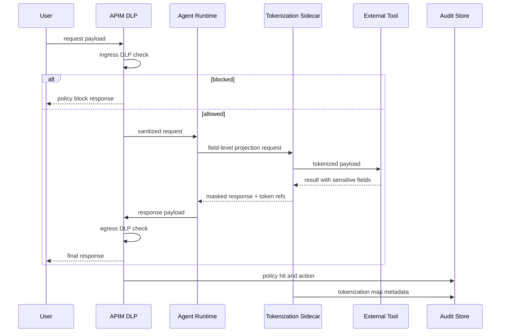

# Enterprise agent privacy-gate selection FAQ: Purview discovery baseline vs APIM ingress/egress DLP policies vs runtime sidecar tokenization vs three-layer zero-trust loop

> **Audience**: Enterprise Cloud & AI Solution Architects, data-governance leads, security platform teams, application platform engineers, and audit owners.  
> **Core question**: When agents connect to tools and enterprise systems, which architecture prevents PII leakage without breaking usability, auditability, and cost control.

## 1. Problem framing: privacy gating is a production baseline, not an optional add-on

In traditional apps,
PII usually travels through fixed interfaces.

In agent systems,
context assembly and tool orchestration expand exposure surfaces.

Common leakage paths include:

- User prompts carrying phone and ID numbers.
- Retrieval chunks containing contract-sensitive fields.
- Tool JSON payloads returning addresses in plain text.
- Human handoff notes propagating sensitive content.

Without systematic privacy gates,
four outcomes appear quickly:

- Compliance violations and financial penalties.
- Cross-tenant data exposure incidents.
- Increased security-operations burden.
- Loss of trust from business owners.

Privacy governance is therefore a control-plane requirement.

## 2. Four enterprise patterns and architecture boundaries

This guide compares four patterns:

- Pattern A: `Purview` discovery and classification baseline.
- Pattern B: `APIM` ingress/egress DLP policy gates.
- Pattern C: runtime `Sidecar Tokenization` controls.
- Pattern D: integrated three-layer zero-trust loop.

Evaluate with the following metrics:

- PII leakage rate.
- False-redaction rate affecting usability.
- Detection-to-block latency.
- Audit evidence completeness.
- Governance cost per 1,000 requests.

## 3. Pattern A: Purview discovery and classification baseline

This pattern focuses on governance-first visibility.

Core capabilities:

- Automated data discovery and classification.
- Sensitive-type tagging.
- Lineage and access-path visibility.
- Policy templates aligned with compliance controls.

Strengths:

- Strong organization-wide visibility.
- Audit readiness improves quickly.
- Establishes a stable policy vocabulary.

Limitations:

- Primarily baseline governance,
  not live interception.
- Limited direct control over runtime context assembly.
- Value depends on tag quality and coverage.

Best fit:

- Cross-domain data-governance programs.
- Foundation phase before runtime hard gates.

## 4. Pattern B: APIM policy-layer DLP gates

This pattern enforces consistent live controls at the gateway layer.

Common actions:

- Sensitive pattern matching by policy.
- Field projection and masking rules.
- Block, degrade, or route decisions by severity.
- Event export to audit and SIEM pipelines.

Strengths:

- Fast rollout and broad coverage.
- Unified controls across heterogeneous backends.
- Effective first line for real-time risk blocking.

Limitations:

- Semantic detection depth can be limited.
- Deeply nested structures may be harder to interpret.
- Over-strict rules can increase business false blocks.

Best fit:

- Platforms with centralized API ingress.
- Environments needing fast policy updates.

## 5. Pattern C: runtime sidecar tokenization controls

This pattern performs field-level transformation close to runtime execution.

Key capabilities:

- Tokenization and controlled detokenization.
- JSON-path and schema-aware field policies.
- Context minimization by projection.
- Default-deny for high-risk outbound fields.

Strengths:

- Fine-grained semantic control.
- Better handling for complex payload structures.
- Strong balance between privacy and usability.

Limitations:

- Higher implementation complexity.
- Closer coupling with app runtime behavior.
- Requires strict key and token lifecycle governance.

Best fit:

- High-value transactional workflows.
- Scenarios requiring reversible controls under policy.

## 6. Pattern D: integrated three-layer zero-trust loop (recommended)

Mature enterprises typically converge on three-layer coordination:

- A defines sensitive-asset and policy baseline.
- B provides unified real-time gateway enforcement.
- C handles deep field-level runtime minimization.

Coordination model:

- Purview answers what is sensitive.
- APIM answers which flows can proceed.
- Sidecar answers which fields can remain visible.

Benefits:

- Stronger protection coverage.
- Better audit-chain completeness.
- Tunable trade-off between false block and false allow.

## 7. Reference architecture: three-layer privacy control plane

Architecture implications:

- One trusted policy source is mandatory.
- Gateway and sidecar rules must be version-aligned.
- Every redaction decision must be traceable.

## 8. Request lifecycle: detect, redact, audit, and return

Lifecycle safeguards:

- Block responses should be user-explainable.
- Token maps must never persist as plain text.
- Egress checks prevent secondary leakage on return paths.

## 9. 12-dimension enterprise comparison matrix

| Dimension | A Purview Baseline | B APIM DLP | C Sidecar Tokenization | D Three-Layer Integrated |
|---|---|---|---|---|
| Asset visibility | Very high | Medium | Medium | Very high |
| Real-time blocking | Low | Very high | High | Very high |
| Field-level precision | Low | Medium | Very high | Very high |
| Cross-system consistency | High | Very high | Medium | Very high |
| Adoption speed | Medium | High | Medium to low | Medium |
| Ops complexity | Medium | Medium | High | High |
| Audit traceability | High | High | High | Very high |
| False-block tuning headroom | Medium | Medium | High | High |
| False-allow containment | Medium | Medium | High | Very high |
| Compliance breadth | High | High | Medium | Very high |
| Scalability | High | High | Medium | Very high |
| Recommended maturity stage | Governance foundation | Live protection | Deep privacy control | Mature enterprise |

## 10. Quantitative break-even: leakage, false-redaction, and TCO

| Metric | A Baseline | B Gateway DLP | C Sidecar | D Three-Layer |
|---|---:|---:|---:|---:|
| PII leakage rate | 1.9% | 1.1% | 0.8% | 0.3% |
| False-redaction rate | 0.7% | 2.4% | 1.3% | 1.1% |
| Median detect-to-block latency | 6.2 hours | 210 ms | 75 ms | 190 ms |
| Audit evidence gap rate | 3.8% | 2.5% | 1.9% | 0.6% |
| Governance cost / 1k requests | $0.8 | $1.4 | $1.9 | $2.2 |
| Privacy-incident loss / 1k requests | $6.6 | $4.3 | $3.8 | $1.6 |

Assumptions:

- 1.2 million requests per day.
- Sensitive-field hit ratio at 14%.
- Cross-system tool calls at 37%.
- Audit overhead amortized quarterly.

Break-even conclusions:

- Medium-risk workloads can phase through A+B first.
- High-risk high-volume workloads should converge to D.
- When incident-loss cost exceeds governance spend, D wins on ROI.

## 11. Decision tree: choose by risk and organizational readiness

Question 1:
Do you have a unified data-catalog baseline already?

- No: start with A.
- Yes: continue to Question 2.

Question 2:
Do you require real-time outbound blocking?

- Yes: B is mandatory.
- No: continue to Question 3.

Question 3:
Do workflows need reversible field controls?

- Yes: add C.
- No: A+B may be sufficient in early phases.

Question 4:
Do regulators require strict evidence chains?

- Yes: target D.
- No: adopt phased evolution based on business risk.

## 12. Common anti-patterns and corrective actions

Anti-pattern 1:
Classification exists,
but no runtime gate is active.

Correction:
Deploy APIM live blocking baseline first.

Anti-pattern 2:
Everything is irreversibly masked,
breaking business usability.

Correction:
Split reversible and irreversible policy tiers by field risk.

Anti-pattern 3:
Sidecar and gateway policies diverge over time.

Correction:
Enforce single policy source and version reconciliation.

Anti-pattern 4:
Audit stores outcomes only,
without decision evidence metadata.

Mitigation:
Persist rule version, match path, and enforcement action.

## 13. Governance operating model and ownership

Recommended four-party ownership:

- Data-governance team: classification model and policy templates.
- Platform team: gateway controls and runtime engines.
- Business teams: field-level risk and usability boundaries.
- Audit team: evidence quality and retention controls.

Operating rules:

- Policy changes must be replay-tested.
- High-risk changes require dual approval.
- Cross-team changes should follow shared release windows.

## 14. Five-step rollout guide (Good fit vs Not for)

Step 1: map high-risk data paths.  
Cover input, retrieval, tool output, and response channels.

Step 2: establish Purview classification baseline.  
Create one canonical sensitive-data vocabulary.

Step 3: deploy APIM DLP ingress/egress gates.  
Control immediate leakage risks at boundaries.

Step 4: add sidecar field-level controls.  
Implement least-visible payload projection.

Step 5: run weekly privacy-governance reviews.  
Tune leakage, false-redaction, and cost together.

Good fit:

- Multi-tenant high-volume agent platforms.
- Regulated industries with strong audit requirements.
- Tool-heavy workflows with complex payloads.

Not for:

- Offline prototypes without sensitive data.
- Tiny internal tools with no compliance scope.
- Temporary projects lacking policy operations capacity.

## 15. Practical FAQ (8 questions)

**Q1: Can Purview alone protect production traffic?**  
A1: No. You still need live gates and runtime controls.

**Q2: Will APIM DLP over-block useful traffic?**  
A2: It can, so tune by domain risk and controlled exceptions.

**Q3: Where does sidecar tokenization add the most value?**  
A3: In complex nested payloads requiring field-aware transformations.

**Q4: How do we balance reversible masking and security?**  
A4: Default high-risk fields to irreversible policy, allow reversible only under strict controls.

**Q5: What evidence does audit usually require?**  
A5: Policy version, match lineage, enforcement decision, and approval trace.

**Q6: Is the three-layer model always too heavy?**  
A6: It is heavier early, but often lower risk and lower total loss at scale.

**Q7: How do we avoid policy oscillation?**  
A7: Use controlled release cadence with observation windows.

**Q8: When is full three-layer adoption mandatory?**  
A8: When risk, audit pressure, and traffic scale rise together.

