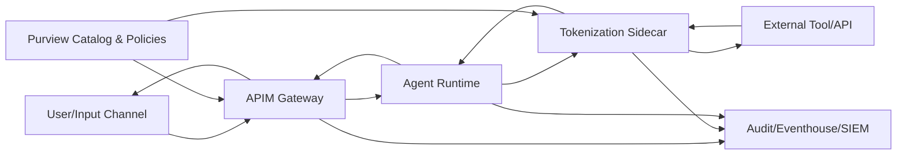
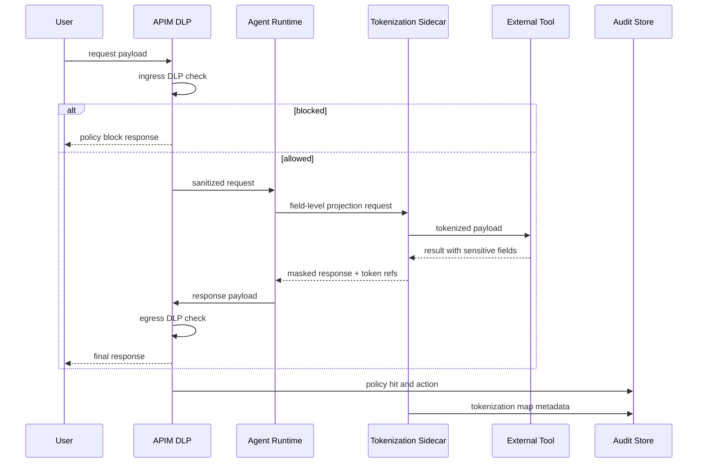

# 企业 Agent 隐私脱敏门禁选型 FAQ：Purview 数据发现基线 vs APIM 入出站 DLP 策略 vs 运行时 Sidecar Tokenization vs 三层混合零信任闭环

> **适用对象**：企业 Cloud & AI Solution Architect、数据合规负责人、安全平台团队、应用平台与审计治理团队。  
> **目标问题**：在 Agent 连接外部工具与多系统数据时，如何防止 PII 外泄并保持业务可用性、审计性与成本可控。

## 1. 问题定义：为什么隐私脱敏是 Agent 生产底线

在传统应用中，
PII 通常沿固定接口流转。

而在 Agent 场景里，
上下文拼接、工具调用与多轮对话会放大泄露面。

常见风险路径包括：

- 用户原始输入含手机号与证件号。
- 检索片段混入合同敏感字段。
- 工具返回 JSON 含个人地址明文。
- 人工接管批注二次扩散隐私内容。

若缺少体系化脱敏门禁，
会带来四类后果：

- 合规违规与高额罚款。
- 跨租户数据误暴露。
- 安全事件处置成本激增。
- 业务团队对 Agent 失去信任。

因此隐私治理不是“上线后补丁”，
而是 Agent 控制平面的先决条件。

## 2. 四类企业方案与能力边界

本文比较四条路径：

- 方案 A：`Purview` 数据发现与分类基线。
- 方案 B：`APIM` 入站/出站 DLP 策略门禁。
- 方案 C：运行时 `Sidecar Tokenization` 细粒度脱敏。
- 方案 D：三层混合零信任闭环（A+B+C）。

选型时建议关注：

- PII 泄露率。
- 误脱敏率（影响可用性）。
- 检测到阻断时延。
- 审计证据完备度。
- 每千请求治理成本。

## 3. 方案 A：Purview 发现与分类基线

该方案强调“先盘点、再治理”，
通过数据地图与分类标签建立组织级资产视图。

核心能力：

- 数据资产自动发现与分类。
- 敏感信息类型标记。
- 数据血缘与访问路径可视化。
- 合规策略模板化管理。

优势：

- 组织级视角完整。
- 便于合规审计对齐。
- 可统一指导后续门禁策略。

短板：

- 偏治理基线，
  非实时阻断主力。
- 对运行时上下文拼接缺少直接拦截。
- 落地价值依赖标签质量。

适用场景：

- 跨部门数据治理体系建设。
- 合规审计前的底盘梳理阶段。

## 4. 方案 B：APIM 策略层 DLP 门禁

该方案在网关层执行统一策略，
对进出流量进行实时检测与处置。

常见动作：

- 正则/字典匹配敏感字段。
- 请求体字段投影与掩码。
- 命中策略后阻断或降级。
- 事件回写审计仓与 SIEM。

优势：

- 部署快、覆盖广。
- 能统一多后端服务治理。
- 适合做实时第一道防线。

短板：

- 深语义识别能力有限。
- 复杂结构字段容易漏检。
- 规则过严可能误伤业务请求。

适用场景：

- 多系统统一入口平台。
- 需要分钟级策略生效能力。

## 5. 方案 C：Sidecar Tokenization 运行时脱敏

该方案在应用运行时近端执行细粒度脱敏，
将敏感值替换为可回溯令牌。

关键能力：

- 字段级 tokenization / detokenization。
- 结构化 JSON 路径级规则。
- 上下文最小化投影。
- 高风险字段“默认不外发”。

优势：

- 业务语义控制精细。
- 对复杂 payload 更友好。
- 可兼顾可用性与合规性。

短板：

- 实施复杂度较高。
- 与业务代码耦合更紧。
- 需要严格密钥与令牌生命周期治理。

适用场景：

- 高价值核心交易流程。
- 强隐私要求且字段语义复杂场景。

## 6. 方案 D：三层混合零信任闭环（推荐）

成熟企业通常采用三层协同：

- A 提供组织级资产与策略基线。
- B 负责统一实时网关阻断。
- C 处理业务近端精细脱敏。

闭环逻辑：

- Purview 定义“哪些数据敏感”。
- APIM 定义“哪些流量可过门”。
- Sidecar 定义“哪些字段可见与可逆”。

收益：

- 防护更稳健。
- 审计更完整。
- 误伤可控且可优化。

## 7. 参考架构：隐私防护三层控制平面

架构要点：

- 策略来源必须单一可信。
- 网关与 Sidecar 规则需版本对齐。
- 任何脱敏动作都应可追溯。

## 8. 请求时序：检测、脱敏、审计与回填

时序治理要点：

- 拦截响应必须可解释。
- 令牌映射禁止明文落盘。
- 出站再次检查可防二次泄露。

## 9. 12 维企业级选型对比矩阵

| 维度 | A Purview 基线 | B APIM DLP | C Sidecar Tokenization | D 三层混合 |
|---|---|---|---|---|
| 资产可见性 | 很高 | 中 | 中 | 很高 |
| 实时阻断能力 | 低 | 很高 | 高 | 很高 |
| 字段级精细控制 | 低 | 中 | 很高 | 很高 |
| 跨系统统一性 | 高 | 很高 | 中 | 很高 |
| 上线速度 | 中 | 高 | 中到低 | 中 |
| 运维复杂度 | 中 | 中 | 高 | 高 |
| 审计可追溯性 | 高 | 高 | 高 | 很高 |
| 误伤控制空间 | 中 | 中 | 高 | 高 |
| 误放行控制空间 | 中 | 中 | 高 | 很高 |
| 合规适配广度 | 高 | 高 | 中 | 很高 |
| 可扩展性 | 高 | 高 | 中 | 很高 |
| 推荐成熟阶段 | 治理起步 | 实时防护 | 深度治理 | 企业成熟 |

## 10. 定量对比：泄露率、误伤率与 TCO 拐点

| 指标 | A 基线 | B 网关 DLP | C Sidecar | D 三层混合 |
|---|---:|---:|---:|---:|
| PII 泄露率 | 1.9% | 1.1% | 0.8% | 0.3% |
| 误脱敏率 | 0.7% | 2.4% | 1.3% | 1.1% |
| 检测到阻断中位时延 | 6.2 小时 | 210 ms | 75 ms | 190 ms |
| 合规审计缺证率 | 3.8% | 2.5% | 1.9% | 0.6% |
| 每千请求治理成本（美元） | 0.8 | 1.4 | 1.9 | 2.2 |
| 每千请求隐私事故损失（美元） | 6.6 | 4.3 | 3.8 | 1.6 |

测算假设：

- 日请求 120 万。
- 高敏字段命中率 14%。
- 跨系统工具调用占比 37%。
- 审计成本按季度平摊。

拐点结论：

- 中低流量可先 A+B。
- 高敏高并发场景应收敛到 D。
- 当事故损失高于治理成本时，
  D 的 ROI 最优。

## 11. 选型决策树：按风险等级与组织能力落地

第一问：
是否已有统一数据资产目录？

- 否：先补 A。
- 是：进入第二问。

第二问：
是否需要实时阻断敏感外发？

- 是：必须有 B。
- 否：进入第三问。

第三问：
是否存在复杂嵌套字段与可逆回填需求？

- 是：引入 C。
- 否：A+B 可阶段满足。

第四问：
是否受强监管审计约束？

- 是：推荐 D。
- 否：可按业务风险分层推进。

## 12. 常见反模式与纠偏策略

反模式一：
只有数据分类，
没有运行时门禁。

纠偏动作：
建立 APIM 实时阻断基线。

反模式二：
把所有字段都做不可逆脱敏，
导致业务不可用。

修复动作：
按字段风险定义可逆/不可逆策略。

反模式三：
Sidecar 规则与网关规则割裂。

治理动作：
统一策略源并做版本对账。

反模式四：
审计只存结果不存决策依据。

改进动作：
记录命中规则、版本与处置动作。

## 13. 平台治理模型与职责分工

建议采用四方协同：

- 数据治理团队：维护分类体系与策略模板。
- 平台团队：维护网关门禁与运行时引擎。
- 业务团队：定义字段风险与可用性边界。
- 审计团队：校验证据链完整性。

治理规则：

- 规则变更必须可回放验证。
- 高风险策略变更双人审批。
- 跨团队变更需统一发布窗口。

## 14. 五步落地指南（Good fit vs Not for）

步骤 1：盘点高敏数据路径。  
识别“输入、检索、工具、回写”四段暴露面。

步骤 2：落地 Purview 分类基线。  
形成统一的敏感标签词典。

步骤 3：上线 APIM DLP 门禁。  
先控入口与出口关键风险。

步骤 4：引入 Sidecar 精细脱敏。  
对复杂字段实施最小可见策略。

步骤 5：建立审计闭环与周度复盘。  
联动泄露率、误伤率与成本曲线调优。

Good fit：

- 多租户高并发平台。
- 强合规与审计行业。
- 数据链路复杂的工具型 Agent。

Not for：

- 单机离线原型验证。
- 无敏感数据的小型内网应用。
- 无运维能力维护策略体系的临时项目。

## 15. 实战 FAQ（8 问）

**Q1：只有 Purview 能否满足生产防护？**  
A1：不能，仍需实时门禁与运行时脱敏。

**Q2：APIM DLP 会不会阻断太多请求？**  
A2：会有风险，需按域分层阈值与豁免策略。

**Q3：Sidecar 的最大价值是什么？**  
A3：在复杂 payload 中做字段级精细化控制。

**Q4：如何平衡可逆脱敏与安全？**  
A4：高风险字段默认不可逆，少量场景受控可逆。

**Q5：审计最关心哪些证据？**  
A5：规则版本、命中路径、处置动作与审批链。

**Q6：三层混合是否过重？**  
A6：早期偏重，但在高风险业务中长期更省。

**Q7：如何避免策略震荡？**  
A7：设置变更节奏与灰度观察窗口。

**Q8：什么时候必须升级到三层闭环？**  
A8：当泄露风险、审计要求与业务规模同步上升时。

