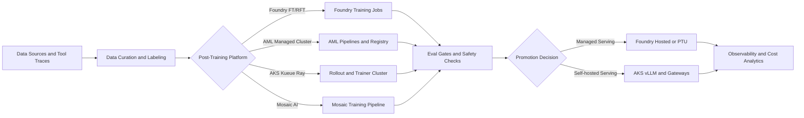
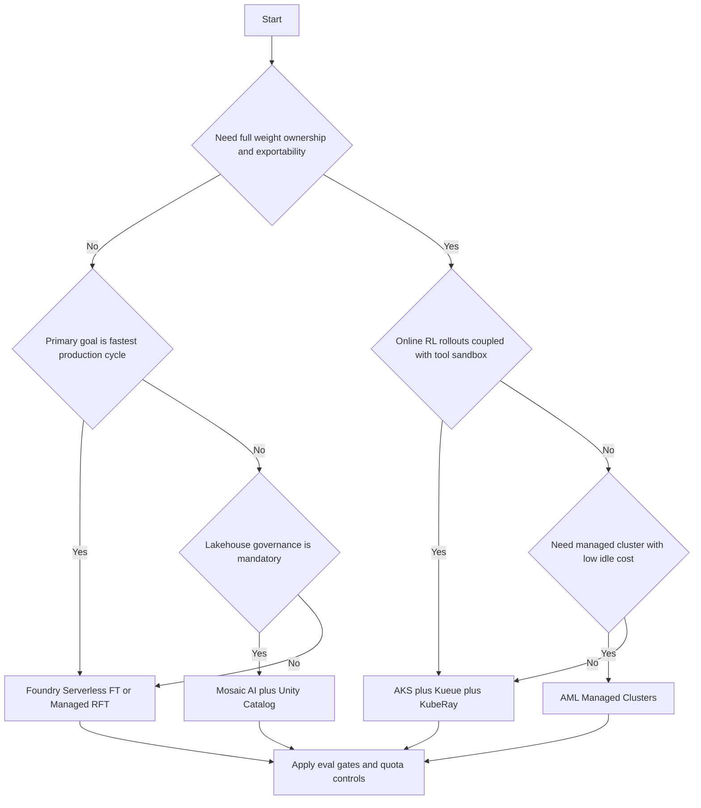

# Enterprise Agent Post-Training Platform Selection FAQ: Foundry Serverless FT/RFT vs AML NDv5 Clusters vs AKS KubeRay veRL vs Mosaic AI
> Audience: Cloud & AI Solution Architects, platform engineering, LLMOps, FinOps, compliance and risk teams  
> Scope: Platform-level selection for `LoRA SFT`, `DPO`, `RFT`, and `CPT` for tool-calling, coding, and regulated-domain agents  
> Objective: Balance weight ownership, time-to-production, quota governance, GPU operations burden, and long-term TCO on Azure

## 1. Decision boundary: this is an operating-model decision, not a feature checklist
Many teams start with capability rows.  
Supports LoRA or not.  
Supports DPO or not.  
Supports RFT or not.  
This usually ends in a tie.  

Enterprise outcomes are decided elsewhere.  
Who owns quota escalation.  
Who owns cluster reliability.  
Who owns lineage evidence.  
Who can execute rollback safely.  

If these boundaries are unresolved,  
training may succeed technically,  
yet production promotion will stall.  
Typical failure patterns include.  
Unpredictable training lead times.  
Long cross-team approval loops.  
Repeated debates on portability and lock-in.  

This guide compares four Azure paths under one lens.  
Organization model.  
Resource governance.  
Delivery speed.  
End-to-end unit economics.  

## 2. Four platform paths at a glance
Path 1.  
Azure AI Foundry serverless fine-tuning and managed RFT.  
Best when teams want minimal cluster operations overhead.  

Path 2.  
Azure Machine Learning managed compute clusters.  
Best when open-weight ownership and reproducible pipelines are strategic.  

Path 3.  
AKS plus Kueue plus KubeRay with veRL/TRL/LLaMA-Factory.  
Best when online rollout execution must be tightly coupled with RL training.  

Path 4.  
Azure Databricks Mosaic AI with Unity Catalog.  
Best when Lakehouse governance and data-team workflows dominate architecture decisions.  

These paths are not mutually exclusive.  
Common enterprise pattern is hybrid.  
Foundry for fast-cycle experimentation.  
AML for long-lived weight programs.  
AKS for specialized online RL loops.  
Mosaic for governance-aligned data and training operations.  

## 3. Option 1: Foundry serverless FT/RFT as the fastest managed route
Foundry removes most initial infrastructure friction.  
Teams can focus on data curation, graders, and release gates.  
Instead of building training platform primitives first.  

For LoRA SFT workloads,  
`Phi-4` and `Llama` adaptation paths are straightforward.  
For managed RFT,  
`GPT-4.1-mini` and `o4-mini` workflows reduce rollout infrastructure burden.  

Organizational benefits.  
- lower platform bootstrap cost  
- shorter path from dataset to evaluable model  
- centralized safety and policy controls  

Governance benefits.  
- graders can be versioned as release contracts  
- token-level budget controls are easier to enforce  
- training and serving audits stay in one managed control plane  

Trade-offs.  
- less flexibility for deep custom runtime changes  
- portability depends on product and model path  
- extreme online rollout coupling may require external orchestration  

If your primary goal is productionization speed,  
with constrained platform headcount,  
Foundry is often the strongest first step.  

## 4. Option 2: AML managed clusters for weight-asset ownership
AML is strongest when model assets are long-lived products.  
Managed clusters on `ND96isr_H100_v5` and `NCads_H100_v5` support broad post-training programs.  
Especially for 7B to 70B open-weight models.  

Typical AML scope includes.  
LoRA SFT.  
DPO preference alignment.  
CPT domain continuation.  
RFT pipelines with custom evaluation stages.  

Operational governance strengths.  
AML Pipelines, MLflow lineage, and Model Registry support.  
Repeatable promotion gates.  
Model version evidence retention.  
Policy-aligned rollback workflows.  

Operational realities.  
Managed compute reduces control-plane burden,  
but teams still need quota planning discipline.  
Priority scheduling policy.  
Checkpoint and recovery strategy.  

Trade-off summary.  
- more platform effort than Foundry  
- higher control and portability for model assets  
- strong fit for mature AI CoE operating models  

## 5. Option 3: AKS + Kueue + KubeRay for online rollout-coupled RL
This path is required in specific architectures.  
Every RL step needs thousands of live tool or sandbox rollouts.  
Rollout workers and trainer workers must co-schedule near each other.  

Kueue handles quota and fairness for batch-style workloads.  
KubeRay orchestrates distributed rollout and trainer roles.  
veRL/TRL/LLaMA-Factory provide RL and post-training framework flexibility.  

Best-fit workloads.  
Tool-calling reliability optimization.  
Coding agent trajectory reinforcement.  
Policy-critical online reward feedback loops.  

Strengths.  
- strongest control over rollout/trainer topology  
- reuse of existing AKS network and security baselines  
- extensible architecture for custom RL loops  

Costs.  
- highest platform complexity among the four paths  
- stronger SRE and platform staffing requirements  
- failure domains must be designed explicitly  

Risk controls to implement early.  
Start with bounded pilot queues.  
Standardize quota and priority semantics.  
Separate training failure blast radius from serving SLO domains.  

## 6. Option 4: Mosaic AI + Unity for governance-first organizations
When enterprise data is already centered on Delta and Unity Catalog,  
Mosaic often reduces organizational friction.  
Data access, lineage, and approval controls stay aligned with existing operating models.  

For regulated domains,  
column and row lineage requirements are often mandatory.  
Mosaic can inherit governance primitives data teams already trust.  

Strengths.  
- governance alignment with existing Lakehouse operations  
- lower process duplication between data and AI programs  
- easier multi-team approval harmonization  

Trade-offs.  
- not automatically the best choice for tightly coupled online RL rollout loops  
- economics still depend on workload mix and compute strategy  
- platform boundaries must be explicit when serving is outside Lakehouse stack  

Fit signal.  
If data governance complexity dominates architecture risk,  
Mosaic can be the most executable path.  

## 7. End-to-end curation to post-training to promotion topology (Mermaid)

The key architecture point is not tool count.  
It is a unified gate-and-promotion contract across platform paths.  

## 8. SA decision tree by weight ownership and rollout coupling (Mermaid)

Recommended order of evaluation.  
Resolve asset ownership and coupling needs first.  
Then optimize governance and delivery cadence.  

## 9. Config sample #1: Foundry RFT job with custom tool-schema grader (Python)
```python
from azure.ai.projects import AIProjectClient
from azure.identity import DefaultAzureCredential

project = AIProjectClient(
    endpoint="https://my-foundry-resource.services.ai.azure.com/api/projects/my-project",
    credential=DefaultAzureCredential(),
)

custom_grader = {
    "name": "tool_schema_grader",
    "type": "python",
    "entryPoint": "graders/tool_schema.py:grade",
    "inputs": {
        "required_tool": "create_credit_memo",
        "schema_version": "v3.2"
    }
}

job = project.training.create_job(
    display_name="rft-coding-agent-2026-11",
    task="reinforcement_fine_tuning",
    model="o4-mini",
    training_data_uri="azureml://datastores/train/paths/rft/train.jsonl",
    validation_data_uri="azureml://datastores/train/paths/rft/valid.jsonl",
    hyperparameters={
        "max_steps": 1200,
        "batch_size": 64,
        "learning_rate": 5e-6
    },
    graders=[custom_grader],
    safety={
        "harmBlockLevel": "medium",
        "piiDetection": "enabled"
    },
    output_adapter={
        "publishTarget": "foundry-hosted",
        "deploymentTier": "developer"
    }
)

print("job_id:", job.id)
```
This pattern binds three controls in one place.  
Tool contract grading.  
Safety policy as code.  
Promotion target declaration.  

## 10. Config sample #2: AKS Kueue + RayJob rollout/trainer split (YAML)
```yaml
apiVersion: kueue.x-k8s.io/v1beta1
kind: WorkloadPriorityClass
metadata:
  name: rl-high
value: 1000
---
apiVersion: ray.io/v1
kind: RayJob
metadata:
  name: agentic-rl-grpo
  namespace: rl-train
spec:
  entrypoint: "python train_grpo.py --config configs/grpo.yaml"
  runtimeEnvYAML: |
    env_vars:
      ROLLOUT_WORKERS: "64"
      TRAINER_GPUS: "8"
      REWARD_ENDPOINT: "http://reward-gateway.rl.svc.cluster.local"
  rayClusterSpec:
    headGroupSpec:
      serviceType: ClusterIP
      template:
        spec:
          priorityClassName: rl-high
          containers:
            - name: ray-head
              image: myacr.azurecr.io/verl-trainer:2026.11
              resources:
                requests:
                  cpu: "8"
                  memory: "32Gi"
    workerGroupSpecs:
      - groupName: rollout
        replicas: 32
        template:
          spec:
            containers:
              - name: rollout
                image: myacr.azurecr.io/verl-rollout:2026.11
                resources:
                  requests:
                    cpu: "4"
                    memory: "16Gi"
      - groupName: trainer
        replicas: 4
        template:
          spec:
            containers:
              - name: trainer
                image: myacr.azurecr.io/verl-trainer:2026.11
                resources:
                  requests:
                    nvidia.com/gpu: "2"
                    cpu: "16"
                    memory: "96Gi"
```
The main purpose is role separation.  
Rollout capacity and trainer capacity scale independently.  
Queue policy protects critical training workloads.  

## 11. 12-dimension platform matrix
| Dimension | Foundry Serverless FT/RFT | AML Managed Clusters | AKS + Kueue + KubeRay | Mosaic + Unity |
|---|---|---|---|---|
| 1. Platform bootstrap speed | Very high | High | Medium-low | High |
| 2. GPU operations burden | Very low | Medium | Very high | Medium |
| 3. Weight ownership and exportability | Medium | Very high | Very high | High |
| 4. Online rollout coupling strength | Medium | Medium | Very high | Medium |
| 5. Training workflow programmability | Medium | Very high | Very high | High |
| 6. Data governance integration | Medium | High | Medium | Very high |
| 7. Quota governance complexity | Low-medium | Medium-high | Very high | Medium-high |
| 8. Time-to-production | Very high | High | Medium | High |
| 9. Cross-team operating friction | Low | Medium | High | Medium-low |
| 10. Audit traceability | High | Very high | High | Very high |
| 11. Platform FTE requirement | Low | Medium | High | Medium |
| 12. Long-term scale elasticity | High | Very high | Very high | High |
Selection tendency.  
Foundry optimizes early velocity.  
AML optimizes owned model lifecycle.  
AKS optimizes deep online RL coupling.  
Mosaic optimizes governance alignment with data platforms.  

## 12. Quantitative comparison: cost per 100M tokens, time-to-prod, GPU Ops FTE, portability
> Assumptions: enterprise tool-calling agent post-training program, common safety/eval gate baseline, East Asia region  
> Units: cost in USD, lead time in days, FTE in people, portability score from 1 to 5
| Platform | Training cost per 100M tokens | Time-to-production | GPU Ops FTE | Weight portability |
|---|---:|---:|---:|---:|
| Foundry Serverless FT/RFT | 7,900 | 7 | 0.4 | 2.8 |
| AML Managed Clusters | 6,800 | 15 | 1.6 | 4.6 |
| AKS + Kueue + KubeRay | 6,200 | 21 | 2.7 | 4.9 |
| Mosaic + Unity | 7,300 | 12 | 1.3 | 4.1 |

Interpretation.  
Foundry leads on launch speed and operational simplicity.  
AKS leads on deep custom control and portability.  
AML balances economics, governance, and ownership.  
Mosaic is strongest when data-governance coupling is primary.  

## 13. Scenario A: coding agent specialization for tool reliability
Business context.  
Engineering organization wants higher tool-call consistency.  
Model updates must move into controlled canary quickly.  

Challenges.  
- tool schema versions evolve rapidly  
- evaluation policy must block unsafe upgrades  
- platform team capacity is limited  

Recommended strategy.  
Phase 1 on Foundry managed RFT for speed.  
Use tool-schema graders as hard release criteria.  
Phase 2 on AML for strategic model ownership and reusable training lines.  

Expected outcomes.  
Fast iteration cycle in early stages.  
Reduced lock-in risk in long-term model strategy.  
Cleaner handoff between experimentation and stable production programs.  

## 14. Scenario B: regulated-domain agent with strict audit controls
Business context.  
Finance and healthcare agents need durable audit evidence.  
Training and promotion decisions require multi-team approvals.  
Rollback and incident attribution must be deterministic.  

Challenges.  
- strict lineage requirements  
- approval-heavy promotion process  
- high consequence of policy violations  

Recommended strategy.  
If data governance already runs on Unity Catalog,  
Mosaic path usually minimizes process disruption.  
If strategic open-weight ownership is central,  
AML path with registry-first governance is stronger.  
Use AKS in isolated domains only for rollout-coupled RL subsystems.  

Expected outcomes.  
Sustained optimization without weakening compliance posture.  
Improved incident analysis and accountability boundaries.  
Predictable governance overhead as programs scale.  

## 15. Day-0 / Day-2 checklist and 8 quantitative FAQs
### Day-0 checklist
- define model-asset policy: managed adapters first or owned weights first  
- classify training program by SFT, DPO, RFT, and CPT gate requirements  
- define unified eval and release-block contracts  
- set budget ceiling per 100M tokens by model tier  
- define quota request and approval SLA  
- standardize artifact naming and registry versioning rules  
- define rollback triggers and re-training criteria  
- connect security scans and compliance evidence logging  
- map promotion path across dev, staging, and prod  
- establish incident escalation and on-call ownership

### Day-2 checklist
- review training success and retry cost weekly  
- review evaluation failure clusters weekly  
- review quota wait times and saturation weekly  
- recalibrate token cost model monthly  
- check time-to-production drift monthly  
- assess platform staffing pressure monthly  
- run rollback drills monthly  
- reassess platform mix and migration signals quarterly  
- reassess portability and lock-in risk score quarterly  
- verify audit evidence completeness quarterly

**Q1: What is the primary difference between Foundry and AML in this context**  
A1: Foundry prioritizes speed and managed operations, while AML prioritizes weight ownership and programmable lifecycle control.

**Q2: When is AKS + KubeRay mandatory rather than optional**  
A2: When RL requires large-scale online rollout execution coupled directly with tool or sandbox environments at each training step.

**Q3: What is Mosaic's strongest advantage**  
A3: Tight alignment with Lakehouse governance and lineage operations when enterprise data control is already centered on Unity Catalog.

**Q4: How should teams estimate platform FTE demand**  
A4: Split responsibilities into GPU operations, pipeline governance, and incident response, then map staffing to monthly job volume.

**Q5: Is lowest cost per 100M tokens always the best decision**  
A5: No; slower delivery or higher governance overhead can outweigh raw training cost efficiency at business level.

**Q6: Why quantify weight portability explicitly**  
A6: Portability score directly reflects future migration flexibility, strategic bargaining power, and long-term lock-in exposure.

**Q7: How can teams avoid repeated platform rewrites**  
A7: Use layered strategy where fast-cycle and asset-ownership paths coexist under one shared evaluation and promotion framework.

**Q8: Which dimension should regulated industries prioritize first**  
A8: Audit traceability and governance completeness should be prioritized before raw training speed or single-run cost.  
