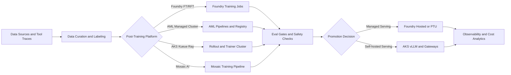
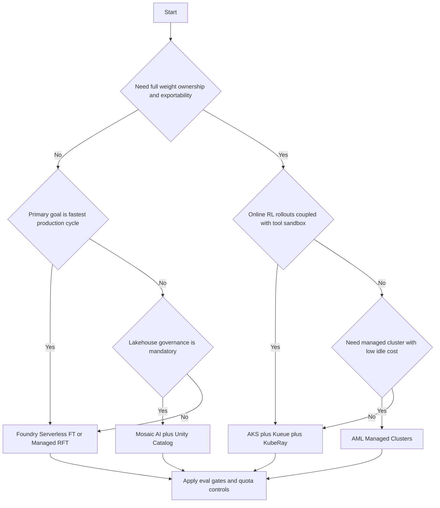

# 企业 Agent 后训练平台选型 FAQ：Foundry Serverless FT/RFT vs AML NDv5 集群 vs AKS KubeRay veRL vs Databricks Mosaic
> 适用对象：Cloud & AI Solution Architect、平台工程、LLMOps、FinOps、合规与风险治理团队  
> 场景边界：工具调用 Agent、Coding Agent、受监管行业 Agent 的 `LoRA SFT`、`DPO`、`RFT` 与 `CPT` 平台选型  
> 目标：在 Azure 上平衡权重所有权、上线时效、GPU 运维复杂度、配额治理与总拥有成本

## 1. 决策边界：后训练平台不是“训练功能对比”，而是“组织操作模型对比”
很多团队在选后训练平台时。  
先看是否支持 LoRA。  
再看是否支持 DPO。  
最后看有没有 RFT。  
这种比法通常只得到“功能清单接近”的结论。  

企业真正的分水岭往往不在算法名词。  
而在操作模型。  
谁负责 GPU 配额。  
谁负责故障恢复。  
谁负责模型血缘审计。  
谁承担发布事故处置。  

如果这些职责边界不清。  
即使训练跑通。  
也会在生产推广阶段失速。  
常见表现是。  
训练周期可预测性下降。  
跨团队审批链拉长。  
模型可移植性争议频发。  

因此本篇把四个平台放在同一框架里。  
统一比较。  
组织职责。  
资源治理。  
交付速度。  
长期 TCO。  

## 2. 四种平台路径总览
路径一。  
Azure AI Foundry Serverless Fine-Tuning 与 Managed RFT。  
核心价值是最小平台运维负担。  
适合想快速交付、弱化集群操作的团队。  

路径二。  
Azure Machine Learning Managed Compute Clusters。  
核心价值是对开源权重的完整控制。  
适合 7B 到 70B 模型长期演进与模型资产沉淀。  

路径三。  
AKS + Kueue + KubeRay + veRL/TRL/LLaMA-Factory。  
核心价值是在线 rollout 与训练同域耦合。  
适合必须在工具沙箱中执行大规模 RL rollout 的团队。  

路径四。  
Azure Databricks Mosaic AI + Unity Catalog。  
核心价值是与 Lakehouse 数据治理一体化。  
适合数据资产与审批流程已经深度标准化的组织。  

这四条路径并非互斥。  
现实中常见模式是。  
Foundry 做快迭代试验。  
AML 做主线权重训练。  
AKS 承担特定在线 RL 环。  
Mosaic 负责数据治理与特征资产联动。  

## 3. 方案一：Foundry Serverless FT/RFT（最少运维路径）
Foundry 的优势是把训练平台复杂度前置托管。  
团队不需要先解决 GPU 集群生命周期问题。  
可以直接围绕数据、评测与门禁构建流程。  

在 LoRA SFT 场景。  
Foundry 对 `Phi-4`、`Llama` 家族有较成熟路径。  
在 RFT 场景。  
`GPT-4.1-mini` 与 `o4-mini` 的托管策略降低了 rollout 基础设施成本。  

组织层收益。  
- 平台团队无需维护训练集群排程器。  
- 新项目可在更短时间拿到首个可评估模型。  
- 安全基线与审计策略更容易统一。  

治理层收益。  
- 可把 grader 与发布门禁合并设计。  
- 可按训练 token 维度做预算约束。  
- 训练与推理在同一治理平面更易追责。  

主要约束。  
- 对权重导出与跨平台迁移能力依赖产品路径。  
- 深度自定义训练栈灵活性低于自管集群。  
- 极端在线 rollout 耦合场景需要额外编排。  

适配判断。  
如果组织优先级是“先把后训练生产化”，  
而不是“先拥有全部基础设施控制权”，  
Foundry 往往是最快达标路线。  

## 4. 方案二：AML Managed Clusters（权重资产优先路径）
AML 的核心吸引力是权重与流水线资产沉淀。  
在 `ND96isr_H100_v5`、`NCads_H100_v5` 这类算力配置上。  
团队可按训练任务精细编排。  

对 7B 到 70B 开源模型。  
AML 更适合做持续迭代主线。  
包含。  
LoRA SFT。  
DPO 偏好对齐。  
CPT 领域持续预训练。  

在工程治理上。  
AML Pipelines 与 Model Registry 可以承接。  
训练血缘。  
审批门禁。  
分环境推广。  
回滚策略。  

在运维上。  
Managed Compute 降低了“自己搭调度器”的难度。  
但仍要求团队具备。  
配额治理能力。  
作业优先级设计能力。  
Checkpoint 策略能力。  

主要权衡。  
- 比 Foundry 需要更多平台工程投入。  
- 但换来更强权重可携带性与流程可编程性。  
- 对中大型 AI CoE 团队更友好。  

## 5. 方案三：AKS + Kueue + KubeRay（在线 RL rollout 耦合路径）
当训练环节必须与在线工具环境紧耦合。  
例如每一步 RL 都要执行工具调用或代码解释器回放。  
AKS 路径的价值会快速上升。  

Kueue 提供批作业配额治理。  
KubeRay 承担 rollout 与 trainer 角色编排。  
veRL/TRL/LLaMA-Factory 提供训练框架层能力。  

这条路径尤其适合。  
工具调用 Agent。  
代码修复 Agent。  
需要在近实时沙箱中采样奖励信号的系统。  

优势。  
- rollout 与训练 worker 可同域调度。  
- 可复用现有 AKS 网络与安全基线。  
- 对特定 RL 任务的结构化优化空间更大。  

成本。  
- 平台复杂度最高。  
- 需要同时维护训练与服务双栈稳定性。  
- SRE 与平台工程人力要求显著增加。  

风险控制要点。  
- 先做小规模候选集验证再扩容。  
- 把 quota、抢占、优先级策略标准化。  
- 将训练事故与线上事故隔离在不同故障域。  

## 6. 方案四：Databricks Mosaic + Unity Catalog（数据治理优先路径）
如果组织的数据工程重心在 Lakehouse。  
并且已经使用 Unity Catalog 管理数据权限。  
Mosaic 路径通常具有组织协同优势。  

主要优势在于。  
训练数据发现、权限、血缘可与现有流程一致。  
减少“AI 平台另起一套治理体系”的摩擦。  

对受监管行业。  
列级、行级治理与审计需求常是硬约束。  
Mosaic 在这类场景的跨团队推进速度往往更高。  

主要权衡。  
- 如果团队核心痛点是在线 RL rollout 耦合。  
  Mosaic 并非天然最优。  
- 如果团队核心痛点是 GPU 极致成本。  
  仍需结合具体训练规模做经济性评估。  

适配判断。  
当数据团队是后训练主导方。  
且数据合规链路复杂。  
Mosaic 会比“另建训练孤岛”更稳。  

## 7. 端到端后训练到推广拓扑（Mermaid）

图中重点不是并列平台数量。  
而是统一评测门禁与推广决策。  
这决定了多平台并存时是否可治理。  

## 8. SA 决策树：按权重所有权与在线 rollout 耦合度选型（Mermaid）

决策顺序建议。  
先回答权重资产与耦合诉求。  
再回答组织治理和交付节奏。  

## 9. 配置示例一：Foundry RFT 提交与自定义 grader（Python）
```python
from azure.ai.projects import AIProjectClient
from azure.identity import DefaultAzureCredential

project = AIProjectClient(
    endpoint="https://my-foundry-resource.services.ai.azure.com/api/projects/my-project",
    credential=DefaultAzureCredential(),
)

custom_grader = {
    "name": "tool_schema_grader",
    "type": "python",
    "entryPoint": "graders/tool_schema.py:grade",
    "inputs": {
        "required_tool": "create_credit_memo",
        "schema_version": "v3.2"
    }
}

job = project.training.create_job(
    display_name="rft-coding-agent-2026-11",
    task="reinforcement_fine_tuning",
    model="o4-mini",
    training_data_uri="azureml://datastores/train/paths/rft/train.jsonl",
    validation_data_uri="azureml://datastores/train/paths/rft/valid.jsonl",
    hyperparameters={
        "max_steps": 1200,
        "batch_size": 64,
        "learning_rate": 5e-6
    },
    graders=[custom_grader],
    safety={
        "harmBlockLevel": "medium",
        "piiDetection": "enabled"
    },
    output_adapter={
        "publishTarget": "foundry-hosted",
        "deploymentTier": "developer"
    }
)

print("job_id:", job.id)
```
该示例体现三个实践点。  
grader 与工具契约绑定。  
安全策略与训练作业同源管理。  
输出直接接入托管部署流程。  

## 10. 配置示例二：AKS Kueue + RayJob（rollout/trainer 分离）
```yaml
apiVersion: kueue.x-k8s.io/v1beta1
kind: WorkloadPriorityClass
metadata:
  name: rl-high
value: 1000
---
apiVersion: ray.io/v1
kind: RayJob
metadata:
  name: agentic-rl-grpo
  namespace: rl-train
spec:
  entrypoint: "python train_grpo.py --config configs/grpo.yaml"
  runtimeEnvYAML: |
    env_vars:
      ROLLOUT_WORKERS: "64"
      TRAINER_GPUS: "8"
      REWARD_ENDPOINT: "http://reward-gateway.rl.svc.cluster.local"
  rayClusterSpec:
    headGroupSpec:
      serviceType: ClusterIP
      template:
        spec:
          priorityClassName: rl-high
          containers:
            - name: ray-head
              image: myacr.azurecr.io/verl-trainer:2026.11
              resources:
                requests:
                  cpu: "8"
                  memory: "32Gi"
    workerGroupSpecs:
      - groupName: rollout
        replicas: 32
        template:
          spec:
            containers:
              - name: rollout
                image: myacr.azurecr.io/verl-rollout:2026.11
                resources:
                  requests:
                    cpu: "4"
                    memory: "16Gi"
      - groupName: trainer
        replicas: 4
        template:
          spec:
            containers:
              - name: trainer
                image: myacr.azurecr.io/verl-trainer:2026.11
                resources:
                  requests:
                    nvidia.com/gpu: "2"
                    cpu: "16"
                    memory: "96Gi"
```
示例强调。  
rollout 与 trainer 可独立扩缩。  
通过优先级和队列策略保护关键训练任务。  

## 11. 12 维选型矩阵
| 维度 | Foundry Serverless FT/RFT | AML Managed Clusters | AKS + Kueue + KubeRay | Mosaic + Unity |
|---|---|---|---|---|
| 1. 平台上手速度 | 很高 | 高 | 中低 | 高 |
| 2. GPU 运维负担 | 很低 | 中 | 很高 | 中 |
| 3. 权重所有权与可迁移 | 中 | 很高 | 很高 | 高 |
| 4. 在线 rollout 耦合能力 | 中 | 中 | 很高 | 中 |
| 5. 训练流程可编排深度 | 中 | 很高 | 很高 | 高 |
| 6. 数据治理一体化 | 中 | 高 | 中 | 很高 |
| 7. 配额治理复杂度 | 低中 | 中高 | 很高 | 中高 |
| 8. Time-to-Production | 很高 | 高 | 中 | 高 |
| 9. 组织协作摩擦 | 低 | 中 | 高 | 中低 |
| 10. 合规审计可追溯 | 高 | 很高 | 高 | 很高 |
| 11. 平台团队 FTE 需求 | 低 | 中 | 高 | 中 |
| 12. 长期规模弹性 | 高 | 很高 | 很高 | 高 |
结论倾向：快速验证优先 Foundry，权重资产沉淀优先 AML，深度在线 RL 优先 AKS，Lakehouse 治理优先 Mosaic。  

## 12. 定量对比：每 100M token 成本、上线时长、GPU Ops FTE、可移植性
> 假设：企业级工具调用 Agent 后训练任务，统一安全门禁和评测标准，东亚区域  
> 单位：成本 USD、时长天、FTE 人数、可移植性评分（1-5）
| 平台 | 100M token 训练成本 | 首次上线时间 | GPU Ops FTE | 权重可移植性 |
|---|---:|---:|---:|---:|
| Foundry Serverless FT/RFT | 7,900 | 7 | 0.4 | 2.8 |
| AML Managed Clusters | 6,800 | 15 | 1.6 | 4.6 |
| AKS + Kueue + KubeRay | 6,200 | 21 | 2.7 | 4.9 |
| Mosaic + Unity | 7,300 | 12 | 1.3 | 4.1 |

解释方式：Foundry 在上线速度上领先，AKS 在大规模自定义与可移植性上最强，AML 在成本/治理/可移植性之间较均衡，Mosaic 在数据治理协同上优势明显。  

## 13. 场景 A：企业 Coding Agent 的工具链专项化训练
业务背景。  
组织希望提升代码修复与工具调用一致性。  
同时要求训练后可快速进入灰度环境。  

关键挑战。  
- 工具 schema 版本频繁变化。  
- 需要把评测门禁与部署流水线联动。  
- 平台团队人手有限。  

推荐路径。  
第一阶段采用 Foundry RFT 快速闭环。  
将工具 schema grader 固化为发布门禁。  
第二阶段对核心模型迁移至 AML 形成权重资产主线。  

收益。  
既获得短周期迭代速度。  
又避免长期被单一路径锁定。  

## 14. 场景 B：受监管行业 Agent（审计 + 权限 +稳态演进）
业务背景。  
金融与医疗类 Agent 需要长期合规审计。  
训练数据与模型变更必须可追溯。  
并要求跨团队审批与回滚机制标准化。  

关键挑战。  
- 训练血缘链路复杂。  
- 模型推广需分级审批。  
- 数据治理要求高于算法迭代速度。  

推荐路径。  
如果组织已有 Lakehouse 治理体系。  
优先 Mosaic + Unity。  
如果组织更重视开源权重长期沉淀。  
优先 AML + Registry + Pipeline。  
高风险在线 RL 子任务可在 AKS 独立域运行。  

收益。  
在合规边界内保持持续优化能力。  
并可将事故定位与责任划分结构化。  

## 15. Day-0 / Day-2 清单与 8 个定量 FAQ
### Day-0（上线前）
- 明确模型资产策略：托管适配器优先还是权重所有权优先。  
- 划定训练任务分级：SFT、DPO、RFT、CPT 的门禁阈值。  
- 建立统一评测集合与发布阻断规则。  
- 定义训练预算：每 100M token 成本上限。  
- 设计 quota 申请与审批 SLA。  
- 配置训练产物命名与版本策略。  
- 建立回滚与再训练触发条件。  
- 对接安全扫描与合规审计台账。  
- 确定跨环境推广路径（dev、staging、prod）。  
- 制定平台故障升级与值班机制。  

### Day-2（运营期）
- 每周复盘训练作业成功率与重试成本。  
- 每周复盘评测失败样本与根因分布。  
- 每周审查配额使用率与等待时长。  
- 每月校准 token 成本模型与预算阈值。  
- 每月复盘上线时间是否偏离基线。  
- 每月评估 FTE 压力与平台自动化覆盖。  
- 每月验证回滚演练与恢复时间。  
- 每季度重评平台组合策略是否需要迁移。  
- 每季度审查审计证据完整性。  

**Q1：Foundry 与 AML 的首要差异是什么**  
A1：Foundry 优先最小运维与快速上线，AML 优先权重所有权与深度可编排训练治理。  

**Q2：什么时候必须考虑 AKS + KubeRay 路线**  
A2：当 RL 训练每步都要与在线工具沙箱高频耦合，且需要大规模 rollout worker 并行时。  

**Q3：Mosaic 的核心优势是什么**  
A3：当数据与权限治理已深度依赖 Unity Catalog 时，训练治理与数据治理可以同构对齐。  

**Q4：如何估算平台团队人力需求**  
A4：可按 GPU 运维、流水线治理、故障值班三类职责拆分，再映射到月均作业规模。  

**Q5：100M token 成本最低就一定最优吗**  
A5：不一定，若上线周期和合规成本更高，总体业务收益可能反而下降。  

**Q6：权重可移植性为什么要量化评分**  
A6：它直接影响未来迁移成本与议价能力，是长期平台战略风险的核心指标。  

**Q7：如何避免后训练平台选择后反复重构**  
A7：建议采用分层策略：快速路径与主线资产路径并存，并通过统一评测门禁连接。  

**Q8：受监管行业应优先哪个维度**  
A8：优先审计可追溯与权限治理完整性，再考虑训练速度与单次成本。  
