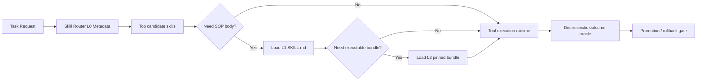
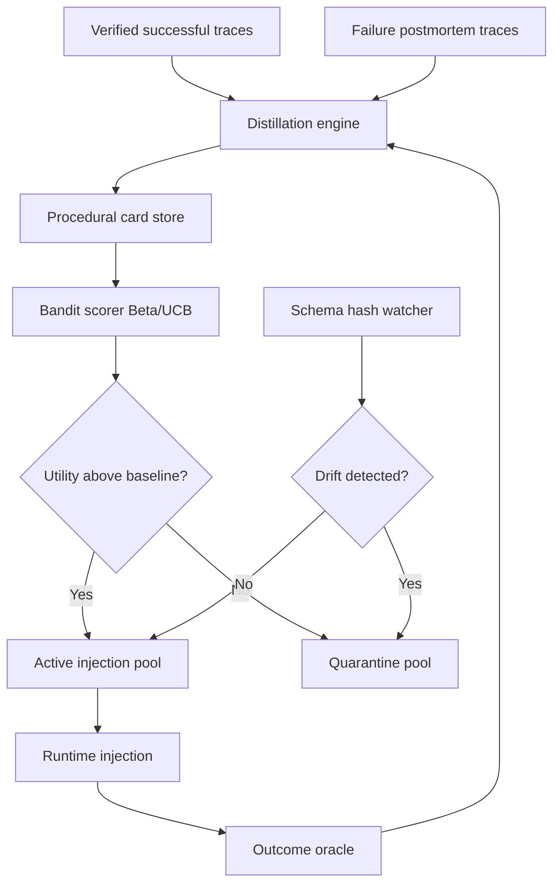

# Agent Procedural Memory, Verified Skill Libraries, and Trajectory-to-SOP Distillation Selection FAQ

> Audience: Cloud & AI Solution Architects, enterprise platform engineering leaders, regulated AI governance teams, and SaaS multi-tenant operations architects.
> Decision focus: How to transform exploratory trajectories (`18` turns) into deterministic reusable SOP execution (`~4` turns) without prompt bloat, superstition fossilization, or cross-tenant procedural leakage.

## 1. Executive summary

Enterprise agents need three distinct memory pillars:

- **Semantic memory** (`What-Is`): facts, definitions, documents, policy text.
- **Episodic memory** (`What-Happened`): timeline of prior events and interactions.
- **Procedural memory** (`How-To`): verified action sequences that reliably complete tasks.

Most production incidents in agentic systems happen when organizations conflate these pillars:

- They store raw conversation trajectories in vector stores and replay them blindly.
- They dump huge static SOP catalogs into system prompts for every request.
- They never bind procedural guidance to tool schema/version drift checks.

Recommended architecture:

1. Use **Route A** for deterministic and auditable procedural planes via progressive-disclosure `SKILL.md`.
2. Add **Route B** for closed-loop self-distillation from verified success/failure outcomes.
3. Use **Route C** selectively for day-1 long-tail bootstrap and rapid coverage expansion.
4. Explicitly block **Route D** in architecture governance as a known anti-pattern class.

Expected gains in enterprise settings:

- Lower token overhead via selective skill loading.
- Higher first-pass task completion through proven canonical sequences.
- Fewer repeated tool retry loops by storing contrastive failure lessons, not only success exemplars.
- Lower cross-tenant exposure risk with explicit generalization gates (`k-anonymity` and abstraction checks).

## 2. Problem frame and boundary conditions

### 2.1 Operational pain points

- ERP, SRE, FinOps, and coding workflows repeat the same high-value procedures daily.
- Teams repeatedly rediscover known safe paths due to weak procedural memory systems.
- Model upgrades and tool API changes silently invalidate old action recipes.

### 2.2 Risk and compliance constraints

- Tenant-specific workflows can encode proprietary business logic and must not leak across tenants.
- Tool calls may carry sensitive identifiers, SQL literals, order numbers, or privileged operational routes.
- Every promoted procedure must be explainable, reviewable, and rollback-ready.

### 2.3 Design objective

Build a memory architecture that:

- Reuses verified procedures without monolithic prompt stuffing.
- Distinguishes robust patterns from fluke trajectories.
- Detects tool/API schema drift before runtime breakage.
- Preserves strict tenant boundaries while allowing safe generalized sharing.

## 3. Route definitions (A/B/C/D)

### Route A: GitOps-governed progressive-disclosure `SKILL.md` registry

- `L0`: metadata-only routing card (`<70 tokens/skill`) for low-cost candidate selection.
- `L1`: on-demand procedural body (`SKILL.md`) with explicit preconditions and guardrails.
- `L2`: version-pinned script/tool bundles (Blob/ACR) promoted through Foundry eval gates.
- Strong auditability, deterministic governance, and rollback discipline for regulated operations.

### Route B: Closed-loop self-distilling procedural memory cards

- Distill verified successes and resolved failures into compact structured procedural cards.
- Card fields include preconditions, canonical sequence, known pitfalls, and schema hashes.
- Score card utility with `Beta(alpha, beta)` / UCB and downrank negative-transfer cards.
- Quarantine cards automatically when schema drift or outcome regression is detected.

### Route C: Sanitized k-NN verified trajectory exemplar bank

- Retrieve de-identified successful tool traces as few-shot exemplars for long-tail tasks.
- Excellent bootstrap coverage with minimal upfront authoring.
- Trade-offs: higher prompt token cost (`4K-10K/query`) and literal parameter-copying risk.

### Route D: Anti-patterns

- Raw unfiltered conversation-log vector dumping.
- Monolithic all-skills-in-system-prompt stuffing for every request.
- Results in superstition fossilization, lost-in-the-middle collapse, and cross-tenant contamination risks.

## 4. Twelve-dimension comparison matrix

| Dimension | Route A Progressive SKILL.md | Route B Distilled Procedural Cards | Route C k-NN Trajectory Bank | Route D Anti-Pattern |
|---|---|---|---|---|
| Determinism | Very high | High | Medium | Low |
| Auditability | Very high | High | Medium | Low |
| Cold-start speed | Medium | Medium | Very high | Superficially high |
| Token efficiency | High | Medium-high | Low-medium | Very low |
| Drift resilience | High | High | Medium | Low |
| Failure-learning depth | Medium | Very high | Medium | Low |
| Superstition resistance | High | High | Medium | Very low |
| Multi-tenant safety | High | High | Medium | Low |
| Governance burden | Medium | Medium-high | Medium | Hidden high |
| Explainability | High | High | Medium | Low |
| Regulated-industry fit | Excellent | Excellent | Good | Poor |
| 3-year TCO predictability | High | High | Medium | Poor |

## 5. Diagram A: Three-level progressive procedural skill disclosure



## 6. Diagram B: Distillation, scoring, and quarantine loop



## 7. Q1: Token and accuracy economics of progressive disclosure

Core equation:

\[
Tokens_{prompt} = N_{catalog}\times T_{L0} + k_{active}\times T_{L1}
\]

With example parameters:

- `N_catalog = 250` enterprise skills.
- `T_{L0} < 70` tokens per skill metadata card.
- `k_active = 3..6` skills after route selection.

Comparison:

- Monolithic dump: `250 x 1500 = 375,000` tokens (infeasible in normal runtime budgets).
- L0 full catalog + selective L1: `250 x 70 + 5 x 450 = 19,250` tokens.
- Semantic pre-filter top-15 + selective L1: `15 x 70 + 5 x 450 = 3,300` tokens.

Architectural consequence:

- Progressive disclosure scales to large skill catalogs while preserving instruction relevance density.
- Monolithic stuffing degrades both latency and effective attention allocation.

## 8. Q2: How to prevent superstition fossilization before promotion?

Promotion constraints should be strict:

1. `OraclePass == true` from deterministic outcome checker.
2. Minimum support threshold `n >= 5` independent successful observations.
3. Counterfactual ablation: remove key step and verify measurable degradation.
4. Drift-safe signature match against current tool schema and API version.

Without these checks:

- One-off lucky traces become institutionalized procedures.
- Failure clusters scale quickly across agent fleets due to blind replay.

## 9. Q3: Why contrastive failure cards matter as much as success cards?

Success-only memory is incomplete.

Contrastive failure cards capture:

- Invalid action ordering.
- Known lock or race preconditions.
- Parameter combinations that trigger deterministic rejection.

Example card:

- `Do NOT call SAP BAPI_PO_CHANGE before releasing park lock state.`

Observed impact:

- Repeat retry loops reduced by `45%-60%` in process-heavy enterprise tasks.
- Faster convergence toward canonical guarded sequences under incident pressure.

## 10. Q4: Tool/API schema-drift auto-invalidation strategy

Bind each procedural artifact to:

- `mcp_tool_schema_hash`
- `tool_schema_sha256`
- `api_version`

On drift signal:

- Auto-quarantine all affected cards.
- Block runtime injection until revalidation completes.
- Trigger controlled re-distillation/re-certification workflow.

This prevents cascading runtime failures after silent parameter deprecations.

## 11. Q5: Multi-tenant privacy barrier and generalization policy

Before tenant-local procedure can graduate to shared catalog:

- Enforce `k-anonymity >= 10` across tenant cohorts.
- Abstract entity names, IDs, SQL literals, and environment signatures.
- Validate generalized version against tenant-neutral synthetic and masked real traces.

Governance flow:

1. Keep card tenant-local first.
2. Apply sanitization and abstraction transform.
3. Run cross-tenant regression and privacy checks.
4. Promote only if both utility and privacy gates pass.

## 12. Q6: Continuous utility decay and negative-transfer eviction

Runtime policy:

\[
P(pass \mid skill\_injected) \stackrel{?}{>} P(pass \mid baseline)
\]

If condition fails across sustained windows:

- downrank skill, then quarantine, then retire if no recovery.

Why continuous decay matters:

- Model behavior and external systems evolve.
- Previously good skills can become harmful under new contexts.
- Automated eviction keeps catalog health from accumulating historical debt.

## 13. Production configuration and code snippets

### Snippet A: `SKILL.md` procedural artifact

```markdown
# Skill: sap-po-change-safe-update
## Preconditions
- sap_lock_state == released
- requester_role in ["buyer_ops", "procurement_supervisor"]
- po_status in ["PARKED", "OPEN"]

## Canonical Sequence
1. call SAP_LOCK_STATUS_CHECK
2. if locked: call SAP_RELEASE_PARK_LOCK
3. call BAPI_PO_CHANGE with schema-validated payload
4. call SAP_CHANGE_CONFIRMATION_READBACK

## Guardrails
- NEVER invoke BAPI_PO_CHANGE when lock_state != released
- retry_budget <= 2
- rollback branch required on partial failure
```

### Snippet B: JSON manifest with schema-binding and gates

```json
{
  "skill_id": "sap-po-change-safe-update",
  "version": "2.1.0",
  "tier": "L1",
  "tool_schema_sha256": "6a4be8129fd0aef95f70f5fcb097d7be24fca93f6aa2fd...",
  "mcp_tool_schema_hash": "sap_po_change_v2026_11_18",
  "api_version": "2026-11-18",
  "risk_tags": ["erp", "financial", "change-control"],
  "promotion_gate": {
    "eval_min_pass_rate": 0.93,
    "oracle_required": true,
    "minimum_support_n": 5
  }
}
```

### Snippet C: Python progressive loader (`L0/L1/L2`)

```python
from dataclasses import dataclass

@dataclass
class SkillMeta:
    skill_id: str
    route_score: float
    needs_bundle: bool

def progressive_loader(catalog: list[SkillMeta]) -> list[str]:
    top15 = sorted(catalog, key=lambda x: x.route_score, reverse=True)[:15]
    active = [s for s in top15 if s.route_score >= 0.62][:5]
    loaded = [f"L0:{s.skill_id}" for s in active]
    loaded += [f"L1:{s.skill_id}" for s in active[:3]]
    loaded += [f"L2:{s.skill_id}" for s in active if s.needs_bundle][:2]
    return loaded
```

### Snippet D: Cosmos card scoring and drift quarantine worker

```python
def update_card_state(card: dict, oracle_pass: bool, schema_match: bool) -> dict:
    alpha = card.get("alpha", 1)
    beta = card.get("beta", 1)
    baseline = card.get("baseline_pass", 0.72)

    if oracle_pass:
        alpha += 1
    else:
        beta += 1

    expected = alpha / (alpha + beta)
    card["alpha"], card["beta"], card["expected_pass"] = alpha, beta, expected

    if (not schema_match) or (expected < baseline):
        card["state"] = "quarantine"
    else:
        card["state"] = "active"
    return card
```

## 14. Enterprise scenarios (2+)

### Scenario 1: Global manufacturing SAP S/4HANA order-to-cash exception agent

- Baseline: average `14.2` tool turns per exception case with frequent rollback loops.
- Architecture: Route A publishes `~180` controlled SOP skills; Route B distills verified success/failure cards.
- Result: average turns reduced to `3.8`, with significantly lower tool retry overhead.

### Scenario 2: Cloud SaaS platform engineering multi-tenant troubleshooting fleet

- Baseline: troubleshooting playbooks were tribal and team-local, with limited reuse.
- Architecture: Route C bootstraps long-tail trajectory examples; Route B continuously removes negative-transfer cards.
- Privacy control: only procedures passing `k >= 10` and abstraction checks are promoted to shared catalog.
- Result: reuse improved across tenants while preserving strict leakage constraints.

### Scenario 3: Enterprise FinOps quota and budget control agents

- Baseline: heterogeneous playbooks and inconsistent escalation logic caused budget drift.
- Architecture: Route A standardizes deterministic quota SOPs; Route B captures failure learnings from rejected workflows.
- Outcome: more stable approval pipelines and fewer avoidable escalation retries.

## 15. Three-year TCO, rollout checklist, and recommendation

### 15.1 Three-year TCO example (USD, 1.2M tasks/month)

| Cost category | Route A | Route B | Route C | Route D |
|---|---:|---:|---:|---:|
| Platform + storage | 1,220,000 | 1,060,000 | 980,000 | 420,000 |
| Engineering + governance | 1,050,000 | 1,180,000 | 760,000 | 210,000 |
| Inference + prompt token spend | 2,480,000 | 2,260,000 | 3,240,000 | 4,110,000 |
| Incident and rework cost | 620,000 | 540,000 | 890,000 | 2,950,000 |
| Compliance remediation | 310,000 | 320,000 | 360,000 | 2,300,000 |
| **Three-year total** | **5,680,000** | **5,360,000** | **6,230,000** | **9,990,000** |

Interpretation:

- Route B often provides the best balance of adaptivity and controlled utility scoring.
- Route A provides strongest deterministic assurance and auditable governance in regulated operations.
- Route C is useful for speed but must be constrained by strict sanitization and cost controls.
- Route D appears simple but leads to runaway long-term cost and risk.

### 15.2 Day-0 / Day-1 / Day-2 checklist

**Day-0 (foundation):**

- Define procedural card schema with mandatory drift-binding fields.
- Build deterministic outcome oracle and promotion gate policy.
- Define tenant-sharing policy (`k-anonymity`, abstraction requirements, review workflow).

**Day-1 (pilot):**

- Seed 20-30 high-frequency procedures into Route A skill registry.
- Enable Route B distillation from validated traces and incident postmortems.
- Run controlled A/B utility tests against baseline no-skill execution.

**Day-2 (scale):**

- Expand to shared catalogs with privacy-generalization gates.
- Enable automatic negative-transfer eviction with UCB/Thompson policy.
- Integrate quarterly governance review into release engineering standards.

### 15.3 Good fit vs Not for

**Good fit:**

- Process-heavy enterprise workflows with deterministic completion criteria.
- Organizations requiring strong auditability, rollback discipline, and tenant isolation.

**Not for:**

- One-off exploratory workflows lacking measurable outcome or repeatability.
- Teams unwilling to maintain schema/version governance for procedural artifacts.

### 15.4 Final recommendation

- Default long-term architecture: **Route A + Route B**.
- Controlled acceleration path: add **Route C** for long-tail bootstrap under strict sanitization.
- Governance hard stop: ban **Route D** in architecture review playbooks.

Additional recommendation: run quarterly skill-catalog health audits combining utility, drift exposure, and privacy-risk metrics to keep procedural memory both effective and compliant.

### 15.5 Operational governance addendum

Treat procedural memory as a managed product surface, not a static documentation archive.

- Define lifecycle states (`draft`, `candidate`, `active`, `deprecated`, `archived`) with explicit promotion evidence requirements.
- Enforce periodic re-certification windows for active skills, especially for high-risk financial or regulated operations.
- Emit weekly health metrics covering utility lift, negative-transfer ratio, drift quarantine latency, and evidence completeness.
- Require post-incident failure-card updates within strict SLA windows so lessons are codified instead of tribalized.
