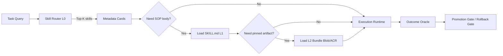

# Agent 程序性记忆与可验证技能库选型 FAQ（Progressive SKILL.md vs ReasoningBank vs k-NN 轨迹库）

> 面向 Cloud & AI Solution Architect 的企业架构决策文档。
> 核心问题：如何把多步任务从“18 轮探索”收敛到“4 轮可复用 SOP”，同时避免跨租户泄漏与迷信性错误固化。

## 1. 执行摘要

企业 Agent 的长期能力，不只来自语义知识检索（What-Is），也不只来自会话事件记录（What-Happened）。
真正决定任务稳定度的是程序性记忆（How-To）：可复用、可验证、可审计、可失效回收的执行步骤资产。

本 FAQ 对比四条路线：

- Route A：GitOps 渐进披露 `SKILL.md` 与参数化 Playbook 注册表。
- Route B：闭环自蒸馏程序记忆（ReasoningBank/ACE 卡片）与带宽约束评分。
- Route C：净化后的 k-NN 轨迹样例库（快速覆盖长尾组合）。
- Route D：未过滤日志向量化或超长系统提示词堆叠反模式。

推荐结论：

1. 受监管场景首选 `Route A + Route B`，用显式门禁保障可信可追责。
2. 冷启动与长尾探索可叠加 `Route C`，但必须有参数抽象与租户隔离。
3. 明确禁止 `Route D`，防止“迷信轨迹化石化”与注意力塌陷。

## 2. 问题定义与边界

典型企业痛点：

- ERP/SRE/FinOps/Coding 任务有大量固定流程，却仍被重复探索。
- 一线团队把成功轨迹复制到提示词后，短期有效，长期失效率上升。
- 工具参数或 API 版本变更后，历史步骤卡失效引发连锁 `400/409/412`。

目标状态：

- 技能注入最小化：仅在需要时加载 SOP 细节。
- 成功与失败都沉淀：既保存“怎么做”，也保存“不要怎么做”。
- 每张技能卡都绑定 schema-hash 与版本，自动隔离失配卡。

## 3. 四条架构路线（A/B/C/D）

### Route A：Progressive Disclosure `SKILL.md` 注册表

- L0：仅加载技能元数据（用途、前置条件、成本范围、风险标签）。
- L1：按需加载 `SKILL.md` SOP 正文（步骤、分支、异常处理）。
- L2：版本钉住工具脚本包（Blob/ACR），并经过评测门禁推广。
- 通过 GitOps 控制变更审查、回滚与审计证据链。

### Route B：ReasoningBank/ACE 程序卡蒸馏

- 从生产成功轨迹与故障复盘提炼结构化卡片。
- 卡片字段包含 Preconditions、Canonical Sequence、Failure Guardrails。
- 通过 `Beta(α, β)` 或 UCB 估计“注入后成功概率提升”。
- 当收益低于基线，自动降权或隔离。

### Route C：净化 k-NN 轨迹样例库

- 对成功工具调用轨迹去标识化后做 few-shot 检索。
- 日 1 可快速覆盖长尾 API 组合，无需先写完整 SOP。
- 代价是 token 成本高，且有参数照抄风险。

### Route D：反模式

- 把原始会话日志直接向量化复用。
- 或把全部技能一次性塞入系统提示词。
- 前者会固化偶然成功步骤，后者会引发中段遗忘与注意力稀释。

## 4. 12 维比较矩阵

| 维度 | Route A Progressive SKILL.md | Route B 蒸馏程序卡 | Route C k-NN 轨迹库 | Route D 反模式 |
|---|---|---|---|---|
| 稳定性 | 很高 | 高 | 中 | 低 |
| 可审计性 | 很高 | 高 | 中 | 低 |
| 冷启动速度 | 中 | 中 | 很高 | 表面高 |
| Token 成本 | 低到中 | 中 | 高 | 很高 |
| 变更治理 | 强 | 强 | 中 | 弱 |
| 失败学习能力 | 中 | 很高 | 中 | 弱 |
| 防迷信能力 | 强 | 高 | 中 | 弱 |
| 多租户隔离 | 强 | 高 | 中 | 弱 |
| 维护负担 | 中 | 中高 | 中 | 后期极高 |
| 工具漂移适应 | 强 | 高 | 中 | 弱 |
| 监管适配 | 优 | 优 | 良 | 差 |
| TCO 可控性 | 高 | 高 | 中 | 差 |

## 5. 参考架构图一：三层渐进披露技能平面



## 6. 参考架构图二：程序卡蒸馏与失效回收闭环

```mermaid
flowchart TD
    T[Verified Trajectories] --> X[Distillation Worker]
    F[Failure Postmortems] --> X
    X --> C[Procedural Cards Store]
    C --> B[Bandit Scorer Beta/UCB]
    B --> G{P(pass|skill) > baseline?}
    G -->|Yes| A[Active Injection Pool]
    G -->|No| Q[Quarantine Pool]
    S[Tool Schema Hash Feed] --> V{schema drift?}
    V -->|Yes| Q
    V -->|No| A
    A --> RUN[Agent Runtime]
    RUN --> ORC[Deterministic Outcome Oracle]
    ORC --> X
```

## 7. Q1：三层渐进披露如何降低 token 成本并提升准确率？

关键公式：

\[
Tokens_{prompt}=N_{catalog}\times T_{L0}+k_{active}\times T_{L1}
\]

示例参数：

- `N_catalog = 250`。
- `T_L0 < 70` tokens/skill。
- Top-15 预过滤后仅加载 `k_active = 3~6`。

对比：

- 单次全量注入：`250 × 1500 = 375,000` tokens（不可行）。
- L0 全扫描 + L1 按需：`250 × 70 + 5 × 450 ≈ 19,250` tokens。
- 若 L0 先做语义预过滤（Top-15）：`15 × 70 + 5 × 450 = 3,300` tokens。

结论：在目录规模化后，渐进披露是唯一可持续策略。

## 8. Q2：如何避免“迷信轨迹化石化”？

推广前门槛：

1. `OraclePass == true`（确定性结果校验通过）。
2. 样本支持度 `n >= 5`。
3. 进行反事实消融：移除关键步骤后应显著降级。

若仅有一次偶然成功，不允许直接推广为 SOP。
否则会把“巧合”误当“规律”，导致大规模负迁移。

## 9. Q3：为什么要同时保存失败教训卡？

只保存成功卡会导致重复踩坑。
失败卡（Do-Not）可显著减少重复错误调用链。

示例：

- 成功卡：`先检查 SAP 锁状态 -> 释放挂起单 -> 再调用 BAPI_PO_CHANGE`。
- 失败卡：`禁止在 park-lock 未释放前直接修改采购单`。

实践数据：

- 引入对比失败卡后，重复工具重试环下降 `45%~60%`。
- 单任务平均冗余调用次数明显下降。

## 10. Q4：如何做工具/API 漂移自动失效？

每张卡都绑定：

- `mcp_tool_schema_hash`
- `api_version`
- `tool_schema_sha256`

当上游 schema 变化时：

- 自动把关联卡片标记为 `quarantine`。
- 禁止继续注入运行时。
- 触发“重验证任务”，通过后再回到 active。

这样可避免版本升级后出现批量 `400 Bad Request`。

## 11. Q5：多租户共享技能库如何满足隐私与泛化？

推荐门槛：

- `k-anonymity >= 10` 才允许租户局部模式进入共享库。
- 所有实体名、账号号段、SQL 字面量必须抽象化。
- 共享库只存“结构流程”，不存租户业务专有值。

治理流程：

1. 租户内技能卡先在本地库稳定运行。
2. 通过脱敏和泛化审查后，进入候选共享池。
3. 经过跨租户回归评测才可提升为全局共享技能。

## 12. Q6：如何持续淘汰负迁移技能？

利用 Thompson Sampling/UCB 动态估计技能收益。
关键判断：

\[
P(pass | skill\_injected) \stackrel{?}{>} P(pass | baseline)
\]

当条件不成立且持续多个窗口：

- 自动降级或剔除技能卡。
- 回滚到基线策略并触发重蒸馏。

实践收益：

- 可避免“旧技能拖累新版本模型”现象。
- 保持技能库质量随时间上升而非腐化。

## 13. 生产代码与配置示例

### 示例 A：`SKILL.md` + manifest（含 schema hash）

```markdown
# Skill: sap-po-change-safe-update
## Preconditions
- sap_lock_state == released
- requester_role in ["buyer_ops","procurement_supervisor"]

## Canonical Steps
1. call SAP_LOCK_STATUS_CHECK
2. if locked: call SAP_RELEASE_PARK_LOCK
3. call BAPI_PO_CHANGE with validated schema

## Failure Guardrails
- NEVER call BAPI_PO_CHANGE before lock release
- Retry budget <= 2
```

```json
{
  "skill_id": "sap-po-change-safe-update",
  "version": "1.4.2",
  "tier": "L1",
  "tool_schema_sha256": "4a6c6f7f...e2aa",
  "mcp_tool_schema_hash": "sap_po_change_v2026_11_01",
  "api_version": "2026-11-01",
  "risk_tags": ["financial", "erp", "change-control"],
  "promotion_gate": "foundry_eval_pass>=0.93"
}
```

### 示例 B：Python 渐进加载器（L0/L1/L2）

```python
from dataclasses import dataclass

@dataclass
class SkillMeta:
    skill_id: str
    score: float
    tier: str

def progressive_load(catalog: list[SkillMeta], need_bundle: bool) -> list[str]:
    top = sorted(catalog, key=lambda x: x.score, reverse=True)[:15]
    active = [s for s in top if s.score >= 0.62][:5]
    loaded = [f"L0:{s.skill_id}" for s in active]
    loaded.extend([f"L1:{s.skill_id}" for s in active[:3]])
    if need_bundle:
        loaded.extend([f"L2:{s.skill_id}" for s in active[:2]])
    return loaded
```

### 示例 C：Cosmos 程序卡 `Beta(α, β)` 更新与漂移隔离

```python
def update_beta(card: dict, oracle_pass: bool) -> dict:
    alpha = card.get("alpha", 1)
    beta = card.get("beta", 1)
    if oracle_pass:
        alpha += 1
    else:
        beta += 1
    card["alpha"] = alpha
    card["beta"] = beta
    card["expected_success"] = alpha / (alpha + beta)
    if card["expected_success"] < card.get("baseline_success", 0.72):
        card["state"] = "quarantine"
    return card
```

## 14. 企业场景（2+）

### 场景 1：全球制造 SAP S/4HANA 订单异常处理智能体

- 现状：平均每单处理需 `14.2` 次工具调用，且人工回滚频繁。
- 方案：Route A 管理 `180` 个 SOP 技能，Route B 蒸馏成功与失败卡。
- 结果：平均调用回落到 `3.8`，异常重试显著减少。

### 场景 2：SaaS 平台工程多租户故障排查智能体

- 现状：团队间经验不可复用，排障路径高度依赖个人记忆。
- 方案：Route C 快速引入净化轨迹样例，配合 Route B 评估负迁移。
- 隐私：仅 `k >= 10` 且完成实体抽象的流程可进入共享库。
- 结果：跨租户可复用排障步骤显著增加且无数据泄漏事件。

### 场景 3：企业 FinOps 配额调度智能体

- 现状：不同团队配额调整流程不一致，策略冲突导致预算偏差。
- 方案：用 Route A 发布标准化配额回收/扩配 SOP，Route B 学习失败教训。
- 结果：月度预算偏差下降，审批路径标准化。

## 15. 三年 TCO、落地清单与选型建议

### 15.1 三年 TCO（示例，USD，120 万任务/月）

| 成本项 | Route A | Route B | Route C | Route D |
|---|---:|---:|---:|---:|
| 平台与存储 | 1,220,000 | 1,060,000 | 980,000 | 420,000 |
| 工程建设与治理 | 1,050,000 | 1,180,000 | 760,000 | 210,000 |
| 推理与 token 成本 | 2,480,000 | 2,260,000 | 3,240,000 | 4,110,000 |
| 故障与返工成本 | 620,000 | 540,000 | 890,000 | 2,950,000 |
| 合规与审计整改 | 310,000 | 320,000 | 360,000 | 2,300,000 |
| **三年总计** | **5,680,000** | **5,360,000** | **6,230,000** | **9,990,000** |

### 15.2 Day-0 / Day-1 / Day-2 清单

Day-0：

- 定义程序卡 schema 与技能分层标准（L0/L1/L2）。
- 建立 outcome oracle 与 promotion gate 基线。
- 完成多租户脱敏与共享门槛策略。

Day-1：

- 选取 20~30 条高频任务建立首批技能卡。
- 接通 schema-hash 漂移监听与自动隔离。
- 对比“注入技能 vs 基线”并记录真实收益。

Day-2：

- 扩展到跨团队共享技能库与版本治理流程。
- 启用负迁移淘汰策略（Thompson/UCB）。
- 将季度审计纳入发布工程标准作业。

### 15.3 Good fit vs Not for

Good fit：

- 任务流程稳定、可验证结果明确、合规要求高的企业。
- 需要把实践经验制度化并跨团队复制的组织。

Not for：

- 纯探索型一次性任务、难以定义 outcome oracle 的场景。
- 无法维护基本版本治理与审计元数据的团队。

### 15.4 最终建议

- 默认采用 `Route A + Route B` 作为长期主路径。
- 以 `Route C` 作为冷启动与长尾补位，并受严格脱敏约束。
- 将 `Route D` 写入架构红线，纳入变更评审拒绝项。

补充建议：每季度对技能库做“效能-风险”双维度体检，确保复用能力与合规强度同步提升。

### 15.5 运行治理补充（建议纳入企业标准）

为保证程序性记忆长期可信，建议建立以下常态化机制：

- 技能卡生命周期状态机：`draft -> candidate -> active -> deprecated -> archived`。
- 每个状态对应审批人、证据要求、回滚条件和自动化检测任务。
- 对 `active` 卡设定“最短再验证周期”，例如 `30` 天必须重放一次金标准验证。
- 生产事故触发“强制复盘卡”：如果事故关联技能卡，必须在 `24h` 内生成 failure card。
- 对高风险技能建立“双签”发布：平台负责人 + 业务域负责人共同批准。
- 对低使用频率卡启用“冷却下线”策略，防止目录膨胀与注意力噪声累积。
- 每周输出技能健康报表：调用量、成功率、回退率、schema 漂移命中率。
- 每月做跨租户泛化审查：检查抽象质量与潜在泄漏字段残留。
- 每季度做灾备演练：验证技能库在跨区域恢复后的一致性与可用性。

建议指标体系：

- `Skill Utility Delta`：注入技能相对基线的成功率提升。
- `Negative Transfer Ratio`：注入后成功率下降任务占比。
- `Drift Quarantine Latency`：schema 变化到技能隔离完成时长。
- `Audit Evidence Completeness`：发布链路证据完整率。
- `Cross-Tenant Generalization Score`：泛化后跨租户表现稳定性。

落地经验提示：

- 技能卡不是越多越好，核心是“高价值、可验证、可维护”。
- 失败卡价值常被低估，建议将其视为与成功卡同等重要资产。
- 程序性记忆必须与发布工程绑定，否则会成为隐性技术债。

### 15.6 合规审计速查问答（建议内置到运营手册）

Q：审计员最常问什么？

- 谁批准了某张技能卡进入 active。
- 当时引用了哪些评测结果与生产证据。
- 该技能卡在最近一次 schema 变化后是否被重验证。
- 若出现事故，是否在规定窗口内完成了 quarantine 与复盘更新。

A：建议沉淀“单卡审计包”：

- 元数据：skill_id、version、owner、risk_class。
- 证据：promotion report、oracle logs、counterfactual ablation 结果。
- 轨迹：最近 30 天调用成功率、失败率、回滚率、负迁移告警记录。
- 漂移：schema 变化时间、隔离完成时间、重新激活时间。

将上述审计包自动化后，程序性记忆体系不仅能“跑得快”，也能“说得清、查得到、可追责”。
进一步建议在季度架构委员会中固定评审“技能库净增长质量”，即新增技能对成功率提升、故障率下降、审计通过率改善的净贡献，避免只追求数量增长而忽视真实业务价值。
同时应把“高风险技能双签率”纳入管理层 KPI，确保治理要求落地执行。
并持续改进。
