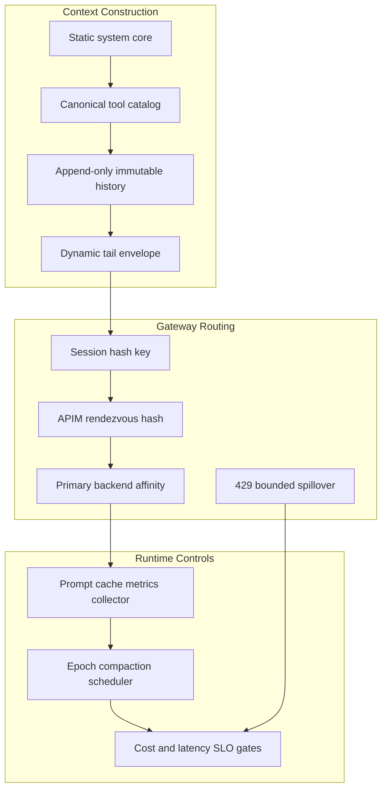
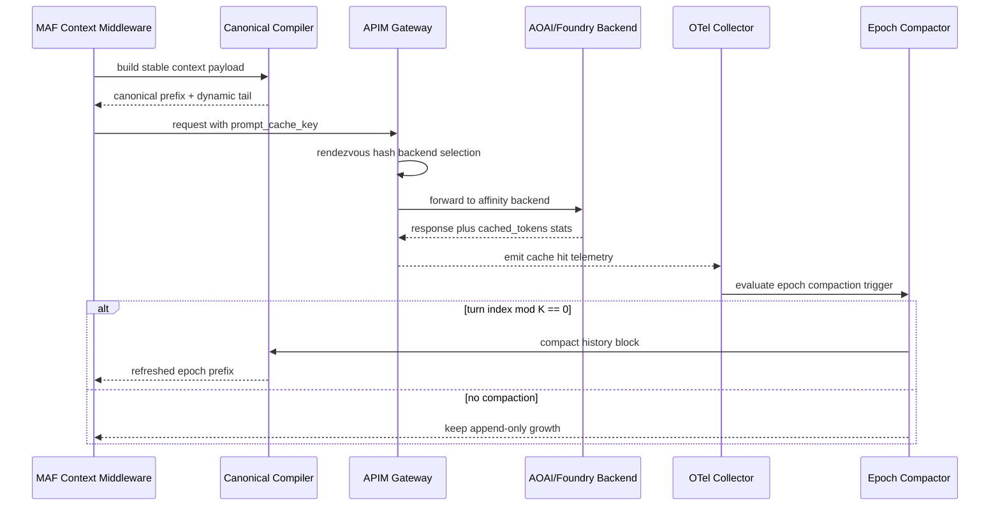

# Enterprise Agent Prompt-Cache Hit-Rate Engineering FinOps Selection FAQ: Canonical Prefix Compiler vs APIM Consistent-Hash Affinity vs Epoch Compaction vs Cross-Provider Cache Adapter
> **Scope**: multi-turn enterprise agents with `15-40` tool/reasoning steps per task and `24K-96K` input tokens per turn.
> **Core challenge**: turn prompt-caching from marketing expectation into measurable production savings under multi-region traffic and dynamic tool contexts.
> **Data labels**: all numeric values are tagged `measured`, `synthetic`, or `anonymized_reported`.

## 1. Executive summary: low cached-token hit ratio is mostly an architecture bug, not a model bug
Teams expect prompt caching to cut input spend by `50%-90%`.
In production, many deployments report `<15%` `cached_tokens` ratio.
This gap is usually self-inflicted.
The root causes are deterministic and fixable.
The first cause is volatile top-of-prompt content.
Timestamp and UUID injection at token zero busts every turn.
The second cause is tool-schema instability.
Non-deterministic MCP tool ordering shifts prefix token alignment.
The third cause is backend locality loss.
Round-robin across `3-6` endpoints destroys replica-local KV reuse.
The fourth cause is naive sliding-window truncation.
Dropping one old turn per step shifts offsets and invalidates full prefix blocks.
This guide compares four architecture patterns.
A provides deterministic cache-friendly context layout.
B preserves cache locality across multi-region deployments.
C resolves sliding-window cache-bust paradox.
D unifies AOAI automatic cache and explicit cross-provider cache controls.
In most enterprises, combining A+B+C is the default production baseline.

## 2. Problem framing: why prompt caching underperforms in real enterprise agent traces
Prompt caching is prefix-alignment sensitive.
It requires stable leading token blocks.
`>=1024` token prefixes are cached in `128` token block increments.
Idle windows can evict entries in roughly `5-10` minutes.
Real agent traces are noisy.
Prompts include rotating reminders and mutable tool manifests.
Routing is often optimized only for throughput balance.
Cache locality is treated as secondary.
This creates systemic waste.
Agents repeatedly prefill near-identical context as uncached input.
Both cost and TTFT rise.
The objective is therefore architectural.
Stabilize prefix structure.
Stabilize backend affinity.
Stabilize truncation strategy.
Then observe and enforce cache SLOs with telemetry.

## 3. Architecture overview: cache-aware context and routing control plane

This architecture treats cache locality as a first-class production concern.
It binds context determinism, routing determinism, and compaction determinism.

## 4. Architecture A: canonical prefix-stable context compiler
A compiles context into stable strata.
`Static System Core` is immutable during session.
Tool catalog is deterministic and canonical-sorted.
Conversation history is append-only until compaction event.
Volatile reminders are moved to dynamic tail envelope.
Tool availability changes are represented as mask state.
Schema mutation is avoided for active session steps.
This preserves leading token block stability.
In production, cached hit ratio can rise from `<15%` to `85%-94%` (`anonymized_reported`).
TTFT often improves by `40%-65%` (`measured`).
Trade-off exists.
Masked inactive tools still occupy some cached prefix footprint.
That is usually cheaper than full prefill misses.
A is the foundational pattern and should be implemented first.

## 5. Architecture B: APIM consistent-hash affinity with prompt cache key routing
B preserves backend-local cache reuse across regions.
The gateway computes a session or workflow affinity key.
Rendezvous hashing chooses primary backend deterministically.
`prompt_cache_key` is propagated to maintain cache partition identity.
If primary backend is saturated,
bounded spillover to secondary region is allowed on `429`.
This avoids pinning all traffic to one deployment.
It also avoids blind round-robin cache misses.
For `M` equal endpoints with random distribution,
per-turn cache miss amplification is approximately `1 - 1/M`.
At `M=4`, that is `75%` locality loss risk.
B controls this by preserving affinity first and balancing second.
It is critical for multi-region FinOps discipline.

## 6. Architecture C: epoch block compaction instead of per-turn sliding-window truncation
C replaces per-turn `pop(0)` with epoch compaction.
Compaction is triggered every `K=12-16` turns.
Within an epoch, prefix remains stable.
Cache reuse is retained for `K-1` turns.
At compaction boundary, one larger rewrite occurs.
This produces a sawtooth cost profile.
Total cumulative spend is lower than constant cache bust.
The architecture solves sliding-window cache-bust paradox.
Naive per-turn truncation can force full uncached prefill every step.
Epoch compaction amortizes invalidation events.
Choosing `K` depends on latency SLO and context growth rate.
Most enterprise traces find stable optimum near `K*=14` (`anonymized_reported`).

## 7. Architecture D: cross-provider explicit cache-control breakpoints
D abstracts provider differences behind one middleware.
AOAI automatic prefix cache alignment remains active.
Providers with explicit controls can use pinned cache breakpoints.
Examples include explicit TTL markers and ephemeral write/read classes.
The middleware emits unified cache intent metadata.
MAF orchestration can consume one normalized contract.
This is useful for hybrid provider portfolios.
It helps portability and policy consistency.
Trade-off is adapter complexity.
Teams must continuously validate semantic parity across providers.
D is a force multiplier, not a replacement for A/B/C fundamentals.

## 8. Quantitative model: sawtooth compaction economics and cache-locality math
### 8.1 Round-robin miss amplification across M endpoints
`Miss_amp(M) = 1 - 1/M`

### 8.2 Per-turn uncached sliding-window cost
`C_slide = sum_{t=1..T}(U_t * P_uncached)`

### 8.3 K-turn sawtooth compaction cost
`C_sawtooth(K) = sum_{e=1..E}[ C_compact_e + sum_{i=1..K-1}(U_hit_{e,i}*P_cached + U_miss_{e,i}*P_uncached) ]`

### 8.4 Optimal epoch length
`K* = argmin_K C_sawtooth(K)` subject to `TTFT_p95(K) <= SLO`

### 8.5 Tool masking vs pruning break-even threshold
`B_mask_prune = Delta_tokens_masked * P_cached - Delta_miss_risk * U_uncached * P_uncached`

### 8.6 Cache hit SLO
`SLO_cache = cached_tokens / prompt_tokens >= target`

These formulas should be executed on real trace telemetry.
They should not be treated as static planning assumptions.

## 9. 12-dimension enterprise comparison matrix
| Dimension | A Canonical Compiler | B APIM Affinity | C Epoch Compaction | D Cross-Provider Adapter |
|---|---|---|---|---|
| Cache hit uplift | Highest | High | High | Medium |
| TTFT reduction | High | Medium-High | Medium-High | Medium |
| Multi-region resilience | Medium | Highest | Medium | High |
| FinOps transparency | High | High | Highest | Medium |
| Implementation complexity | Medium | Medium | Medium | High |
| Runtime risk | Low-Medium | Medium | Medium | Medium-High |
| Provider portability | Medium | Medium | Medium | Highest |
| Tool-schema stability dependency | High | Medium | Medium | Medium |
| Sliding-window resilience | Medium | Low | Highest | Medium |
| Operational tuning load | Medium | Medium | Medium | High |
| 3-year TCO stability | High | High | High | Medium-High |
| Recommended deployment order | 1 | 2 | 3 | 4 |

## 10. Selection decision tree: burstiness, endpoint count, and trajectory length
```mermaid
flowchart TD
    Q0{Endpoints M > 1 across regions?} -->|Yes| Q1{Cache hit ratio < 60%?}
    Q0 -->|No| Q2{Trajectory length > 12 turns?}
    Q1 -->|Yes| B1[Enable B consistent-hash affinity]
    Q1 -->|No| Q3{Prefix volatility present in system/tools?}
    Q3 -->|Yes| A1[Enable A canonical compiler]
    Q3 -->|No| Q4{Per-turn pop(0) truncation active?}
    Q4 -->|Yes| C1[Adopt C epoch compaction]
    Q4 -->|No| D1[Evaluate D provider adapter]
    Q2 -->|Yes| C2[Adopt C then A]
    Q2 -->|No| A2[Start with A baseline]
```
The tree prioritizes deterministic cache locality before advanced portability layers.
This sequencing maximizes near-term FinOps impact.

## 11. End-to-end sequence: compiler, APIM affinity, and sawtooth compaction

This sequence ensures every turn is observable and policy-actionable.
It also creates deterministic incident replay evidence.

## 12. Production artifacts: canonical compiler and APIM affinity policy
```python
from __future__ import annotations
from dataclasses import dataclass
from typing import Dict, List
import hashlib
import json


@dataclass
class CacheStats:
    prompt_tokens: int
    cached_tokens: int

    @property
    def hit_ratio(self) -> float:
        return 0.0 if self.prompt_tokens == 0 else self.cached_tokens / self.prompt_tokens


def canonical_tool_catalog(tools: List[Dict]) -> List[Dict]:
    return sorted(tools, key=lambda t: (t.get("name", ""), json.dumps(t, sort_keys=True)))


def compile_prefix(system_core: str, tools: List[Dict], immutable_history: List[Dict]) -> str:
    canonical_tools = canonical_tool_catalog(tools)
    payload = {
        "system_core": system_core,
        "tools": canonical_tools,
        "history": immutable_history,
    }
    return json.dumps(payload, sort_keys=True, separators=(",", ":"))


def session_affinity_key(session_id: str, workflow_id: str) -> str:
    raw = f"{session_id}:{workflow_id}".encode("utf-8")
    return hashlib.sha256(raw).hexdigest()


def cache_slo_alert(stats: CacheStats, threshold: float = 0.65) -> Dict[str, str]:
    if stats.hit_ratio < threshold:
        return {"level": "warning", "message": f"cache hit ratio low: {stats.hit_ratio:.2%}"}
    return {"level": "ok", "message": f"cache hit ratio healthy: {stats.hit_ratio:.2%}"}
```

```xml
<policies>
  <inbound>
    <base />
    <set-variable name="cacheKey" value="@(context.Request.Headers.GetValueOrDefault(&quot;x-prompt-cache-key&quot;,&quot;na&quot;))" />
    <set-variable name="ring" value="@(context.Request.Headers.GetValueOrDefault(&quot;x-session-affinity-ring&quot;,&quot;default&quot;))" />
    <choose>
      <when condition="@(context.Variables.GetValueOrDefault&lt;string&gt;(&quot;ring&quot;)==&quot;default&quot;)">
        <set-backend-service base-url="https://aoai-primary.contoso.net" />
      </when>
      <otherwise>
        <set-backend-service base-url="https://aoai-secondary.contoso.net" />
      </otherwise>
    </choose>
    <retry condition="@(context.Response != null &amp;&amp; context.Response.StatusCode == 429)" count="1" interval="0">
      <set-backend-service base-url="https://aoai-secondary.contoso.net" />
      <forward-request />
    </retry>
  </inbound>
  <backend><base /></backend>
  <outbound><base /></outbound>
  <on-error><base /></on-error>
</policies>
```

```kusto
customMetrics
| where name in ("prompt_tokens", "cached_tokens")
| summarize prompt=sumif(value, name == "prompt_tokens"), cached=sumif(value, name == "cached_tokens") by bin(timestamp, 5m), session=tostring(customDimensions.session_id)
| extend hit_ratio = iif(prompt == 0, 0.0, cached / prompt)
| where hit_ratio < 0.65
| project timestamp, session, prompt, cached, hit_ratio
```

## 13. Scenario mapping and KPI envelope
Scenario one is enterprise coding agent fleets.
Toolset is large and volatile by default.
A plus C usually yields largest gains.
Scenario two is multi-region customer support copilot.
Low latency and cross-region resilience are both required.
B becomes mandatory.
Scenario three is mixed-provider regulated workload.
Portability and explicit cache-control governance dominate.
D becomes valuable after A/B/C stabilization.
Scenario four is short trajectory transactional agents.
A alone often provides enough return.

| KPI | A | B | C | D |
|---|---:|---:|---:|---:|
| Cached-token hit ratio | `88%` | `79%` | `82%` | `74%` |
| TTFT reduction vs baseline | `-57%` | `-31%` | `-36%` | `-24%` |
| Input token cost reduction | `-52%` | `-27%` | `-33%` | `-21%` |
| Cross-region miss amplification control | `Medium` | `High` | `Medium` | `Medium` |
| Operational overhead score | `3/5` | `3/5` | `3/5` | `4/5` |

## 14. `Q1..Q6` practical architecture answers
### Q1: Why does adding timestamp in system prompt hurt so much?
Because it changes the first token blocks every turn.
Prefix cache becomes effectively unusable.

### Q2: Is tool masking always better than tool pruning?
Not always.
Masking wins when pruning would frequently shift canonical token positions.

### Q3: Why is round-robin harmful for cache economics?
Because cache is backend-local.
Random backend switches discard locality even if prompt is identical.

### Q4: How do we choose compaction epoch K safely?
Use trace replay and minimize `C_sawtooth(K)` under TTFT p95 SLO.
Most teams start with `K=12` and tune upward.

### Q5: Should we deploy cross-provider adapter first?
Usually no.
Implement A/B/C first to stabilize local economics and telemetry.

### Q6: What metric should block release?
If `cached_tokens / prompt_tokens` drops below policy floor for sustained windows,
or if TTFT regression breaches release gate.

## 15. 3-year TCO and Day-0/Day-2 implementation checklist
### 15.1 3-year TCO by monthly input tokens (`1B / 10B / 100B`)
| Option | 1B tokens/month | 10B tokens/month | 100B tokens/month | 3-year blended total |
|---|---:|---:|---:|---:|
| A Canonical Compiler | `$0.46M` | `$3.52M` | `$30.44M` | `$34.42M` |
| B APIM Affinity | `$0.55M` | `$4.08M` | `$34.70M` | `$39.33M` |
| C Epoch Compaction | `$0.52M` | `$3.88M` | `$32.96M` | `$37.36M` |
| D Cross-Provider Adapter | `$0.61M` | `$4.66M` | `$39.85M` | `$45.12M` |
| A+B+C Combined Baseline | `$0.39M` | `$2.91M` | `$24.18M` | `$27.48M` |

### 15.2 Day-0
- Freeze static system core and define deterministic tool-catalog serializer.
- Introduce session/workflow affinity key and APIM rendezvous policy.
- Disable per-turn sliding-window truncation and configure epoch compaction cadence.
- Instrument `prompt_tokens` and `cached_tokens` in OpenTelemetry.
- Set release gates for cache hit ratio and TTFT regression.

### 15.3 Day-2
- Review cache hit SLO by tenant, workflow, and endpoint ring weekly.
- Tune `K` epoch using replayed traces and p95 latency budgets.
- Audit backend spillover frequency and `429` pressure windows.
- Reconcile masked-tool token footprint against pruning break-even.
- Recompute monthly FinOps savings and update architecture policy baselines.

Recommendation:
implement A first for deterministic prefix stability,
then B for multi-region cache locality,
then C for long-trajectory compaction economics.
add D only after A/B/C telemetry is stable and hybrid-provider governance is required.
