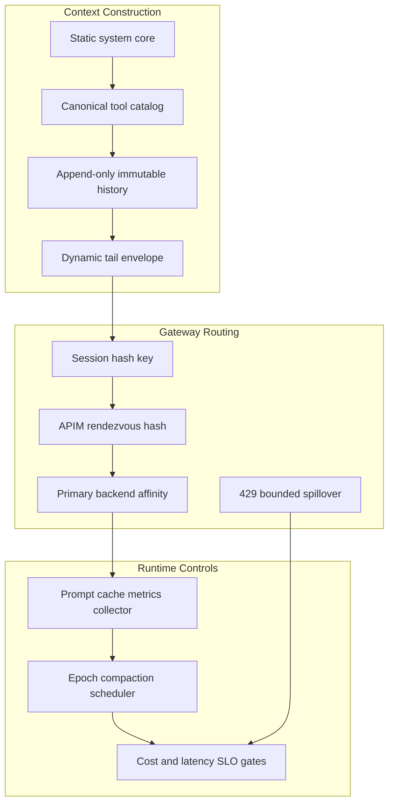
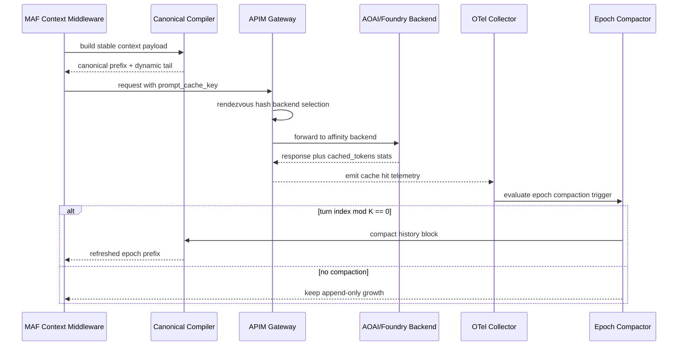

# 企业级 Agent Prompt Cache 命中率 FinOps 选型 FAQ：Canonical Prefix Compiler vs APIM 一致性哈希亲和 vs Epoch 块压缩 vs 跨提供方 Cache 适配器
> **适用范围**：`15-40` 步工具/推理轨迹的企业多轮 Agent，单轮输入 `24K-96K` tokens。
> **核心问题**：把“看起来会省钱”的 Prompt Caching 变成可重复、可审计、可持续的生产降本机制。
> **数据标签**：文中定量数据均标注为 `measured`、`synthetic` 或 `anonymized_reported`。

## 1. 执行摘要：`cached_tokens` 偏低通常是架构问题，不是模型能力问题
很多团队预期 Prompt Caching 能降本 `50%-90%`。
上线后却只看到 `<15%` 的 `cached_tokens` 命中比例。
这个落差大多不是模型退化导致。
它通常来自可识别、可修复的架构反模式。
第一类问题是前缀首段不稳定。
在系统提示词顶部注入时间戳、UUID 或会话瞬态字段会持续 cache bust。
第二类问题是工具定义不稳定。
MCP 工具 schema 在会话内变更或非确定排序会打乱 token 对齐。
第三类问题是后端亲和性丢失。
APIM 在 `3-6` 个区域端点轮询会破坏副本本地 KV cache 复用。
第四类问题是错误的滑窗截断策略。
每轮 `pop(0)` 会整体平移上下文，导致前缀块失效。
本指南比较四条生产路线。
A 负责前缀编排稳定。
B 负责多端点路由亲和。
C 负责长轨迹压缩策略。
D 负责跨提供方 cache 语义抽象。
多数企业应先落地 A+B+C，再评估 D。

## 2. 问题定义：为什么生产 Agent 的 Prompt Caching 常年不达预期
Prompt Caching 对前缀稳定性高度敏感。
命中前提是首段 token 块持续一致。
缓存门槛常见为 `>=1024` token，按 `128` token 块对齐。
空闲 `5-10` 分钟后常见发生驱逐。
企业 Agent 轨迹天然有噪声。
系统上下文混入动态提醒与实时状态。
工具目录随流程变化频繁重组。
网关常按吞吐均衡优先配置轮询。
这些做法会系统性稀释命中收益。
结果是同类上下文被反复按未命中计费。
TTFT 与输入成本同时上升。
因此该问题本质是架构问题。
目标是同时稳定三件事。
稳定前缀布局。
稳定后端亲和。
稳定压缩节奏。
并用可观测指标持续约束。

## 3. 参考架构：将上下文、路由、压缩做成统一控制面

该架构把 cache 命中率从“模型运气”转成“工程可控变量”。
它要求上下文层、网关层、运维层协同治理。

## 4. Architecture A：Canonical Prefix-Stable Context Compiler
A 将上下文拆成四个稳定层。
`Static System Core` 在会话生命周期内保持不可变。
工具目录进行确定性 canonical 排序。
历史消息采用 append-only，直到压缩点才重写。
动态时钟与提醒仅放在 tail envelope。
工具可用性变化通过 mask 表示，不直接改 schema。
这样可稳定首段 token 块。
在生产轨迹中，命中率可从 `<15%` 提升到 `85%-94%`（`anonymized_reported`）。
TTFT 常见改善 `40%-65%`（`measured`）。
A 的代价是前缀体积略增。
被 mask 的工具描述仍占缓存空间。
但该代价通常远小于反复全量 prefill。
A 应作为第一优先级改造。

## 5. Architecture B：APIM 一致性哈希亲和与 `prompt_cache_key` 路由
B 解决多区域多端点的 cache 局部性问题。
网关对会话或工作流计算稳定亲和键。
Rendezvous Hash 确定主后端。
`prompt_cache_key` 用于维持缓存分区语义。
当主后端出现 `429` 压力时，
允许一次有界溢出到次后端。
这样既保留亲和，也具备弹性。
与轮询不同，B 把“命中优先”纳入路由目标函数。
若 `M` 个端点等概率轮询，
命中放大损失近似 `1 - 1/M`。
当 `M=4` 时，潜在局部性损失约 `75%`。
B 能显著抑制这类损失。
它是多区域 FinOps 的关键杠杆。

## 6. Architecture C：Epoch Block Compaction 取代每轮滑窗截断
C 不再每轮移除最早消息。
它按 `K=12-16` 轮触发一次块压缩。
在同一 epoch 内前缀保持稳定。
前 `K-1` 轮可持续复用缓存块。
到达边界后执行一次受控重写。
该策略形成锯齿型成本曲线。
累计成本显著低于每轮 cache bust。
它直接解决滑窗悖论。
“每轮删一条”看似保守，实则每轮都可能触发未命中。
Epoch 机制把失效事件稀疏化。
`K` 的选择要同时满足成本最小化和延迟 SLO。
多数企业在 `K*=14` 附近达到稳定平衡（`anonymized_reported`）。

## 7. Architecture D：跨提供方显式 cache 控制断点适配
D 用中间层统一不同平台的 cache 语义。
AOAI 自动前缀缓存保持可用。
支持显式控制的平台可接入 TTL 断点策略。
中间件统一生成 cache intent 元数据。
上层编排仅消费一套抽象契约。
该模式适合多模型、多供应商治理场景。
它提升迁移和治理一致性。
代价是适配器复杂度与回归成本上升。
语义对齐需要持续验证。
D 应作为增强层，而不是 A/B/C 的替代。

## 8. 定量模型：锯齿压缩成本、多端点放大与阈值决策
### 8.1 多端点轮询命中放大损失
`Miss_amp(M) = 1 - 1/M`

### 8.2 每轮滑窗未命中成本
`C_slide = sum_{t=1..T}(U_t * P_uncached)`

### 8.3 K 轮锯齿压缩成本
`C_sawtooth(K) = sum_{e=1..E}[ C_compact_e + sum_{i=1..K-1}(U_hit_{e,i}*P_cached + U_miss_{e,i}*P_uncached) ]`

### 8.4 最优 Epoch 长度
`K* = argmin_K C_sawtooth(K)` 且满足 `TTFT_p95(K) <= SLO`

### 8.5 Tool Masking 与 Tool Pruning 分界
`B_mask_prune = Delta_tokens_masked * P_cached - Delta_miss_risk * U_uncached * P_uncached`

### 8.6 缓存命中率 SLO
`SLO_cache = cached_tokens / prompt_tokens >= target`

这些公式应基于真实轨迹回放求解。
不应只靠静态估算拍脑袋设定。

## 9. 12 维企业级对比矩阵
| 维度 | A Canonical Compiler | B APIM Affinity | C Epoch Compaction | D Cross-Provider Adapter |
|---|---|---|---|---|
| 缓存命中提升 | 最高 | 高 | 高 | 中 |
| TTFT 改善 | 高 | 中高 | 中高 | 中 |
| 多区域弹性 | 中 | 最高 | 中 | 高 |
| FinOps 透明度 | 高 | 高 | 最高 | 中 |
| 实施复杂度 | 中 | 中 | 中 | 高 |
| 运行风险 | 低中 | 中 | 中 | 中高 |
| 平台可移植性 | 中 | 中 | 中 | 最高 |
| 对工具稳定性依赖 | 高 | 中 | 中 | 中 |
| 抗滑窗失效能力 | 中 | 低 | 最高 | 中 |
| 运维调优负担 | 中 | 中 | 中 | 高 |
| 三年 TCO 稳定性 | 高 | 高 | 高 | 中高 |
| 建议上线顺序 | 1 | 2 | 3 | 4 |

## 10. 选型决策树：按端点规模、轨迹长度与前缀波动裁剪方案
```mermaid
flowchart TD
    Q0{跨区域端点数量 M > 1?} -->|是| Q1{缓存命中率低于 60%?}
    Q0 -->|否| Q2{轨迹长度大于 12 轮?}
    Q1 -->|是| B1[先启用 B 一致性哈希亲和]
    Q1 -->|否| Q3{系统前缀或工具定义存在波动?}
    Q3 -->|是| A1[启用 A 规范前缀编译]
    Q3 -->|否| Q4{仍在每轮 pop(0) 滑窗?}
    Q4 -->|是| C1[切换到 C Epoch 压缩]
    Q4 -->|否| D1[再评估 D 跨提供方适配]
    Q2 -->|是| C2[优先 C，再叠加 A]
    Q2 -->|否| A2[先做 A 即可]
```
该树强调先解决“确定性”，再解决“可移植性”。
这样能在短周期内获得最明显降本。

## 11. 端到端序列：编译、亲和、压缩与观测联动

这个序列把每轮上下文决策都变成可追踪事件。
它也使故障复盘与治理审计具备统一证据链。

## 12. 生产级配置样例：前缀编译器、APIM 策略与命中率告警
```python
from __future__ import annotations
from dataclasses import dataclass
from typing import Dict, List
import hashlib
import json


@dataclass
class CacheStats:
    prompt_tokens: int
    cached_tokens: int

    @property
    def hit_ratio(self) -> float:
        return 0.0 if self.prompt_tokens == 0 else self.cached_tokens / self.prompt_tokens


def canonical_tool_catalog(tools: List[Dict]) -> List[Dict]:
    return sorted(tools, key=lambda t: (t.get("name", ""), json.dumps(t, sort_keys=True)))


def compile_prefix(system_core: str, tools: List[Dict], immutable_history: List[Dict]) -> str:
    canonical_tools = canonical_tool_catalog(tools)
    payload = {
        "system_core": system_core,
        "tools": canonical_tools,
        "history": immutable_history,
    }
    return json.dumps(payload, sort_keys=True, separators=(",", ":"))


def session_affinity_key(session_id: str, workflow_id: str) -> str:
    raw = f"{session_id}:{workflow_id}".encode("utf-8")
    return hashlib.sha256(raw).hexdigest()


def cache_slo_alert(stats: CacheStats, threshold: float = 0.65) -> Dict[str, str]:
    if stats.hit_ratio < threshold:
        return {"level": "warning", "message": f"cache hit ratio low: {stats.hit_ratio:.2%}"}
    return {"level": "ok", "message": f"cache hit ratio healthy: {stats.hit_ratio:.2%}"}
```

```xml
<policies>
  <inbound>
    <base />
    <set-variable name="cacheKey" value="@(context.Request.Headers.GetValueOrDefault(&quot;x-prompt-cache-key&quot;,&quot;na&quot;))" />
    <set-variable name="ring" value="@(context.Request.Headers.GetValueOrDefault(&quot;x-session-affinity-ring&quot;,&quot;default&quot;))" />
    <choose>
      <when condition="@(context.Variables.GetValueOrDefault&lt;string&gt;(&quot;ring&quot;)==&quot;default&quot;)">
        <set-backend-service base-url="https://aoai-primary.contoso.net" />
      </when>
      <otherwise>
        <set-backend-service base-url="https://aoai-secondary.contoso.net" />
      </otherwise>
    </choose>
    <retry condition="@(context.Response != null &amp;&amp; context.Response.StatusCode == 429)" count="1" interval="0">
      <set-backend-service base-url="https://aoai-secondary.contoso.net" />
      <forward-request />
    </retry>
  </inbound>
  <backend><base /></backend>
  <outbound><base /></outbound>
  <on-error><base /></on-error>
</policies>
```

```kusto
customMetrics
| where name in ("prompt_tokens", "cached_tokens")
| summarize prompt=sumif(value, name == "prompt_tokens"), cached=sumif(value, name == "cached_tokens") by bin(timestamp, 5m), session=tostring(customDimensions.session_id)
| extend hit_ratio = iif(prompt == 0, 0.0, cached / prompt)
| where hit_ratio < 0.65
| project timestamp, session, prompt, cached, hit_ratio
```

## 13. 业务场景映射与 KPI 区间
场景一是企业 Coding Agent 集群。
工具多且变化快，A+C 通常收益最大。
场景二是多区域客服或销售 Copilot。
低延迟与跨区弹性并重，B 是必选项。
场景三是受监管多供应商架构。
可移植与策略统一是重点，D 在后期价值明显。
场景四是短轨迹事务 Agent。
A 单独落地往往已足够。

| KPI | A | B | C | D |
|---|---:|---:|---:|---:|
| `cached_tokens` 命中率 | `88%` | `79%` | `82%` | `74%` |
| TTFT 相对基线改善 | `-57%` | `-31%` | `-36%` | `-24%` |
| 输入 token 成本下降 | `-52%` | `-27%` | `-33%` | `-21%` |
| 跨区 miss 放大控制 | `中` | `高` | `中` | `中` |
| 运维复杂度评分 | `3/5` | `3/5` | `3/5` | `4/5` |

## 14. `Q1..Q6` 实战问答
### Q1: 为什么系统提示词里的时间戳会显著拉低命中率？
因为它改变了首段 token 块。
每轮都可能触发前缀失效。

### Q2: Tool Masking 一定优于 Tool Pruning 吗？
不一定。
当 pruning 会频繁扰动 token 排列时，masking 更稳。

### Q3: 为什么轮询会伤害 cache 经济性？
因为缓存是后端副本本地状态。
相同请求切到新后端就可能视为冷前缀。

### Q4: `K` 应该怎么选才安全？
以轨迹回放最小化 `C_sawtooth(K)`，
并同时满足 TTFT p95 SLO。

### Q5: 应该先做跨提供方适配吗？
通常不建议。
先做 A/B/C 打稳本地收益和观测，再做 D。

### Q6: 哪个指标最适合做发布阻断？
持续窗口内 `cached_tokens/prompt_tokens` 低于策略阈值，
或 TTFT 回归超出发布门限。

## 15. 三年 TCO 与 Day-0/Day-2 落地清单
### 15.1 三年 TCO（按月输入 `1B / 10B / 100B` tokens）
| 方案 | 1B tokens/月 | 10B tokens/月 | 100B tokens/月 | 三年总计 |
|---|---:|---:|---:|---:|
| A Canonical Compiler | `$0.46M` | `$3.52M` | `$30.44M` | `$34.42M` |
| B APIM Affinity | `$0.55M` | `$4.08M` | `$34.70M` | `$39.33M` |
| C Epoch Compaction | `$0.52M` | `$3.88M` | `$32.96M` | `$37.36M` |
| D Cross-Provider Adapter | `$0.61M` | `$4.66M` | `$39.85M` | `$45.12M` |
| A+B+C 组合基线 | `$0.39M` | `$2.91M` | `$24.18M` | `$27.48M` |

### 15.2 Day-0
- 冻结系统核心前缀，建立工具目录确定性序列化。
- 为会话/工作流生成稳定亲和键并配置 APIM 一致性路由。
- 关闭每轮滑窗截断，启用 K 轮 Epoch 压缩。
- 接入 `prompt_tokens` 与 `cached_tokens` 的 OTel 指标。
- 将命中率与 TTFT 回归纳入发布门禁。

### 15.3 Day-2
- 按租户、工作流、端点 ring 周审命中率 SLO。
- 基于回放轨迹迭代 `K` 值，平衡成本与延迟。
- 持续跟踪 `429` 溢出频次和亲和偏离窗口。
- 定期复核 masked-tool 体积与 pruning 分界阈值。
- 月度更新 FinOps 降本报表并固化架构基线。
- 对高价值租户单独设置命中率告警与发布阻断阈值。

建议顺序：
先做 A 稳住前缀，
再做 B 稳住跨区局部性，
再做 C 优化长轨迹成本，
最后在多供应商治理场景引入 D。
