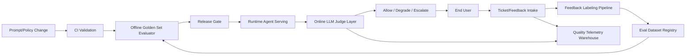

# Enterprise agent quality-gate selection FAQ: offline Golden Set regression vs online LLM Judge guardrails vs production feedback loop vs three-ring integrated governance

> **Audience**: Enterprise Cloud & AI Solution Architects, LLMOps platform owners, business risk teams, service operations, and compliance leaders.  
> **Core question**: During continuous agent releases, which quality-gate architecture best balances regression prevention, live-risk interception, and total governance cost.

## 1. Problem framing: why quality gates are now a control-plane requirement

Many teams rely on manual sampling in PoC,
then discover it does not scale in production.

When agents serve high-volume workloads,
quality governance faces three simultaneous pressures:

- Fast release cadence.
- Growing scenario diversity.
- Stronger audit and compliance obligations.

Typical failure signals include:

- Model upgrades sound smoother,
  but factual accuracy drops.
- Tool chains return no system error,
  yet produce non-executable business outcomes.
- Relaxed safety rules increase short-term pass rate,
  while complaint rates rise weeks later.
- Incidents cannot be traced back to gate version and data basis.

Therefore quality gating is not a testing add-on,
it is part of the release control plane.

## 2. Four enterprise patterns and architecture boundaries

This guide compares four patterns:

- Pattern A: offline `Golden Set` regression gates.
- Pattern B: online `LLM Judge` layered gates.
- Pattern C: production ticket and feedback gates.
- Pattern D: three-ring integrated governance loop.

Evaluate with more than one metric:

- False allow rate.
- False block rate.
- Mean time to detect quality issues.
- Mean time to recover from quality incidents.
- Governance cost per 1,000 requests.

## 3. Pattern A: offline Golden Set regression gates

This pattern uses curated benchmark suites before release.

Core components:

- Scenario-tiered dataset pools.
- Structured scoring rubrics for factuality and compliance.
- Hard release thresholds.
- Historical score trend baselines.

Strengths:

- Repeatable and auditable decisions.
- Strong regression detection before production.
- Clear fit for pre-release go/no-go.

Limitations:

- Coverage gaps for unknown emerging failure modes.
- Dataset maintenance overhead grows with business expansion.
- Slow feedback on real-time drift.

Best fit:

- Regulated release workflows.
- Multi-version canary and staged deployments.

## 4. Pattern B: online LLM Judge layered gates

This pattern runs evaluator models in live request paths,
scoring outputs and routing outcomes by policy.

Key mechanisms:

- Lightweight online judging for consistency and citation quality.
- Secondary review or escalation for high-risk outputs.
- Dynamic threshold tuning and controlled experiments.
- Versioned judging policies and score schemas.

Strengths:

- Fast drift detection in production traffic.
- Short detection latency for risk events.
- Tenant- and scenario-specific governance.

Limitations:

- Additional latency and cost overhead.
- Judge model drift must also be monitored.
- Overly strict thresholds can hurt throughput.

Best fit:

- High-frequency production workloads.
- Environments needing both quality and responsiveness.

## 5. Pattern C: production feedback-loop gating

This pattern treats real-world complaints and corrections as first-class signals.

Core capabilities:

- Standardized ticket taxonomy for quality defects.
- Feedback-to-dataset ingestion and replay pipeline.
- Complaint severity linked to release guardrails.
- Topic clustering and root-cause mining.

Strengths:

- Closest representation of business reality.
- Captures failures that benchmark suites miss.
- Supports durable ROI optimization.

Limitations:

- Noisy labels require strong data governance.
- Signal delay makes it weak as the only first gate.
- Attribution chain design can be non-trivial.

Best fit:

- Mature production platforms at scale.
- Programs aligning quality with customer outcomes.

## 6. Pattern D: three-ring integrated governance (recommended)

Mature enterprises usually converge to a three-ring model:

- Offline ring for pre-release minimum quality baselines.
- Online ring for real-time interception and routing.
- Production ring for evidence-driven iteration.

Coordination logic:

- Offline defines minimum acceptable quality.
- Online blocks immediate risk.
- Production feedback corrects long-term blind spots.

Why this wins:

- Controlled release quality.
- Visible drift and risk posture.
- Sustainable long-horizon improvement.

## 7. Reference architecture: three-ring quality control plane



Architecture implications:

- Keep evaluation datasets independently versioned.
- Link release-gate and runtime-gate lineage explicitly.
- Standardize feedback labels across teams.

## 8. Request lifecycle: pre-release, live, and post-release gating

```mermaid
sequenceDiagram
    participant Dev as Dev Team
    participant CI as CI Pipeline
    participant Off as Offline Evaluator
    participant Gate as Release Gate
    participant Run as Runtime Agent
    participant Judge as Online Judge
    participant User as User
    participant Ticket as Ticket System
    participant Label as Labeling Workflow

    Dev->>CI: commit prompt/policy/model change
    CI->>Off: run golden-set regression
    Off-->>Gate: scorecard + threshold verdict
    alt pass
        Gate->>Run: release candidate
    else fail
        Gate-->>Dev: block release
    end
    Run->>Judge: inference output for live check
    Judge-->>Run: allow/degrade/escalate decision
    Run-->>User: response with trace id
    User->>Ticket: complaint or correction
    Ticket->>Label: structured labeling
    Label-->>Off: dataset update request
```

Lifecycle safeguards:

- Every gate decision must carry version metadata.
- Every ticket must map to request trace IDs.
- Every dataset update must trigger replay validation.

## 9. 12-dimension enterprise comparison matrix

| Dimension | A Offline Golden Set | B Online LLM Judge | C Production Feedback | D Three-Ring Integrated |
|---|---|---|---|---|
| Pre-release regression prevention | Very high | Medium | Low | Very high |
| Live-risk interception | Low | Very high | Medium | Very high |
| Business realism coverage | Medium | High | Very high | Very high |
| Audit traceability | Very high | High | High | Very high |
| False-block tuning headroom | Medium | Medium | High | High |
| False-allow containment | High | Medium | Medium | Very high |
| Latency overhead | Low | Medium | Low | Medium |
| Ops complexity | Medium | Medium to high | Medium | High |
| Data-governance demand | Medium | High | Very high | Very high |
| Cross-team coordination load | Medium | Medium | High | High |
| Scale-out evolution potential | Medium | High | High | Very high |
| Recommended maturity stage | Early release | Production scale | Experience optimization | Mature enterprise |

## 10. Quantitative break-even: detection, recovery, and cost

| Metric | A Offline | B Online | C Feedback | D Three-Ring |
|---|---:|---:|---:|---:|
| False allow rate | 2.9% | 2.4% | 3.1% | 1.3% |
| False block rate | 2.1% | 3.6% | 1.9% | 2.4% |
| Median issue detection latency | 2.8 days | 18 min | 9.5 hours | 14 min |
| Quality incident MTTR | 4.2 days | 2.7 days | 3.4 days | 1.9 days |
| Governance cost / 1k requests | $1.1 | $2.0 | $1.5 | $2.4 |
| Quality-loss cost / 1k requests | $5.8 | $4.9 | $4.6 | $2.7 |

Assumptions:

- 1.5 million requests per day.
- High-risk traffic ratio at 18%.
- Ticket conversion ratio at 0.42%.
- Human review unit economics are tier-weighted.

Break-even observations:

- Below 200k daily requests, A or A+B is often enough.
- Above 500k daily requests, D reduces quality-loss cost sharply.
- Regulated industries usually converge to D earlier.

## 11. Decision tree: route by risk and scale

Question 1:
Do you require mandatory pre-release approval?

- Yes: include A by default.
- No: continue to Question 2.

Question 2:
Do you need minute-level live risk interception?

- Yes: include B.
- No: continue to Question 3.

Question 3:
Do you have a stable ticketing and feedback system?

- Yes: include C with replay integration.
- No: standardize feedback workflow first.

Question 4:
Are multiple teams releasing in parallel every week?

- Yes: D becomes the preferred target architecture.
- No: phase through A+B or A+C.

## 12. Common anti-patterns and corrective actions

Anti-pattern 1:
Treating offline scores as the only source of truth.

Correction:
Correlate offline scores with live judging and ticket evidence.

Anti-pattern 2:
Applying one online threshold across all domains.

Correction:
Use risk-tiered thresholds and controlled exception lists.

Anti-pattern 3:
Allowing free-form ticket labels with no taxonomy.

Correction:
Enforce label dictionaries and quality audits.

Anti-pattern 4:
Fixing incidents in prompts only,
without updating benchmark assets.

Action:
Promote incident cases into Golden Set regression suites.

## 13. Governance operating model and ownership

Recommended four-layer ownership model:

- LLMOps platform: scoring engines, policy runtime, and telemetry.
- Business domain teams: risk definitions and acceptance thresholds.
- Operations teams: feedback quality and taxonomy maintenance.
- Compliance teams: evidence-chain controls and audit mapping.

Operating rules:

- Gate policies must be versioned and replayable.
- Release exemptions require explicit approval records.
- Every quality incident requires replay-based postmortem.

## 14. Five-step rollout guide (Good fit vs Not for)

Step 1: define a unified quality metric dictionary.  
Align factuality, policy compliance, and executability scoring.

Step 2: deploy offline baseline gates first.  
Make each release comparable and blockable.

Step 3: introduce online judge routing.  
Handle high-risk outputs with degrade or escalation paths.

Step 4: close the production feedback ingestion loop.  
Convert real incidents into reusable evaluation assets.

Step 5: run weekly three-ring optimization.  
Tune quality, latency, and cost together.

Good fit:

- Multi-team high-frequency release platforms.
- Regulated sectors with audit-heavy governance.
- Programs with telemetry and ticket foundations in place.

Not for:

- One-off experiments with no sustained operations.
- Small teams lacking feedback capture capabilities.
- Low-risk internal tools without release gating requirements.

## 15. Practical FAQ (8 questions)

**Q1: If offline scores are high, can we skip live gates?**  
A1: No. Live gates are still needed to catch runtime drift.

**Q2: Will online judging add too much latency?**  
A2: It adds overhead, but layered triggering and sampling reduce impact.

**Q3: How do we reduce noisy ticket labels?**  
A3: Standardize taxonomy, enforce templates, and audit sampling quality.

**Q4: What if false blocks are too high?**  
A4: Split thresholds by risk tier and add controlled human-review paths.

**Q5: How do we justify release approvals to auditors?**  
A5: Provide gate versions, thresholds, evidence sets, and approval trails.

**Q6: Is three-ring governance always more expensive?**  
A6: Short-term yes in many cases, long-term usually lower total loss and rework.

**Q7: How do we avoid threshold thrashing week to week?**  
A7: Use fixed tuning windows and a change cool-down policy.

**Q8: When is a full three-ring upgrade mandatory?**  
A8: When release frequency, risk events, and complaints rise together.

