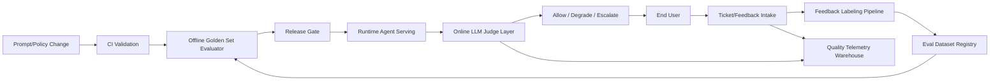

# 企业 Agent 质量门禁选型 FAQ：离线 Golden Set 基准回归 vs 在线 LLM Judge 评审流 vs 生产工单反馈闭环 vs 三环融合治理

> **适用对象**：企业 Cloud & AI Solution Architect、LLMOps 平台团队、业务风控团队、客服运营与质量管理团队。  
> **目标问题**：在持续发布 Agent 能力时，如何同时控制“质量回退、误判拦截、上线风险与治理成本”。

## 1. 问题定义：为什么质量门禁决定 Agent 是否可持续运营

很多团队在 PoC 阶段依赖人工抽查，
上线后才发现该方法无法扩展。

当 Agent 进入高频生产流量，
质量治理会面对三重压力：

- 版本迭代快。
- 业务情境复杂。
- 合规审计严格。

典型失控信号包括：

- 模型升级后答复更“流畅”，
  但事实正确率下降。
- 工具调用链未报错，
  却生成业务不可执行结论。
- 安全策略放宽后短期通过率提升，
  长期投诉率上升。
- 线上问题无法追溯到具体版本与规则。

因此质量门禁不是“测试补丁”，
而是 Agent 平台发布控制面的主干。

## 2. 四类企业方案与能力边界

本文比较四条主路径：

- 方案 A：离线 `Golden Set` 基准回归门禁。
- 方案 B：在线 `LLM Judge` 分层评审门禁。
- 方案 C：生产工单与用户反馈驱动门禁。
- 方案 D：三环融合（离线 + 在线 + 生产）闭环。

评估门禁架构时，
建议同时观察：

- 误放行率（False Allow）。
- 误拦截率（False Block）。
- 质量问题发现时延（MTTD）。
- 质量修复闭环时长（MTTR）。
- 每千请求治理成本。

## 3. 方案 A：离线 Golden Set 基准回归

该方案以高质量样本集为主轴，
在发布前执行标准化回归。

关键构件：

- 场景分层样本池（通用/高风险/长尾）。
- 结构化评分规则（事实性、合规性、格式性）。
- 阈值门禁（未达标禁止上线）。
- 历史分数趋势基线。

优势：

- 可重复、可审计、可比较。
- 对回归退化敏感。
- 适合做发布前硬门槛。

短板：

- 对“新型未知问题”覆盖有限。
- 样本维护成本随业务扩张上升。
- 对实时漂移感知较慢。

适用场景：

- 强监管域上线前审查。
- 多版本并行 A/B 发布前筛选。

## 4. 方案 B：在线 LLM Judge 分层评审

该方案在生产请求链路中，
让评审模型对主模型输出进行打分与分流。

关键机制：

- 轻量在线评审（语义一致性、引用完整性）。
- 高风险输出二次评审或人工升级。
- 阈值动态调整与灰度实验。
- 评审判据版本化。

优势：

- 可快速捕捉线上漂移。
- 发现问题时延短。
- 支持按租户、场景分层策略。

短板：

- 会引入额外时延与成本。
- 评审模型本身也会漂移。
- 过严阈值可能误伤业务吞吐。

适用场景：

- 高频请求场景。
- 质量与时效都重要的生产系统。

## 5. 方案 C：生产工单反馈闭环门禁

该方案以真实用户反馈为事实来源，
将投诉、返工、人工改写等信号纳入质量治理。

关键能力：

- 工单标签标准化（事实错误、流程错误、语气风险）。
- 反馈回灌训练与评测样本池。
- 客诉等级联动发布门禁。
- 质量热点自动聚类与根因分析。

优势：

- 最贴近业务真实痛点。
- 能发现离线集未覆盖问题。
- 有助于持续优化 ROI。

短板：

- 信号噪声大，需治理标签质量。
- 反馈滞后，不适合单独做首道门禁。
- 归因链路建设复杂。

适用场景：

- 已规模化运行的业务平台。
- 需要把质量治理与客户体验联动。

## 6. 方案 D：三环融合闭环（推荐）

企业成熟路径通常是三环协同：

- 离线环：发布前硬性基线。
- 在线环：实时质量分流与防护。
- 生产环：真实反馈驱动迭代。

协同逻辑：

- 离线环定义“最低质量线”。
- 在线环阻断“即时风险”。
- 生产环纠正“长期偏差”。

该模式的价值在于：

- 发布可控。
- 漂移可见。
- 优化可持续。

## 7. 参考架构：质量门禁三环控制平面



架构要点：

- 评测数据集需独立版本管理。
- 发布门禁与运行时门禁要可追溯关联。
- 反馈标签标准必须跨团队统一。

## 8. 请求时序：发布前、发布中、发布后门禁协同

```mermaid
sequenceDiagram
    participant Dev as Dev Team
    participant CI as CI Pipeline
    participant Off as Offline Evaluator
    participant Gate as Release Gate
    participant Run as Runtime Agent
    participant Judge as Online Judge
    participant User as User
    participant Ticket as Ticket System
    participant Label as Labeling Workflow

    Dev->>CI: commit prompt/policy/model change
    CI->>Off: run golden-set regression
    Off-->>Gate: scorecard + threshold verdict
    alt pass
        Gate->>Run: release candidate
    else fail
        Gate-->>Dev: block release
    end
    Run->>Judge: inference output for live check
    Judge-->>Run: allow/degrade/escalate decision
    Run-->>User: response with trace id
    User->>Ticket: complaint or correction
    Ticket->>Label: structured labeling
    Label-->>Off: dataset update request
```

协同原则：

- 每个决策节点都要带版本号。
- 每个工单都要绑定请求追踪号。
- 每次数据集更新都要回放验证。

## 9. 12 维企业级选型对比矩阵

| 维度 | A 离线 Golden Set | B 在线 LLM Judge | C 生产反馈闭环 | D 三环融合 |
|---|---|---|---|---|
| 发布前防回退能力 | 很高 | 中 | 低 | 很高 |
| 实时风险拦截能力 | 低 | 很高 | 中 | 很高 |
| 真实业务贴合度 | 中 | 高 | 很高 | 很高 |
| 门禁可审计性 | 很高 | 高 | 高 | 很高 |
| 误拦截控制空间 | 中 | 中 | 高 | 高 |
| 误放行控制空间 | 高 | 中 | 中 | 很高 |
| 时延影响 | 低 | 中 | 低 | 中 |
| 运维复杂度 | 中 | 中到高 | 中 | 高 |
| 数据治理要求 | 中 | 高 | 很高 | 很高 |
| 组织协同成本 | 中 | 中 | 高 | 高 |
| 规模化演进能力 | 中 | 高 | 高 | 很高 |
| 推荐成熟度阶段 | 起步发布 | 规模运行 | 体验优化 | 企业成熟 |

## 10. 定量对比：误判、发现时延与成本拐点

| 指标 | A 离线 | B 在线 | C 反馈 | D 三环 |
|---|---:|---:|---:|---:|
| 误放行率 | 2.9% | 2.4% | 3.1% | 1.3% |
| 误拦截率 | 2.1% | 3.6% | 1.9% | 2.4% |
| 问题发现中位时延 | 2.8 天 | 18 分钟 | 9.5 小时 | 14 分钟 |
| 质量修复 MTTR | 4.2 天 | 2.7 天 | 3.4 天 | 1.9 天 |
| 每千请求治理成本（美元） | 1.1 | 2.0 | 1.5 | 2.4 |
| 每千请求质量损失成本（美元） | 5.8 | 4.9 | 4.6 | 2.7 |

测算假设：

- 日请求量 150 万。
- 高风险请求占比 18%。
- 客诉工单转化率 0.42%。
- 人工复核单价按分层计入。

拐点结论：

- 日请求量低于 20 万时，
  A 或 A+B 更经济。
- 日请求量 50 万以上时，
  D 的损失成本下降显著。
- 强监管行业通常直接收敛到 D。

## 11. 选型决策树：按风险与规模分流

第一问：
是否有强制上线审查？

- 是：必须引入 A。
- 否：进入第二问。

第二问：
是否需要分钟级风险拦截？

- 是：引入 B。
- 否：进入第三问。

第三问：
是否已形成稳定工单体系？

- 是：引入 C 并打通数据回灌。
- 否：先建设反馈标准化能力。

第四问：
是否达到多团队并行发布阶段？

- 是：采用 D 统一治理。
- 否：可按 A+B 或 A+C 过渡。

## 12. 常见反模式与纠偏

反模式一：
把离线分数当成唯一质量真相。

纠偏方法：
同步观察线上判定与工单证据。

反模式二：
在线评审阈值一刀切，
忽略业务场景差异。

修复方法：
按风险域分层阈值与白名单。

反模式三：
工单标签自由发挥，
无法沉淀训练样本。

治理方法：
建立统一标签字典与审核流程。

反模式四：
发现问题后只修 Prompt，
不更新评测集。

改进方法：
把问题样本固化到 Golden Set。

## 13. 平台治理模型与职责分工

建议采用四层责任模型：

- LLMOps 平台：维护门禁引擎与评分体系。
- 业务团队：定义场景风险与可接受阈值。
- 运营团队：维护工单标签与反馈质量。
- 合规团队：审计门禁证据链。

制度要求：

- 所有门禁规则必须版本化。
- 所有豁免上线都需记录审批。
- 所有质量事故都要回放复盘。

## 14. 五步落地指南（Good fit vs Not for）

步骤 1：建立统一质量指标字典。  
统一事实性、合规性、可执行性评分口径。

步骤 2：先落地离线基线门禁。  
确保每次发布可比较、可阻断。

步骤 3：接入在线评审分流。  
把高风险输出实时导向降级或人工。

步骤 4：打通工单反馈回灌。  
把真实问题转化为评测资产。

步骤 5：形成三环周度优化。  
联动误判、时延、成本做滚动调参。

Good fit：

- 多团队高频发布平台。
- 强审计与质量约束行业。
- 已有观测与工单系统基础。

Not for：

- 一次性短期试验项目。
- 无反馈数据沉淀能力的小团队。
- 不要求发布门禁的低风险内网工具。

## 15. 实战 FAQ（8 问）

**Q1：离线分数高就可以直接上线吗？**  
A1：不建议，仍需在线门禁防漂移。

**Q2：在线 Judge 会不会引入较大时延？**  
A2：会有开销，可通过分层触发与采样优化。

**Q3：工单反馈噪声太大怎么办？**  
A3：先做标签规范与质检抽样，再接入闭环。

**Q4：误拦截过高如何处理？**  
A4：按场景拆分阈值并引入人工复核白名单。

**Q5：如何向审计解释“为何放行”？**  
A5：输出门禁版本、阈值、证据样本与审批记录。

**Q6：三环融合是否一定更贵？**  
A6：短期成本更高，但在大规模下总体更省。

**Q7：如何避免门禁规则频繁震荡？**  
A7：采用周度窗口调参并设置变更冷静期。

**Q8：什么时候必须升级到三环融合？**  
A8：当发布频率、风险和投诉同时上升时。

