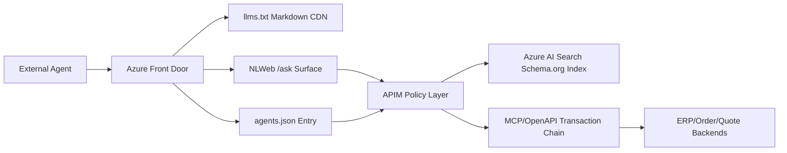
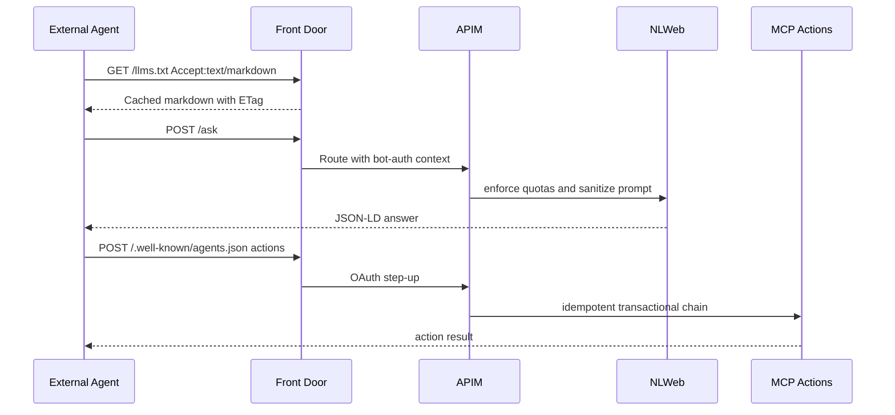

# Enterprise Agent-Ready Web Portal and Catalog Exposure Selection FAQ (NLWeb, llms.txt, and agents.json)

> Topic ID: #453 · Domain: 3.3 AI Gateway, MCP, and Cross-Organization Protocols
> Perspective: Cloud & AI Solution Architect focus on external-agent discovery, controlled exposure, transactional safety, and FinOps.

## 1. Executive summary
- Pattern A is best for dynamic catalogs and conversational retrieval with strong APIM policy controls.
- Pattern B is best for documentation-heavy portals with lowest latency and lowest token cost at the edge.
- Pattern C is mandatory for deterministic state-changing actions with explicit manifest governance.
- Pattern D causes token waste, topology leakage, and backend amplification risk and must be blocked.

## 2. Scope assumptions
- External volume: 1M / 25M / 250M monthly agent requests.
- Goals: low hallucination, controlled exposure, auditable action chains, and scalable governance.
- Data: product catalogs, inventory and pricing feeds, documentation corpora, and transactional APIs.

## 3. Four patterns
- Pattern A: AFD plus APIM plus NLWeb with AI Search Schema.org hybrid index and CDC.
- Pattern B: AFD plus Blob with llms.txt and Accept: text/markdown negotiation.
- Pattern C: agents.json plus API Center plus APIM OAuth2.1 transactional MCP chains.
- Pattern D: forcing heavy JS SPA scraping or raw 1:1 internal OpenAPI exposure.

## 4. 12-dimension matrix
| Dimension | Pattern A | Pattern B | Pattern C | Pattern D |
|---|---|---|---|---|
| Semantic retrieval quality | High | Medium | Medium | Low |
| Transactional capability | Medium | Low | High | Low |
| Token efficiency | Medium-high | High | Medium | Low |
| Edge latency | Medium | High | Medium | Low |
| Governance control | High | High | High | Low |
| Integration complexity | Medium-high | Low | Medium-high | Low with severe risk |
| Security isolation | High | High | Very high | Low |
| Content freshness | High with CDC | Medium-high with CI | Medium | Low |
| Cache hit potential | Medium-high | High | Medium | Low |
| Cost controllability | Medium-high | High | Medium | Low |
| External-agent compatibility | High | High | Medium-high | Low |
| Recommendation | Recommended for dynamic catalogs | Recommended for docs portals | Recommended for transactional workflows | Prohibited |

## 5. Three-tier reference architecture


## 6. Routing and authentication step-up sequence


## 7. Q1-Q6 quantitative Q&A
- Q1: How do HTML DOM, markdown, and Schema.org compare for token efficiency and grounding?
  - Markdown often reduces token footprint by 8-18x versus full DOM, while Schema.org reduces ambiguity and follow-up turns for catalog grounding.
- Q2: How to prevent AFD cache fragmentation and poisoning with Vary: Accept?
  - Include normalized Accept values in cache keys and constrain allowed variants to prevent HTML/markdown confusion.
- Q3: How to protect NLWeb /ask budgets from crawler abuse?
  - Use AFD WAF plus APIM progressive token buckets and dual thresholds for rate and concurrency.
- Q4: How to sanitize user-generated reviews exposed through NLWeb?
  - Apply ingestion-time normalization and output-time schema filters so untrusted strings never become system instructions.
- Q5: When is agents.json required?
  - Whenever workflows mutate state such as RFQ, RMA, provisioning, or entitlement operations.
- Q6: Why avoid 1:1 externalization of internal OpenAPI surfaces?
  - It overwhelms model tool selection, leaks internal topology, and can amplify backend load.

## 8. Production snippets (AFD and APIM)
```bicep
resource fdRule "Microsoft.Cdn/profiles/rulesets/rules@2025-04-15" = {
  name: "accept-markdown-route"
  properties: {
    order: 10
    conditions: [ { name: "RequestHeader" parameters: { selector: "Accept" operator: "Contains" matchValues: ["text/markdown"] } } ]
    actions: [ { name: "UrlRewrite" parameters: { sourcePattern: "/docs/(.*)" destination: "/markdown/{R:1}.md" } }, { name: "ModifyResponseHeader" parameters: { headerAction: "Overwrite" headerName: "Vary" value: "Accept" } } ]
  }
}
```

```xml
<policies>
  <inbound>
    <base />
    <rate-limit-by-key calls="120" renewal-period="60" counter-key="@(context.Request.Headers.GetValueOrDefault("x-agent-id","anon"))" />
    <validate-content unspecified-content-type-action="prevent" max-size="102400" />
  </inbound>
</policies>
```

## 9. Scenario 1: global B2B distributor with 2.4M parts
- Pattern A provides real-time stock and MOQ grounding, while Pattern C handles RFQ and ordering transactions.
- APIM identity tiers expand quotas for authenticated procurement agents and throttle anonymous crawlers.
- The architecture preserves low hallucination rates during promotional spikes.

## 10. Scenario 2: SaaS vendor with 40k developer-doc pages
- Pattern B delivers llms.txt and markdown twins for efficient IDE-agent retrieval.
- Pattern C exposes only curated transactional tools with explicit idempotent flow.
- The result is lower cost, higher cache hit, and controlled action safety.

## 11. Three-year TCO (1M / 25M / 250M monthly requests)
| Scale | Pattern A | Pattern B | Pattern C | Error exposure reference |
|---|---:|---:|---:|---:|
| 1M/mo | $0.62M | $0.28M | $0.74M | $0.19M |
| 25M/mo | $3.40M | $1.55M | $4.20M | $1.10M |
| 250M/mo | $19.6M | $8.90M | $24.7M | $6.60M |

## 12. Day-0 / Day-1 / Day-2 checklist
### Day-0
1. Define external-agent access tiers
2. Map documentation and catalog source-of-truth datasets
3. Define authentication and quota tiers
4. Specify idempotency contracts for actions
5. Standardize observability and audit fields
### Day-1
1. Publish llms.txt and markdown twins
2. Deploy NLWeb and AI Search indexing
3. Enable APIM tiered throttling policies
4. Publish agents.json transactional manifest
5. Run security and performance tests
### Day-2
1. Tune cache keys and hit rates
2. Improve prompt-sanitization policies
3. Review transactional error patterns monthly
4. Tune cost guardrails and quotas
5. Refresh runbook and incident playbooks

## 13. Good fit vs Not for
- Good fit: enterprises requiring both discoverable read surfaces and strictly governed state-changing agent actions.
- Not for: temporary sites lacking source-of-truth datasets, authentication governance, or audit requirements.

## 14. Risks and mitigations
- Risk: Cache-key fragmentation
  - Mitigation: strict Vary policies, progressive throttling, sanitization pipelines, idempotency validation, and abstracted tool surfaces.
- Risk: Anonymous crawler budget exhaustion
  - Mitigation: strict Vary policies, progressive throttling, sanitization pipelines, idempotency validation, and abstracted tool surfaces.
- Risk: Prompt injection from user reviews
  - Mitigation: strict Vary policies, progressive throttling, sanitization pipelines, idempotency validation, and abstracted tool surfaces.
- Risk: Idempotency key misuse
  - Mitigation: strict Vary policies, progressive throttling, sanitization pipelines, idempotency validation, and abstracted tool surfaces.
- Risk: Internal topology disclosure
  - Mitigation: strict Vary policies, progressive throttling, sanitization pipelines, idempotency validation, and abstracted tool surfaces.

## 15. References and retrieval timestamps
- Source: NLWeb project · https://github.com/microsoft/NLWeb · Retrieved: 2026-11-26 (UTC+8)
- Source: Schema.org vocabulary · https://schema.org/ · Retrieved: 2026-11-26 (UTC+8)
- Source: Azure API Management documentation · https://learn.microsoft.com/azure/api-management/ · Retrieved: 2026-11-26 (UTC+8)
- Source: Azure Front Door documentation · https://learn.microsoft.com/azure/frontdoor/ · Retrieved: 2026-11-26 (UTC+8)
- Source: Azure AI Search documentation · https://learn.microsoft.com/azure/search/ · Retrieved: 2026-11-26 (UTC+8)

---

### Appendix A: exposure KPI dictionary
- `markdown_ttfb_p95`: define thresholds, alerts, remediation actions, recovery criteria, and owner.
- `nlweb_ask_qps`: define thresholds, alerts, remediation actions, recovery criteria, and owner.
- `apim_rate_limit_hits`: define thresholds, alerts, remediation actions, recovery criteria, and owner.
- `agent_action_success_rate`: define thresholds, alerts, remediation actions, recovery criteria, and owner.
- `cache_hit_ratio`: define thresholds, alerts, remediation actions, recovery criteria, and owner.
- `prompt_sanitization_block_rate`: define thresholds, alerts, remediation actions, recovery criteria, and owner.

### Appendix B: audit evidence items
- Audit item 01: retain request samples, auth traces, policy versions, action logs, and rollback evidence.
- Audit item 02: retain request samples, auth traces, policy versions, action logs, and rollback evidence.
- Audit item 03: retain request samples, auth traces, policy versions, action logs, and rollback evidence.
- Audit item 04: retain request samples, auth traces, policy versions, action logs, and rollback evidence.
- Audit item 05: retain request samples, auth traces, policy versions, action logs, and rollback evidence.
- Audit item 06: retain request samples, auth traces, policy versions, action logs, and rollback evidence.
- Audit item 07: retain request samples, auth traces, policy versions, action logs, and rollback evidence.
- Audit item 08: retain request samples, auth traces, policy versions, action logs, and rollback evidence.
- Audit item 09: retain request samples, auth traces, policy versions, action logs, and rollback evidence.
- Audit item 10: retain request samples, auth traces, policy versions, action logs, and rollback evidence.
- Audit item 11: retain request samples, auth traces, policy versions, action logs, and rollback evidence.
- Audit item 12: retain request samples, auth traces, policy versions, action logs, and rollback evidence.
- Audit item 13: retain request samples, auth traces, policy versions, action logs, and rollback evidence.
- Audit item 14: retain request samples, auth traces, policy versions, action logs, and rollback evidence.
- Audit item 15: retain request samples, auth traces, policy versions, action logs, and rollback evidence.
- Audit item 16: retain request samples, auth traces, policy versions, action logs, and rollback evidence.
- Audit item 17: retain request samples, auth traces, policy versions, action logs, and rollback evidence.
- Audit item 18: retain request samples, auth traces, policy versions, action logs, and rollback evidence.
- Audit item 19: retain request samples, auth traces, policy versions, action logs, and rollback evidence.
- Audit item 20: retain request samples, auth traces, policy versions, action logs, and rollback evidence.
- Audit item 21: retain request samples, auth traces, policy versions, action logs, and rollback evidence.
- Audit item 22: retain request samples, auth traces, policy versions, action logs, and rollback evidence.
- Audit item 23: retain request samples, auth traces, policy versions, action logs, and rollback evidence.
- Audit item 24: retain request samples, auth traces, policy versions, action logs, and rollback evidence.
- Audit item 25: retain request samples, auth traces, policy versions, action logs, and rollback evidence.
- Audit item 26: retain request samples, auth traces, policy versions, action logs, and rollback evidence.
- Audit item 27: retain request samples, auth traces, policy versions, action logs, and rollback evidence.
- Audit item 28: retain request samples, auth traces, policy versions, action logs, and rollback evidence.
- Audit item 29: retain request samples, auth traces, policy versions, action logs, and rollback evidence.
- Audit item 30: retain request samples, auth traces, policy versions, action logs, and rollback evidence.
- Audit item 31: retain request samples, auth traces, policy versions, action logs, and rollback evidence.
- Audit item 32: retain request samples, auth traces, policy versions, action logs, and rollback evidence.
- Audit item 33: retain request samples, auth traces, policy versions, action logs, and rollback evidence.
- Audit item 34: retain request samples, auth traces, policy versions, action logs, and rollback evidence.
- Audit item 35: retain request samples, auth traces, policy versions, action logs, and rollback evidence.
- Audit item 36: retain request samples, auth traces, policy versions, action logs, and rollback evidence.
- Audit item 37: retain request samples, auth traces, policy versions, action logs, and rollback evidence.
- Audit item 38: retain request samples, auth traces, policy versions, action logs, and rollback evidence.
- Audit item 39: retain request samples, auth traces, policy versions, action logs, and rollback evidence.
- Audit item 40: retain request samples, auth traces, policy versions, action logs, and rollback evidence.
- Audit item 41: retain request samples, auth traces, policy versions, action logs, and rollback evidence.
- Audit item 42: retain request samples, auth traces, policy versions, action logs, and rollback evidence.
- Audit item 43: retain request samples, auth traces, policy versions, action logs, and rollback evidence.
- Audit item 44: retain request samples, auth traces, policy versions, action logs, and rollback evidence.
- Audit item 45: retain request samples, auth traces, policy versions, action logs, and rollback evidence.
- Audit item 46: retain request samples, auth traces, policy versions, action logs, and rollback evidence.
- Audit item 47: retain request samples, auth traces, policy versions, action logs, and rollback evidence.
- Audit item 48: retain request samples, auth traces, policy versions, action logs, and rollback evidence.
- Audit item 49: retain request samples, auth traces, policy versions, action logs, and rollback evidence.
- Audit item 50: retain request samples, auth traces, policy versions, action logs, and rollback evidence.

### Appendix C: extended implementation checkpoints
- Checkpoint 001: validate cache keys, quota policies, sanitization rules, transaction idempotency, index consistency, and FinOps tags.
- Checkpoint 002: validate cache keys, quota policies, sanitization rules, transaction idempotency, index consistency, and FinOps tags.
- Checkpoint 003: validate cache keys, quota policies, sanitization rules, transaction idempotency, index consistency, and FinOps tags.
- Checkpoint 004: validate cache keys, quota policies, sanitization rules, transaction idempotency, index consistency, and FinOps tags.
- Checkpoint 005: validate cache keys, quota policies, sanitization rules, transaction idempotency, index consistency, and FinOps tags.
- Checkpoint 006: validate cache keys, quota policies, sanitization rules, transaction idempotency, index consistency, and FinOps tags.
- Checkpoint 007: validate cache keys, quota policies, sanitization rules, transaction idempotency, index consistency, and FinOps tags.
- Checkpoint 008: validate cache keys, quota policies, sanitization rules, transaction idempotency, index consistency, and FinOps tags.
- Checkpoint 009: validate cache keys, quota policies, sanitization rules, transaction idempotency, index consistency, and FinOps tags.
- Checkpoint 010: validate cache keys, quota policies, sanitization rules, transaction idempotency, index consistency, and FinOps tags.
- Checkpoint 011: validate cache keys, quota policies, sanitization rules, transaction idempotency, index consistency, and FinOps tags.
- Checkpoint 012: validate cache keys, quota policies, sanitization rules, transaction idempotency, index consistency, and FinOps tags.
- Checkpoint 013: validate cache keys, quota policies, sanitization rules, transaction idempotency, index consistency, and FinOps tags.
- Checkpoint 014: validate cache keys, quota policies, sanitization rules, transaction idempotency, index consistency, and FinOps tags.
- Checkpoint 015: validate cache keys, quota policies, sanitization rules, transaction idempotency, index consistency, and FinOps tags.
- Checkpoint 016: validate cache keys, quota policies, sanitization rules, transaction idempotency, index consistency, and FinOps tags.
- Checkpoint 017: validate cache keys, quota policies, sanitization rules, transaction idempotency, index consistency, and FinOps tags.
- Checkpoint 018: validate cache keys, quota policies, sanitization rules, transaction idempotency, index consistency, and FinOps tags.
- Checkpoint 019: validate cache keys, quota policies, sanitization rules, transaction idempotency, index consistency, and FinOps tags.
- Checkpoint 020: validate cache keys, quota policies, sanitization rules, transaction idempotency, index consistency, and FinOps tags.
- Checkpoint 021: validate cache keys, quota policies, sanitization rules, transaction idempotency, index consistency, and FinOps tags.
- Checkpoint 022: validate cache keys, quota policies, sanitization rules, transaction idempotency, index consistency, and FinOps tags.
- Checkpoint 023: validate cache keys, quota policies, sanitization rules, transaction idempotency, index consistency, and FinOps tags.
- Checkpoint 024: validate cache keys, quota policies, sanitization rules, transaction idempotency, index consistency, and FinOps tags.
- Checkpoint 025: validate cache keys, quota policies, sanitization rules, transaction idempotency, index consistency, and FinOps tags.
- Checkpoint 026: validate cache keys, quota policies, sanitization rules, transaction idempotency, index consistency, and FinOps tags.
- Checkpoint 027: validate cache keys, quota policies, sanitization rules, transaction idempotency, index consistency, and FinOps tags.
- Checkpoint 028: validate cache keys, quota policies, sanitization rules, transaction idempotency, index consistency, and FinOps tags.
- Checkpoint 029: validate cache keys, quota policies, sanitization rules, transaction idempotency, index consistency, and FinOps tags.
- Checkpoint 030: validate cache keys, quota policies, sanitization rules, transaction idempotency, index consistency, and FinOps tags.
- Checkpoint 031: validate cache keys, quota policies, sanitization rules, transaction idempotency, index consistency, and FinOps tags.
- Checkpoint 032: validate cache keys, quota policies, sanitization rules, transaction idempotency, index consistency, and FinOps tags.
- Checkpoint 033: validate cache keys, quota policies, sanitization rules, transaction idempotency, index consistency, and FinOps tags.
- Checkpoint 034: validate cache keys, quota policies, sanitization rules, transaction idempotency, index consistency, and FinOps tags.
- Checkpoint 035: validate cache keys, quota policies, sanitization rules, transaction idempotency, index consistency, and FinOps tags.
- Checkpoint 036: validate cache keys, quota policies, sanitization rules, transaction idempotency, index consistency, and FinOps tags.
- Checkpoint 037: validate cache keys, quota policies, sanitization rules, transaction idempotency, index consistency, and FinOps tags.
- Checkpoint 038: validate cache keys, quota policies, sanitization rules, transaction idempotency, index consistency, and FinOps tags.
- Checkpoint 039: validate cache keys, quota policies, sanitization rules, transaction idempotency, index consistency, and FinOps tags.
- Checkpoint 040: validate cache keys, quota policies, sanitization rules, transaction idempotency, index consistency, and FinOps tags.
- Checkpoint 041: validate cache keys, quota policies, sanitization rules, transaction idempotency, index consistency, and FinOps tags.
- Checkpoint 042: validate cache keys, quota policies, sanitization rules, transaction idempotency, index consistency, and FinOps tags.
- Checkpoint 043: validate cache keys, quota policies, sanitization rules, transaction idempotency, index consistency, and FinOps tags.
- Checkpoint 044: validate cache keys, quota policies, sanitization rules, transaction idempotency, index consistency, and FinOps tags.
- Checkpoint 045: validate cache keys, quota policies, sanitization rules, transaction idempotency, index consistency, and FinOps tags.
- Checkpoint 046: validate cache keys, quota policies, sanitization rules, transaction idempotency, index consistency, and FinOps tags.
- Checkpoint 047: validate cache keys, quota policies, sanitization rules, transaction idempotency, index consistency, and FinOps tags.
- Checkpoint 048: validate cache keys, quota policies, sanitization rules, transaction idempotency, index consistency, and FinOps tags.
- Checkpoint 049: validate cache keys, quota policies, sanitization rules, transaction idempotency, index consistency, and FinOps tags.
- Checkpoint 050: validate cache keys, quota policies, sanitization rules, transaction idempotency, index consistency, and FinOps tags.
- Checkpoint 051: validate cache keys, quota policies, sanitization rules, transaction idempotency, index consistency, and FinOps tags.
- Checkpoint 052: validate cache keys, quota policies, sanitization rules, transaction idempotency, index consistency, and FinOps tags.
- Checkpoint 053: validate cache keys, quota policies, sanitization rules, transaction idempotency, index consistency, and FinOps tags.
- Checkpoint 054: validate cache keys, quota policies, sanitization rules, transaction idempotency, index consistency, and FinOps tags.
- Checkpoint 055: validate cache keys, quota policies, sanitization rules, transaction idempotency, index consistency, and FinOps tags.
- Checkpoint 056: validate cache keys, quota policies, sanitization rules, transaction idempotency, index consistency, and FinOps tags.
- Checkpoint 057: validate cache keys, quota policies, sanitization rules, transaction idempotency, index consistency, and FinOps tags.
- Checkpoint 058: validate cache keys, quota policies, sanitization rules, transaction idempotency, index consistency, and FinOps tags.
- Checkpoint 059: validate cache keys, quota policies, sanitization rules, transaction idempotency, index consistency, and FinOps tags.
- Checkpoint 060: validate cache keys, quota policies, sanitization rules, transaction idempotency, index consistency, and FinOps tags.
- Checkpoint 061: validate cache keys, quota policies, sanitization rules, transaction idempotency, index consistency, and FinOps tags.
- Checkpoint 062: validate cache keys, quota policies, sanitization rules, transaction idempotency, index consistency, and FinOps tags.
- Checkpoint 063: validate cache keys, quota policies, sanitization rules, transaction idempotency, index consistency, and FinOps tags.
- Checkpoint 064: validate cache keys, quota policies, sanitization rules, transaction idempotency, index consistency, and FinOps tags.
- Checkpoint 065: validate cache keys, quota policies, sanitization rules, transaction idempotency, index consistency, and FinOps tags.
- Checkpoint 066: validate cache keys, quota policies, sanitization rules, transaction idempotency, index consistency, and FinOps tags.
- Checkpoint 067: validate cache keys, quota policies, sanitization rules, transaction idempotency, index consistency, and FinOps tags.
- Checkpoint 068: validate cache keys, quota policies, sanitization rules, transaction idempotency, index consistency, and FinOps tags.
- Checkpoint 069: validate cache keys, quota policies, sanitization rules, transaction idempotency, index consistency, and FinOps tags.
- Checkpoint 070: validate cache keys, quota policies, sanitization rules, transaction idempotency, index consistency, and FinOps tags.
- Checkpoint 071: validate cache keys, quota policies, sanitization rules, transaction idempotency, index consistency, and FinOps tags.
- Checkpoint 072: validate cache keys, quota policies, sanitization rules, transaction idempotency, index consistency, and FinOps tags.
- Checkpoint 073: validate cache keys, quota policies, sanitization rules, transaction idempotency, index consistency, and FinOps tags.
- Checkpoint 074: validate cache keys, quota policies, sanitization rules, transaction idempotency, index consistency, and FinOps tags.
- Checkpoint 075: validate cache keys, quota policies, sanitization rules, transaction idempotency, index consistency, and FinOps tags.
- Checkpoint 076: validate cache keys, quota policies, sanitization rules, transaction idempotency, index consistency, and FinOps tags.
- Checkpoint 077: validate cache keys, quota policies, sanitization rules, transaction idempotency, index consistency, and FinOps tags.
- Checkpoint 078: validate cache keys, quota policies, sanitization rules, transaction idempotency, index consistency, and FinOps tags.
- Checkpoint 079: validate cache keys, quota policies, sanitization rules, transaction idempotency, index consistency, and FinOps tags.
- Checkpoint 080: validate cache keys, quota policies, sanitization rules, transaction idempotency, index consistency, and FinOps tags.
- Checkpoint 081: validate cache keys, quota policies, sanitization rules, transaction idempotency, index consistency, and FinOps tags.
- Checkpoint 082: validate cache keys, quota policies, sanitization rules, transaction idempotency, index consistency, and FinOps tags.
- Checkpoint 083: validate cache keys, quota policies, sanitization rules, transaction idempotency, index consistency, and FinOps tags.
- Checkpoint 084: validate cache keys, quota policies, sanitization rules, transaction idempotency, index consistency, and FinOps tags.
- Checkpoint 085: validate cache keys, quota policies, sanitization rules, transaction idempotency, index consistency, and FinOps tags.
- Checkpoint 086: validate cache keys, quota policies, sanitization rules, transaction idempotency, index consistency, and FinOps tags.
- Checkpoint 087: validate cache keys, quota policies, sanitization rules, transaction idempotency, index consistency, and FinOps tags.
- Checkpoint 088: validate cache keys, quota policies, sanitization rules, transaction idempotency, index consistency, and FinOps tags.
- Checkpoint 089: validate cache keys, quota policies, sanitization rules, transaction idempotency, index consistency, and FinOps tags.
- Checkpoint 090: validate cache keys, quota policies, sanitization rules, transaction idempotency, index consistency, and FinOps tags.
- Checkpoint 091: validate cache keys, quota policies, sanitization rules, transaction idempotency, index consistency, and FinOps tags.
- Checkpoint 092: validate cache keys, quota policies, sanitization rules, transaction idempotency, index consistency, and FinOps tags.
- Checkpoint 093: validate cache keys, quota policies, sanitization rules, transaction idempotency, index consistency, and FinOps tags.
- Checkpoint 094: validate cache keys, quota policies, sanitization rules, transaction idempotency, index consistency, and FinOps tags.
- Checkpoint 095: validate cache keys, quota policies, sanitization rules, transaction idempotency, index consistency, and FinOps tags.
- Checkpoint 096: validate cache keys, quota policies, sanitization rules, transaction idempotency, index consistency, and FinOps tags.
- Checkpoint 097: validate cache keys, quota policies, sanitization rules, transaction idempotency, index consistency, and FinOps tags.
- Checkpoint 098: validate cache keys, quota policies, sanitization rules, transaction idempotency, index consistency, and FinOps tags.
- Checkpoint 099: validate cache keys, quota policies, sanitization rules, transaction idempotency, index consistency, and FinOps tags.
- Checkpoint 100: validate cache keys, quota policies, sanitization rules, transaction idempotency, index consistency, and FinOps tags.
- Checkpoint 101: validate cache keys, quota policies, sanitization rules, transaction idempotency, index consistency, and FinOps tags.
- Checkpoint 102: validate cache keys, quota policies, sanitization rules, transaction idempotency, index consistency, and FinOps tags.
- Checkpoint 103: validate cache keys, quota policies, sanitization rules, transaction idempotency, index consistency, and FinOps tags.
- Checkpoint 104: validate cache keys, quota policies, sanitization rules, transaction idempotency, index consistency, and FinOps tags.
- Checkpoint 105: validate cache keys, quota policies, sanitization rules, transaction idempotency, index consistency, and FinOps tags.
- Checkpoint 106: validate cache keys, quota policies, sanitization rules, transaction idempotency, index consistency, and FinOps tags.
- Checkpoint 107: validate cache keys, quota policies, sanitization rules, transaction idempotency, index consistency, and FinOps tags.
- Checkpoint 108: validate cache keys, quota policies, sanitization rules, transaction idempotency, index consistency, and FinOps tags.
- Checkpoint 109: validate cache keys, quota policies, sanitization rules, transaction idempotency, index consistency, and FinOps tags.
- Checkpoint 110: validate cache keys, quota policies, sanitization rules, transaction idempotency, index consistency, and FinOps tags.
- Checkpoint 111: validate cache keys, quota policies, sanitization rules, transaction idempotency, index consistency, and FinOps tags.
- Checkpoint 112: validate cache keys, quota policies, sanitization rules, transaction idempotency, index consistency, and FinOps tags.
- Checkpoint 113: validate cache keys, quota policies, sanitization rules, transaction idempotency, index consistency, and FinOps tags.
- Checkpoint 114: validate cache keys, quota policies, sanitization rules, transaction idempotency, index consistency, and FinOps tags.
- Checkpoint 115: validate cache keys, quota policies, sanitization rules, transaction idempotency, index consistency, and FinOps tags.
- Checkpoint 116: validate cache keys, quota policies, sanitization rules, transaction idempotency, index consistency, and FinOps tags.
- Checkpoint 117: validate cache keys, quota policies, sanitization rules, transaction idempotency, index consistency, and FinOps tags.
- Checkpoint 118: validate cache keys, quota policies, sanitization rules, transaction idempotency, index consistency, and FinOps tags.
- Checkpoint 119: validate cache keys, quota policies, sanitization rules, transaction idempotency, index consistency, and FinOps tags.
- Checkpoint 120: validate cache keys, quota policies, sanitization rules, transaction idempotency, index consistency, and FinOps tags.
- Checkpoint 121: validate cache keys, quota policies, sanitization rules, transaction idempotency, index consistency, and FinOps tags.
- Checkpoint 122: validate cache keys, quota policies, sanitization rules, transaction idempotency, index consistency, and FinOps tags.
- Checkpoint 123: validate cache keys, quota policies, sanitization rules, transaction idempotency, index consistency, and FinOps tags.
- Checkpoint 124: validate cache keys, quota policies, sanitization rules, transaction idempotency, index consistency, and FinOps tags.
- Checkpoint 125: validate cache keys, quota policies, sanitization rules, transaction idempotency, index consistency, and FinOps tags.
- Checkpoint 126: validate cache keys, quota policies, sanitization rules, transaction idempotency, index consistency, and FinOps tags.
- Checkpoint 127: validate cache keys, quota policies, sanitization rules, transaction idempotency, index consistency, and FinOps tags.
- Checkpoint 128: validate cache keys, quota policies, sanitization rules, transaction idempotency, index consistency, and FinOps tags.
- Checkpoint 129: validate cache keys, quota policies, sanitization rules, transaction idempotency, index consistency, and FinOps tags.
- Checkpoint 130: validate cache keys, quota policies, sanitization rules, transaction idempotency, index consistency, and FinOps tags.
- Checkpoint 131: validate cache keys, quota policies, sanitization rules, transaction idempotency, index consistency, and FinOps tags.
- Checkpoint 132: validate cache keys, quota policies, sanitization rules, transaction idempotency, index consistency, and FinOps tags.
- Checkpoint 133: validate cache keys, quota policies, sanitization rules, transaction idempotency, index consistency, and FinOps tags.
- Checkpoint 134: validate cache keys, quota policies, sanitization rules, transaction idempotency, index consistency, and FinOps tags.
- Checkpoint 135: validate cache keys, quota policies, sanitization rules, transaction idempotency, index consistency, and FinOps tags.
- Checkpoint 136: validate cache keys, quota policies, sanitization rules, transaction idempotency, index consistency, and FinOps tags.
- Checkpoint 137: validate cache keys, quota policies, sanitization rules, transaction idempotency, index consistency, and FinOps tags.
- Checkpoint 138: validate cache keys, quota policies, sanitization rules, transaction idempotency, index consistency, and FinOps tags.
- Checkpoint 139: validate cache keys, quota policies, sanitization rules, transaction idempotency, index consistency, and FinOps tags.
- Checkpoint 140: validate cache keys, quota policies, sanitization rules, transaction idempotency, index consistency, and FinOps tags.
- Checkpoint 141: validate cache keys, quota policies, sanitization rules, transaction idempotency, index consistency, and FinOps tags.
- Checkpoint 142: validate cache keys, quota policies, sanitization rules, transaction idempotency, index consistency, and FinOps tags.
- Checkpoint 143: validate cache keys, quota policies, sanitization rules, transaction idempotency, index consistency, and FinOps tags.
- Checkpoint 144: validate cache keys, quota policies, sanitization rules, transaction idempotency, index consistency, and FinOps tags.
- Checkpoint 145: validate cache keys, quota policies, sanitization rules, transaction idempotency, index consistency, and FinOps tags.
- Checkpoint 146: validate cache keys, quota policies, sanitization rules, transaction idempotency, index consistency, and FinOps tags.
- Checkpoint 147: validate cache keys, quota policies, sanitization rules, transaction idempotency, index consistency, and FinOps tags.
- Checkpoint 148: validate cache keys, quota policies, sanitization rules, transaction idempotency, index consistency, and FinOps tags.
- Checkpoint 149: validate cache keys, quota policies, sanitization rules, transaction idempotency, index consistency, and FinOps tags.
- Checkpoint 150: validate cache keys, quota policies, sanitization rules, transaction idempotency, index consistency, and FinOps tags.
- Checkpoint 151: validate cache keys, quota policies, sanitization rules, transaction idempotency, index consistency, and FinOps tags.
- Checkpoint 152: validate cache keys, quota policies, sanitization rules, transaction idempotency, index consistency, and FinOps tags.
- Checkpoint 153: validate cache keys, quota policies, sanitization rules, transaction idempotency, index consistency, and FinOps tags.
- Checkpoint 154: validate cache keys, quota policies, sanitization rules, transaction idempotency, index consistency, and FinOps tags.
- Checkpoint 155: validate cache keys, quota policies, sanitization rules, transaction idempotency, index consistency, and FinOps tags.
- Checkpoint 156: validate cache keys, quota policies, sanitization rules, transaction idempotency, index consistency, and FinOps tags.
- Checkpoint 157: validate cache keys, quota policies, sanitization rules, transaction idempotency, index consistency, and FinOps tags.
- Checkpoint 158: validate cache keys, quota policies, sanitization rules, transaction idempotency, index consistency, and FinOps tags.
- Checkpoint 159: validate cache keys, quota policies, sanitization rules, transaction idempotency, index consistency, and FinOps tags.
- Checkpoint 160: validate cache keys, quota policies, sanitization rules, transaction idempotency, index consistency, and FinOps tags.
- Checkpoint 161: validate cache keys, quota policies, sanitization rules, transaction idempotency, index consistency, and FinOps tags.
- Checkpoint 162: validate cache keys, quota policies, sanitization rules, transaction idempotency, index consistency, and FinOps tags.
- Checkpoint 163: validate cache keys, quota policies, sanitization rules, transaction idempotency, index consistency, and FinOps tags.
- Checkpoint 164: validate cache keys, quota policies, sanitization rules, transaction idempotency, index consistency, and FinOps tags.
- Checkpoint 165: validate cache keys, quota policies, sanitization rules, transaction idempotency, index consistency, and FinOps tags.
- Checkpoint 166: validate cache keys, quota policies, sanitization rules, transaction idempotency, index consistency, and FinOps tags.
- Checkpoint 167: validate cache keys, quota policies, sanitization rules, transaction idempotency, index consistency, and FinOps tags.
- Checkpoint 168: validate cache keys, quota policies, sanitization rules, transaction idempotency, index consistency, and FinOps tags.
- Checkpoint 169: validate cache keys, quota policies, sanitization rules, transaction idempotency, index consistency, and FinOps tags.
- Checkpoint 170: validate cache keys, quota policies, sanitization rules, transaction idempotency, index consistency, and FinOps tags.
- Checkpoint 171: validate cache keys, quota policies, sanitization rules, transaction idempotency, index consistency, and FinOps tags.
- Checkpoint 172: validate cache keys, quota policies, sanitization rules, transaction idempotency, index consistency, and FinOps tags.
- Checkpoint 173: validate cache keys, quota policies, sanitization rules, transaction idempotency, index consistency, and FinOps tags.
- Checkpoint 174: validate cache keys, quota policies, sanitization rules, transaction idempotency, index consistency, and FinOps tags.
- Checkpoint 175: validate cache keys, quota policies, sanitization rules, transaction idempotency, index consistency, and FinOps tags.
- Checkpoint 176: validate cache keys, quota policies, sanitization rules, transaction idempotency, index consistency, and FinOps tags.
- Checkpoint 177: validate cache keys, quota policies, sanitization rules, transaction idempotency, index consistency, and FinOps tags.
- Checkpoint 178: validate cache keys, quota policies, sanitization rules, transaction idempotency, index consistency, and FinOps tags.
- Checkpoint 179: validate cache keys, quota policies, sanitization rules, transaction idempotency, index consistency, and FinOps tags.
- Checkpoint 180: validate cache keys, quota policies, sanitization rules, transaction idempotency, index consistency, and FinOps tags.
- Checkpoint 181: validate cache keys, quota policies, sanitization rules, transaction idempotency, index consistency, and FinOps tags.
- Checkpoint 182: validate cache keys, quota policies, sanitization rules, transaction idempotency, index consistency, and FinOps tags.
- Checkpoint 183: validate cache keys, quota policies, sanitization rules, transaction idempotency, index consistency, and FinOps tags.
- Checkpoint 184: validate cache keys, quota policies, sanitization rules, transaction idempotency, index consistency, and FinOps tags.
- Checkpoint 185: validate cache keys, quota policies, sanitization rules, transaction idempotency, index consistency, and FinOps tags.
- Checkpoint 186: validate cache keys, quota policies, sanitization rules, transaction idempotency, index consistency, and FinOps tags.
- Checkpoint 187: validate cache keys, quota policies, sanitization rules, transaction idempotency, index consistency, and FinOps tags.
- Checkpoint 188: validate cache keys, quota policies, sanitization rules, transaction idempotency, index consistency, and FinOps tags.
- Checkpoint 189: validate cache keys, quota policies, sanitization rules, transaction idempotency, index consistency, and FinOps tags.
- Checkpoint 190: validate cache keys, quota policies, sanitization rules, transaction idempotency, index consistency, and FinOps tags.
- Checkpoint 191: validate cache keys, quota policies, sanitization rules, transaction idempotency, index consistency, and FinOps tags.
- Checkpoint 192: validate cache keys, quota policies, sanitization rules, transaction idempotency, index consistency, and FinOps tags.
- Checkpoint 193: validate cache keys, quota policies, sanitization rules, transaction idempotency, index consistency, and FinOps tags.
- Checkpoint 194: validate cache keys, quota policies, sanitization rules, transaction idempotency, index consistency, and FinOps tags.
- Checkpoint 195: validate cache keys, quota policies, sanitization rules, transaction idempotency, index consistency, and FinOps tags.
- Checkpoint 196: validate cache keys, quota policies, sanitization rules, transaction idempotency, index consistency, and FinOps tags.
- Checkpoint 197: validate cache keys, quota policies, sanitization rules, transaction idempotency, index consistency, and FinOps tags.
- Checkpoint 198: validate cache keys, quota policies, sanitization rules, transaction idempotency, index consistency, and FinOps tags.
- Checkpoint 199: validate cache keys, quota policies, sanitization rules, transaction idempotency, index consistency, and FinOps tags.
- Checkpoint 200: validate cache keys, quota policies, sanitization rules, transaction idempotency, index consistency, and FinOps tags.
- Checkpoint 201: validate cache keys, quota policies, sanitization rules, transaction idempotency, index consistency, and FinOps tags.
- Checkpoint 202: validate cache keys, quota policies, sanitization rules, transaction idempotency, index consistency, and FinOps tags.
- Checkpoint 203: validate cache keys, quota policies, sanitization rules, transaction idempotency, index consistency, and FinOps tags.
- Checkpoint 204: validate cache keys, quota policies, sanitization rules, transaction idempotency, index consistency, and FinOps tags.
- Checkpoint 205: validate cache keys, quota policies, sanitization rules, transaction idempotency, index consistency, and FinOps tags.
- Checkpoint 206: validate cache keys, quota policies, sanitization rules, transaction idempotency, index consistency, and FinOps tags.
- Checkpoint 207: validate cache keys, quota policies, sanitization rules, transaction idempotency, index consistency, and FinOps tags.
- Checkpoint 208: validate cache keys, quota policies, sanitization rules, transaction idempotency, index consistency, and FinOps tags.
- Checkpoint 209: validate cache keys, quota policies, sanitization rules, transaction idempotency, index consistency, and FinOps tags.
- Checkpoint 210: validate cache keys, quota policies, sanitization rules, transaction idempotency, index consistency, and FinOps tags.
- Checkpoint 211: validate cache keys, quota policies, sanitization rules, transaction idempotency, index consistency, and FinOps tags.
- Checkpoint 212: validate cache keys, quota policies, sanitization rules, transaction idempotency, index consistency, and FinOps tags.
- Checkpoint 213: validate cache keys, quota policies, sanitization rules, transaction idempotency, index consistency, and FinOps tags.
- Checkpoint 214: validate cache keys, quota policies, sanitization rules, transaction idempotency, index consistency, and FinOps tags.
- Checkpoint 215: validate cache keys, quota policies, sanitization rules, transaction idempotency, index consistency, and FinOps tags.
- Checkpoint 216: validate cache keys, quota policies, sanitization rules, transaction idempotency, index consistency, and FinOps tags.
- Checkpoint 217: validate cache keys, quota policies, sanitization rules, transaction idempotency, index consistency, and FinOps tags.
- Checkpoint 218: validate cache keys, quota policies, sanitization rules, transaction idempotency, index consistency, and FinOps tags.
- Checkpoint 219: validate cache keys, quota policies, sanitization rules, transaction idempotency, index consistency, and FinOps tags.
- Checkpoint 220: validate cache keys, quota policies, sanitization rules, transaction idempotency, index consistency, and FinOps tags.
- Checkpoint 221: validate cache keys, quota policies, sanitization rules, transaction idempotency, index consistency, and FinOps tags.
- Checkpoint 222: validate cache keys, quota policies, sanitization rules, transaction idempotency, index consistency, and FinOps tags.
- Checkpoint 223: validate cache keys, quota policies, sanitization rules, transaction idempotency, index consistency, and FinOps tags.
- Checkpoint 224: validate cache keys, quota policies, sanitization rules, transaction idempotency, index consistency, and FinOps tags.
- Checkpoint 225: validate cache keys, quota policies, sanitization rules, transaction idempotency, index consistency, and FinOps tags.
- Checkpoint 226: validate cache keys, quota policies, sanitization rules, transaction idempotency, index consistency, and FinOps tags.
- Checkpoint 227: validate cache keys, quota policies, sanitization rules, transaction idempotency, index consistency, and FinOps tags.
- Checkpoint 228: validate cache keys, quota policies, sanitization rules, transaction idempotency, index consistency, and FinOps tags.
- Checkpoint 229: validate cache keys, quota policies, sanitization rules, transaction idempotency, index consistency, and FinOps tags.
- Checkpoint 230: validate cache keys, quota policies, sanitization rules, transaction idempotency, index consistency, and FinOps tags.

