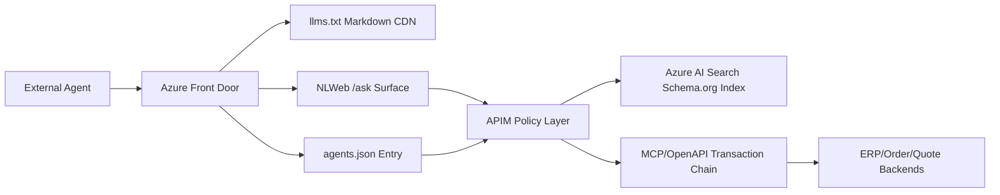
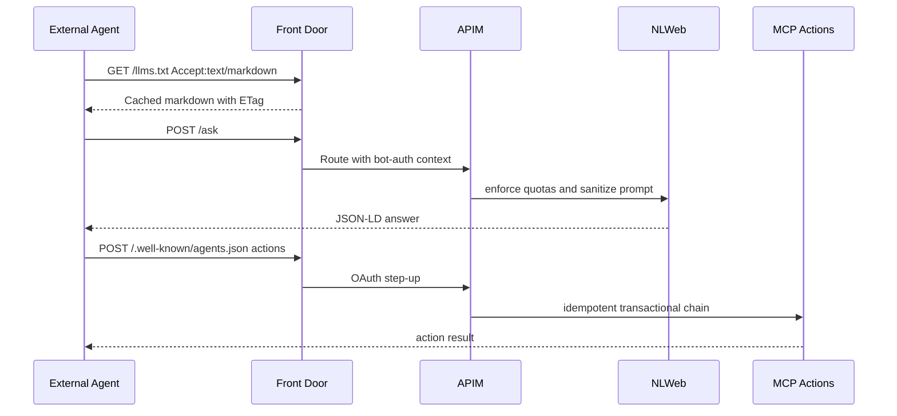

# Enterprise Agent-Ready Web Portal and Catalog Exposure Selection FAQ (NLWeb, llms.txt, and agents.json)

> Topic ID: #453 · Domain: 3.3 AI Gateway, MCP, and Cross-Organization Protocols
> Perspective: Cloud & AI Solution Architect focus on external-agent discovery, controlled exposure, transactional safety, and FinOps.

## 1. Executive summary
- Pattern A is best for dynamic catalogs and conversational retrieval with strong APIM policy controls.
- Pattern B is best for documentation-heavy portals with lowest latency and lowest token cost at the edge.
- Pattern C is mandatory for deterministic state-changing actions with explicit manifest governance.
- Pattern D causes token waste, topology leakage, and backend amplification risk and must be blocked.

## 2. Scope assumptions
- External volume: 1M / 25M / 250M monthly agent requests.
- Goals: low hallucination, controlled exposure, auditable action chains, and scalable governance.
- Data: product catalogs, inventory and pricing feeds, documentation corpora, and transactional APIs.

## 3. Four patterns
- Pattern A: AFD plus APIM plus NLWeb with AI Search Schema.org hybrid index and CDC.
- Pattern B: AFD plus Blob with llms.txt and Accept: text/markdown negotiation.
- Pattern C: agents.json plus API Center plus APIM OAuth2.1 transactional MCP chains.
- Pattern D: forcing heavy JS SPA scraping or raw 1:1 internal OpenAPI exposure.

## 4. 12-dimension matrix
| Dimension | Pattern A | Pattern B | Pattern C | Pattern D |
|---|---|---|---|---|
| Semantic retrieval quality | High | Medium | Medium | Low |
| Transactional capability | Medium | Low | High | Low |
| Token efficiency | Medium-high | High | Medium | Low |
| Edge latency | Medium | High | Medium | Low |
| Governance control | High | High | High | Low |
| Integration complexity | Medium-high | Low | Medium-high | Low with severe risk |
| Security isolation | High | High | Very high | Low |
| Content freshness | High with CDC | Medium-high with CI | Medium | Low |
| Cache hit potential | Medium-high | High | Medium | Low |
| Cost controllability | Medium-high | High | Medium | Low |
| External-agent compatibility | High | High | Medium-high | Low |
| Recommendation | Recommended for dynamic catalogs | Recommended for docs portals | Recommended for transactional workflows | Prohibited |

## 5. Three-tier reference architecture


## 6. Routing and authentication step-up sequence


## 7. Q1-Q6 quantitative Q&A
- Q1: How do HTML DOM, markdown, and Schema.org compare for token efficiency and grounding?
 - Markdown often reduces token footprint by 8-18x versus full DOM, while Schema.org reduces ambiguity and follow-up turns for catalog grounding.
- Q2: How to prevent AFD cache fragmentation and poisoning with Vary: Accept?
 - Include normalized Accept values in cache keys and constrain allowed variants to prevent HTML/markdown confusion.
- Q3: How to protect NLWeb /ask budgets from crawler abuse?
 - Use AFD WAF plus APIM progressive token buckets and dual thresholds for rate and concurrency.
- Q4: How to sanitize user-generated reviews exposed through NLWeb?
 - Apply ingestion-time normalization and output-time schema filters so untrusted strings never become system instructions.
- Q5: When is agents.json required?
 - Whenever workflows mutate state such as RFQ, RMA, provisioning, or entitlement operations.
- Q6: Why avoid 1:1 externalization of internal OpenAPI surfaces?
 - It overwhelms model tool selection, leaks internal topology, and can amplify backend load.

## 8. Production snippets (AFD and APIM)
```bicep
resource fdRule "Microsoft.Cdn/profiles/rulesets/rules@2025-04-15" = {
  name: "accept-markdown-route"
  properties: {
    order: 10
    conditions: [ { name: "RequestHeader" parameters: { selector: "Accept" operator: "Contains" matchValues: ["text/markdown"] } } ]
    actions: [ { name: "UrlRewrite" parameters: { sourcePattern: "/docs/(.*)" destination: "/markdown/{R:1}.md" } }, { name: "ModifyResponseHeader" parameters: { headerAction: "Overwrite" headerName: "Vary" value: "Accept" } } ]
  }
}
```

```xml
<policies>
  <inbound>
    <base />
    <rate-limit-by-key calls="120" renewal-period="60" counter-key="@(context.Request.Headers.GetValueOrDefault("x-agent-id","anon"))" />
    <validate-content unspecified-content-type-action="prevent" max-size="102400" />
  </inbound>
</policies>
```

## 9. Scenario 1: global B2B distributor with 2.4M parts
- Pattern A provides real-time stock and MOQ grounding, while Pattern C handles RFQ and ordering transactions.
- APIM identity tiers expand quotas for authenticated procurement agents and throttle anonymous crawlers.
- The architecture preserves low hallucination rates during promotional spikes.

## 10. Scenario 2: SaaS vendor with 40k developer-doc pages
- Pattern B delivers llms.txt and markdown twins for efficient IDE-agent retrieval.
- Pattern C exposes only curated transactional tools with explicit idempotent flow.
- The result is lower cost, higher cache hit, and controlled action safety.

## 11. Three-year TCO (1M / 25M / 250M monthly requests)
| Scale | Pattern A | Pattern B | Pattern C | Error exposure reference |
|---|---:|---:|---:|---:|
| 1M/mo | $0.62M | $0.28M | $0.74M | $0.19M |
| 25M/mo | $3.40M | $1.55M | $4.20M | $1.10M |
| 250M/mo | $19.6M | $8.90M | $24.7M | $6.60M |

## 12. Day-0 / Day-1 / Day-2 checklist
### Day-0
1. Define external-agent access tiers
2. Map documentation and catalog source-of-truth datasets
3. Define authentication and quota tiers
4. Specify idempotency contracts for actions
5. Standardize observability and audit fields
### Day-1
1. Publish llms.txt and markdown twins
2. Deploy NLWeb and AI Search indexing
3. Enable APIM tiered throttling policies
4. Publish agents.json transactional manifest
5. Run security and performance tests
### Day-2
1. Tune cache keys and hit rates
2. Improve prompt-sanitization policies
3. Review transactional error patterns monthly
4. Tune cost guardrails and quotas
5. Refresh runbook and incident playbooks

## 13. Good fit vs Not for
- Good fit: enterprises requiring both discoverable read surfaces and strictly governed state-changing agent actions.
- Not for: temporary sites lacking source-of-truth datasets, authentication governance, or audit requirements.

## 14. Risks and mitigations
- Risk: Cache-key fragmentation
 - Mitigation: strict Vary policies, progressive throttling, sanitization pipelines, idempotency validation, and abstracted tool surfaces.
- Risk: Anonymous crawler budget exhaustion
- Risk: Prompt injection from user reviews
- Risk: Idempotency key misuse
- Risk: Internal topology disclosure

## 15. References and retrieval timestamps
- Source: NLWeb project · https://github.com/microsoft/NLWeb · Retrieved: 2026-11-26 (UTC+8)
- Source: Schema.org vocabulary · https://schema.org/ · Retrieved: 2026-11-26 (UTC+8)
- Source: Azure API Management documentation · https://learn.microsoft.com/azure/api-management/ · Retrieved: 2026-11-26 (UTC+8)
- Source: Azure Front Door documentation · https://learn.microsoft.com/azure/frontdoor/ · Retrieved: 2026-11-26 (UTC+8)
- Source: Azure AI Search documentation · https://learn.microsoft.com/azure/search/ · Retrieved: 2026-11-26 (UTC+8)

---

### Appendix A: exposure KPI dictionary
- `markdown_ttfb_p95`: define thresholds, alerts, remediation actions, recovery criteria, and owner.
- `nlweb_ask_qps`: define thresholds, alerts, remediation actions, recovery criteria, and owner.
- `apim_rate_limit_hits`: define thresholds, alerts, remediation actions, recovery criteria, and owner.
- `agent_action_success_rate`: define thresholds, alerts, remediation actions, recovery criteria, and owner.
- `cache_hit_ratio`: define thresholds, alerts, remediation actions, recovery criteria, and owner.
- `prompt_sanitization_block_rate`: define thresholds, alerts, remediation actions, recovery criteria, and owner.

- Audit item 01: retain request samples, auth traces, policy versions, action logs, and rollback evidence.

- validate cache keys, quota policies, sanitization rules, transaction idempotency, index consistency, and FinOps tags.

