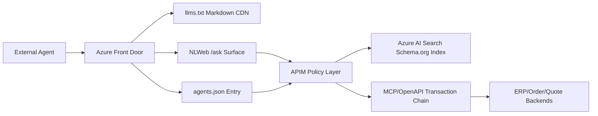
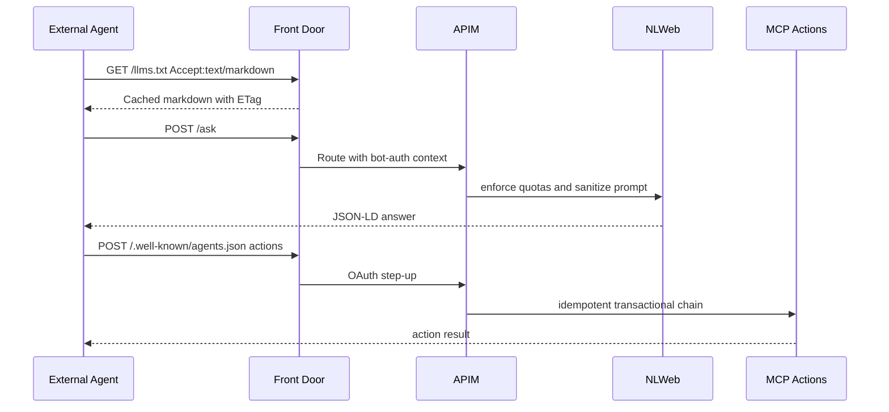

# 企业 Agent-Ready Web 门户与产品目录暴露架构选型 FAQ（NLWeb / llms.txt / agents.json）

> 主题编号：#453 · 架构域：3.3 AI Gateway、MCP 与跨组织协议
> 视角：Cloud & AI Solution Architect，关注外部代理接入、可控暴露面、交易安全与成本。

## 1. 执行摘要
- Pattern A 适合动态目录与对话检索，需结合 APIM 身份分层与预算保护。
- Pattern B 适合文档型场景，边缘 markdown 分发具备最低延迟与最低成本。
- Pattern C 负责事务型动作闭环，避免外部代理回退到脆弱 GUI 抓取。
- Pattern D 会造成 token 浪费、接口泄露与数据库放大风险，应禁止。

## 2. 范围与假设
- 外部请求：1M / 25M / 250M 月请求，含匿名与认证代理。
- 目标：高可用可控暴露、低幻觉、可审计交易链路、可扩展治理。
- 数据：商品目录、库存价格、文档知识库、B2B 交易动作 API。

## 3. 四种模式
- Pattern A：AFD + APIM + NLWeb + AI Search Schema.org 混合索引与 CDC。
- Pattern B：AFD + Blob + llms.txt + Accept: text/markdown 协商。
- Pattern C：agents.json + API Center + APIM OAuth2.1 事务链。
- Pattern D：重 JS SPA 强制入口或内部 OpenAPI 1:1 暴露（反模式）。

## 4. 12 维比较矩阵
| 维度 | Pattern A | Pattern B | Pattern C | Pattern D |
|---|---|---|---|---|
| 语义检索能力 | 高 | 中 | 中 | 低 |
| 事务能力 | 中 | 低 | 高 | 低 |
| token 效率 | 中高 | 高 | 中 | 低 |
| 边缘延迟 | 中 | 高 | 中 | 低 |
| 治理可控 | 高 | 高 | 高 | 低 |
| 接入复杂度 | 中高 | 低 | 中高 | 低（风险高） |
| 安全隔离 | 高 | 高 | 很高 | 低 |
| 文档新鲜度 | 高（CDC） | 中高（CI） | 中 | 低 |
| 缓存命中 | 中高 | 高 | 中 | 低 |
| 成本可控 | 中高 | 高 | 中 | 低 |
| 外部代理兼容 | 高 | 高 | 中高 | 低 |
| 推荐结论 | 推荐（目录场景） | 推荐（文档场景） | 推荐（交易场景） | 禁止 |

## 5. 三层参考架构图


## 6. 外部代理请求路由与鉴权序列


## 7. Q1-Q6 定量问答
- Q1：HTML DOM 与 markdown 与 Schema.org 的 token 效率差异？
 - 在同内容下 markdown 通常比富 DOM 低 8-18 倍 token；Schema.org 结构化响应可进一步减少歧义与补充提问。
- Q2：AFD Vary: Accept 如何避免缓存污染？
 - 将 Accept 纳入缓存键并约束可接受值，避免 HTML/markdown 混淆导致命中错误与响应碎片化。
- Q3：如何保护 NLWeb /ask 的预算？
 - AFD WAF + APIM 渐进式 token bucket（匿名更严、认证更宽）并配合速率与并发双阈值。
- Q4：用户评论中的提示注入如何处理？
 - 进入索引前做清洗与标签化，输出时做结构化过滤，禁止将未净化文本直接注入系统提示。
- Q5：何时需要 agents.json？
 - 一旦涉及下单、报价、RMA、授权等状态变更动作，必须显式动作链与幂等键。
- Q6：为什么反对 1:1 暴露内部 OpenAPI？
 - 外部代理会被工具噪声淹没，且容易泄露内部拓扑与放大后端负载。

## 8. 生产配置片段（AFD + APIM）
```bicep
resource fdRule "Microsoft.Cdn/profiles/rulesets/rules@2025-04-15" = {
  name: "accept-markdown-route"
  properties: {
    order: 10
    conditions: [ { name: "RequestHeader" parameters: { selector: "Accept" operator: "Contains" matchValues: ["text/markdown"] } } ]
    actions: [ { name: "UrlRewrite" parameters: { sourcePattern: "/docs/(.*)" destination: "/markdown/{R:1}.md" } }, { name: "ModifyResponseHeader" parameters: { headerAction: "Overwrite" headerName: "Vary" value: "Accept" } } ]
  }
}
```

```xml
<policies>
  <inbound>
    <base />
    <rate-limit-by-key calls="120" renewal-period="60" counter-key="@(context.Request.Headers.GetValueOrDefault("x-agent-id","anon"))" />
    <validate-content unspecified-content-type-action="prevent" max-size="102400" />
  </inbound>
</policies>
```

## 9. 场景 1：全球工业分销商 240 万 SKU
- 以 Pattern A 提供实时库存/MOQ 语义检索；Pattern C 承接 RFQ/下单流程。
- 通过 APIM 对认证采购代理提升额度，匿名抓取限流。
- 在高峰促销期保持低幻觉与可追踪交易链。

## 10. 场景 2：SaaS 厂商 4 万页开发文档
- 以 Pattern B 输出 llms.txt 与 markdown twin，降低 IDE 代理抓取成本。
- 对需要写操作的场景由 Pattern C 提供受控 MCP 事务。
- 达成高命中、低成本与低耦合升级。

## 11. 三年 TCO（1M / 25M / 250M 月请求）
| 规模 | Pattern A | Pattern B | Pattern C | 错误暴露参考 |
|---|---:|---:|---:|---:|
| 1M/mo | $0.62M | $0.28M | $0.74M | $0.19M |
| 25M/mo | $3.40M | $1.55M | $4.20M | $1.10M |
| 250M/mo | $19.6M | $8.90M | $24.7M | $6.60M |

## 12. Day-0 / Day-1 / Day-2 清单
### Day-0
1. 定义外部代理接入分级
2. 梳理文档与目录数据主源
3. 建立鉴权与配额策略
4. 定义动作链幂等协议
5. 建立观测与审计字段
### Day-1
1. 上线 llms.txt 与 markdown twin
2. 部署 NLWeb + AI Search 索引
3. 上线 APIM 分层限流策略
4. 接入 agents.json 事务清单
5. 完成安全与性能压测
### Day-2
1. 优化缓存键与命中率
2. 优化提示净化规则
3. 按月审计动作链错误
4. 持续调优成本阈值
5. 更新 runbook 与应急流程

## 13. Good fit vs Not for
- Good fit：既要对外可发现，又要对交易动作严格受控的企业门户与目录。
- Not for：无统一数据主源、无鉴权治理、无审计要求的临时站点。

## 14. 风险与缓解
- 风险：缓存键碎片化
 - 缓解：Vary 策略、渐进限流、内容净化、幂等键校验与抽象化工具暴露。
- 风险：匿名爬虫预算耗尽
- 风险：评论内容注入污染
- 风险：动作幂等失效
- 风险：内部拓扑泄露

## 15. 参考来源与时间
- 来源：NLWeb 项目 · https://github.com/microsoft/NLWeb · 抓取时间：2026-11-26（UTC+8）
- 来源：Schema.org 词汇 · https://schema.org/ · 抓取时间：2026-11-26（UTC+8）
- 来源：Azure API Management 文档 · https://learn.microsoft.com/azure/api-management/ · 抓取时间：2026-11-26（UTC+8）
- 来源：Azure Front Door 文档 · https://learn.microsoft.com/azure/frontdoor/ · 抓取时间：2026-11-26（UTC+8）
- 来源：Azure AI Search 文档 · https://learn.microsoft.com/azure/search/ · 抓取时间：2026-11-26（UTC+8）

---

### 附录 A：接入指标字典
- `markdown_ttfb_p95`：记录阈值、告警、处置动作、恢复条件与负责人。
- `nlweb_ask_qps`：记录阈值、告警、处置动作、恢复条件与负责人。
- `apim_rate_limit_hits`：记录阈值、告警、处置动作、恢复条件与负责人。
- `agent_action_success_rate`：记录阈值、告警、处置动作、恢复条件与负责人。
- `cache_hit_ratio`：记录阈值、告警、处置动作、恢复条件与负责人。
- `prompt_sanitization_block_rate`：记录阈值、告警、处置动作、恢复条件与负责人。

- 审计项 01：保留请求样本、鉴权记录、策略版本、动作日志与回滚证据。

- 验证缓存键、配额策略、净化规则、事务幂等、索引一致性与成本标签。

