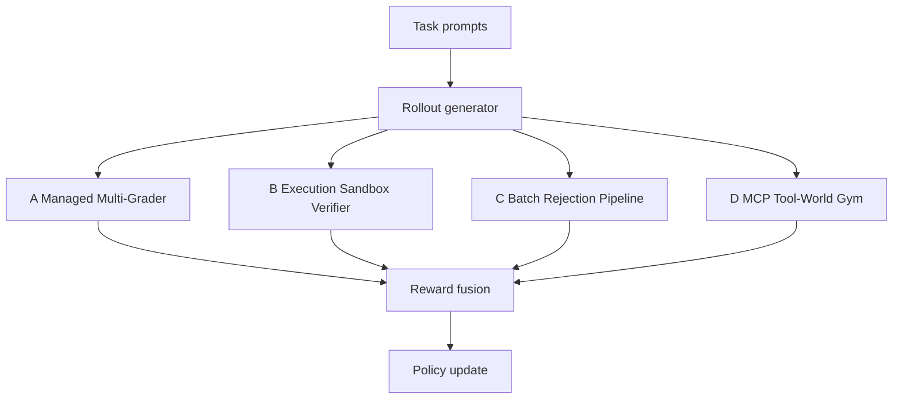
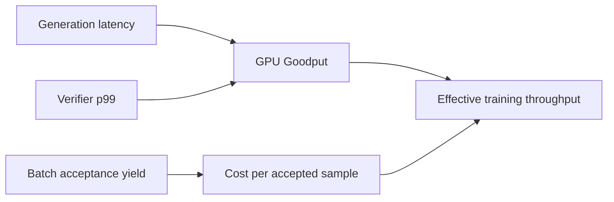
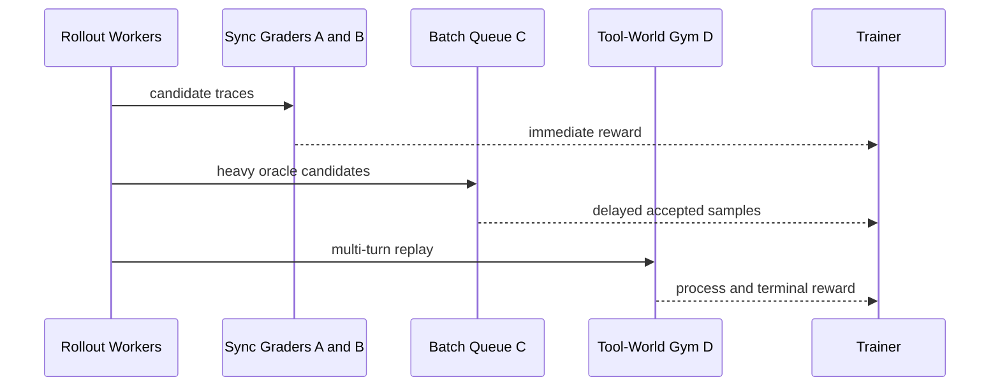

# Enterprise agent RFT/RLVR verifiable-reward grader architecture selection FAQ: Foundry multi-grader vs ACA execution sandbox vs batch rejection sampling

> 🌐 **Language Switch**: [中文](./agent-rft-rlvr-verifiable-grader-architecture-foundry-multi-grader-vs-aca-execution-sandbox-vs-batch-rejection-sampling-selection-faq.md) | **English (current)**
> **Audience**: Cloud & AI Solution Architects, LLMOps, platform engineering, model governance, and security teams.
> **Problem frame**: enterprise NL2SQL, IaC, code synthesis, and ERP tool-calling alignment frequently fails due to rollout stalls, side effects, and reward hacking.

## 1. From #283 platform selection to #330 reward-environment selection

Guide #283 solved where post-training compute should run, while #330 solves how reward signals remain verifiable, reproducible, and resistant to gaming.
The same GPU budget can be wasted rapidly when reward contracts are weak and allow stylistic or verbose outputs to score above invalid executions.
Enterprise losses are not only GPU spend; they include failed release gates, repeated approval loops, and post-incident remediation cycles.
This guide therefore focuses on grader architecture and verifier environments rather than model-size comparisons.

## 2. Four architecture options and operating boundaries

Architecture A uses managed Foundry/AOAI multi-graders to combine string checks, deterministic AST/schema gates, and calibrated judge scores.
Architecture B runs high-concurrency execution verifiers on ACA Dynamic Sessions or AKS Kata warm pools for execution-grounded RLVR.
Architecture C decouples heavy verifiers via asynchronous batch rejection sampling so slow oracles do not stall synchronous GPU loops.
Architecture D builds a deterministic multi-turn MCP tool-world gym with step-level and terminal-diff rewards.

## 3. Reference topology: synchronous and asynchronous reward lanes



The architecture principle is to isolate low-latency deterministic signals from high-cost high-fidelity signals.
Most enterprises begin with A+B for baseline reliability and add C or D where task complexity justifies additional control.

## 4. Architecture A: managed declarative multi-grader with zero gate

A combines `StringCheck`, `PythonGrader`, and `ScoreModelGrader` in one managed reward contract.
The core anti-hacking control is multiplicative zero-gating: `Reward = I(valid_ast_and_policy==1) * (w1*s1 + w2*s2 + w3*s3 - λ*verbosity_penalty)`.
If deterministic validity fails, reward is always zero, preventing style-only or verbosity-only gaming.
A is fast to deploy and operationally light, but less expressive for deep environment-level verification.

## 5. Architecture B: high-concurrency execution verifier pool

B executes `bicep build`, `opa eval`, `z3`, unit tests, and read-only SQL fixtures in isolated warm sandboxes.
At `128–512` concurrent verifiers, rollout evaluation can remain around `P95 < 800ms`, preserving practical RL training cadence.
B is strongest for code, IaC, and query tasks where real execution truth is mandatory.
The tradeoff is higher platform effort across sandbox images, fixture lifecycle, and isolation hardening.

## 6. Architecture C: asynchronous batch rejection sampling and heavy oracles

C removes slow verifiers from synchronous loops by generating candidate sets and filtering them offline using heavy validators.
Typical flow is `Best-of-N` candidate generation followed by acceptance filtering and return into SFT/DPO pipelines.
With Batch API pricing advantages often near `50%`, C can reduce both cost and GPU idle waiting.
Its limitation is delayed reward feedback, so it is best as a complement to synchronous lanes, not a full replacement.

## 7. Architecture D: deterministic multi-turn MCP tool-world gym

D replays `6–15` turn enterprise tool trajectories and scores tool choice, argument schema, invariants, and terminal state diffs.
Redis/Cosmos CoW snapshots preserve replay determinism and prevent environment drift between training iterations.
This is highly effective for long-horizon ERP/ITSM/CRM workflows where sparse terminal rewards are insufficient.
The cost is substantial environment engineering and strong anonymized-trace curation requirements.

## 8. Core formulas: GPU goodput, anti-hacking reward, and batch yield

Synchronous loop efficiency can be approximated by `GPU_Goodput = T_gen_step / (T_gen_step + T_grader_p99)`.
Anti-hacking reward can be modeled as `R = I(valid) * max(0, Σ(w_i*s_i) - λ*len_penalty - μ*style_repeat)`.
Batch rejection economics can be expressed as `Yield = Accepted / (N * Prompts)` and `Cost_per_accept = BatchCost / Accepted`.
All three must be tracked together; optimizing only one often degrades overall training economics or reliability.



## 9. Twelve-dimension quantitative comparison matrix

| Dimension | Architecture A managed multi-grader | Architecture B execution verifier pool | Architecture C async batch filtering | Architecture D tool-world gym |
|---|---|---|---|---|
| Typical verifier concurrency | `64–128` | `128–512` | `1000+` batch jobs | `96–256` multi-turn trajectories |
| Verification latency P95 | `120–320ms` | `350–800ms` | `5–60s` | `450–1200ms` |
| GPU_Goodput range | `0.78–0.91` | `0.62–0.84` | `0.90–0.97` | `0.58–0.80` |
| Reward anti-gaming strength | Medium-high | High | High | High |
| Production side-effect risk | Low | Low | Low | Medium-low |
| Reward feedback timeliness | High | High | Low | Medium |
| Engineering complexity | Medium | High | Medium-high | Very high |
| Task coverage | NL2SQL and IaC baseline | Code and IaC execution-heavy | Slow-oracle dominated tasks | Long-horizon tool workflows |
| Pricing advantage | Standard | Standard | Batch often `~50%` discount | Standard |
| Explainability | High | Very high | High | Very high |
| Operations staffing | `2–4` | `4–7` | `3–6` | `6–10` |
| 3-year TCO at 5K/25K/100K tasks | Medium | Medium-high | Medium-low | High |

## 10. Pipeline orchestration between synchronous and asynchronous lanes



Synchronous rewards should optimize immediate policy updates, while asynchronous rewards should improve sample quality and long-term robustness.
Using separate lanes with explicit fusion weights prevents one lane from destabilizing the entire learning loop.

## 11. Production snippet: Foundry multi-grader reward contract

```json
{
  "reward": {
    "aggregation": "multiplicative_zero_gate",
    "validity_gate": {
      "type": "PythonGrader",
      "expr": "valid_ast_and_policy == 1"
    },
    "graders": [
      {"type":"StringCheck","weight":0.20,"metric":"format_contract"},
      {"type":"PythonGrader","weight":0.45,"metric":"schema_and_ast"},
      {"type":"ScoreModelGrader","weight":0.35,"metric":"task_quality","calibration":"isotonic_v3"}
    ],
    "penalties": {"verbosity_lambda":0.08,"style_repeat_mu":0.12}
  }
}
```

High-risk write actions should force non-overridable deterministic validity gates before any model-judge score contributes.
Reward configuration must be versioned and linked to training snapshots to support deterministic rollback analysis.

## 12. Python execution grader with anti-hacking and state-hash checks

```python
import hashlib

def anti_hack_score(result: dict) -> float:
    valid = int(result['valid_ast'] and result['policy_ok'] and result['tests_passed'])
    base = 0.45 * result['schema_score'] + 0.35 * result['exec_score'] + 0.20 * result['judge_score']
    penalty = 0.08 * result['verbosity_tokens'] + 0.12 * result['style_repeat_ratio']
    return max(0.0, valid * (base - penalty))

def stable_state_hash(world_state: str) -> str:
    return hashlib.sha256(world_state.encode('utf-8')).hexdigest()

def reward_from_execution(result: dict, expected_state_hash: str) -> float:
    if stable_state_hash(result['state_snapshot']) != expected_state_hash:
        return 0.0
    return anti_hack_score(result)
```

Reward quality depends more on deterministic invalidation than on increasing judge-model weights.
State hashes and execution logs should be persisted together so reward anomalies can be replayed exactly.

## 13. Enterprise scenarios and 3-year TCO (5K / 25K / 100K tasks)

Scenario A: a BI engineering team aligns NL2SQL/DAX agents at `5K–25K` task scale and prioritizes prevention of syntax-valid but semantically invalid rewards.
A+B provides fast iteration plus execution truth, reducing manual SQL review load before release gates.
Scenario B: a global operations team aligns ERP multi-step tool-calling agents at `25K–100K` scale with simulation-heavy and policy-heavy verifiers.
C+D handles slow validators and long-horizon trajectories more effectively by separating asynchronous filtering from dense process rewards.

| Architecture path | 5K tasks | 25K tasks | 100K tasks | 3-year total cost | 3-year net value |
|---|---:|---:|---:|---:|---:|
| A managed multi-grader | `$0.42M` | `$1.28M` | `$4.36M` | `$6.06M` | `$7.80M` |
| B execution verifier pool | `$0.55M` | `$1.66M` | `$5.48M` | `$7.69M` | `$8.44M` |
| C batch rejection sampling | `$0.36M` | `$1.02M` | `$3.78M` | `$5.16M` | `$7.12M` |
| D tool-world gym | `$0.63M` | `$1.95M` | `$6.34M` | `$8.92M` | `$8.36M` |
| A+B+C hybrid | `$0.58M` | `$1.54M` | `$4.92M` | `$7.04M` | `$9.68M` |
| A+B+D hybrid | `$0.66M` | `$1.88M` | `$5.96M` | `$8.50M` | `$9.74M` |

## 14. Rollout checklist and Q1-Q6 worked math

### Day-0

1. Define reward contracts and non-negotiable zero-gate semantics.

2. Prepare isolated verifier images and read-only fixture datasets.

3. Separate synchronous and asynchronous reward lanes with explicit fusion weights.

4. Version all grader configurations and replay indices.

5. Set guardrails for GPU goodput and verifier p99 latency.

6. Prepare safe-degradation procedures for verifier incidents.

### Day-1

1. Track `GPU_Goodput`, `T_grader_p99`, reward variance, and batch acceptance yield daily.

2. Sample high-scoring outputs to detect invalid-but-high-score patterns.

3. Monitor cost per accepted sample and drift in acceptance thresholds.

4. Verify state-hash consistency to detect sandbox contamination.

5. Tune verbosity and repetition penalties to suppress stylistic gaming.

6. Align release criteria with business reviewers on acceptable output quality.

### Day-2

1. Rebalance grader weights weekly with controlled A/B runs.

2. Prune low-value high-latency oracle checks monthly.

3. Replay failed trajectories monthly to expand gym transition coverage.

4. Refresh anti-gaming rules quarterly as task distributions shift.

5. Audit reward-config-to-model-version mapping quarterly.

6. Convert incident findings into policy-as-code release gates.

### Q1: How do we calculate synchronous-loop GPU goodput?

With `T_gen_step=420ms` and `T_grader_p99=180ms`, `GPU_Goodput=420/(420+180)=0.70`, meaning 70% effective generation time.

If `T_grader_p99` is reduced to `90ms`, goodput rises to `0.82`, materially improving iteration throughput.

### Q2: How does multiplicative zero-gating stop reward hacking?

When `I(valid)=0`, final reward is forced to zero regardless of judge score magnitude.

That eliminates positive reinforcement for outputs that look polished but violate syntax, schema, or policy constraints.

### Q3: How is batch rejection sampling cost efficiency measured?

If `N=8`, `Prompts=25000`, `Accepted=42000`, and batch cost is `$21000`, then `Cost_per_accept=$0.50`.

Raising acceptance from `21%` to `30%` yields more high-quality samples under the same budget envelope.

### Q4: When should B be prioritized over A?

If correctness depends on real execution outcomes such as IaC compilation, SQL plans, or unit tests, B should take precedence.

If tasks are mostly format and semantic checks, A usually offers faster deployment with lower platform overhead.

### Q5: Why is D necessary for long-horizon workflows?

Long workflows often fail late after early correct steps, and terminal-only rewards produce sparse gradients.

D introduces dense step-level and terminal-diff rewards across `6–15` turns, stabilizing learning signals.

### Q6: What architecture mix is recommended for most enterprises?

Use A as baseline governance, B for execution truth, C for slow expensive oracles, and D for long-horizon tool worlds.

For most enterprises, A+B+C covers the majority of workloads before selective D rollout.

## 15. Good fit vs Not for and runtime alert dictionary

Good fit: enterprises that require verifiable reward contracts for execution-sensitive tasks and need robust anti-gaming controls.
Not for: lightweight static text tasks without execution side effects, tool calls, or long-horizon state transitions.

| Alert key | Trigger condition | Immediate action | Owner |
|---|---|---|---|
| `grader_p99_spike` | `T_grader_p99` exceeds threshold persistently | enable degraded scoring and scale verifier pool | Platform Engineering |
| `reward_hacking_signal` | invalid outputs receive high scores | increase zero-gate strictness and run manual review | Model Governance |
| `sandbox_state_drift` | state-hash mismatch rate rises | pause training and reset fixtures | Training SRE |
| `batch_yield_drop` | acceptance yield below target | retune sampling temperature and acceptance threshold | LLMOps |
| `gpu_goodput_drop` | sustained decline in `GPU_Goodput` | move slow verifiers to async lane | Training Platform |
| `policy_zero_gate_bypass` | invalid outputs bypass gate | lock config version and rollback | Security Engineering |
| `oracle_timeout_burst` | heavy oracle timeout burst | shard retries and throttle expensive checks | Data Platform |
| `promotion_regression_risk` | release regression rate exceeds limit | stop promotion and trigger red-team evaluation | Release Management |

Program governance should treat reward reliability as a first-class KPI instead of optimizing only throughput and headline accuracy.
If reward reliability is weak, hidden failure modes will move from training into production and amplify downstream remediation cost.

### Suggested quarterly threshold bands

| Metric | Recommended band | Escalation trigger |
|---|---|---|
| `GPU_Goodput` | `>=0.75` | below `0.68` for 3 consecutive days |
| Invalid outputs with positive reward | `<=0.5%` | above `1.5%` on any day |
| Batch acceptance rate | `18%–35%` | below `15%` for 2 weeks |
| Train-to-release cycle time | `<=72h` | any batch above `120h` |
| Post-release regression rate | `<=2.0%` | any release above `3.5%` |

Thresholds should be recalibrated by task complexity and risk tier rather than treated as static constants.
For highly regulated workloads, sacrificing some throughput for stronger determinism is typically the correct tradeoff.

### Risk-tier rollout recommendations

| Risk tier | Training strategy | Reward strategy | Release gate |
|---|---|---|---|
| High | A+B+D dominant | non-degradable zero gate | dual approval plus red-team replay |
| Medium | A+B+C combined | strict thresholds with sampled review | single approval plus automated regression |
| Low | A or A+C | lightweight deterministic gate | automated release with monitored rollback |

Risk-tiering avoids applying the same high-cost verifier path to every task and concentrates budget on high-impact workflows.
Teams should re-evaluate tier mapping quarterly so governance remains aligned with business and model-scope changes.

For cross-region regulated workloads, tie risk tiers to data-sovereignty labels so training samples never drift into non-compliant environments.

### References (retrieved: 2026-11-24)

1. Azure OpenAI fine-tuning and RFT docs: https://learn.microsoft.com/azure/ai-services/openai/how-to/fine-tuning

2. Azure Container Apps sessions: https://learn.microsoft.com/azure/container-apps/sessions

3. Azure OpenAI Batch API: https://learn.microsoft.com/azure/ai-services/openai/how-to/batch

4. OPA policy evaluation: https://www.openpolicyagent.org/docs/latest/

5. Z3 theorem prover guide: https://microsoft.github.io/z3guide/

These references anchor verifiable reward-environment controls and execution-verifier practices.
Thresholds should be calibrated to task distribution, risk tier, and rollout economics in each enterprise.
