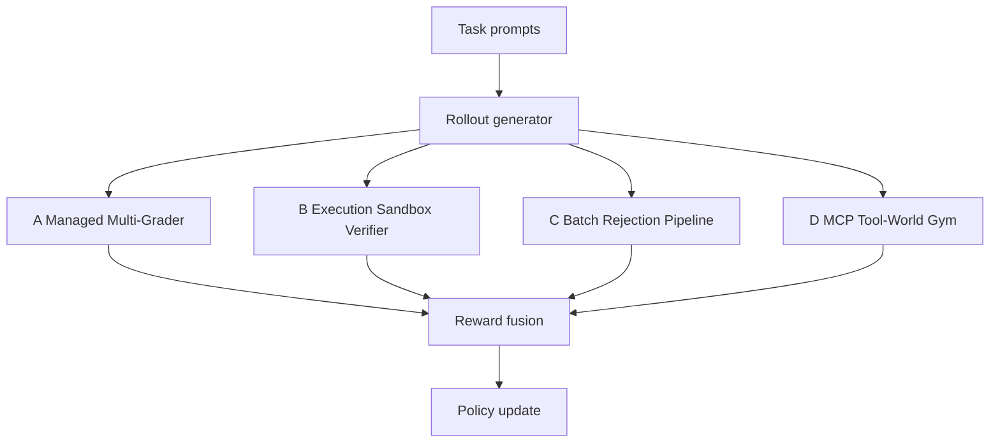
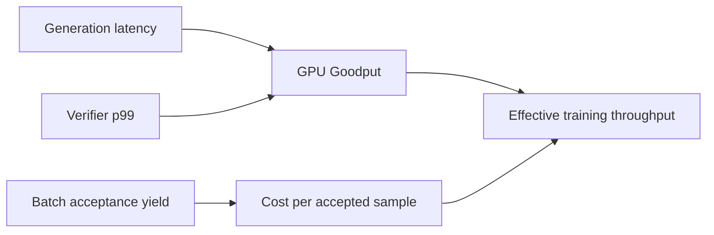
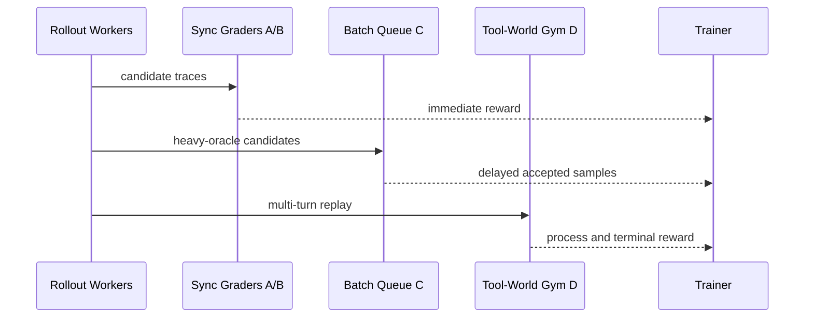

# 企业 Agent RFT/RLVR 可验证奖励 Grader 架构选型 FAQ：Foundry 多 Grader vs ACA 执行沙箱 vs Batch 拒绝采样

> 🌐 **Language Switch**：**中文（当前）** | [English](./agent-rft-rlvr-verifiable-grader-architecture-foundry-multi-grader-vs-aca-execution-sandbox-vs-batch-rejection-sampling-selection-faq.en.md)
> **适用对象**：Cloud & AI Solution Architect、LLMOps、平台工程、模型治理与安全团队。
> **问题背景**：在 NL2SQL、IaC、代码生成与 ERP 工具调用训练中，企业常遇到 GPU rollout 堵塞、生产副作用和 LLM-judge 奖励投机。

## 1. 从 #283 平台选型到 #330 奖励环境选型：决策重心为何变化

#283 已解决“训练平台在哪里跑”的问题，而 #330 解决“奖励如何可信、可复现、不可投机”的核心问题。
同样的训练算力，在不可靠奖励体系下会快速消耗在无效探索上，甚至把模型推向能骗分但不可用的行为模式。
企业真正损失不只在 GPU 账单，还包括上线回归失败、审批重跑和生产事故复盘成本。
因此本篇聚焦 Grader 架构、执行验证环境与反奖励投机机制，而不是单纯比较模型参数规模。

## 2. 四类架构与边界条件

架构 A 采用 Foundry/AOAI 托管多 Grader 组合，把字符串规则、AST/Schema 校验和裁判模型分数并联到统一奖励契约。
架构 B 通过 ACA Dynamic Sessions 或 AKS Kata 暖池做高并发执行验证，把真实单元测试和状态哈希验证接入 RLVR。
架构 C 将重验证器迁移到 Batch 异步离线通道，以 `Best-of-N` 拒绝采样规避同步循环中的 GPU 空等。
架构 D 构建多轮 MCP 工具世界 Gym，以步骤奖励 + 终局状态差异奖励缓解长链任务稀疏奖励问题。

## 3. 总体参考架构：同步奖励与异步奖励双轨



双轨设计关键在于把“低延迟可判定信号”与“高精度高成本信号”拆开，避免任何一方成为系统瓶颈。
企业可先上线 A+B 保证基线可信，再按任务复杂度引入 C 或 D 提升对齐质量。

## 4. 架构 A：Foundry 托管多 Grader 乘法零闸门

A 适合快速落地，使用 `StringCheck`、`PythonGrader` 和 `ScoreModelGrader` 组合成声明式评分图。
核心策略是乘法零闸门：`Reward = I(valid_ast_and_policy==1) * (w1*s1 + w2*s2 + w3*s3 - λ*verbosity_penalty)`。
只要 AST、Schema 或策略不合法，`I` 立即置零，杜绝通过文风或冗长解释骗分。
A 对团队友好，几乎不需要自建训练控制面，但在超复杂执行环境验证上深度有限。

## 5. 架构 B：高并发执行验证暖池

B 把 `bicep build`、`opa eval`、`z3`、单元测试和只读数据库夹具放入可重置沙箱，做执行真值奖励。
在 `128–512` 并发暖池配置下，可把 rollout 验证维持在 `P95 < 800ms`，显著降低训练 GPU 等待时间。
该路径适合代码、IaC 与数据查询任务，奖励信号与真实执行结果一致，抗幻觉能力最强。
但 B 需要对镜像、夹具和沙箱逃逸面长期维护，平台工程投入高于 A。

## 6. 架构 C：Batch 拒绝采样 + 重型 Oracle 离线筛选

C 把慢验证器从同步 RL 循环剥离，先批量生成候选，再由仓库级 SQL 计划器、仿真器或多人评审筛选。
典型流程是 `Best-of-N` + 接受阈值过滤，再回灌到 SFT/DPO 数据集做稳定迭代。
由于 Batch API 常有约 `50%` 定价优势，且不阻塞在线训练 GPU，C 在高成本验证场景性价比突出。
代价是反馈延迟较大，不适合依赖即时奖励的策略梯度场景。

## 7. 架构 D：多轮 MCP 工具世界 Gym

D 在 AKS Ray 上重放 `6–15` 步企业任务轨迹，步骤级验证 `tool_choice`、参数模式、不变量守卫和终局状态差异。
通过 Redis/Cosmos CoW 快照保持状态可回溯，避免多轮训练中环境漂移导致奖励不稳定。
D 对长链 ERP/ITSM/CRM 自动化尤其有效，可显著减少“前几步正确、末步破坏状态”的隐藏失败。
挑战在于环境建模复杂，且需要高质量匿名真实轨迹作为种子数据。

## 8. 关键公式：GPU 好吞吐、反投机奖励与 Batch 产率

同步回路好吞吐可用 `GPU_Goodput = T_gen_step / (T_gen_step + T_grader_p99)` 估算，`T_grader_p99` 越高，训练有效吞吐越低。
反投机乘法奖励可写为 `R = I(valid) * max(0, Σ(w_i*s_i) - λ*len_penalty - μ*style_repeat)`，硬性无效输出永远拿不到正分。
拒绝采样产率可写为 `Yield = Accepted / (N * Prompts)`，批处理单位成本为 `Cost_per_accept = BatchCost / Accepted`。
工程上应把三条公式同时上报，避免仅优化准确率却忽视 GPU 空转和成本劣化。



## 9. 12 维定量对比矩阵

| 维度 | 架构 A 托管多 Grader | 架构 B 执行验证暖池 | 架构 C 离线拒绝采样 | 架构 D 工具世界 Gym |
|---|---|---|---|---|
| 典型并发验证能力 | `64–128` | `128–512` | `1000+` 批任务 | `96–256` 多步轨迹 |
| 验证延迟 P95 | `120–320ms` | `350–800ms` | `5–60s` | `450–1200ms` |
| GPU_Goodput 区间 | `0.78–0.91` | `0.62–0.84` | `0.90–0.97` | `0.58–0.80` |
| 奖励抗投机能力 | 中高（乘法门禁） | 高（执行真值） | 高（重筛选） | 高（过程+终局） |
| 生产副作用风险 | 低 | 低 | 低 | 中低 |
| 训练反馈时效 | 高 | 高 | 低 | 中 |
| 工程复杂度 | 中 | 高 | 中高 | 很高 |
| 任务覆盖面 | NL2SQL/IaC 基线 | 代码/IaC 强验证 | 慢 Oracle 场景 | 长链工具调用 |
| 计费优势 | 标准 | 标准 | Batch 约 `50%` 优惠 | 标准 |
| 可解释性 | 高 | 很高 | 高 | 很高 |
| 运维人力需求 | `2–4` 人 | `4–7` 人 | `3–6` 人 | `6–10` 人 |
| 5K/25K/100K 任务三年 TCO | 中 | 中高 | 中低 | 高 |

## 10. 流水线编排：同步与异步回路协同



建议把同步奖励用于“快反馈训练步”，把异步奖励用于“高价值样本增广”，两者使用不同权重进入同一奖励融合层。
这样可以保证训练稳定性，同时利用慢验证器提供的高置信信号。

## 11. 生产配置片段：Foundry 多 Grader JSON 契约

```json
{
  "reward": {
    "aggregation": "multiplicative_zero_gate",
    "validity_gate": {
      "type": "PythonGrader",
      "expr": "valid_ast_and_policy == 1"
    },
    "graders": [
      {"type":"StringCheck","weight":0.20,"metric":"format_contract"},
      {"type":"PythonGrader","weight":0.45,"metric":"schema_and_ast"},
      {"type":"ScoreModelGrader","weight":0.35,"metric":"task_quality","calibration":"isotonic_v3"}
    ],
    "penalties": {"verbosity_lambda":0.08,"style_repeat_mu":0.12}
  }
}
```

若任务涉及高风险写操作，应把 `validity_gate` 前置到第一优先级并设置不可降级策略。
奖励聚合配置必须版本化并记录对应训练快照，确保回归分析可重放。

## 12. Python 执行沙箱 Grader：反投机与状态哈希校验

```python
import hashlib

def anti_hack_score(result: dict) -> float:
    valid = int(result['valid_ast'] and result['policy_ok'] and result['tests_passed'])
    base = 0.45 * result['schema_score'] + 0.35 * result['exec_score'] + 0.20 * result['judge_score']
    penalty = 0.08 * result['verbosity_tokens'] + 0.12 * result['style_repeat_ratio']
    return max(0.0, valid * (base - penalty))

def stable_state_hash(world_state: str) -> str:
    return hashlib.sha256(world_state.encode('utf-8')).hexdigest()

def reward_from_execution(result: dict, expected_state_hash: str) -> float:
    if stable_state_hash(result['state_snapshot']) != expected_state_hash:
        return 0.0
    return anti_hack_score(result)
```

关键不是把裁判模型分数调高，而是确保任何违反结构约束或状态约束的候选都会被硬清零。
建议把状态哈希与执行日志同时写入审计存储，便于后续复盘奖励漂移事件。

## 13. 企业场景与三年 TCO（5K / 25K / 100K 任务）

场景一：企业 BI 团队训练 NL2SQL/DAX Agent，任务规模 `5K–25K`，优先需要防止 SQL 语法骗分和执行副作用。
A+B 组合可在保持快速迭代的同时，用执行验证约束真实可用性，减少上线前人工 SQL 评审负担。
场景二：全球制造与财务共享中心训练 ERP 多步工具调用 Agent，任务规模 `25K–100K`，验证链路包含仿真器与跨系统不变量。
C+D 组合更适合长链任务，把慢验证器移到离线并在 Gym 中做步骤奖励，显著降低稀疏奖励训练不稳定性。

| 架构路径 | 5K 任务 | 25K 任务 | 100K 任务 | 三年总成本 | 三年净收益 |
|---|---:|---:|---:|---:|---:|
| A 托管多 Grader | `$0.42M` | `$1.28M` | `$4.36M` | `$6.06M` | `$7.80M` |
| B 执行验证暖池 | `$0.55M` | `$1.66M` | `$5.48M` | `$7.69M` | `$8.44M` |
| C Batch 拒绝采样 | `$0.36M` | `$1.02M` | `$3.78M` | `$5.16M` | `$7.12M` |
| D 工具世界 Gym | `$0.63M` | `$1.95M` | `$6.34M` | `$8.92M` | `$8.36M` |
| A+B+C 混合 | `$0.58M` | `$1.54M` | `$4.92M` | `$7.04M` | `$9.68M` |
| A+B+D 混合 | `$0.66M` | `$1.88M` | `$5.96M` | `$8.50M` | `$9.74M` |

## 14. 落地清单与 Q1-Q6 数学演算

### Day-0

1. 定义奖励契约与无效零闸门语义，先冻结不可协商约束。

2. 建立执行沙箱镜像与只读数据夹具，隔离生产系统写面。

3. 把同步与异步奖励链路拆分建模，明确权重与优先级。

4. 完成 Grader 配置版本化与回放索引设计。

5. 设置 GPU 好吞吐与验证延迟的双阈值告警。

6. 准备故障降级策略，保证训练可在安全模式连续运行。

### Day-1

1. 按日追踪 `GPU_Goodput`、`T_grader_p99`、奖励方差与拒绝采样产率。

2. 抽样复核高分样本，确认不存在结构无效但得分偏高现象。

3. 监控 Batch 接收率与单个 accepted 样本成本漂移。

4. 验证沙箱状态哈希一致性，防止环境污染导致奖励虚高。

5. 校准长度惩罚与风格重复惩罚，抑制表面润色型骗分。

6. 与业务评审组对齐“可上线样本”的客观判定标准。

### Day-2

1. 按周重估各 Grader 权重并执行 A/B 对照。

2. 按月更新慢验证器白名单，淘汰低贡献高成本检查项。

3. 按月重放失败轨迹，补齐 Gym 中缺失的状态转换场景。

4. 按季度评估训练集分布漂移并增补新型反投机规则。

5. 按季度审计奖励配置与模型版本映射完整性。

6. 持续把事故结论回写到策略代码与发布门禁。

### Q1: 如何计算同步训练回路的 GPU 好吞吐？

若 `T_gen_step=420ms`、`T_grader_p99=180ms`，则 `GPU_Goodput=420/(420+180)=0.70`，表示约 70% 时间用于有效生成。

若把 `T_grader_p99` 降到 `90ms`，好吞吐提升到 `0.82`，同等算力下可显著提升训练迭代速度。

### Q2: 乘法零闸门如何抑制奖励投机？

当 `I(valid)=0` 时，无论 `judge_score` 多高，最终奖励都为 `0`，样本无法进入正反馈更新。

这避免了模型通过冗长解释、格式花哨或语义空泛文本获取虚高分数。

### Q3: Batch 拒绝采样的成本如何估算？

若 `N=8`、`Prompts=25000`、`Accepted=42000`，Batch 总成本 `$21000`，则 `Cost_per_accept=$0.50`。

若接受率从 `21%` 提升到 `30%`，同预算下可获得更多高质量样本，显著改善后续 SFT/DPO 效率。

### Q4: 何时应优先选 B 而不是 A？

当任务正确性依赖真实执行结果，例如 IaC 编译、SQL 执行计划或单元测试通过率，B 的执行真值优势更明显。

若仅需格式和语义评分，A 的交付速度和运维简洁性通常更优。

### Q5: 长链工具任务为什么需要 D？

多步任务常出现前段正确、终局失真，单一终局评分不足以提供稳定梯度，容易导致训练塌缩。

D 提供步骤级奖励和终局状态差异奖励，可在 `6–15` 步流程中维持学习信号密度。

### Q6: 如何组合 A/B/C/D 获得最优性价比？

推荐以 A 做基线合规评分，B 负责高价值执行验证，C 承接慢验证器，D 覆盖长链复杂任务。

对多数企业，A+B+C 先落地即可覆盖 80% 以上场景，再按业务复杂度增量引入 D。

## 15. Good fit vs Not for 与运行告警字典

Good fit：需要把模型对齐能力落到可审计奖励契约，并且任务包含执行验证、慢验证器或多步工具世界状态转换的企业团队。
Not for：仅做离线文本分类且没有执行副作用、没有工具调用和没有长链状态约束的轻量任务。

| 告警键 | 触发条件 | 立即动作 | 责任团队 |
|---|---|---|---|
| `grader_p99_spike` | `T_grader_p99` 连续超阈值 | 启用降级评分并扩容验证池 | 平台工程 |
| `reward_hacking_signal` | 无效样本高分占比上升 | 提高零闸门权重并人工复核 | 模型治理 |
| `sandbox_state_drift` | 状态哈希不一致率升高 | 冻结训练并重置夹具快照 | 训练 SRE |
| `batch_yield_drop` | Batch 接受率低于目标 | 调整候选生成温度和筛选阈值 | LLMOps |
| `gpu_goodput_drop` | `GPU_Goodput` 连续下滑 | 迁移慢验证器到异步链路 | 训练平台 |
| `policy_zero_gate_bypass` | 发现无效样本未被清零 | 锁定配置版本并回滚 | 安全工程 |
| `oracle_timeout_burst` | 慢验证器超时异常增多 | 分片重试并限流重任务 | 数据平台 |
| `promotion_regression_risk` | 线上回归率超容忍阈值 | 暂停推广并触发红队评测 | 发布管理 |

治理执行上建议把“奖励可信度”纳入季度 OKR，而不是只考核训练速度和准确率。
若奖励可信度没有持续提高，模型上线后仍会把隐性错误迁移到生产侧，造成更高修复成本。

### 建议的季度阈值带

| 指标 | 推荐阈值 | 升级条件 |
|---|---|---|
| `GPU_Goodput` | `>=0.75` | 连续 3 天 `<0.68` |
| 无效样本正奖励占比 | `<=0.5%` | 任一天 `>1.5%` |
| Batch 接受率 | `18%–35%` | 连续两周 `<15%` |
| 训练到可发布耗时 | `<=72h` | 任一批次 `>120h` |
| 发布后回归率 | `<=2.0%` | 任一发布 `>3.5%` |

阈值带不应一成不变，需结合任务复杂度和业务风险等级动态调整。
对于高监管任务，可牺牲部分吞吐换取更高确定性与可解释性。

### 风险分层落地建议

| 风险等级 | 训练策略 | 奖励策略 | 发布门禁 |
|---|---|---|---|
| 高风险 | A+B+D 主导 | 无效零闸门不可降级 | 双人审批 + 红队回放 |
| 中风险 | A+B+C 组合 | 严格阈值 + 抽样复核 | 单人审批 + 自动回归 |
| 低风险 | A 或 A+C | 轻量门禁 | 自动发布 + 监控回滚 |

风险分层能避免所有任务使用同一高成本验证路径，从而把预算集中在真正高影响任务。
组织应每季度复核风险分层映射，确保任务升级和业务变化被及时纳入治理。

对于跨区域监管任务，建议把风险层级与数据主权标签联动，防止训练样本流向不合规环境。

### 参考来源（抓取日期：2026-11-24）

1. Azure OpenAI fine-tuning and RFT docs: https://learn.microsoft.com/azure/ai-services/openai/how-to/fine-tuning

2. Azure Container Apps sessions: https://learn.microsoft.com/azure/container-apps/sessions

3. Azure OpenAI Batch API: https://learn.microsoft.com/azure/ai-services/openai/how-to/batch

4. OPA policy evaluation: https://www.openpolicyagent.org/docs/latest/

5. Z3 theorem prover guide: https://microsoft.github.io/z3guide/

以上来源用于约束可验证奖励环境与执行验证链路的工程边界，具体阈值应根据企业任务分布和风险等级进行本地化标定。
建议在季度治理评审中重新校准奖励参数和告警阈值，避免随着任务形态变化产生奖励漂移。
