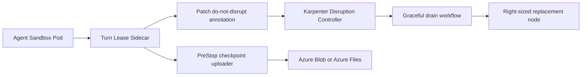
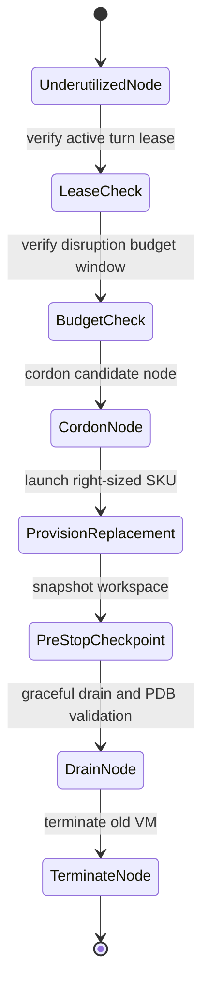

# Enterprise AI Agent Sandbox Node Defragmentation, Bin-Packing, and Eviction-Safe Consolidation FAQ (AKS NAP/Karpenter vs Descheduler+CA vs Duration-Tiered Pools)
> Topic ID: #459
> Section: 3.1 Agent Runtime Hosting and Code/GUI Sandboxes
> Decision Goal: improve node utilization and reclaim stranded capacity without interrupting in-flight agent turns
> Target Platforms: `AKS Standard`, `AKS NAP`, `Kata` sandboxes, browser session clusters, and code-execution workloads

## 1) Production problem: Swiss-cheese stranded capacity
Enterprise agent platforms usually mix two workload classes.
The first class is short-lived `10–30s` tool or CodeAct pods.
The second class is long-lived `20–60min` coding or browser sessions.
After traffic peaks, many nodes are pinned by only `1–2` session pods.
As a result, node CPU and memory utilization can remain at `18–28%`.
Naive eviction interrupts active LLM turns, WebSocket streams, and MCP stdio channels.
Permanent `do-not-disrupt` flags protect continuity but waste `35–50%` of compute spend.
The practical answer is turn-aware consolidation with checkpointed state handling.

## 2) Why conventional autoscaling underperforms for mixed-duration loads
Classic Cluster Autoscaler is good at reclaiming empty nodes, not half-empty nodes.
A few long sessions can block scale-down for entire node groups.
Widespread `safe-to-evict=false` annotations often freeze optimization.
`PDB minAvailable=100%` can create deterministic drain deadlocks.
When short and long tasks share one pool, low-fragmentation and low-disruption goals conflict.
A robust design links scheduling, eviction policy, and turn-state semantics.

## 3) Four architecture patterns
Pattern A is the primary recommendation.
It uses `AKS NAP/Karpenter` `WhenEmptyOrUnderutilized` consolidation.
An agent sidecar sets `karpenter.sh/do-not-disrupt=true` only during active turns.
After checkpoints complete, the annotation is removed automatically.
Pattern B is a standard-pool rebalancing strategy.
It combines `Cluster Autoscaler + MostAllocated + Descheduler`.
Pattern C is duration-tiered pool separation.
It hard-splits short jobs and long sessions into dedicated pools.
Pattern D is the anti-pattern.
It mixes all workloads in one pool and keeps static no-evict settings.

## 4) Twelve-dimension decision matrix
| Dimension | Pattern A (NAP/Karpenter turn-aware) | Pattern B (CA + Descheduler) | Pattern C (duration-tiered pools) | Pattern D (anti-pattern) |
|---|---|---|---|---|
| Steady-state packing utilization | High (`68–82%`) | Medium-high (`55–72%`) | High (`62–80%`) | Low (`20–45%`) |
| D64s->D16s replacement ability | Strong | Medium | Strong | Weak |
| Mid-turn disruption rate | Low | Medium | Low | High |
| Empty-node reclamation latency | Low | Medium | Medium-low | High |
| `emptyDir` state safety | Strong | Medium | Strong | Weak |
| GPU/MIG fragmentation recovery | Medium-high | Medium | Medium-high | Weak |
| PDB deadlock risk | Low | Medium-high | Medium | High |
| 5k-pod scheduling throughput | High | Medium-high | High | Medium |
| Operational complexity | Medium | Medium | Medium | Low (with hidden cost) |
| Explainability for SRE | High | Medium | High | Low |
| Three-year TCO trend | Best | Good | Best | Poor |
| Recommendation level | Primary | Secondary | Strong secondary | Avoid |

## 5) Mermaid: turn-aware consolidation and checkpoint drain plane

This path enforces turn-state validation before eviction actions.
Skipping turn-state checks amplifies user-facing session interruptions.
Skipping checkpoint upload creates state loss during node replacement.

## 6) Mermaid: defragmentation and PDB deadlock guard state machine

Each transition should emit structured reason codes.
That makes blocked drains diagnosable instead of opaque and intermittent.

## 7) Q1: fragmentation waste ratio and thresholds
Use `W_frag = 1 - Sum(PodRequests) / Sum(ActiveNodeAllocatable)`.
When `W_frag` is persistently above `0.32`, wasted capacity is usually material.
Track CPU and memory waste separately to avoid misleading blended averages.
Use stricter consolidation during off-peak windows and conservative limits at peak.
Static thresholds should be replaced by profile-based policy by tenant and region.

## 8) Q2: probability of node pinning by long sessions
A practical estimate is `P_pinned = 1 - (1 - p_long)^M`.
`p_long` is per-slot long-session probability and `M` is slots per node.
The curve is nonlinear, so risk accelerates as `p_long` rises.
Duration-tiered separation reduces pinning before policy complexity grows.
Turn-aware annotations prevent all-day no-evict drift in production.

## 9) Q3: sizing `terminationGracePeriodSeconds`
Recommended bound: `T_grace >= T_turn_p99 + T_checkpoint_upload + 15s`.
The `15s` buffer absorbs API jitter and PreStop variability.
Too-small grace kills sessions mid-turn.
Too-large grace slows node recycling and reduces consolidation gains.
Different workload classes should maintain independent grace policies.

## 10) Q4: preventing consolidation thrash
Thrash appears when the platform rapidly consolidates and re-expands.
Control knobs are `consolidateAfter` and time-windowed `disruption.budgets`.
At peak, keep budget near `10%`; off-peak can move toward `35%`.
Avoid very short `consolidateAfter`; start around `2m` and tune with data.
Always include replacement-node startup latency in policy validation.

## 11) Q5: proving and preventing PDB deadlock
With `minAvailable=100%` and fixed replicas, drains cannot progress.
A safer baseline is `maxUnavailable >= 1`.
For session-critical services, combine PDB with topology spread policies.
Keep PDB, HPA, and VPA intent aligned to avoid control-plane contradictions.
All blocked drains should persist explicit failure reason codes.

## 12) Q6: GPU consolidation ROI
GPU decisions must include model reload time `T_reload`.
Large images and heavy warm-up can negate consolidation savings.
A useful expression is `ROI = SavedNodeHours - ReloadPenaltyHours`.
If ROI is negative in prime hours, reduce consolidation aggressiveness.
Many teams run deep consolidation at night and moderate policies by day.

## 13) Production code blocks (real multiline content)
### 13.1 Karpenter v1 NodePool with time-windowed budgets
```yaml
apiVersion: karpenter.sh/v1
kind: NodePool
metadata:
  name: agent-sandbox
spec:
  disruption:
    consolidationPolicy: WhenEmptyOrUnderutilized
    consolidateAfter: 2m
    budgets:
    - schedule: "0 9 * * 1-5"
      duration: 9h
      nodes: "10%"
    - schedule: "0 18 * * 1-5"
      duration: 12h
      nodes: "35%"
  template:
    spec:
      requirements:
      - key: karpenter.k8s.aws/instance-family
        operator: In
        values: ["D", "E", "NC"]
      - key: kubernetes.io/arch
        operator: In
        values: ["amd64"]
      taints:
      - key: sandbox.workload
        value: "agent"
        effect: NoSchedule
```
### 13.2 Descheduler policy plus PDB
```yaml
apiVersion: descheduler/v1alpha2
kind: DeschedulerPolicy
profiles:
- name: default
  pluginConfig:
  - name: LowNodeUtilization
    args:
      thresholds:
        cpu: 25
        memory: 25
        pods: 25
      targetThresholds:
        cpu: 70
        memory: 70
        pods: 70
      evictableNamespaces:
        exclude:
        - kube-system
  plugins:
    balance:
      enabled:
      - LowNodeUtilization
---
apiVersion: policy/v1
kind: PodDisruptionBudget
metadata:
  name: agent-session-pdb
spec:
  maxUnavailable: 1
  selector:
    matchLabels:
      app: agent-session
```
### 13.3 Python turn-lease controller toggling `do-not-disrupt`
```python
import asyncio
import signal
import tarfile
from pathlib import Path
from kubernetes import client, config

ANNOTATION_KEY = "karpenter.sh/do-not-disrupt"
NAMESPACE = "agent-runtime"
POD_NAME = "agent-session-0"

def patch_annotation(value: str) -> None:
    config.load_incluster_config()
    v1 = client.CoreV1Api()
    body = {"metadata": {"annotations": {ANNOTATION_KEY: value}}}
    v1.patch_namespaced_pod(POD_NAME, NAMESPACE, body)

def checkpoint_workspace() -> None:
    workspace = Path("/workspace")
    target = Path("/checkpoint/session.tar.gz")
    target.parent.mkdir(parents=True, exist_ok=True)
    with tarfile.open(target, "w:gz") as tar:
        tar.add(workspace, arcname="workspace")

def handle_sigterm(signum, frame):
    checkpoint_workspace()
    raise SystemExit(0)

async def turn_loop():
    signal.signal(signal.SIGTERM, handle_sigterm)
    patch_annotation("true")
    await asyncio.sleep(8)
    patch_annotation("false")

if __name__ == "__main__":
    asyncio.run(turn_loop())
```

## 14) Enterprise scenarios and three-tier three-year TCO
### 14.1 Scenario A: global SWE coding-agent SaaS
The platform runs around `6,000` concurrent Kata sandboxes across three regions.
Mixed-duration workloads pin tail nodes after peak demand.
Using Pattern A + Pattern C can reduce idle-tail node-hours by about `44%`.
Session interruption remains low with checkpointed restart paths.
This pattern is effective for platforms with strong diurnal traffic cycles.

### 14.2 Scenario B: multi-department enterprise Copilot on AKS Standard
This platform has not enabled NAP yet and operates on standard node pools.
Pattern B (`MostAllocated + Descheduler`) reduced memory fragmentation by about `31%`.
Drain safety was preserved through PDB tuning and service placement controls.
It is a practical migration path for conservative operations teams.
Pattern A can be introduced later in low-risk domains.

### 14.3 Three-tier TCO (`30 / 150 / 600` nodes, three-year)
| Tier | Node scale | Pattern A | Pattern B | Pattern C |
|---|---:|---:|---:|---:|
| Department | 30 | `$0.83M` | `$0.92M` | `$0.88M` |
| Regional | 150 | `$3.42M` | `$3.86M` | `$3.58M` |
| Group | 600 | `$13.66M` | `$15.28M` | `$14.21M` |
Cost driver 1: stranded tail node-hours from long-session pinning.
Cost driver 2: checkpoint and restore overhead during node replacement.
Cost driver 3: GPU warm-up, image distribution, and session reconstruction.
Cost driver 4: additional SRE governance effort for advanced policies.

## 15) Day-0 / Day-1 / Day-2 action plan (15 actions)
Day-0: map utilization distribution and session duration distribution by pool.
Day-0: audit `safe-to-evict` and PDB settings; remove stale permanent blocks.
Day-0: define turn-state semantics for evictable and non-evictable windows.
Day-0: define checkpoint targets (Blob/Files/Redis) and recovery SLOs.
Day-0: design time-window disruption budgets aligned to business peaks.
Day-1: canary Pattern A turn-aware annotation toggling and watch interruption rate.
Day-1: enable NodePool consolidation and right-size replacement policy.
Day-1: activate Descheduler low-utilization balancing on standard pools.
Day-1: enforce `maxUnavailable>=1` PDB for session services and test drains.
Day-1: build an audit dashboard for all consolidation and drain outcomes.
Day-2: weekly review fragmentation ratio and reclaim latency; retune thresholds.
Day-2: monthly review GPU consolidation ROI against reload penalties.
Day-2: quarterly run large-scale replacement and session recovery drills.
Day-2: continuously optimize short-task versus long-session pool boundaries.
Day-2: make consolidation parameters release-gated with rollback evidence.

Fit guidance: choose Pattern A for high-concurrency mixed-session platforms; use Pattern B for conservative transitions; add Pattern C for structural long-term stability.
Risk guidance: single-pool mixed workloads with permanent no-evict markers will steadily increase both waste and disruption risk.

Official references (fetched 2026-11-27):
- AKS Node Auto Provisioning: https://learn.microsoft.com/azure/aks/node-auto-provisioning
- Karpenter Disruption and Consolidation: https://karpenter.sh/docs/concepts/disruption/
- Kubernetes Descheduler: https://github.com/kubernetes-sigs/descheduler
- Cluster Autoscaler on AKS: https://learn.microsoft.com/azure/aks/cluster-autoscaler
- PodDisruptionBudget: https://kubernetes.io/docs/concepts/workloads/pods/disruptions/
