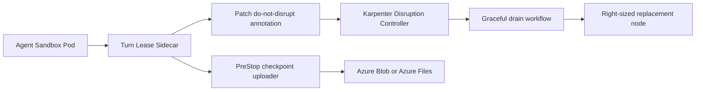
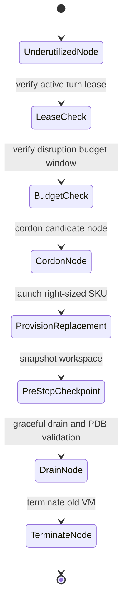

# 企业智能体沙箱节点碎片整理、装箱率优化与安全驱逐整合选型 FAQ（AKS NAP/Karpenter vs Descheduler+CA vs 双池时长分层）
> 主题编号：#459
> 章节归属：3.1 计算宿主、代码沙箱与运行时隔离
> 目标问题：在不打断进行中 Agent 回合与会话状态前提下，提升节点利用率并回收碎片化空闲容量
> 适用对象：`AKS Standard`、`AKS NAP`、`Kata` 沙箱、浏览器会话集群、代码执行工作负载

## 1) 生产问题：瑞士奶酪式碎片容量导致长期低利用率
企业 Agent 平台常同时承载两类负载。
第一类是 `10–30s` 的短时工具或 CodeAct Pod。
第二类是 `20–60min` 的长会话编码和浏览器沙箱。
高峰结束后，很多节点只剩 `1–2` 个长会话 Pod 挂在节点上。
这会导致节点 CPU 和内存利用率长期停留在 `18–28%`。
如果直接驱逐，容易中断进行中的 LLM 推理回合、WebSocket 连接和 MCP stdio 管道。
如果永久 `do-not-disrupt`，则会把 `35–50%` 的计算成本变成长期浪费。
因此需要“回合感知 + 可中断窗口 + 状态检查点”的综合整治机制。

## 2) 为什么传统自动扩缩容在混合时长负载下失效
传统 Cluster Autoscaler 擅长“空节点回收”，不擅长“半空节点重排”。
当节点上残留少量长会话 Pod 时，自动缩容会被阻断。
`safe-to-evict=false` 滥用会把缩容策略完全钉死。
`PDB minAvailable=100%` 会在多副本场景造成排空死锁。
短任务和长会话混跑同池时，调度器很难同时满足低碎片和低扰动。
要突破该瓶颈，需要把调度、驱逐、检查点与回合状态联动起来。

## 3) 四条架构路径：从动态整合到反模式
Pattern A 是主推荐路径。
利用 `AKS NAP/Karpenter` 的 `WhenEmptyOrUnderutilized` 做动态整合。
由 Agent 侧边车在活跃回合期间设置 `karpenter.sh/do-not-disrupt=true`。
回合完成且状态落盘后自动移除保护标记。
Pattern B 是标准节点池重平衡路径。
组合 `Cluster Autoscaler + MostAllocated + Descheduler` 提升装箱率。
Pattern C 是时长分层双池路径。
把短任务和长会话硬拆到不同池，降低互相拖累。
Pattern D 是反模式。
表现为单池混跑加永久不可驱逐标记，导致长期低利用率与成本失控。

## 4) 十二维量化决策矩阵
| 评估维度 | Pattern A（NAP/Karpenter 动态整合） | Pattern B（CA + Descheduler） | Pattern C（双池时长分层） | Pattern D（反模式） |
|---|---|---|---|---|
| 稳态装箱利用率 | 高（可达 `68–82%`） | 中高（`55–72%`） | 高（`62–80%`） | 低（`20–45%`） |
| D64s->D16s 替换能力 | 强 | 中 | 强 | 弱 |
| 中途会话打断率 | 低（回合感知） | 中（依赖 PDB） | 低（池隔离） | 高 |
| 空节点回收时延 | 低 | 中 | 中低 | 高 |
| `emptyDir` 状态保护 | 强（回合后快照） | 中（需额外控制器） | 强（会话池规则） | 弱 |
| GPU/MIG 碎片恢复 | 中高 | 中 | 中高 | 弱 |
| PDB 死锁风险 | 低（策略约束） | 中高 | 中 | 高 |
| 5k Pod 调度吞吐 | 高 | 中高 | 高 | 中 |
| 变更复杂度 | 中 | 中 | 中 | 低（但有代价） |
| 运营可解释性 | 高 | 中 | 高 | 低 |
| 三年 TCO 表现 | 优 | 良 | 优 | 差 |
| 企业推荐等级 | 主路径 | 补路径 | 强补路径 | 禁用 |

## 5) Mermaid：回合感知整合与检查点排空控制面

该链路强调“先判断回合状态，再执行驱逐动作”。
若跳过回合状态检查，系统会在吞吐高峰期放大会话中断风险。
若跳过检查点上传，系统会在节点替换后丢失会话上下文。

## 6) Mermaid：节点碎片整理与 PDB 死锁防护状态机

状态机需要记录每一步通过/拒绝原因。
这能避免“看似可驱逐、实则被策略阻断”的灰色故障窗口。

## 7) Q1：碎片浪费比率如何计算与设阈
推荐公式 `W_frag = 1 - Sum(PodRequests) / Sum(ActiveNodeAllocatable)`。
当 `W_frag` 长期高于 `0.32` 时，通常已进入显著浪费区。
对 CPU 池与内存池应分别计算，避免单指标掩盖结构性问题。
建议在业务低峰允许更积极整合，在高峰使用保守预算。
门槛不应静态固定，需按地区、租户规模与业务时段动态调整。

## 8) Q2：节点被长会话钉住概率如何估算
可用 `P_pinned = 1 - (1 - p_long)^M`。
其中 `p_long` 是单槽位出现长会话概率，`M` 是节点可容纳槽位数。
当 `p_long` 增长时，钉住概率呈非线性上升。
因此应尽早做短长任务分层，避免长期在同池内对抗。
同时结合回合感知标记，降低不必要的“全时段不可驱逐”。

## 9) Q3：`terminationGracePeriodSeconds` 如何定标
推荐约束 `T_grace >= T_turn_p99 + T_checkpoint_upload + 15s`。
`15s` 安全边际用于处理 API 波动与预停钩子抖动。
若 `T_grace` 过小，回合尚未结束就会被系统强杀。
若 `T_grace` 过大，会延长排空链路并降低整合效率。
生产实践应按工作负载类型维护差异化 `T_grace` 策略。

## 10) Q4：如何防止 consolidation thrash 抖动
抖动通常来自“刚合并就反向扩容”的快速往返。
关键参数是 `consolidateAfter` 与分时段 `disruption.budgets`。
在高峰时段可把预算降到 `10%`，低峰放宽到 `35%`。
`consolidateAfter` 不宜过短，建议从 `2m` 起步再按数据收敛。
同时要观察替换节点启动时延，避免整合窗口和扩容窗口互相打架。

## 11) Q5：PDB 死锁证明与规避要点
若 `minAvailable=100%` 且副本数固定，排空流程无法前进。
更稳妥的是使用 `maxUnavailable >= 1`。
对核心会话服务可配合多副本与拓扑分散，降低单节点依赖。
还需确保 PDB 与 HPA/VPA 策略一致，避免策略目标冲突。
所有排空失败都应回写原因码，供后续策略迭代。

## 12) Q6：GPU 节点整合 ROI 如何判断
GPU 整合不能只看空闲率，还要看模型重载时间 `T_reload`。
当 `T_reload` 长、镜像体积大、预热成本高时，过度整合会反噬延迟。
建议综合指标：`ROI = SavedNodeHours - ReloadPenaltyHours`。
若 `ROI` 在主要业务时段为负，应降低该时段整合强度。
可在夜间窗口做深度整合，在白天保持温和策略。

## 13) 生产代码片段（真实多行，无转义换行）
### 13.1 Karpenter v1 NodePool（AKS NAP）与分时段预算
```yaml
apiVersion: karpenter.sh/v1
kind: NodePool
metadata:
  name: agent-sandbox
spec:
  disruption:
    consolidationPolicy: WhenEmptyOrUnderutilized
    consolidateAfter: 2m
    budgets:
    - schedule: "0 9 * * 1-5"
      duration: 9h
      nodes: "10%"
    - schedule: "0 18 * * 1-5"
      duration: 12h
      nodes: "35%"
  template:
    spec:
      requirements:
      - key: karpenter.k8s.aws/instance-family
        operator: In
        values: ["D", "E", "NC"]
      - key: kubernetes.io/arch
        operator: In
        values: ["amd64"]
      taints:
      - key: sandbox.workload
        value: "agent"
        effect: NoSchedule
```
### 13.2 DeschedulerPolicy 与 PDB 示例
```yaml
apiVersion: descheduler/v1alpha2
kind: DeschedulerPolicy
profiles:
- name: default
  pluginConfig:
  - name: LowNodeUtilization
    args:
      thresholds:
        cpu: 25
        memory: 25
        pods: 25
      targetThresholds:
        cpu: 70
        memory: 70
        pods: 70
      evictableNamespaces:
        exclude:
        - kube-system
  plugins:
    balance:
      enabled:
      - LowNodeUtilization
---
apiVersion: policy/v1
kind: PodDisruptionBudget
metadata:
  name: agent-session-pdb
spec:
  maxUnavailable: 1
  selector:
    matchLabels:
      app: agent-session
```
### 13.3 Python：回合租约控制与 `do-not-disrupt` 动态开关
```python
import asyncio
import signal
import tarfile
from pathlib import Path
from kubernetes import client, config, watch

ANNOTATION_KEY = "karpenter.sh/do-not-disrupt"
NAMESPACE = "agent-runtime"
POD_NAME = "agent-session-0"

def patch_annotation(value: str) -> None:
    config.load_incluster_config()
    v1 = client.CoreV1Api()
    body = {"metadata": {"annotations": {ANNOTATION_KEY: value}}}
    v1.patch_namespaced_pod(POD_NAME, NAMESPACE, body)

def checkpoint_workspace() -> None:
    workspace = Path("/workspace")
    target = Path("/checkpoint/session.tar.gz")
    target.parent.mkdir(parents=True, exist_ok=True)
    with tarfile.open(target, "w:gz") as tar:
        tar.add(workspace, arcname="workspace")

def handle_sigterm(signum, frame):
    checkpoint_workspace()
    raise SystemExit(0)

async def turn_loop():
    signal.signal(signal.SIGTERM, handle_sigterm)
    patch_annotation("true")
    await asyncio.sleep(8)
    patch_annotation("false")

if __name__ == "__main__":
    asyncio.run(turn_loop())
```

## 14) 企业场景与三档三年 TCO
### 14.1 场景 A：企业级 SWE Coding Agent SaaS（3 区域）
平台在工作时段维持约 `6,000` 并发 Kata 沙箱。
短任务和长会话混跑导致高峰后尾部节点难回收。
采用 Pattern A + Pattern C 后，空闲尾部节点时长下降约 `44%`。
会话中断率保持在低位，并可通过检查点实现可恢复执行。
该方案适合高峰明显、会话时长分布离散的研发平台。

### 14.2 场景 B：多部门企业 Copilot 平台（AKS Standard）
平台暂不启用 NAP，仅用标准节点池和 CA。
通过 Pattern B 的 `MostAllocated + Descheduler` 重平衡，内存碎片下降约 `31%`。
在保证 PDB 合规与关键服务连续性的前提下，提升了可回收节点比例。
该方案适合保守升级路径和治理成熟度中等的平台团队。
后续可在低风险业务域引入 Pattern A 做渐进演进。

### 14.3 三档三年 TCO（30 / 150 / 600 节点）
| 规模层级 | 节点规模 | Pattern A | Pattern B | Pattern C |
|---|---:|---:|---:|---:|
| 部门级 | 30 | `$0.83M` | `$0.92M` | `$0.88M` |
| 区域级 | 150 | `$3.42M` | `$3.86M` | `$3.58M` |
| 集团级 | 600 | `$13.66M` | `$15.28M` | `$14.21M` |
成本驱动一：被长会话钉住节点带来的尾部浪费小时数。
成本驱动二：整合替换链路触发的检查点与恢复开销。
成本驱动三：GPU 预热、镜像分发与会话重建的时间成本。
成本驱动四：策略复杂度提高后对 SRE 运维人力的新增需求。

### 14.4 架构治理补充：避免“看起来节省，实际变贵”的隐形回归
在企业治理层面，节点整合不是单一的计算题，而是要把可用性、开发者体验、审计追踪和预算纪律共同纳入同一条控制面闭环。
若只追逐瞬时利用率而忽略回合中断成本，平台会把节约下来的节点费用转移为更多失败重试、更多人工排障和更高的业务机会损失。
建议在月度治理评审中同时展示“节点回收收益曲线”和“会话中断损失曲线”，并要求两条曲线在同一时间轴和同一租户粒度下进行对照。
当某条业务线存在长事务审批、复杂 IDE 任务链或高价值交易回放场景时，应提升该业务线的回合保护级别，避免被通用策略错误驱逐。
对于跨区域部署的团队，还应单独统计不同区域的镜像拉取耗时、存储吞吐瓶颈和检查点恢复耗时，防止把某一区域经验错误外推到全部区域。
强烈建议把“驱逐前检查点完整性校验”纳入发布门禁，没有通过校验的策略变更禁止进入高峰生产时段，避免在流量压力下暴露不可恢复故障。
在组织流程上，平台团队需要与应用团队约定统一的回合边界语义、统一的回滚剧本模板和统一的异常分级口径，否则同类故障会在不同团队被重复解释。
对金融、医疗等高合规行业，建议把排空审计日志、恢复证据和策略审批记录打通到统一证据库，确保审计时可以还原“为什么驱逐、谁批准、何时恢复”。
若平台同时存在 CPU 与 GPU 混合池，必须分别制定整合阈值与回收窗口，禁止以单一百分比阈值管理全部池型，避免 GPU 业务被 CPU 策略误伤。
对于采用多租户计费的组织，建议将碎片浪费成本、检查点存储成本、恢复带宽成本拆分为可解释账单字段，减少“账单上涨但原因不明”的治理摩擦。
在演进节奏上，推荐先在低风险租户启用回合感知整合，再逐步扩展到高价值租户；每次扩展必须先完成一次真实故障注入演练并复核恢复时序证据。
最终目标不是追求单日最高利用率，而是在全年视角下达到“稳定可恢复、成本可解释、策略可审计、体验可接受”的生产级平衡点。
同时建议建立跨团队术语字典，明确“整合成功”“安全驱逐”“恢复完成”“用户无感”的统一定义，避免不同报表口径导致误判。
对于高并发开发平台，应增加“排空窗口命中率”和“检查点有效恢复率”两项月度指标，并把异常样本回放纳入架构评审固定议程。
在技术债治理层面，要定期清理历史遗留的节点亲和、污点容忍和手工注解策略，防止策略叠加后出现不可预测的调度分叉。

## 15) Day-0 / Day-1 / Day-2（15 项执行动作）
Day-0：盘点当前节点利用率分布与会话时长分布，识别碎片高风险池。
Day-0：梳理 `safe-to-evict` 与 PDB 配置，删除历史遗留永久禁驱逐标记。
Day-0：建立回合状态模型，明确何时允许驱逐、何时必须保护会话。
Day-0：定义检查点落盘目标（Blob/Files/Redis）与恢复 SLA。
Day-0：设计分时段 disruption budget 与业务高峰保护策略。
Day-1：灰度启用 Pattern A 的回合感知标记开关，观察会话中断率。
Day-1：上线 NodePool consolidation 与替换规则，验证 SKU 右尺寸运行效果。
Day-1：在标准池启用 Descheduler 低利用重排策略并监控调度吞吐。
Day-1：对会话服务应用 `maxUnavailable>=1` 的 PDB 并验证排空可行性。
Day-1：建立整合事件审计看板，追踪每次驱逐的成功与失败原因。
Day-2：每周复盘碎片浪费比率和节点回收时延，调优阈值与预算。
Day-2：每月评估 GPU 整合 ROI 与模型重载惩罚，优化分时段策略。
Day-2：每季度演练节点大规模替换与会话批量恢复，验证应急韧性。
Day-2：持续做短任务与长会话池隔离优化，防止策略回归混跑反模式。
Day-2：将整合策略纳入发布门禁，确保参数变更有回滚与验证证据。

适配建议：高并发混合会话平台优先 Pattern A，保守平台可从 Pattern B 过渡，长期建议叠加 Pattern C 完成结构化分层。
风险提示：若继续使用单池混跑与永久不可驱逐标记，容量浪费与中断风险会同步上升。

官方参考（抓取 2026-11-27）：
- AKS Node Auto Provisioning: https://learn.microsoft.com/azure/aks/node-auto-provisioning
- Karpenter Disruption and Consolidation: https://karpenter.sh/docs/concepts/disruption/
- Kubernetes Descheduler: https://github.com/kubernetes-sigs/descheduler
- Cluster Autoscaler on AKS: https://learn.microsoft.com/azure/aks/cluster-autoscaler
- PodDisruptionBudget: https://kubernetes.io/docs/concepts/workloads/pods/disruptions/
