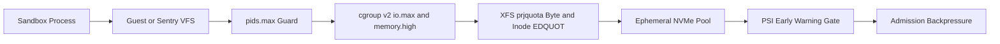
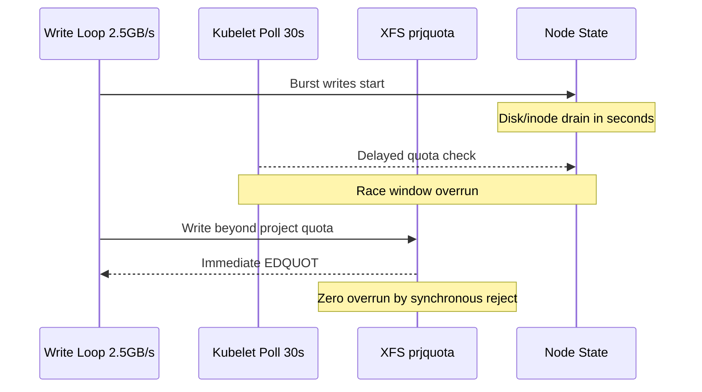

# Enterprise Multi-Tenant Agent Sandbox Noisy-Neighbor and Resource-Exhaustion Isolation Selection FAQ (AKS Kata+XFS+cgroupv2+PSI vs ACA Dynamic Sessions vs gVisor)
> Topic ID: #467
> Section: 3.1 Agent Runtime Hosting and Code/GUI Sandboxes
> Audience: platform SRE teams, container platform teams, MLOps teams, sandbox product engineers, and FinOps decision-makers
> Goal: prevent inode/IOPS/PID exhaustion cascades from collapsing co-located tenants under high-concurrency coding and analysis workloads

## 1) Production problem: CPU and memory limits do not cover secondary kernel and storage exhaustion
Many teams treat `resources.limits.cpu` and `resources.limits.memory` as the primary sandbox isolation boundary.
That assumption appears acceptable in low-density single-tenant workloads.
In multi-tenant agent platforms, severe incidents usually come from disk bytes, inode depletion, PID pressure, and storage contention.
A common chain starts when one session unpacks huge dependency trees or runs metadata-heavy builds, then the node enters `DiskPressure`, then neighboring tenants are evicted.
Another chain starts with runaway process fan-out that saturates host PID tables and causes random timeout behavior across unrelated pods.
These failures are usually not application defects.
They are resource-boundary design failures.
Therefore, “container limits equal sandbox isolation” is one of the most damaging production myths.

## 2) Why asynchronous `emptyDir.sizeLimit` can still collapse a node
`emptyDir.sizeLimit` is enforced by periodic kubelet accounting, not synchronous write-path rejection.
On fast NVMe, write throughput can exceed gigabytes per second.
That creates an overrun window between checks.
A session can exhaust bytes or inodes during this window before kubelet reacts.
By the time eviction starts, collateral damage is already distributed to co-located tenants.
For multi-tenant sandboxes, critical resources must move from delayed eviction logic to immediate kernel-level denial.

## 3) Four architecture paths
Pattern A: `AKS + Kata` (or dedicated block path) plus `XFS prjquota` plus `cgroup v2 io.max/pids.max/memory.high` plus `PSI` admission shedding, for high-throughput build sandboxes.
Pattern B: `ACA Dynamic Sessions` with per-session Hyper-V boundaries and managed ceilings, for zero-ops untrusted execution.
Pattern C: `AKS gVisor (runsc)` plus UserNS plus cgroup v2 controls, for fast startup where metadata overhead is acceptable.
Pattern D: anti-pattern (shared OS disk, async-only `emptyDir`, unlimited PID, no IOPS throttling).

## 4) Twelve-dimension comparison matrix
| Dimension | Pattern A (Kata+XFS+cgroup) | Pattern B (ACA Dynamic Sessions) | Pattern C (gVisor+UserNS) | Pattern D (anti-pattern) |
|---|---|---|---|---|
| Synchronous byte hard limit | High | High | Medium | Low |
| Synchronous inode hard limit | High | High | Medium | Low |
| Per-sandbox IOPS isolation | High | Medium-high | Medium | Low |
| PID blast containment | High | High | High | Low |
| `emptyDir` race exposure | Low | Low | Medium | High |
| Startup latency | Medium | Medium-high | High | High |
| Metadata-heavy I/O speed | High | Medium | Medium-low | Medium |
| Kernel attack-surface reduction | High | High | Medium-high | Low |
| Operational complexity | High | Low | Medium-high | Low but fragile |
| Observability and audit depth | High | Medium-high | Medium-high | Low |
| TCO control per 1,000 sandbox-hours | Medium-high | Medium-high | Medium | Low |
| Enterprise recommendation | Primary for heavy build pools | Primary for zero-ops untrusted sessions | Secondary mixed workload option | Disallow |

## 5) Pattern A: Kata plus XFS project quota plus cgroup v2 hard ceilings (primary for high-throughput pools)
Separate OS disk and sandbox data disks at node design time.
Format sandbox data path with `XFS` and enable `prjquota`.
Assign each sandbox a dedicated project ID.
Apply both `bhard` and `ihard` so byte and inode overrun are both blocked synchronously.
Use `cgroup v2 io.max` to cap random-write pressure and protect neighbor IOPS budgets.
Use `podPidsLimit` and `pids.max` so accidental or malicious process fan-out stays local.
Use `memory.high` as soft throttle before hard `memory.max` kill.
This path needs stronger platform engineering but produces the most stable high-density outcome.

## 6) Pattern B: ACA Dynamic Sessions managed Hyper-V boundary (primary for zero-ops untrusted execution)
ACA Dynamic Sessions provide per-session isolation with managed CPU, memory, PID, and ephemeral storage limits.
Lifecycle cleanup is automatic, reducing long-lived host contamination.
This is highly attractive for untrusted customer code execution and platform teams with low infra staffing.
The trade-off is reduced control over low-level disk topology and custom NVMe tuning.
When workloads are interactive and bounded rather than extreme build throughput, this model often wins on velocity and safety.

## 7) Pattern C: gVisor Sentry VFS plus UserNS plus cgroup v2 (balanced path)
gVisor moves many syscall paths into user-space Sentry and shrinks direct host-kernel exposure.
Startup can be fast without nested virtualization.
Metadata-intensive workflows such as `git/npm/cargo` may see significant overhead versus Kata and native virtio-blk.
Treat this as a startup-versus-throughput trade-off path, not a universal replacement.
If `tmpfs` is used for speed, memory charging and limits must be explicit or disk pressure simply becomes memory failure.

## 8) Pattern D: anti-pattern checklist
Placing multi-tenant sandbox data on managed OS disks.
Relying only on asynchronous `emptyDir.sizeLimit`.
Keeping `podPidsLimit=-1` or effectively unbounded process ceilings.
Allowing unthrottled random I/O bursts with no `io.max` guardrails.
These designs may survive quiet periods and fail catastrophically during burst windows.

## 9) Mermaid: multi-layer synchronous containment stack


## 10) Mermaid: async polling race versus synchronous rejection timeline


## 11) Quantitative Q1-Q6 formulas and thresholds
Q1: asynchronous overrun window.
`Delta_overrun = BW_nvme * T_poll - Quota_remaining`.
At `BW=2.5GB/s` and `T_poll=15s`, overrun can reach `37.5GB`.
Q2: inode-bomb boundary.
`N_files <= ihard_project`; beyond this limit writes fail synchronously and avoid node-wide inode depletion.
Q3: IOPS budget allocation.
`WIOPS_pod = floor(IOPS_nvme * 0.85 / N_active)` with `15%` reserved for system and burst headroom.
Q4: PID ceiling sizing.
Build pools typically use `pids.max` in `512–2048`; fork-bombs should be contained in `<5ms`.
Q5: memory throttle strategy.
Set `memory.high` around `0.85–0.92 * memory.max` for graceful pressure before hard OOM kill.
Q6: PSI admission gate.
When `io.full avg10 > 15%` or `memory.full avg10 > 10%`, pause new sandbox admission and reroute.

## 12) Production code block 1: AKS agent pool and kubelet limits (Bicep)
```bicep
param clusterName string = 'aks-agent-sandbox'
param location string = 'eastus2'
param vmSize string = 'Standard_L16s_v3'

resource agentPool 'Microsoft.ContainerService/managedClusters/agentPools@2024-01-01' = {
  name: '${clusterName}/sandboxpool'
  location: location
  properties: {
    vmSize: vmSize
    count: 6
    mode: 'User'
    osDiskType: 'Ephemeral'
    kubeletConfig: {
      podPidsLimit: 1024
      containerLogMaxSizeMB: 50
      containerLogMaxFiles: 3
      imageGcHighThreshold: 80
      imageGcLowThreshold: 60
      evictionHard: {
        'memory.available': '500Mi'
        'nodefs.available': '10%'
      }
      evictionSoft: {
        'memory.available': '1Gi'
      }
      evictionSoftGracePeriod: {
        'memory.available': '2m'
      }
    }
  }
}
```

## 13) Production code block 2: XFS project quota and cgroup v2 I/O limits (DaemonSet hook)
```bash
set -euo pipefail

SANDBOX_ID="$1"
PROJECT_ID="$2"
MOUNT_POINT="/var/lib/sandbox-data"
CGROUP_PATH="/sys/fs/cgroup/kubepods.slice/${SANDBOX_ID}"

xfs_quota -x -c "project -s -p ${MOUNT_POINT}/${SANDBOX_ID} ${PROJECT_ID}" "${MOUNT_POINT}"
xfs_quota -x -c "limit -p bhard=12g ihard=200000 ${PROJECT_ID}" "${MOUNT_POINT}"

echo "8:0 wbps=268435456 wiops=8000 rbps=268435456 riops=8000" > "${CGROUP_PATH}/io.max"
echo "1536" > "${CGROUP_PATH}/pids.max"
echo "15032385536" > "${CGROUP_PATH}/memory.high"
```

## 14) Production code block 3: PSI telemetry and admission backpressure gate (Python)
```python
from pathlib import Path

def read_psi_avg10(path: str, key: str) -> float:
    text = Path(path).read_text(encoding="utf-8").strip().splitlines()
    line = next(l for l in text if l.startswith(key))
    for token in line.split():
        if token.startswith("avg10="):
            return float(token.split("=")[1])
    return 0.0

def should_shed(io_full_avg10: float, mem_full_avg10: float) -> bool:
    return io_full_avg10 > 15.0 or mem_full_avg10 > 10.0

def admission_decision() -> dict:
    io_full = read_psi_avg10("/proc/pressure/io", "full")
    mem_full = read_psi_avg10("/proc/pressure/memory", "full")
    shed = should_shed(io_full, mem_full)
    return {
        "io_full_avg10": io_full,
        "mem_full_avg10": mem_full,
        "admit_new_sandbox": not shed,
    }
```

## 15) Enterprise scenarios and three-tier three-year TCO
### 15.1 Scenario A: enterprise SWE-agent build platform
The platform ran `400` concurrent `npm/cargo/pytest` sandboxes on `Standard_L16s_v3`.
Legacy design used shared OS disk plus async `emptyDir` enforcement and suffered repeated `DiskPressure` cascades.
After moving to Pattern A with `Kata + XFS prjquota + io.max + podPidsLimit`, tenant isolation improved materially.
Across a `90-day` window, node `NotReady/DiskPressure` incidents dropped from `11/week` to `0`.
Stable isolation also improved usable packing density by about `1.8x`.
### 15.2 Scenario B: multi-tenant SaaS data analysis interpreter
The service routed high-risk untrusted interactive execution into Pattern B (ACA Dynamic Sessions).
It routed heavy repository build and regression workflows into Pattern A (AKS Kata pools).
This split delivered stronger default isolation where risk was highest while preserving build throughput where performance mattered most.
The operating model became risk-based for isolation and workload-based for cost.
### 15.3 Three-tier TCO
| Tier | Concurrent sandbox scale | Recommended combination | Three-year blended TCO |
|---|---:|---|---:|
| Tier-1 | 120 concurrent | B primary + A small high-throughput pool | `$3.1M` |
| Tier-2 | 400 concurrent | A primary + B high-risk lane | `$8.7M` |
| Tier-3 | 1200 concurrent | A multi-pool + B session isolation + C light-task lane | `$21.9M` |
### 15.4 Fine-grained architecture implementation points
Model disk bytes, inode capacity, IOPS ceilings, and PID ceilings as separate first-class capacity axes.
Use workload pool segmentation for build-heavy, interactive, and high-risk tenants instead of one shared node pool.
Require one XFS project ID per sandbox path to keep quota policy and audit entity aligned.
Set both `bhard` and `ihard` so byte and inode failures are both prevented synchronously.
Generate `io.max` templates from disk class and tenant priority, and revisit them as workload mix changes.
Set `pids.max` from measured compiler and test fan-out, not arbitrary defaults.
Use `memory.high` as backpressure before hard kill to reduce abrupt recovery storms.
Include PSI in pre-admission checks so the platform sheds load before node-wide pressure events.
Require complete resource-budget declarations before sandbox creation to avoid policy bypasses.
Publish tenant-level ledgers for bytes, inodes, IOPS, PID peaks, and PSI contribution.
Automate incident runbooks for inode bombs, IOPS storms, and PID explosions.
Replay sandbox pressure tests before node-image upgrades to detect quota regressions early.
Quantify reliability gains in cost metrics such as stable hours per 1,000 sandbox-hours.
Default high-risk tenants into stronger isolation pools to reduce blast-radius probability.
Track success rate, neighbor impact rate, and recovery latency together as primary SLO indicators.
Retain decision logs for throttle and eviction actions to satisfy audit and postmortem review.
Offer local resource preflight tooling so developers catch inode and PID risk before submission.
Review PSI trends and quota hit-rates weekly and tune templates continuously.
Define explicit ownership boundaries: platform for controls, security for audits, product for workload profiles.
Pre-boost sensitivity thresholds during known high-risk windows such as promotions and release trains.
Validate whether throttling alerts map to real incident reduction, not just lower alert noise.
Set maximum sandbox lifespan and enforced cleanup to prevent long-lived state drift.
Run onboarding resource profiling for new toolchains before allowing them into shared pools.
Re-evaluate ACA, Kata, and gVisor economics each quarter as kernel and hardware baselines evolve.
### 15.5 Day-0 / Day-1 / Day-2 engineering runbook (18 actions)
Day-0: define sandbox workload tiers and admission labels.
Day-0: design node-pool topology with OS-data disk separation.
Day-0: publish baseline `bhard/ihard` and `pids.max` templates.
Day-0: define `io.max` allocation policy and priority classes.
Day-0: define PSI thresholds and backpressure actions.
Day-0: define ledger fields and audit retention policy.
Day-1: deploy Pattern A high-throughput pool and stress race conditions.
Day-1: deploy Pattern B high-risk execution pool and validate lifecycle cleanup.
Day-1: deploy Pattern C light-task pool and benchmark metadata overhead limits.
Day-1: connect pre-`DiskPressure` backpressure to scheduler policies.
Day-1: run automated fork-bomb and fsync-storm drills.
Day-1: publish tenant-level observability dashboards and alerts.
Day-2: review weekly quota hit-rate and false-positive throttles.
Day-2: replay weekly inode/IOPS/PID stress checks.
Day-2: review monthly incident patterns and mitigation latency.
Day-2: review monthly pool utilization and cost mix.
Day-2: refresh quarterly quota templates and operations runbook.
Day-2: rebalance quarterly A/B/C strategy and budget weighting.

Sources (fetched 2026-11-27):
- Kubernetes emptyDir volume: https://kubernetes.io/docs/concepts/storage/volumes/#emptydir
- Kubernetes pod PID limiting: https://kubernetes.io/docs/concepts/policy/pid-limiting/
- Linux cgroup v2 docs: https://www.kernel.org/doc/html/latest/admin-guide/cgroup-v2.html
- Linux PSI docs: https://www.kernel.org/doc/html/latest/accounting/psi.html
- XFS quota reference: https://docs.kernel.org/filesystems/xfs/xfs-quota.html
- Kata Containers: https://github.com/kata-containers/kata-containers
- gVisor: https://gvisor.dev/
- Azure Container Apps sessions: https://learn.microsoft.com/azure/container-apps/sessions
