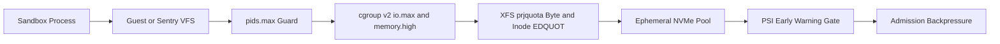
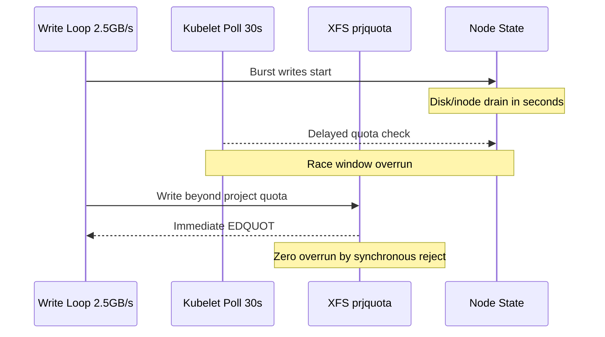

# 企业多租户 Agent 沙箱噪声邻居与资源耗尽隔离选型 FAQ（AKS Kata+XFS+cgroupv2+PSI vs ACA Dynamic Sessions vs gVisor）
> Topic ID: #467
> Section: 3.1 计算宿主、代码沙箱与运行时隔离（Agent Runtime Hosting & Code/GUI Sandboxes）
> Audience: 平台 SRE、容器平台团队、MLOps 团队、沙箱产品工程与 FinOps 决策者
> Goal: 在高并发 Coding/Data Agent 负载下，避免 inode/IOPS/PID 级联耗尽导致整机连带故障

## 1）生产问题：CPU/内存限额并不能覆盖二级内核与存储耗尽
很多团队把 `resources.limits.cpu` 与 `resources.limits.memory` 当作沙箱隔离的主要防线。
这在单租户或低并发场景下通常“看起来够用”。
但在多租户 Agent 平台中，节点级事故常来自磁盘、inode、PID、IOPS 与调度阻塞。
典型事故链路是：某个会话执行高并发构建或解压海量小文件，节点出现 `DiskPressure`，随后同机租户被批量驱逐。
另一类事故链路是线程/进程激增触发 PID 表耗尽，邻近沙箱出现随机超时与任务崩溃。
这类问题往往不是应用代码错误，而是资源控制边界设计不完整。
因此“容器配额=沙箱隔离”是最常见且最危险的误解之一。

## 2）异步 `emptyDir.sizeLimit` 竞态为何会击穿节点
`emptyDir.sizeLimit` 由 Kubelet 周期性检查，不是每次 `write()` 的同步硬拒绝。
当 NVMe 写入速度达到 `GB/s` 量级时，轮询间隔会形成明显“超写窗口”。
如果会话在窗口内写满磁盘或耗尽 inode，后续即使 Kubelet发现，也已经造成邻居租户受损。
这就是“限制存在但来不及生效”的经典竞态。
对多租户沙箱而言，必须把关键资源从“事后驱逐”升级为“写入即拒绝”。

## 3）四类架构路径总览
Pattern A：`AKS + Kata`（或独立块设备）+ `XFS prjquota` + `cgroup v2 io.max/pids.max/memory.high` + `PSI` 早压制，适合高吞吐构建型沙箱。
Pattern B：`ACA Dynamic Sessions` 每会话 Hyper-V 隔离与配额托管，适合零运维不可信代码执行。
Pattern C：`AKS gVisor(runsc)` + UserNS + cgroup v2，适合快速启动且可接受元数据密集工作负载开销的场景。
Pattern D：反模式（OS 盘共享、仅依赖 `emptyDir`、无限 PID、无 IOPS 限流）。

## 4）十二维对比矩阵
| 维度 | Pattern A（Kata+XFS+cgroup） | Pattern B（ACA Dynamic Sessions） | Pattern C（gVisor+UserNS） | Pattern D（反模式） |
|---|---|---|---|---|
| 磁盘字节同步硬限制 | 高 | 高 | 中 | 低 |
| inode 同步硬限制 | 高 | 高 | 中 | 低 |
| IOPS 限流颗粒度 | 高 | 中高 | 中 | 低 |
| PID 爆炸隔离 | 高 | 高 | 高 | 低 |
| `emptyDir` 竞态暴露面 | 低 | 低 | 中 | 高 |
| 启动时延 | 中 | 中高 | 高 | 高 |
| 元数据密集 I/O 性能 | 高 | 中 | 中低 | 中 |
| 内核攻击面收敛 | 高 | 高 | 中高 | 低 |
| 运维复杂度 | 高 | 低 | 中高 | 低（但脆弱） |
| 可观测与审计 | 高 | 中高 | 中高 | 低 |
| 每千沙箱小时 TCO 可控性 | 中高 | 中高 | 中 | 低 |
| 推荐结论 | 高并发构建主路径 | 零运维不可信执行主路径 | 兼顾启动与隔离备选 | 禁用 |

## 5）Pattern A：Kata + XFS 项目配额 + cgroup v2 硬上限（高吞吐主路径）
先在节点层把 OS 磁盘与沙箱数据磁盘彻底分离，避免系统盘与工作负载盘互相污染。
将沙箱数据盘格式化为 `XFS` 并启用 `prjquota`，对每个沙箱分配独立 project ID。
通过 `bhard` 与 `ihard` 同时限制“字节”与“inode”，使超额写入在内核路径即时返回 `EDQUOT`。
再用 `cgroup v2 io.max` 为沙箱切片设置 `wiops/wbps`，防止单租户随机写风暴抢占整盘 IOPS。
配合 `podPidsLimit` 与 `pids.max`，把 fork-bomb 影响局限在单沙箱级别。
最后以 `memory.high` 实施渐进式回压，而不是直接靠 `memory.max` 触发硬杀，提升任务恢复稳定性。
该模式投入较高，但在高并发构建与测试集群中最能稳定长期 SLO。

## 6）Pattern B：ACA Dynamic Sessions 每会话 Hyper-V 隔离（零运维主路径）
ACA Dynamic Sessions 把会话边界、CPU/内存/PID/临时存储配额交给平台托管。
每个会话生命周期可独立回收，减少宿主长期污染与漂移。
对“多租户不可信代码执行”尤其有价值，因为隔离默认更强且平台运维负担更低。
代价是磁盘布局、NVMe 调优与节点级混合资源编排的定制空间较小。
当场景偏向可预期的交互式执行而非极限构建吞吐时，该模式通常是更快落地选择。

## 7）Pattern C：gVisor Sentry VFS + UserNS + cgroup v2（折中路径）
gVisor 通过用户态 Sentry 拦截系统调用，缩小宿主内核暴露面。
无需嵌套虚拟化即可获得较快启动，适合强调启动密度的任务群。
但在 `git/npm/cargo` 等元数据密集工作负载上，VFS 开销可能显著高于 Kata/virtio-blk。
因此要把 gVisor 定位为“安全与启动速度折中”，而不是盲目替代所有构建类任务。
若结合 `tmpfs`，必须把内存计费与阈值联动，否则会把磁盘压力转移成内存崩溃。

## 8）Pattern D：反模式清单
把多租户沙箱统一写到 Azure Managed OS Disk 上。
只配置 `emptyDir.sizeLimit`，不配置同步字节/inode硬限制。
保留 `podPidsLimit=-1` 或者放任节点使用默认极高 pid 配额。
缺少 `io.max` 限流，任由单租户 `fsync` 风暴占满 NVMe。
这类架构在低负载短时间内可运行，但在高并发窗口会快速进入节点级联故障。

## 9）Mermaid：多层同步防线栈


## 10）Mermaid：异步轮询竞态 vs 同步拒绝时间线


## 11）Q1-Q6 量化公式与阈值
Q1：异步超写窗口。
`Delta_overrun = BW_nvme * T_poll - Quota_remaining`。
若 `BW=2.5GB/s` 且 `T_poll=15s`，理论超写可达 `37.5GB`。
Q2：inode 炸弹边界。
`N_files <= ihard_project`，超过即同步 `EDQUOT/ENOSPC`，避免 0 字节占用也能拖垮节点。
Q3：IOPS 配额分摊。
`WIOPS_pod = floor(IOPS_nvme * 0.85 / N_active)`，保留 `15%` 作为突发与系统开销缓冲。
Q4：PID 配额。
构建类沙箱建议 `pids.max` 在 `512–2048` 区间，fork-bomb 应在 `<5ms` 内被硬拦截。
Q5：内存回压。
`memory.high` 应在 `0.85–0.92 * memory.max` 触发，让系统先降速而不是直接 `OOMKilled`。
Q6：PSI 准入闸门。
当 `io.full avg10 > 15%` 或 `memory.full avg10 > 10%` 时，暂停新沙箱放置并转移流量。

## 12）生产代码块 1：AKS 节点池与 Kubelet 限额（Bicep）
```bicep
param clusterName string = 'aks-agent-sandbox'
param location string = 'eastus2'
param vmSize string = 'Standard_L16s_v3'

resource agentPool 'Microsoft.ContainerService/managedClusters/agentPools@2024-01-01' = {
  name: '${clusterName}/sandboxpool'
  location: location
  properties: {
    vmSize: vmSize
    count: 6
    mode: 'User'
    osDiskType: 'Ephemeral'
    kubeletConfig: {
      podPidsLimit: 1024
      containerLogMaxSizeMB: 50
      containerLogMaxFiles: 3
      imageGcHighThreshold: 80
      imageGcLowThreshold: 60
      evictionHard: {
        'memory.available': '500Mi'
        'nodefs.available': '10%'
      }
      evictionSoft: {
        'memory.available': '1Gi'
      }
      evictionSoftGracePeriod: {
        'memory.available': '2m'
      }
    }
  }
}
```

## 13）生产代码块 2：XFS 项目配额与 cgroup v2 I/O 限流（DaemonSet Hook）
```bash
set -euo pipefail

SANDBOX_ID="$1"
PROJECT_ID="$2"
MOUNT_POINT="/var/lib/sandbox-data"
CGROUP_PATH="/sys/fs/cgroup/kubepods.slice/${SANDBOX_ID}"

xfs_quota -x -c "project -s -p ${MOUNT_POINT}/${SANDBOX_ID} ${PROJECT_ID}" "${MOUNT_POINT}"
xfs_quota -x -c "limit -p bhard=12g ihard=200000 ${PROJECT_ID}" "${MOUNT_POINT}"

echo "8:0 wbps=268435456 wiops=8000 rbps=268435456 riops=8000" > "${CGROUP_PATH}/io.max"
echo "1536" > "${CGROUP_PATH}/pids.max"
echo "15032385536" > "${CGROUP_PATH}/memory.high"
```

## 14）生产代码块 3：PSI 遥测与准入回压门（Python）
```python
from pathlib import Path

def read_psi_avg10(path: str, key: str) -> float:
    text = Path(path).read_text(encoding="utf-8").strip().splitlines()
    line = next(l for l in text if l.startswith(key))
    for token in line.split():
        if token.startswith("avg10="):
            return float(token.split("=")[1])
    return 0.0

def should_shed(io_full_avg10: float, mem_full_avg10: float) -> bool:
    return io_full_avg10 > 15.0 or mem_full_avg10 > 10.0

def admission_decision() -> dict:
    io_full = read_psi_avg10("/proc/pressure/io", "full")
    mem_full = read_psi_avg10("/proc/pressure/memory", "full")
    shed = should_shed(io_full, mem_full)
    return {
        "io_full_avg10": io_full,
        "mem_full_avg10": mem_full,
        "admit_new_sandbox": not shed,
    }
```

## 15）企业场景与三档三年 TCO
### 15.1 场景 A：企业 SWE-Agent 构建平台
平台在 `Standard_L16s_v3` 节点上承载 `400` 并发 `npm/cargo/pytest` 沙箱。
旧架构使用共享 OS 盘与异步 `emptyDir`，每周出现多次 `DiskPressure` 与批量驱逐。
切换到 Pattern A 后，引入 `Kata + XFS prjquota + io.max + podPidsLimit` 组合。
`90` 天观察窗口内，节点 `NotReady/DiskPressure` 从 `11/week` 降到 `0`。
同时通过稳定 I/O 隔离把节点可用密度提升约 `1.8x`。
### 15.2 场景 B：多租户 SaaS 数据分析解释器
平台把“高不可信交互执行”放到 Pattern B（ACA Dynamic Sessions）。
把“重仓库构建与批量测试”放到 Pattern A（AKS Kata 高性能池）。
通过工作负载分层，既保留零运维会话隔离，又保障高吞吐构建效率。
业务层面实现“按风险选隔离、按负载选成本”的双轨运营模型。
### 15.3 三档三年 TCO
| 档位 | 并发沙箱规模 | 推荐组合 | 三年综合 TCO |
|---|---:|---|---:|
| Tier-1 | 120 并发 | B 主路径 + A 小规模高性能池 | `$3.1M` |
| Tier-2 | 400 并发 | A 主路径 + B 高风险补充 | `$8.7M` |
| Tier-3 | 1200 并发 | A 多池分层 + B 会话隔离 + C 轻量任务池 | `$21.9M` |
### 15.4 架构落地细粒度工程要点
在容量规划层，应将“磁盘字节”“inode 总量”“IOPS 峰值”“PID 峰值”四类容量独立建模，而不是只看 CPU/内存均值。
在节点分层层，应建立“构建型池”“交互型池”“高风险池”三层池化策略，避免不同资源曲线工作负载混跑。
在磁盘治理层，应强制每个沙箱路径绑定唯一 XFS project ID，确保配额策略与审计实体一一对应。
在配额治理层，应同时设置 `bhard` 与 `ihard`，防止字节可控但 inode 失控导致无声故障。
在 I/O 治理层，应结合节点盘型与租户优先级动态生成 `io.max` 模板，避免静态配额长期失真。
在 PID 治理层，应基于真实构建链路压测设定 `pids.max`，既防 fork-bomb 又不误伤正常并发编译。
在内存治理层，应采用 `memory.high` 先回压、`memory.max` 后兜底的双阈值策略，降低突发 OOM 造成的回滚成本。
在调度治理层，应将 PSI 指标纳入调度前置判断，不等到 `DiskPressure` 才做被动驱逐。
在准入治理层，应把“资源预算声明完整性”作为沙箱创建前置条件，防止匿名任务绕过限制。
在观测治理层，应为每个租户输出“写入字节、inode 消耗、IOPS、PID 峰值、PSI 贡献”五维账本。
在故障治理层，应沉淀“inode 爆炸”“IOPS 风暴”“PID 爆炸”三类标准化剧本并自动触发缓解。
在升级治理层，应在节点镜像升级前回放沙箱资源压力测试，避免升级窗口引入新配额回归。
在财务治理层，应把磁盘与 IOPS 约束收益量化到“每千沙箱小时稳定性成本”，避免只用算力单价决策。
在安全治理层，应要求高风险租户默认进入更强隔离池，降低恶意或误操作对公共池的传播概率。
在 SLO 治理层，应把“任务成功率”“邻居影响率”“恢复时长”并列为主指标，防止只优化吞吐掩盖稳定性退化。
在合规治理层，应保留关键限流与驱逐决策日志，支持对外审计说明“为何拒绝、为何驱逐、何时恢复”。
在研发协同层，应提供沙箱资源自检工具，让开发者在提交前发现潜在 inode/IOPS/PID 超预算风险。
在持续改进层，应每周复盘 PSI 趋势与配额命中率，动态修正各类任务默认模板。
在跨团队接口层，应明确平台负责隔离策略、安全负责边界审计、业务负责任务画像，避免互相推诿导致盲区。
在运营节奏层，应把大促、版本窗口、批量回归测试窗口作为重点保障时段，提前提升配额与准入敏感度。
在指标审查层，应定期校验“限流命中是否真正减少故障”，避免把告警静默误当成稳定提升。
在生命周期治理层，应定义沙箱会话最长生存期与强制回收策略，防止长寿命脏状态积累成系统性风险。
在风险评估层，应把新语言工具链、新包管理器、新构建系统纳入资源画像再上线，避免未知 I/O 曲线直接入池。
在架构演进层，应持续评估 ACA、Kata、gVisor 三条路径在新内核与新硬件上的性价比变化，及时调整主路径。
在租户配额协商层，应把“默认配额、临时增配、超配审批、回收时限”标准化，避免人工沟通滞后导致策略执行不一致。
在资源借调策略层，应明确“可借调资源种类与借调上限”，并绑定自动回收计时器，防止借调机制演化为长期超配。
在异常隔离层，应对高频触发 `EDQUOT`、`pids.max`、`io.max` 的租户自动降级到观察队列，降低持续冲击共享池的概率。
在容量预测层，应建立“版本发布日前后七天”与“大促前后七天”的双窗口预测模型，提前调整准入阈值与回压策略。
在可用区冗余层，应至少维持两组独立沙箱池，确保单池 I/O 异常时仍有可控承接面，不把所有租户压在单点池。
在回滚治理层，应把配额策略发布纳入灰度与回滚框架，出现误伤时可在分钟级恢复，避免长时间业务阻塞。
在日志治理层，应分离“租户可见日志”和“平台诊断日志”，既保护平台内部细节，又保证租户可定位自身配额触发原因。
在审计可解释性层，应为每条自动化拒绝或驱逐决策生成结构化解释字段，支持客服与合规团队快速对外说明。
在性能基准层，应定期复跑标准化 `npm/cargo/pip` 组合基准，持续校准三种隔离路径的真实吞吐与尾延迟表现。
在混部治理层，应限制重 I/O 与高 PID 任务的同机比例，通过调度权重避免短时间资源尖峰叠加。
在平台 API 治理层，应开放可查询的沙箱资源画像接口，让上层编排器可基于实时压力做任务分流，而非盲目提交。
在长期运营层，应将“噪声邻居事故率”纳入季度平台 OKR，用可量化指标驱动资源隔离策略持续优化。
### 15.5 Day-0 / Day-1 / Day-2 工程运行清单（18 项）
Day-0：定义沙箱工作负载分层与准入标签体系。
Day-0：完成节点池分层与磁盘拓扑设计（OS 盘与数据盘隔离）。
Day-0：确定 XFS `bhard/ihard` 与 `pids.max` 基线模板。
Day-0：确定 `io.max` 分配策略与优先级模型。
Day-0：定义 PSI 准入阈值与回压动作。
Day-0：建立资源账本字段与审计保留策略。
Day-1：上线 Pattern A 高吞吐沙箱池并压测竞态场景。
Day-1：上线 Pattern B 高风险会话池并验证隔离回收。
Day-1：上线 Pattern C 轻量任务池并验证元数据开销边界。
Day-1：联调 `DiskPressure` 前置回压与调度策略。
Day-1：完成 fork-bomb 与 IOPS 风暴自动化演练。
Day-1：完成租户级可观测看板发布与阈值告警。
Day-2：每周复核配额命中率与误伤率并调参。
Day-2：每周抽样回放 inode/IOPS/PID 极限测试。
Day-2：每月复盘故障剧本命中与恢复时长。
Day-2：每月复核三池资源成本与利用率结构。
Day-2：季度更新平台配额模板与运行手册。
Day-2：季度评估 A/B/C 组合比例与预算重心。

来源（抓取日期 2026-11-27）：
- Kubernetes emptyDir volume: https://kubernetes.io/docs/concepts/storage/volumes/#emptydir
- Kubernetes pod PID limiting: https://kubernetes.io/docs/concepts/policy/pid-limiting/
- Linux cgroup v2 docs: https://www.kernel.org/doc/html/latest/admin-guide/cgroup-v2.html
- Linux PSI docs: https://www.kernel.org/doc/html/latest/accounting/psi.html
- XFS quota reference: https://docs.kernel.org/filesystems/xfs/xfs-quota.html
- Kata Containers: https://github.com/kata-containers/kata-containers
- gVisor: https://gvisor.dev/
- Azure Container Apps sessions: https://learn.microsoft.com/azure/container-apps/sessions
