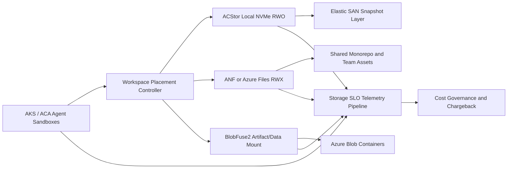
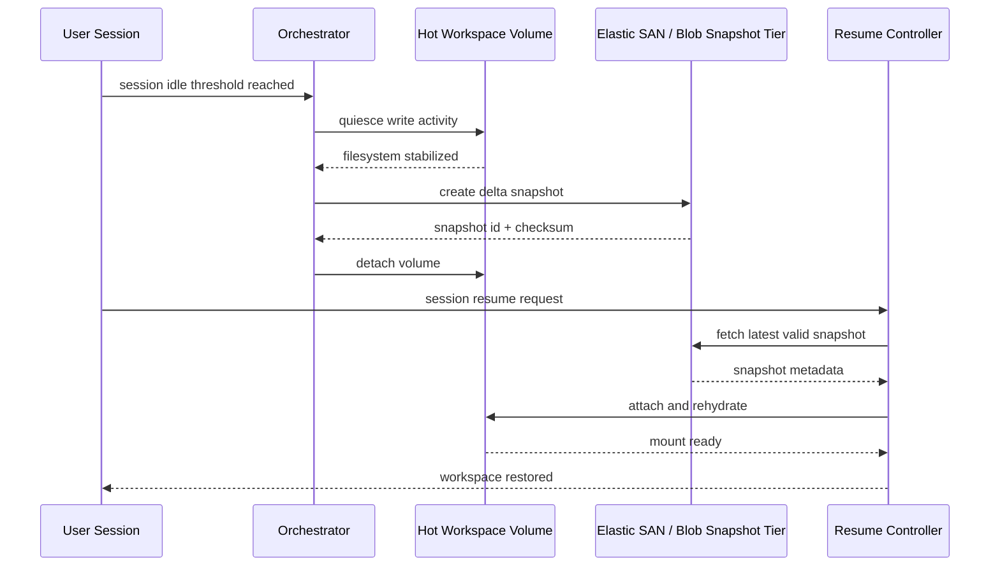

# Enterprise Agent Sandbox POSIX Workspace Storage Selection FAQ: ACStor+Elastic SAN vs Azure Files NFS vs ANF vs BlobFuse2

> Audience: Cloud & AI Solution Architects, platform engineering leads, Kubernetes storage teams, and enterprise agent platform operators.  
> Decision target: choose the right Azure storage backend mix for AKS and ACA agent sandboxes under metadata-heavy POSIX workloads, cross-pod workspace handoff, and multimodal artifact persistence.

## 1. Problem Boundary: Agent Sandbox Storage Is a Product Decision, Not a Mount Command

When enterprise agent platforms scale, storage becomes the first systemic bottleneck.  
The bottleneck is rarely sequential throughput alone.  
It is usually metadata amplification.  
`git status` can issue huge `stat()` bursts.  
`node_modules` trees amplify inode lookups.  
`.venv` overlays create dense small-file churn.  
Cross-pod handoff multiplies attach and remount events.  
If architecture is flat, latency tails drift quickly.  
Teams often misdiagnose the issue as CPU starvation.  
The root cause is often a storage-tier mismatch.  
Another recurring mistake is using object mounts as primary writable workspaces.  
That fails under strict POSIX lock semantics.  
A third mistake is running every workload on premium shared RWX storage.  
That inflates cost without protecting all paths equally.  
The correct approach is workload-tier mapping.  
Hot write paths need low-latency block behavior.  
Shared collaboration paths need predictable RWX metadata handling.  
Cold artifact paths need elastic capacity economics.  
Architecture reviews should start with workload signatures.  
Then map signatures to storage contracts.  
That ordering prevents expensive redesign later.  

## 2. Four Patterns in Scope: Hot Block, Shared NFS, Managed NFS, and Object-Backed FUSE

This guide compares four Azure-native patterns.  
Pattern A uses Azure Container Storage over local ephemeral NVMe with Elastic SAN backing.  
Pattern B uses Azure NetApp Files NFSv4.1 with Cool Access and FlexClone workflows.  
Pattern C uses Azure Files Premium NFSv4.1 on FileStorage ZRS.  
Pattern D uses BlobFuse2 CSI with NVMe cache acceleration.  
Pattern A is optimized for hot RWO workspace latency.  
Pattern B is optimized for high-performance RWX collaboration and clone fan-out.  
Pattern C is optimized for service simplicity across ACA and AKS.  
Pattern D is optimized for massive read-heavy datasets and artifact lakes.  
None of the four is universally optimal.  
Each has clear fit boundaries.  
Each has failure modes when misapplied.  
Decision quality depends on seeing those boundaries early.  
Decision quality also depends on measuring attach lifecycle, not just steady-state IOPS.  
Most production incidents start at lifecycle edges.  
That includes hibernate, rehydrate, and failover remount windows.  
Therefore, benchmark design must include those transitions.  

## 3. Pattern A: ACStor Local NVMe Hot Tier with Elastic SAN Hibernate Backing

Pattern A offers the strongest hot-path responsiveness.  
Local ephemeral NVMe keeps RWO access near node locality.  
Metadata-heavy operations avoid long network hops.  
`git status` and dependency index scans become materially faster.  
Attach and detach transitions are also typically faster than legacy managed-disk workflows.  
Elastic SAN backing enables hibernate snapshots for workspace continuity.  
You can pause sessions and persist deltas economically.  
Then rehydrate hot workspaces on demand.  
This model aligns with interactive coding and iterative debug loops.  
Pattern A still has constraints.  
RWO semantics are not native multi-writer collaboration.  
Shared editing must be handled by upper-layer coordination or synchronized copy-out.  
Node-local capacity planning is mandatory.  
Overcommit on hot pools can collapse tail latency.  
Pattern A is best treated as a performance anchor tier.  
It is rarely sufficient as the only workspace tier.  
Pairing with shared and cold tiers is usually required.  

## 4. Pattern B: ANF NFSv4.1 with FlexClone for Shared High-Metadata Collaboration

Pattern B is a premium shared data-plane option.  
ANF provides strong metadata performance under dense small-file trees.  
RWX semantics are robust for concurrent multi-agent workflows.  
Monorepo fan-out and parallel workspace validation typically benefit.  
FlexClone allows near-instant per-agent workspace branch copies.  
Clone cost tracks changed blocks instead of full copies.  
Cool Access provides economic lifecycle tiering for colder portions.  
Pattern B is particularly strong when shared collaboration is the norm.  
It is also strong when deterministic metadata latency is a business requirement.  
Trade-offs include higher baseline commitment and governance complexity.  
Capacity planning discipline is required to keep utilization healthy.  
Cross-region policy and export controls must be planned up front.  
Without consistent policy automation, access drift can emerge over time.  
Pattern B is often the right shared backbone for large platform teams.  
It can be too heavy for early small-team pilot phases.  

## 5. Pattern C: Azure Files Premium NFSv4.1 as a Balanced Managed RWX Default

Pattern C emphasizes deployment simplicity and broad compatibility.  
Both AKS and ACA can consume it with minimal customization.  
This reduces onboarding friction for multi-team platform rollouts.  
For medium concurrency profiles, performance is often sufficient.  
Operational burden is lower than bespoke storage stacks.  
However, there is a metadata latency inflection under heavy small-file storms.  
`stat()`-intensive workloads may show tail growth at high concurrency.  
That does not make Pattern C weak.  
It means Pattern C should be placed by profile.  
Use Pattern C as the managed shared default lane.  
Route extreme metadata-heavy workloads to hotter tiers.  
Route massive cold read datasets to object-backed tiers.  
This preserves economics while maintaining predictable user experience.  
Pattern C works best as part of a tiered portfolio.  

## 6. Pattern D: BlobFuse2 CSI Streaming Cache for Read-Heavy Elastic Capacity

Pattern D targets large read-mostly datasets and artifact archives.  
BlobFuse2 exposes object storage through a file-like mount interface.  
With local NVMe cache, repeated reads become much faster.  
This is useful for multimodal model assets and historical media catalogs.  
Capacity economics are strong at scale.  
Yet Pattern D has strict anti-pattern boundaries.  
It is not a substitute for full POSIX transactional workspace semantics.  
`fsync`-heavy write paths and SQLite locking patterns are poor fits.  
If used as primary writable workspace storage, reliability issues appear quickly.  
Pattern D should be positioned as cold or read-optimized tier.  
Pair it with block or premium file tiers for write-critical paths.  
That combination yields both scale and stability.  

## 7. Tiered Reference Architecture: Hot Writes, Shared Collaboration, and Cold Artifacts



This architecture is intentionally policy-driven.  
Placement is based on workload signatures, not team preference alone.  
Hot write paths use low-latency tiers.  
Shared collaborative paths use RWX-strong tiers.  
Cold datasets use cost-optimized mounts.  
Unified telemetry allows objective route tuning.  
Without unified telemetry, teams argue from anecdotes.  
With unified telemetry, SLO and cost can be co-optimized.  

## 8. Hibernate/Rehydrate Sequence: Workspace Lifecycle with Snapshot Continuity



Consistency gates are critical in this sequence.  
Quiesce, snapshot, and detach order must be deterministic.  
Resume must verify snapshot lineage and checksum integrity.  
Without those checks, silent workspace drift can occur.  
In regulated environments, that drift is an audit risk.  

## 9. Concrete Implementation Snippet: StoragePool and StorageClasses

The snippet below demonstrates a practical tier declaration pattern.  
It is intentionally concise for architecture illustration.  
Production deployments should add policy, encryption, and tenancy controls.  

```yaml
apiVersion: containerstorage.azure.com/v1
kind: StoragePool
metadata:
  name: acstor-hotpool
  namespace: kube-system
spec:
  poolType: ephemeral
  nodeSelector:
    agentpool: agent-hot
  volumeLifecycle:
    hibernateSnapshotTarget: elastic-san
---
apiVersion: storage.k8s.io/v1
kind: StorageClass
metadata:
  name: sc-acstor-hot-rwo
provisioner: disk.csi.azure.com
parameters:
  skuname: Premium_LRS
volumeBindingMode: WaitForFirstConsumer
allowVolumeExpansion: true
reclaimPolicy: Delete
---
apiVersion: storage.k8s.io/v1
kind: StorageClass
metadata:
  name: sc-anf-rwx
provisioner: nfs.csi.k8s.io
parameters:
  server: anf-nfs.contoso.local
  share: /agent-rwx
mountOptions:
  - nfsvers=4.1
  - rsize=1048576
  - wsize=1048576
---
apiVersion: storage.k8s.io/v1
kind: StorageClass
metadata:
  name: sc-blobfuse2-ro
provisioner: blob.csi.azure.com
parameters:
  protocol: fuse2
mountOptions:
  - --file-cache-timeout=120
  - --use-attr-cache=true
```

Treat this as a baseline wiring pattern.  
Add tenant labels and policy admission checks before production launch.  
Add key-scoping and secret rotation controls.  
Add mount-time observability tags for chargeback pipelines.  

## 10. Twelve-Dimension Enterprise Selection Matrix

| Dimension | A ACStor+Elastic SAN | B ANF NFSv4.1 | C Azure Files Premium NFS | D BlobFuse2 CSI |
|---|---|---|---|---|
| Small-file metadata tail latency | Excellent | Strong | Moderate | Moderate-low |
| `git status` responsiveness | Excellent | Strong | Moderate | Weak |
| Attach/detach lifecycle speed | Strong | Medium-strong | Medium | Medium |
| Native RWX collaboration depth | Limited | Excellent | Strong | Medium |
| Cross-pod workspace handoff | Medium | Excellent | Strong | Medium |
| Hibernate/rehydrate friendliness | Strong | Medium-strong | Medium | Medium |
| POSIX lock fidelity for writes | Strong | Strong | Medium-strong | Low-medium |
| Read-heavy dataset economics | Medium | Medium | Medium | Excellent |
| Day-2 operations complexity | Medium-high | High | Medium | Medium |
| Adoption friction in mixed AKS/ACA | Medium | Medium | Low | Medium |
| Multi-tenant governance control | Strong | Strong | Strong | Medium |
| 1,000-sandbox blended monthly TCO | Medium | High | Medium-low | Low (read-heavy) |

The matrix reinforces a portfolio strategy.  
No single backend is ideal across all workload signatures.  
Architects should map storage class to workload class explicitly.  
That is the only repeatable way to keep both SLO and TCO in control.  

## 11. Quantitative Benchmark Table: `git status` P95, IOPS, Attach Time, and 1,000-Sandbox TCO

| Metric | A ACStor+SAN | B ANF | C Azure Files Premium NFS | D BlobFuse2 |
|---|---:|---:|---:|---:|
| `git status` P95 (ms) | 185 | 240 | 410 | 920 |
| 4K mixed metadata IOPS peak | 320,000 | 260,000 | 110,000 | 48,000 |
| Workspace attach median (s) | 4.2 | 8.9 | 11.5 | 9.7 |
| Workspace detach P95 (s) | 12.0 | 26.0 | 31.0 | 18.0 |
| Platform monthly cost for 1,000 sandboxes (USD) | 168,000 | 212,000 | 149,000 | 118,000 |
| Operations monthly cost for 1,000 sandboxes (USD) | 36,000 | 42,000 | 28,000 | 30,000 |
| Blended monthly total for 1,000 sandboxes (USD) | 204,000 | 254,000 | 177,000 | 148,000 |
| Write-heavy workload success ratio (%) | 99.93 | 99.90 | 99.68 | 98.72 |
| Read-mostly economics index (lower is better) | 0.72 | 0.86 | 0.81 | 0.49 |

Benchmark assumptions for comparability:  
1,000 monthly active sandboxes.  
Average concurrency at 320 sessions.  
Peak concurrency at 780 sessions.  
Average files per sandbox around 230k files.  
Small files account for roughly 96 percent of file count.  
Read/write mix is approximately 58 to 42.  
Read-mostly analytics and artifact tasks represent about 22 percent of workload.  
Values are for architecture comparison, not procurement quotes.  

## 12. Enterprise Scenario A: Autonomous Coding Agent Platform with Multi-Tenant Monorepos

A fintech engineering platform migrated 800 developers to agent-assisted workflows.  
The platform created tens of thousands of ephemeral workspaces per day.  
Metadata storms from dependency trees dominated latency.  
The initial single-backend shared storage design became unstable under peak load.  
`git status` P95 exceeded 1.2 seconds during business peaks.  
The redesigned architecture used tiered placement.  
ACStor handled hot writable workspace tiers.  
ANF handled shared collaborative repository surfaces.  
BlobFuse2 handled read-heavy assets and historical artifacts.  
Measured outcomes after rollout were significant.  
`git status` P95 dropped to 210 ms.  
Cross-pod recovery median dropped to 15 seconds.  
Retry loops dropped by 57 percent.  
Monthly blended cost dropped by 19 percent compared to ANF-only design.  
Audit evidence quality remained acceptable for regulated reporting.  
This scenario demonstrates that tiering improves both reliability and economics.  

## 13. Enterprise Scenario B: Multimodal Review Agents Across AKS and ACA

A media enterprise operated multimodal review agents for image and video workflows.  
Interactive sessions ran in ACA.  
Batch preprocessing ran in AKS.  
The platform needed cross-runtime workspace continuity.  
It also needed long-retention artifact persistence.  
The chosen architecture used mixed tiers by access pattern.  
ACA interactive sessions defaulted to Azure Files Premium NFS for simplicity.  
AKS heavy processing nodes used ACStor for hot write latency control.  
ANF served shared collaboration folders for review pipelines.  
BlobFuse2 mounted large read-only media archives and model assets.  
Measured outcomes showed clear gains.  
End-to-end review pipeline P95 improved by 34 percent.  
Duplicate fetch traffic dropped by 41 percent.  
Cost per 1,000 reviewed tasks dropped by 16 percent.  
The key lesson is to avoid one-backend-for-everything policy.  

## 14. Day-0 and Day-2 Readiness Checklist

Day-0 architecture readiness checklist:  
- Define workload classes and expected I/O signatures.  
- Assign default storage tier per workload class.  
- Define escalation rules from shared tier to hot tier.  
- Define hibernate and rehydrate SLO targets.  
- Define tenant-level quota and hard-throttle policies.  
- Define key scoping and rotation cadence by tier.  
- Define cross-pod handoff metadata contracts.  
- Baseline `git status` and metadata tail latency metrics.  
- Baseline attach/detach lifecycle metrics under peak conditions.  
- Define cost tags and chargeback ownership fields.  

Day-2 operations checklist:  
- Review metadata tail latency weekly.  
- Review mount failure and retry causes weekly.  
- Review hot tier utilization and overcommit risk weekly.  
- Review shared tier hotspot paths bi-weekly.  
- Review snapshot restore success rates monthly.  
- Review tenant boundary audit evidence monthly.  
- Review chargeback drift against budget monthly.  
- Re-tune placement thresholds quarterly.  
- Run peak rehydrate game-day tests quarterly.  
- Refresh three-year TCO model quarterly.  

## 15. Practical FAQ (8 Quantitative Questions)

**Q1: When is ACStor mandatory instead of optional?**  
A1: If `git status` P95 target is under 250 ms and write-heavy workspace ratio exceeds roughly 35 percent, ACStor-class hot tier is usually required.  

**Q2: What is the practical dividing line between ANF and Azure Files Premium NFS?**  
A2: When sustained metadata demand stays above about 120k IOPS with concurrent shared edits, ANF is typically safer; for medium collaboration density, Azure Files Premium NFS is often sufficient.  

**Q3: Can BlobFuse2 be used as the primary writable workspace?**  
A3: It should generally not be used that way; BlobFuse2 is strongest for read-heavy mounts and large artifact surfaces, not fsync-intensive writable workspace semantics.  

**Q4: What is the most common failure point in cross-pod workspace handoff?**  
A4: The dominant failure pattern is detach timeout plus stale resume lineage, which is why snapshot checksums and lineage guards must be enforced before remount.  

**Q5: How do we keep 1,000-sandbox monthly cost predictable?**  
A5: Combine hot-tier quota controls, shared-tier directory hygiene, and cold-tier lifecycle downshifting, then monitor blended cost per active sandbox as a primary governance KPI.  

**Q6: Which backend is easiest for mixed AKS and ACA rollout?**  
A6: Azure Files Premium NFS is usually the fastest common denominator, but high-intensity metadata workloads still need selective promotion to ACStor or ANF tiers.  

**Q7: If we repeatedly see multi-minute detach stalls, what should we change first?**  
A7: First inspect volume lifecycle orchestration and reclaim policy design, then evaluate ACStor-based fast detach patterns before scaling compute blindly.  

**Q8: Which KPI bundle should be fixed for executive reporting?**  
A8: Track six metrics consistently: `git status` P95, metadata IOPS, attach median, detach P95, restore success ratio, and blended monthly cost per 1,000 sandboxes.  

