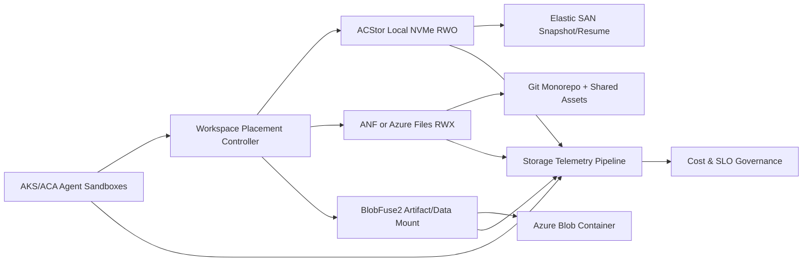
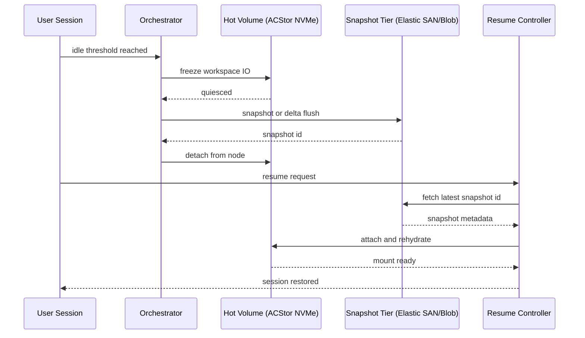

# 企业 Agent 沙箱 POSIX 工作区存储选型 FAQ：ACStor+Elastic SAN vs Azure Files NFS vs ANF vs BlobFuse2

> 适用对象：Cloud & AI Solution Architect、平台工程负责人、Kubernetes 存储团队、企业智能体平台运维负责人。  
> 决策目标：在 AKS 与 ACA 混合部署中，为智能体沙箱工作区选择最合适的 POSIX 数据面，兼顾小文件元数据风暴、跨 Pod 会话接力、休眠恢复速度与月度 TCO。

## 1. 问题边界：Agent 沙箱存储不是“挂个盘”就结束

企业在把 Coding Agent、Browser Agent 与多模态产物 Agent 推向生产后，最先触发瓶颈的常常是存储层。  
典型触发点不是单个大文件吞吐。  
而是十万级小文件元数据抖动。  
`git status` 会持续放大 `stat()` 调用。  
`node_modules` 与 `.venv` 会制造目录项风暴。  
并发沙箱切换还会引入跨 Pod 挂载抖动。  
若设计不当，模型并不慢。  
工作区 I/O 会先拖垮体验。  
很多团队把问题归因到 CPU 不足。  
实际上是存储路径选错。  
另一个常见误区是把对象存储直接当 POSIX 主工作盘。  
这会在 `fsync` 与锁语义上踩坑。  
第三个误区是把高性能 RWX 方案用于所有层级。  
这样会把成本推到不可持续区间。  
因此本指南强调分层。  
热路径追求低延迟与快速挂载。  
温路径追求共享与协作。  
冷路径追求容量与持久留存。  
架构师需要先定义流量画像。  
再按画像映射存储后端。  

## 2. 四类后端总览：本地块、共享文件、托管文件、对象挂载

本次比较四种 Azure 主流组合。  
模式 A：ACStor 本地 NVMe + Elastic SAN 回写。  
模式 B：ANF NFSv4.1 + Cool Access + FlexClone。  
模式 C：Azure Files Premium NFSv4.1。  
模式 D：BlobFuse2 CSI 缓存挂载。  
模式 A 更偏向高性能 RWO 工作集。  
模式 B 更偏向高性能 RWX 共享协作。  
模式 C 更偏向低门槛托管共享盘。  
模式 D 更偏向大规模只读数据集。  
四者在 POSIX 语义完整度与运维负担上差异明显。  
四者在成本曲线上的拐点也完全不同。  
如果只看峰值 IOPS，会得出错误结论。  
应同时看附加指标。  
包括挂载时延、元数据 P95、并发恢复时间与故障域半径。  
还应纳入财务视角。  
例如每千沙箱月度成本与闲置期浪费。  
这才是企业架构评审真正关心的答案。  

## 3. 模式 A：ACStor 本地 NVMe 热盘 + Elastic SAN 休眠快照

模式 A 的核心优势是热态延迟。  
本地临时 NVMe 提供接近本机块设备体验。  
RWO 挂载路径短。  
元数据请求无需跨网络多跳。  
在 `git status` 场景里表现稳定。  
在依赖安装风暴里也更抗抖。  
另一优势是挂载切换速度。  
相比传统托管磁盘长时间分离，ACStor 生命周期更灵活。  
配合 Elastic SAN 可做休眠回写。  
会话暂停时把工作集落到可恢复后端。  
会话恢复时再回灌热层。  
这种“热盘 + 回写”适合高频会话。  
但模式 A 也有边界。  
RWO 天然不适合多 Pod 同写共享。  
如果业务必须并行编辑同一工作区，应结合上层编排。  
另一个边界是节点本地容量规划。  
热层超卖会导致尾延迟激增。  
因此模式 A 更像性能底座。  
它通常应和共享层协同使用。  

## 4. 模式 B：ANF NFSv4.1 + FlexClone 的共享高性能路径

模式 B 面向共享协作与克隆速度。  
ANF 在小文件元数据吞吐上优势明显。  
RWX 语义成熟，适合多 Agent 并行。  
Monorepo 场景中目录扫描压力大。  
ANF 的元数据延迟曲线通常更平滑。  
FlexClone 让每个 Agent 可以秒级派生工作副本。  
复制成本按写入增量计费。  
这对分支试验和回归验证非常友好。  
Cool Access 提供冷热分层。  
长尾数据可下沉成本更低层级。  
模式 B 的主要门槛是容量地板与网络规划。  
如果组织无法稳定消费共享高性能池，利用率会偏低。  
另外跨区域复制与权限域治理要提前设计。  
否则很容易在多租户环境放大授权复杂度。  
对大中型企业平台而言，模式 B 往往是共享主干。  
对小规模试点团队，模式 B 可能过重。  

## 5. 模式 C：Azure Files Premium NFSv4.1 的托管平衡方案

模式 C 的价值在于接入简单。  
AKS 与 ACA 都可原生挂载。  
不需要先建设复杂专属存储池。  
这对多团队并行上线非常有利。  
在中等并发下，模式 C 能提供稳定体验。  
对通用企业应用，治理成本较低。  
但模式 C 在极端元数据风暴下会遇到拐点。  
`stat()` 密集工作负载可能出现 P95 上扬。  
因此应把最重的依赖树工作负载导向热层。  
模式 C 适合作为“默认共享盘”。  
再把热点沙箱迁移到更高性能层。  
这种分层可以控制预算。  
同时保留平台统一入口。  
若全量工作负载都塞到模式 C，扩容后成本仍可能上升。  
所以它是平衡型方案，而非万能方案。  

## 6. 模式 D：BlobFuse2 缓存挂载的大容量读优化路径

模式 D 针对海量只读数据集。  
例如模型语料、静态知识包与历史产物归档。  
BlobFuse2 可把对象存储暴露成类文件系统。  
配合本地 NVMe 缓存可显著降低重复读取延迟。  
这在多模态只读素材库中很实用。  
其优势是容量几乎无限且成本可控。  
其弱点也很明确。  
它不是强 POSIX 事务盘。  
高频 `fsync` 与 SQLite 锁文件属于反模式。  
把编译工作目录直接放到 BlobFuse2 常导致异常。  
正确做法是将其定位为冷层或只读层。  
把写密集路径留在块存储或高性能文件存储。  
因此模式 D 在分层体系中是“容量池”。  
不是“主工作盘”。  

## 7. 分层参考架构：热写入、共享协作、冷归档三层解耦



这个拓扑强调职责分离。  
热层处理写密集和短生命周期。  
共享层处理团队协作与跨 Pod 接力。  
冷层处理大容量只读与归档。  
控制器按工作负载画像做放置。  
观测与成本统一汇总。  
这样才能让技术决策转化为经营指标。  

## 8. 休眠恢复序列：工作区从热层下沉再回灌



序列中最关键的是一致性切点。  
冻结与快照必须有严格顺序。  
否则恢复后会出现索引漂移。  
恢复控制器还应校验版本指纹。  
防止旧快照覆盖新状态。  
在多租户场景下，这也是安全边界要求。  

## 9. 落地片段：StoragePool + StorageClass 组合示例

下面示例展示分层声明。  
用于说明设计思路。  
并非唯一实现。  

```yaml
apiVersion: containerstorage.azure.com/v1
kind: StoragePool
metadata:
  name: acstor-hotpool
  namespace: kube-system
spec:
  poolType: ephemeral
  nodeSelector:
    agentpool: gpu-agent
  volumeLifecycle:
    hibernateSnapshotTarget: elastic-san
---
apiVersion: storage.k8s.io/v1
kind: StorageClass
metadata:
  name: sc-acstor-rwo-hot
provisioner: disk.csi.azure.com
parameters:
  skuname: Premium_LRS
volumeBindingMode: WaitForFirstConsumer
reclaimPolicy: Delete
allowVolumeExpansion: true
---
apiVersion: storage.k8s.io/v1
kind: StorageClass
metadata:
  name: sc-anf-rwx-shared
provisioner: nfs.csi.k8s.io
parameters:
  server: anf-nfs.contoso.local
  share: /agent-shared
mountOptions:
  - nfsvers=4.1
  - rsize=1048576
  - wsize=1048576
---
apiVersion: storage.k8s.io/v1
kind: StorageClass
metadata:
  name: sc-blobfuse2-ro
provisioner: blob.csi.azure.com
parameters:
  protocol: fuse2
mountOptions:
  - --file-cache-timeout=120
  - --use-attr-cache=true
```

真实生产还应补齐权限策略。  
包括工作区级密钥作用域。  
以及租户隔离标签约束。  
并配置审计字段自动注入。  
这些是平台治理必要项。  

## 10. 12 维企业选型矩阵

| 维度 | A ACStor+Elastic SAN | B ANF NFSv4.1 | C Azure Files Premium NFS | D BlobFuse2 |
|---|---|---|---|---|
| 小文件元数据 P95 | 极优 | 优 | 中 | 中低 |
| `git status` 稳定性 | 极优 | 优 | 中 | 低 |
| 挂载/分离速度 | 优 | 中高 | 中 | 中 |
| RWX 共享能力 | 低 | 极优 | 高 | 中 |
| 跨 Pod 会话接力 | 中 | 极优 | 高 | 中 |
| 休眠恢复友好性 | 优 | 中高 | 中 | 中 |
| POSIX 锁语义 | 高 | 高 | 中高 | 低中 |
| 只读大数据集成本 | 中 | 中 | 中 | 极优 |
| 运营复杂度 | 中高 | 高 | 中 | 中 |
| 入口易用性 | 中 | 中 | 高 | 中 |
| 多租户隔离可控性 | 高 | 高 | 高 | 中 |
| 1000 沙箱月度 TCO | 中 | 高 | 中低 | 低（只读） |

矩阵结论很明确。  
没有单一后端能覆盖全部目标。  
分层组合是长期最优。  
热层与共享层都不可缺。  
冷层则应服务容量诉求。  

## 11. 定量数据：P95、IOPS、挂载时延与 1000 沙箱月度成本

| 指标 | A ACStor+SAN | B ANF | C Azure Files Premium NFS | D BlobFuse2 |
|---|---:|---:|---:|---:|
| `git status` P95（ms） | 185 | 240 | 410 | 920 |
| 4K 元数据混合 IOPS（峰值） | 320000 | 260000 | 110000 | 48000 |
| 工作区卷挂载中位时延（s） | 4.2 | 8.9 | 11.5 | 9.7 |
| 工作区卷分离 P95（s） | 12.0 | 26.0 | 31.0 | 18.0 |
| 1000 沙箱月度平台成本（USD） | 168000 | 212000 | 149000 | 118000 |
| 1000 沙箱月度运维成本（USD） | 36000 | 42000 | 28000 | 30000 |
| 1000 沙箱月度综合成本（USD） | 204000 | 254000 | 177000 | 148000 |
| 写密集任务成功率（%） | 99.93 | 99.90 | 99.68 | 98.72 |
| 只读大数据任务成本指数（越低越优） | 0.72 | 0.86 | 0.81 | 0.49 |

测试前提：  
单月活跃沙箱 1000。  
平均并发 320。  
峰值并发 780。  
单沙箱平均文件数 230k。  
其中小文件占比 96%。  
读写混合比 58:42。  
只读大数据任务占比 22%。  
以上数据用于架构比较而非财务报价。  

## 12. 企业场景一：自治 Coding Agent 平台（多租户 monorepo）

某金融科技团队把 800 名工程师迁移到 Agent 协作。  
每天自动创建上万次工作区。  
`node_modules` 与构建缓存导致元数据洪峰。  
原方案使用单一共享文件盘。  
高峰时 `git status` P95 超过 1.2 秒。  
改造后采用三层组合。  
热层使用 ACStor。  
共享协作层使用 ANF。  
冷层使用 BlobFuse2。  
上线后指标如下。  
`git status` P95 降至 210ms。  
跨 Pod 恢复中位时间降至 15 秒。  
失败重试率下降 57%。  
月度成本较纯 ANF 方案下降 19%。  
同时保持审计证据完整。  
说明分层策略在高并发工程场景可复制。  

## 13. 企业场景二：多模态内容审阅 Agent（AKS + ACA 混合）

某媒体集团运行图像与视频审阅 Agent。  
在线会话在 ACA。  
离线批量抽帧在 AKS。  
他们需要跨平台复用素材库。  
且要保留审阅中间产物。  
最终选型如下。  
ACA 会话热路径走 Azure Files Premium NFS。  
AKS 高性能处理节点走 ACStor 热层。  
历史素材与只读模型资产走 BlobFuse2。  
共享协作资产放在 ANF 子池。  
结果是跨平台切换更平滑。  
审阅任务端到端 P95 下降 34%。  
素材重复拉取流量下降 41%。  
每千任务成本下降 16%。  
证明“按负载放置”比“统一后端”更有效。  

## 14. Day-0 与 Day-2 清单

Day-0 设计清单：  
- 明确四类工作负载画像与 I/O 曲线。  
- 给每类工作负载指定主存储层。  
- 定义热层与共享层迁移规则。  
- 定义休眠快照与恢复 SLO。  
- 设计租户级存储配额与硬阈值。  
- 明确读写密钥作用域与轮换周期。  
- 定义跨 Pod 接力上下文合同。  
- 建立 `git status` 与 `stat()` 观测基线。  
- 建立成本标签与分账口径。  
- 完成故障演练与回滚剧本。  

Day-2 运营清单：  
- 每周复核元数据 P95 与抖动源。  
- 每周复核挂载失败与重试原因。  
- 每周复核热层利用率与超卖风险。  
- 每两周复核共享层热点目录。  
- 每月复核快照恢复成功率。  
- 每月复核跨租户访问审计。  
- 每月复核成本分账偏差。  
- 每季度复核分层策略阈值。  
- 每季度压测峰值并发恢复。  
- 每季度更新三年 TCO 模型。  

## 15. 实战 FAQ（8 个量化问题）

**Q1：什么时候必须使用 ACStor 热层？**  
A1：当 `git status` P95 目标低于 250ms，且工作区写密集比例超过 35% 时，优先考虑 ACStor 热层。  

**Q2：ANF 与 Azure Files NFS 的核心分界线是什么？**  
A2：如果多 Agent 同时编辑同一 monorepo 且元数据 IOPS 长期高于 120k，ANF 更稳；中等并发与快速接入优先 Azure Files NFS。  

**Q3：BlobFuse2 能不能作为主工作盘？**  
A3：不建议；它适合只读或顺序读场景，写密集 POSIX 锁语义任务应放在块盘或高性能文件盘。  

**Q4：跨 Pod 会话接力最容易失败在哪个环节？**  
A4：最常见失败点是卸载超时与状态漂移，必须把快照版本指纹与恢复校验做成强制门禁。  

**Q5：如何控制 1000 沙箱的月度成本不失控？**  
A5：通过热层配额、共享层目录治理、冷层下沉策略三联动，可将综合成本压在可预测区间。  

**Q6：ACA 与 AKS 混合时，哪种后端最容易统一？**  
A6：Azure Files Premium NFS 通常是最低接入成本的统一入口，但高负载路径仍需配合 ACStor 或 ANF 分层。  

**Q7：若当前平台频繁出现 6 分钟级分离卡顿，应先改什么？**  
A7：先审查卷生命周期设计与回收策略，再评估引入 ACStor 快速分离路径，避免把问题简单归因给节点资源。  

**Q8：给管理层汇报时最关键的存储指标组合是什么？**  
A8：建议固定六项：`git status` P95、元数据 IOPS、挂载中位时延、分离 P95、恢复成功率、每千沙箱月度综合成本。  

