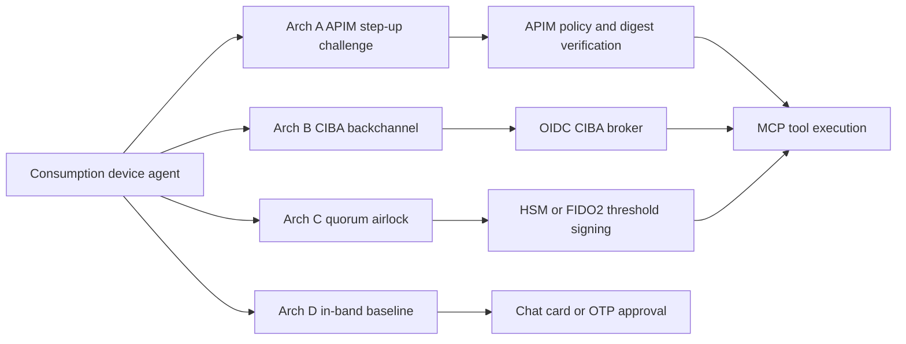
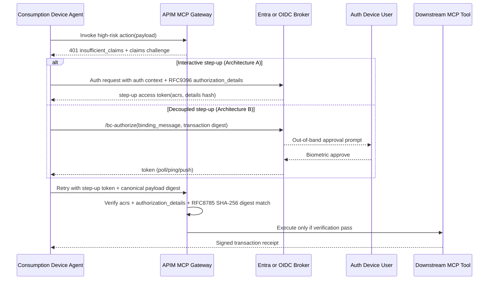
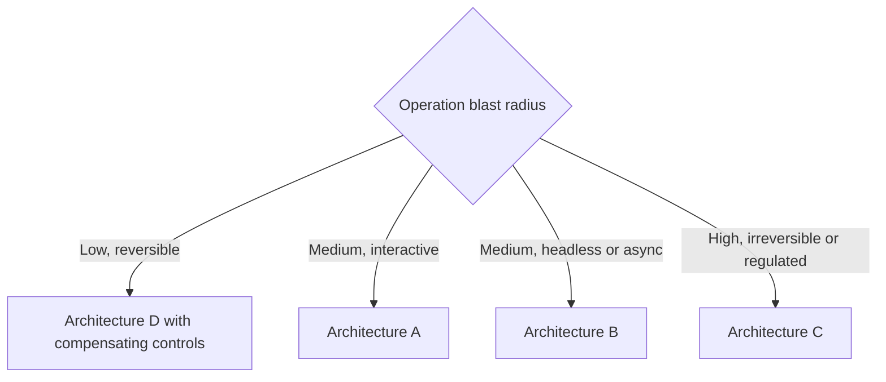

# Agent Step-Up Transaction Signing Selection FAQ: RFC 9396 RAR + Entra Auth Context vs OpenID CIBA vs HSM Quorum
> **Applies to**: enterprise B2E and headless/background autonomous agents executing high-blast-radius MCP mutations.
> **Decision pressure**: enforce cryptographically bound step-up approval and payload integrity for asynchronous workflows without active browser sessions.
> **Core objective**: select an authorization pattern that blocks TOCTOU, push-fatigue abuse, replay, and confused-deputy execution under enterprise audit.

## 1. Executive summary
- High-risk autonomous agent actions require payload-bound authorization, not generic session-level approval.
- Front-channel OAuth challenge loops break down for headless and long-wait asynchronous workers.
- Chat-card click approvals without signed payload binding are vulnerable to summary-payload divergence.
- Architecture A is strongest for interactive hosts with strict APIM `insufficient_claims` challenge flow.
- Architecture B is strongest for decoupled headless channels via OpenID CIBA backchannel authentication.
- Architecture C is strongest for irreversible tier-0 operations demanding multi-party cryptographic quorum.
- Architecture D is acceptable only for low-risk controlled actions and should be treated as anti-pattern baseline.
- `authorization_details` digest binding is required to stop TOCTOU action swapping.
- Step-up decisions must be bound to exact action type, scope ceiling, resource URI, and canonical argument hash.
- Async worker parking must use checkpoint/resume patterns, not thread blocking.
- Service design should route requests by risk tier to the appropriate step-up architecture.
- Finance, security, and operations should jointly own challenge-rate and control-cost policies.

## 2. Applicability and explicit non-goals
- Scope includes enterprise internal operations: treasury release, DB failover/drop, RBAC elevation, and confidential share governance.
- Scope includes decoupled authentication where consumption device and authentication device are distinct.
- Scope includes transaction-specific signing and attestation with replay-resistant binding data.
- Scope includes APIM enforcement gates and step-up token re-acquisition loops.
- Scope is explicitly not B2C payment card checkout 3DS flows from #291.
- Scope is distinct from general runtime prompt-injection defenses in section 3.3.
- Scope is distinct from broad FinOps token chargeback accounting in section 3.7.
- Scope excludes end-user UX copywriting and brand approval workflows.
- Scope excludes low-risk read-only API operation authentication simplifications.

## 3. Scenario and failure mechanics
- Headless workers cannot complete browser redirects required by front-channel OAuth challenges.
- Chat approval summaries can diverge from final executable payloads after approval click.
- Long approval waits can hold expensive workers if no checkpoint pattern is used.
- Generic broad-scope refresh tokens enable confused-deputy overreach in delegated agents.
- Push fatigue can coerce users into approving malicious or stale prompts.
- Replay of previously approved payloads can bypass intent if nonce/expiry is weak.
- Step-up architecture must preserve non-repudiation and precise action intent.

## 4. Four architecture candidates
- **Architecture A**: Entra Conditional Access Authentication Context + RFC 9396 RAR + APIM `insufficient_claims` enforcement.
- **Architecture B**: OpenID CIBA backchannel step-up with signed binding message and JWS transaction receipt.
- **Architecture C**: multi-party cryptographic quorum using HSM/FIDO2 signatures plus Verified ID and Confidential Ledger.
- **Architecture D**: in-band chat/SMS OTP or static broad-scope OBO refresh token baseline.
- A emphasizes interactive challenge-response with strict payload-bound token reacquisition.
- B emphasizes asynchronous decoupled approval without blocking compute workers.
- C emphasizes dual-control governance for irreversible operations.
- D highlights convenience-first patterns with high security and audit failure risk.

## 5. Architecture A details (auth context + RAR + APIM step-up)
- APIM returns `WWW-Authenticate: Bearer error=\"insufficient_claims\"` when higher assurance is required.
- Interactive host reauthenticates with required auth context (`acrs` claim, e.g. `c1`) and strong device posture.
- `authorization_details` include action type, resource, amount ceiling, and canonical argument hash.
- Canonicalization should follow RFC 8785 JCS before SHA-256 digest binding.
- APIM verifies token claims and payload digest equality before tool invocation.
- Short-lived step-up token limits replay window for sensitive operations.
- Works best when user has active browser-capable interaction channel.
- Less suitable for long-running background workers without user session context.

## 6. Architecture B details (OpenID CIBA backchannel)
- Consumption device submits `/bc-authorize` with transaction intent and binding message.
- User approves on separate authentication device (mobile authenticator or verified identity channel).
- CD handles `authorization_pending` and `slow_down` with controlled poll backoff.
- Ping or push callback modes avoid busy waiting and reduce worker occupancy.
- Returned token is bound to approved transaction context and validity window.
- Signed receipt (JWS) should be archived for audit and dispute traceability.
- Best fit for IVR, daemon, queue worker, and unattended service scenarios.
- Requires robust callback security and correlation-state management.

## 7. Architecture C details (cryptographic quorum airlock)
- Requires `2-of-N` or stronger threshold signatures for irreversible actions.
- Separate approvers sign identical canonical payload digest, preventing hidden parameter mutation.
- Managed HSM/FIDO2 detached signatures provide hardware-backed non-repudiation.
- Verified ID liveness signals can strengthen human-presence assurance.
- Confidential Ledger records immutable approval sequence and evidence hashes.
- Single compromised account cannot execute unilateral high-impact mutations.
- Adds higher friction and latency but maximizes governance assurance.
- Ideal for treasury, key lifecycle, and top-tier policy mutation controls.

## 8. Architecture D details (baseline/anti-pattern)
- In-band card clicks summarize intent but often lack payload digest binding.
- SMS/email OTP lacks robust transaction detail integrity and is phishing-prone.
- Static broad-scope refresh tokens can authorize actions beyond current intent.
- TOCTOU mutation between displayed summary and executed payload is common.
- Push-fatigue social engineering raises false approval probability.
- Manual review burden rises because evidence is weak and ambiguous.
- Useful only for low-risk reversible operations with strict compensating controls.
- Should not be used for high-blast-radius autonomous mutations.

## 9. Twelve-dimension architecture comparison matrix
| Dimension | Architecture A | Architecture B | Architecture C | Architecture D |
|---|---|---|---|---|
| Headless suitability | Medium | Highest | High | Medium |
| Payload binding strength | High | High | Highest | Low |
| Decoupled auth support | Medium | Highest | High | Low |
| TOCTOU resistance | High | High | Highest | Low |
| Replay resistance | High | High | Highest | Low |
| Push-fatigue resilience | Medium-high | High | Highest | Low |
| Human friction | Medium | Medium | High | Low |
| Worker efficiency | Medium | Highest | Medium | Medium |
| Audit non-repudiation | High | High | Highest | Low |
| Implementation complexity | Medium | Medium-high | High | Low |
| Cost per governed action | Medium | Medium | High | Low upfront |
| Suitability for irreversible ops | High | High | Highest | Not suitable |

## 10. Four-architecture topology overview


## 11. APIM challenge + CIBA + RFC 9396 digest-binding sequence


## 12. Risk-tier routing decision tree


### Q1. Why front-channel OAuth and chat buttons fail for headless or async agents
- Front-channel OAuth assumes active browser handoff and immediate user interaction.
- Queue workers and daemons cannot reliably satisfy redirect-based claim challenges.
- Chat cards often display summarized intent instead of canonical executable payload.
- Approval timestamps can outlive payload validity and enable stale-action replay.
- Without digest binding, summary/payload divergence remains undetected.
- OTP channels are vulnerable to phishing relays and prompt confusion.
- Async operations need resumable checkpoints, not synchronous wait loops.
- Headless-safe flows must externalize approval while preserving cryptographic intent binding.
- These failure modes compound under incident pressure and high approval volume.

### Q2. End-to-end protocol mechanics across the four architectures
- Architecture A uses APIM challenge-response with enriched claims and RAR details.
- Architecture B decouples approval via CIBA and asynchronous callback/poll control.
- Architecture C adds threshold-signature quorum and immutable evidence chain.
- Architecture D relies on low-assurance channels and weak context coupling.
- Architecture A and B should both enforce canonical payload digest checks at gateway.
- Architecture C should require identical digest signed by multiple approvers.
- Architecture D requires strict scope limits and compensating controls if retained.
- Common control plane should log action intent, challenge state, and final receipt.
- Selection should be deterministic by risk class and execution modality.

### Q3. TOCTOU, replay, push-fatigue, and async worker parking math
- TOCTOU risk can be approximated as `P_tamper = 1 - e^(-λ_mutation * Δt)`.
- Replay risk grows when token TTL significantly exceeds approval confirmation latency.
- CIBA `expires_in` should be aligned with expected `T_approval` envelope and risk tier.
- Push-fatigue risk increases with challenge frequency and low context clarity.
- Worker parking cost is `Cost_hold = N_workers * T_approval * C_worker`.
- Durable checkpointing converts blocking wait into low-cost resumed orchestration.
- Poll loops should apply exponential backoff for `authorization_pending` and `slow_down`.
- Nonce and one-time transaction IDs must be mandatory for all high-risk approvals.
- Metrics should track challenge acceptance quality, not only approval rate.

### Q4. How to implement payload-bound transaction signing correctly
- Canonicalize payload via RFC 8785 JCS before digest computation.
- Include action type, resource URI, scope ceiling, and argument hash in signed details.
- Gateway must verify exact digest equality with runtime payload before invocation.
- Any payload mutation after approval should invalidate token and require re-approval.
- Signatures should include issuance timestamp, expiry, nonce, and signer identity.
- Quorum mode requires each signer to attest identical canonical digest bytes.
- Store detached signatures and verification outputs in immutable audit storage.
- This closes summary-payload divergence and confused-deputy execution paths.
- Deterministic verification logic improves legal and compliance defensibility.

### Q5. Production patterns for APIM step-up and CIBA backchannel orchestration
- APIM policy should branch by risk tier and operation metadata.
- `insufficient_claims` responses should include precise required auth context.
- CIBA orchestration should persist correlation state and callback authenticity checks.
- Worker should checkpoint state and release compute while awaiting approval.
- On approval, tool invocation must re-validate digest and scope constraints.

```python
def verify_authorization_details(canonical_payload, auth_details):
    digest = sha256(canonical_payload.encode("utf-8")).hexdigest()
    if auth_details["payload_sha256"] != digest:
        raise ValueError("payload digest mismatch")
    if not within_scope_ceiling(auth_details):
        raise ValueError("scope ceiling violation")
    return True
```

```python
def ciba_orchestration(state, oidc_client):
    if state.phase == "init":
        state.auth_req_id = oidc_client.bc_authorize(state.binding_message, state.payload_digest)
        state.phase = "pending"
        return checkpoint(state, wake_in_seconds=30)
    if state.phase == "pending":
        result = oidc_client.poll_token(state.auth_req_id)
        if result.status in ["authorization_pending", "slow_down"]:
            return checkpoint(state, wake_in_seconds=result.retry_after)
        state.stepup_token = result.access_token
        state.phase = "approved"
        return state
```

```json
{
  "stepup_contract": {
    "required_acrs": "c1",
    "rar_fields": ["action", "resource_uri", "scope_ceiling", "payload_sha256", "nonce", "expires_at"],
    "reject_on": ["digest_mismatch", "expired", "scope_violation", "replay_nonce"]
  }
}
```

### Q6. Three-year TCO across 50K, 1M, and 10M governed invocations per month
- Cost depends on invocation volume, challenge rate (`2%–8%`), and approval architecture.
- Architecture D appears cheaper upfront but increases incident, fraud, and dispute losses.
- Architecture C has highest control assurance and highest per-action friction cost.
- Architecture B often yields best headless efficiency at moderate assurance cost.

| Monthly governed invocations | Architecture A | Architecture B | Architecture C | Architecture D |
|---|---:|---:|---:|---:|
| 50K | \$0.80M–\$1.30M | \$0.85M–\$1.35M | \$1.10M–\$1.80M | \$0.60M–\$1.00M |
| 1M | \$5.90M–\$9.20M | \$6.10M–\$9.40M | \$8.30M–\$12.90M | \$5.20M–\$8.60M |
| 10M | \$31.00M–\$47.00M | \$32.00M–\$49.00M | \$44.00M–\$66.00M | \$30.00M–\$46.00M |

| Monthly governed invocations | Typical reduction in unauthorized high-risk execution incidents | Typical reduction in approval-dispute resolution effort |
|---|---:|---:|
| 50K | 34%–52% | 27%–44% |
| 1M | 43%–61% | 35%–53% |
| 10M | 50%–68% | 41%–59% |

- Risk-adjusted TCO should include downstream loss avoidance and audit burden changes.
- Challenge-rate tuning should be tied to dynamic risk posture and incident telemetry.
- Quarterly recalibration is required as operation mix and threat pressure change.

## 13. Day-0 rollout checklist
- Define operation risk tiers and mandatory step-up routing policy.
- Standardize canonical payload schema and RFC 8785 digest generation library.
- Implement APIM policy enforcing `insufficient_claims` and RAR verification.
- Build CIBA correlation, callback verification, and retry/backoff orchestration.
- Integrate durable checkpoint/resume for long approval latency scenarios.
- Configure token TTL, nonce replay cache, and transaction expiry controls.
- Establish immutable receipt and approval-evidence retention pipeline.
- Publish break-glass workflow with strict post-incident review requirements.

## 14. Day-2 operations checklist
- Monitor challenge acceptance quality, not just approval completion rates.
- Track digest mismatch rejections and root-cause categories.
- Audit stale-token and replay-block metrics weekly.
- Measure worker parking savings from checkpointing versus blocking baselines.
- Validate CIBA callback authenticity and queue delay distributions.
- Review quorum signer participation health and fallback readiness.
- Reassess risk-tier mapping for newly onboarded tools and actions.
- Recompute TCO and control efficacy quarterly.

## 15. Good fit versus not for
| Category | Guidance |
|---|---|
| ✅ Good fit | Enterprise autonomous operations with high-blast-radius mutable actions. |
| ✅ Good fit | Headless/async platforms requiring out-of-band step-up and signed payload binding. |
| ✅ Good fit | Regulated environments needing strong non-repudiation and audit evidence. |
| ⛔ Not for | Low-risk read-only actions where additional friction outweighs risk reduction. |
| ⛔ Not for | Teams without capability to run challenge orchestration and receipt governance. |
| ⛔ Not for | Workloads dependent on broad static delegated refresh tokens for convenience. |

## 16. Five-step implementation guide
1. Classify operations by blast radius and map to A/B/C/D authorization lanes.
2. Enforce payload canonicalization and digest-bound RAR contracts.
3. Deploy APIM and CIBA flows with durable async checkpointing.
4. Add quorum signing for irreversible tier-0 operations.
5. Operate continuous metrics, incident drills, and quarterly policy recalibration.

## 17. Quarterly governance metric pack
- Track challenge rate by operation class and tenant cohort.
- Track `insufficient_claims` round-trip latency percentiles.
- Track CIBA pending duration distribution and timeout rates.
- Track callback authenticity failures and replay-block counts.
- Track payload digest mismatch rejection frequency.
- Track scope-ceiling violation attempts and block outcomes.
- Track nonce cache hit ratio for replay prevention.
- Track stale approval token usage attempts.
- Track worker thread-hours avoided via checkpoint/resume.
- Track approval fatigue indicators by user group.
- Track quorum signer availability and participation variance.
- Track break-glass invocation count and postmortem closure time.
- Track unauthorized execution incidents prevented by step-up controls.
- Track dispute cases requiring transaction receipt evidence.
- Track receipt verification failures in audit sampling.
- Track action rollback frequency after approved execution.
- Track average cost per governed invocation by architecture lane.
- Track challenge success quality versus false-approval indicators.
- Track identity-device compliance drift impacting approval success.
- Track policy version drift across gateway and identity brokers.
- Track top operations triggering repeated step-up failures.
- Track quarterly TCO variance against forecast.
- Track legal/compliance exception findings for authorization evidence.
- Track high-risk operation volume migrating from D to A/B/C lanes.
- Track customer/internal stakeholder confidence score in approval integrity.
- Maintain architecture decision records for all step-up policy changes.

## 18. Provenance
- `anonymized_reported`: protocol patterns, risk formulas, and TCO ranges are synthesized from anonymized enterprise authorization-governance programs with reproducible assumptions.
