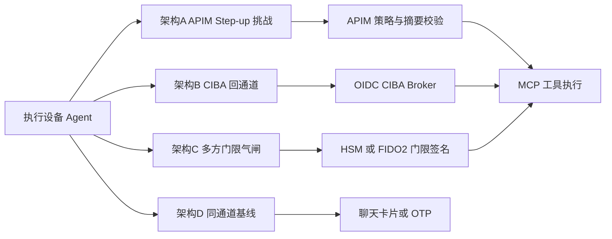
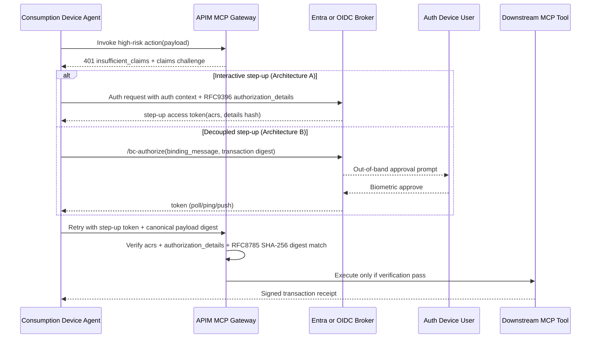
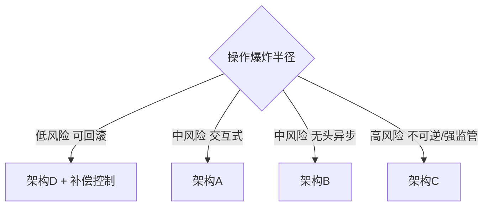

# 智能体 Step-Up 交易签名选型 FAQ：RFC 9396 RAR + Entra Auth Context vs OpenID CIBA vs HSM 多方门限
> **适用场景**：企业 B2E 与无头/后台自治智能体执行高爆炸半径 MCP 变更操作。
> **决策压力**：在异步流程下实现“强身份 + 载荷绑定 + 不可抵赖”的 step-up 授权。
> **核心目标**：在企业审计约束中阻断 TOCTOU、推送疲劳、重放与 confused-deputy 风险。

## 1. 执行摘要
- 高风险自治操作必须采用“交易载荷绑定授权”，不能只靠会话级批准。
- 前向通道 OAuth 在无头与长等待异步 worker 场景中天然脆弱。
- 未签名绑定载荷的聊天卡片审批容易出现摘要与执行参数偏离。
- 架构 A 适合交互式宿主，依赖 APIM `insufficient_claims` 严格挑战闭环。
- 架构 B 适合无头后台场景，依赖 OpenID CIBA 解耦认证设备与执行设备。
- 架构 C 适合不可逆 Tier-0 操作，依赖多方门限签名与强不可抵赖证据。
- 架构 D 仅可用于低风险受控动作，需作为反模式基线分析。
- `authorization_details` 必须绑定规范化 payload 摘要才能防 TOCTOU。
- step-up 决策需绑定动作类型、资源 URI、额度上限与参数哈希。
- 异步审批等待必须使用 checkpoint/resume，不应长时间占用线程。
- 平台应基于风险分层把请求路由到对应授权架构。
- 安全、财务、运维需共同治理 challenge 率与控制成本。

## 2. 适用边界与明确非目标
- 适用于 ERP/资金划拨、生产数据库 failover/drop、RBAC 提权、并购保密共享等高风险操作。
- 适用于执行设备（CD）与认证设备（AD）分离的解耦审批模型。
- 适用于交易级签名与重放防护的不可抵赖审计链。
- 适用于 APIM 网关 step-up 与载荷摘要强校验。
- 本文明确不覆盖 #291 的 B2C 支付卡 3DS 场景。
- 本文不等同于 3.3 中通用提示词注入防火墙问题。
- 本文不等同于 3.7 中 token 成本分摊核算议题。
- 不覆盖面向终端用户的交互文案设计。
- 不覆盖低风险只读 API 的简化鉴权方案。

## 3. 场景约束与失效机理
- 无头 worker 无法稳定完成浏览器重定向类 claims 挑战。
- 聊天审批卡片常展示摘要而非最终可执行 canonical payload。
- 若无 checkpoint，长审批等待会造成线程和算力空转占用。
- 宽范围静态 refresh token 容易触发 confused-deputy 越权执行。
- 推送疲劳会显著提高误批准概率。
- 若 nonce/过期控制不足，历史批准可被重放滥用。
- step-up 架构必须同时保障意图完整性与可追责性。

## 4. 四类候选架构
- **架构 A**：Entra 条件访问认证上下文 + RFC 9396 RAR + APIM `insufficient_claims` 门禁。
- **架构 B**：OpenID CIBA 回通道 step-up + 绑定消息 + JWS 交易回执。
- **架构 C**：多方门限签名气闸（HSM/FIDO2 + Verified ID + Confidential Ledger）。
- **架构 D**：聊天/SMS OTP 同通道审批或宽范围 OBO refresh token 基线。
- A 强在交互式挑战-重取 token 的严格载荷绑定执行。
- B 强在异步无头审批链路的可恢复与线程友好特性。
- C 强在不可逆操作的双人控制与抗单点妥协能力。
- D 强在易用性但安全与审计可辩护性最弱。

## 5. 架构 A 细节（Auth Context + RAR + APIM）
- APIM 对高风险动作返回 `WWW-Authenticate: Bearer error=\"insufficient_claims\"`。
- 交互宿主按 `acrs`（如 `c1`）与设备合规要求重新获取 step-up token。
- `authorization_details` 写入动作类型、资源、额度上限与参数摘要。
- 参数规范化应采用 RFC 8785 JCS 后再做 SHA-256 绑定。
- APIM 在调用工具前强校验 claims 与摘要一致性。
- 短时效 step-up token 可显著压缩重放窗口。
- 该方案最适合有活跃用户会话的交互场景。
- 对纯后台长流程无头 worker 适配性有限。

## 6. 架构 B 细节（OpenID CIBA）
- CD 通过 `/bc-authorize` 提交交易意图与绑定消息。
- AD（手机认证器/身份凭证）执行生物特征确认。
- CD 处理 `authorization_pending` / `slow_down` 并执行退避策略。
- Ping/Push 回调模式可减少轮询占用与线程阻塞。
- 返回 token 需绑定审批上下文与有效期窗口。
- JWS 回执应归档用于审计与争议举证。
- 适用于 IVR、守护进程、队列 worker 等无浏览器场景。
- 需要严格回调验签与关联状态管理。

## 7. 架构 C 细节（多方门限签名气闸）
- 对不可逆操作要求 `2-of-N` 或更高门限签名。
- 多审批人对同一 canonical payload 摘要签名，阻断参数暗改。
- Managed HSM/FIDO2 提供硬件级签名与不可抵赖证明。
- 可叠加 Verified ID 活体信号加强“真人在环”保障。
- Confidential Ledger 固化审批链和证据哈希。
- 单个会话被攻陷无法单点完成高风险操作。
- 代价是流程摩擦与延迟增加。
- 适合资金、密钥、核心策略等 Tier-0 变更。

## 8. 架构 D 细节（基线/反模式）
- 同通道卡片审批通常缺少交易载荷摘要绑定。
- SMS/邮件 OTP 易受钓鱼转发与上下文混淆影响。
- 宽范围 refresh token 易越过当前意图执行额外动作。
- 摘要展示与最终 payload 间 TOCTOU 漏洞常见。
- 推送疲劳攻击会抬升误批准概率。
- 证据链弱导致后续审计/法务争议成本高。
- 仅适用于低风险可回滚操作并需强补偿控制。
- 不可用于高爆炸半径自治变更。

## 9. 十二维架构对比矩阵
| 维度 | 架构 A | 架构 B | 架构 C | 架构 D |
|---|---|---|---|---|
| 无头适配性 | 中 | 最高 | 高 | 中 |
| 载荷绑定强度 | 高 | 高 | 最高 | 低 |
| 解耦认证支持 | 中 | 最高 | 高 | 低 |
| TOCTOU 抗性 | 高 | 高 | 最高 | 低 |
| 重放抗性 | 高 | 高 | 最高 | 低 |
| 推送疲劳抗性 | 中高 | 高 | 最高 | 低 |
| 人工摩擦成本 | 中 | 中 | 高 | 低 |
| Worker 资源效率 | 中 | 最高 | 中 | 中 |
| 审计不可抵赖 | 高 | 高 | 最高 | 低 |
| 实施复杂度 | 中 | 中高 | 高 | 低 |
| 单次治理成本 | 中 | 中 | 高 | 低（短期） |
| 不可逆操作适配 | 高 | 高 | 最高 | 不适用 |

## 10. 四架构拓扑总览


## 11. APIM `401` 挑战 + CIBA + RFC 9396 绑定时序


## 12. 风险分级路由决策树


### Q1. 为什么前向 OAuth 与聊天按钮在无头异步场景会失效
- 前向 OAuth 假设存在活跃浏览器会话与即时用户交互。
- 队列 worker/守护进程通常无法完成可靠重定向挑战闭环。
- 聊天卡片常只展示摘要，未绑定执行级 canonical payload。
- 审批时间与执行时间错位会放大过期/重放风险。
- 若无摘要哈希绑定，摘要与执行参数偏差无法被发现。
- OTP 渠道容易被钓鱼中继与上下文误导利用。
- 异步场景需 checkpoint/resume，不能同步阻塞等待。
- 无头安全路径必须把审批解耦且做交易级签名绑定。
- 在应急高压场景上述弱点会被进一步放大。

### Q2. 四种架构的端到端协议机制如何落地
- 架构 A：APIM 触发 claims 挑战，客户端重取 step-up token 并带 RAR 细粒度约束。
- 架构 B：CIBA 回通道把认证设备与执行设备解耦，异步回调恢复流程。
- 架构 C：多方签名对同一摘要达成门限后才放行执行。
- 架构 D：便捷但语义绑定弱，应限于低风险基线。
- 架构 A/B 都应在网关侧强校验摘要与范围上限。
- 架构 C 要求每个签名对应相同 canonical digest 字节串。
- 架构 D 若保留，需最小作用域与强审计补偿。
- 统一控制面应记录意图、挑战状态、最终回执。
- 最终路由应由风险等级与执行模式共同决定。

### Q3. TOCTOU/重放/推送疲劳与异步 worker 挂起数学
- TOCTOU 可近似为 `P_tamper = 1 - e^(-λ_mutation * Δt)`。
- 当 token TTL 远大于审批延迟时，重放风险显著提升。
- CIBA `expires_in` 应与 `T_approval` 分布和风险等级匹配。
- 推送疲劳风险与挑战频率、上下文清晰度高度相关。
- 线程阻塞成本可估算为 `Cost_hold = N_workers * T_approval * C_worker`。
- Durable checkpoint 可把阻塞等待转为低成本可恢复编排。
- `authorization_pending`/`slow_down` 应使用指数退避。
- 高风险审批必须强制 nonce 与一次性事务 ID。
- 质量指标应关注“批准正确率”而非“批准完成率”。

### Q4. 如何正确实现载荷绑定交易签名
- 对 payload 使用 RFC 8785 JCS 规范化后计算摘要。
- 签名/授权详情必须包含动作、资源、额度上限与摘要值。
- 网关必须在执行前做摘要逐字节一致性校验。
- 审批后若 payload 任何字段变化，必须强制重批。
- 签名内容应含签发时间、过期时间、nonce 与签名主体。
- 门限模式要求多方签名覆盖完全一致的摘要。
- 分离式签名与验签结果应写入不可变审计存储。
- 该模式可封堵摘要-执行偏差与 confused-deputy 路径。
- 确定性验签逻辑更易通过法务和审计审查。

### Q5. APIM step-up 与 CIBA 回通道的生产实现模式
- APIM 按风险标签分流策略与挑战门槛。
- `insufficient_claims` 响应应明确 required auth context。
- CIBA 编排需持久化关联状态与回调验签信息。
- 等待审批期间 worker 应 checkpoint 并释放执行资源。
- 审批通过后仍需二次校验摘要与作用域上限。

```python
def verify_authorization_details(canonical_payload, auth_details):
    digest = sha256(canonical_payload.encode("utf-8")).hexdigest()
    if auth_details["payload_sha256"] != digest:
        raise ValueError("payload digest mismatch")
    if not within_scope_ceiling(auth_details):
        raise ValueError("scope ceiling violation")
    return True
```

```python
def ciba_orchestration(state, oidc_client):
    if state.phase == "init":
        state.auth_req_id = oidc_client.bc_authorize(state.binding_message, state.payload_digest)
        state.phase = "pending"
        return checkpoint(state, wake_in_seconds=30)
    if state.phase == "pending":
        result = oidc_client.poll_token(state.auth_req_id)
        if result.status in ["authorization_pending", "slow_down"]:
            return checkpoint(state, wake_in_seconds=result.retry_after)
        state.stepup_token = result.access_token
        state.phase = "approved"
        return state
```

```json
{
  "stepup_contract": {
    "required_acrs": "c1",
    "rar_fields": ["action", "resource_uri", "scope_ceiling", "payload_sha256", "nonce", "expires_at"],
    "reject_on": ["digest_mismatch", "expired", "scope_violation", "replay_nonce"]
  }
}
```

### Q6. `50K/1M/10M` 月治理调用规模下三年 TCO
- 成本受调用规模、挑战率（`2%–8%`）与授权架构共同影响。
- 架构 D 虽短期便宜，但事故与争议损耗会吞噬收益。
- 架构 C 控制最强但单次操作摩擦成本最高。
- 架构 B 在无头异步场景通常兼顾效率与安全。

| 月治理调用量 | 架构 A | 架构 B | 架构 C | 架构 D |
|---|---:|---:|---:|---:|
| 50K | \$0.80M–\$1.30M | \$0.85M–\$1.35M | \$1.10M–\$1.80M | \$0.60M–\$1.00M |
| 1M | \$5.90M–\$9.20M | \$6.10M–\$9.40M | \$8.30M–\$12.90M | \$5.20M–\$8.60M |
| 10M | \$31.00M–\$47.00M | \$32.00M–\$49.00M | \$44.00M–\$66.00M | \$30.00M–\$46.00M |

| 月治理调用量 | 未授权高风险执行事件下降幅度（典型） | 审批争议处置工时下降幅度（典型） |
|---|---:|---:|
| 50K | 34%–52% | 27%–44% |
| 1M | 43%–61% | 35%–53% |
| 10M | 50%–68% | 41%–59% |

- 风险调整 TCO 必须计入事故避免价值与审计负担变化。
- challenge 率应与动态风险评分和事件遥测联动调节。
- 随操作结构变化需按季度重校参数。

## 13. Day-0 上线清单
- 定义操作风险分级与 step-up 路由策略。
- 统一 canonical payload schema 与 RFC 8785 摘要库。
- 在 APIM 落地 `insufficient_claims` 与 RAR 校验策略。
- 建立 CIBA 关联状态、回调验签与退避编排。
- 对长审批链路接入 durable checkpoint/resume。
- 配置 token TTL、nonce 缓存与事务过期控制。
- 建立不可变回执与审批证据归档链路。
- 发布 break-glass 流程与事后审计要求。

## 14. Day-2 运维清单
- 监控 challenge 质量而非仅审批完成率。
- 追踪摘要不一致拒绝与根因分类。
- 周度审计重放阻断和过期 token 拒绝指标。
- 评估 checkpoint 节省的 worker 线程成本。
- 监控 CIBA 回调验签失败与延迟分布。
- 复核 quorum 签署可用性与替补机制。
- 持续更新新接入工具的风险分级映射。
- 按季度重算 TCO 与控制有效性。

## 15. 适配场景与不适配场景
| 类别 | 建议 |
|---|---|
| ✅ Good fit | 高爆炸半径可变操作的企业自治运维平台。 |
| ✅ Good fit | 需要无头异步 step-up 与交易签名绑定的系统。 |
| ✅ Good fit | 强监管下要求不可抵赖审计证据的组织。 |
| ⛔ Not for | 低风险只读操作，额外摩擦大于风险收益。 |
| ⛔ Not for | 无法维护挑战编排与回执治理能力的团队。 |
| ⛔ Not for | 依赖宽范围静态 refresh token 追求便利的场景。 |

## 16. 五步落地指南
1. 按爆炸半径分层，把操作映射到 A/B/C/D 授权通道。
2. 强制 payload 规范化与摘要绑定 RAR 契约。
3. 部署 APIM + CIBA，并启用异步 checkpoint。
4. 对不可逆 Tier-0 操作引入门限签名。
5. 运行持续指标、演练与季度策略重校闭环。

## 17. 季度治理指标包
- 追踪按操作等级与租户分层的 challenge 触发率。
- 追踪 `insufficient_claims` 往返时延分位数。
- 追踪 CIBA pending 持续时间与超时率。
- 追踪回调验签失败与重放阻断计数。
- 追踪 payload 摘要不一致拒绝频率。
- 追踪 scope ceiling 越权尝试与拦截结果。
- 追踪 nonce 缓存命中率与重放压制效果。
- 追踪过期审批 token 使用尝试次数。
- 追踪 checkpoint/resume 节省的线程工时。
- 追踪用户群体推送疲劳指标变化。
- 追踪 quorum 签署人可用性与参与波动。
- 追踪 break-glass 启用次数与复盘闭环时长。
- 追踪 step-up 阻断的未授权执行事件数。
- 追踪依赖交易回执举证的争议案件量。
- 追踪抽样审计中回执验签失败率。
- 追踪审批后执行回滚频率。
- 追踪按架构通道拆分的单次治理成本。
- 追踪“批准成功率”与“批准正确率”偏差。
- 追踪设备合规漂移对审批成功的影响。
- 追踪网关与身份代理间策略版本漂移。
- 追踪重复触发 step-up 失败的高风险动作。
- 追踪季度 TCO 与预算预测偏差。
- 追踪授权证据相关法务/审计例外项。
- 追踪高风险动作从 D 向 A/B/C 迁移比例。
- 追踪业务方对审批完整性的信任评分。
- 维护 step-up policy 变更的架构决议记录。

## 18. 数据来源声明
- `anonymized_reported`：文中协议模式、风险公式与 TCO 区间来自匿名化企业授权治理项目，采用可复现假设归纳。
