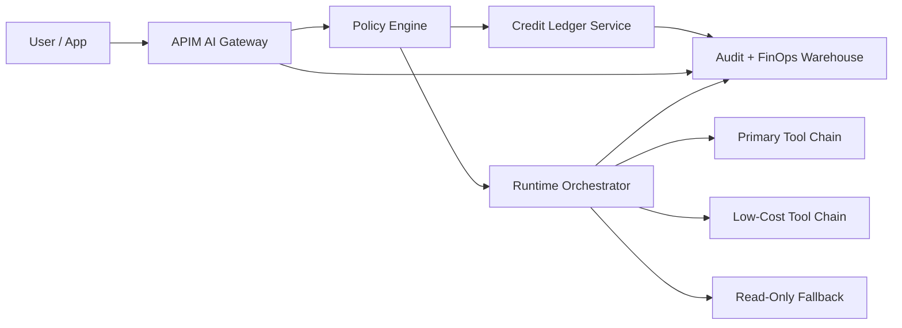
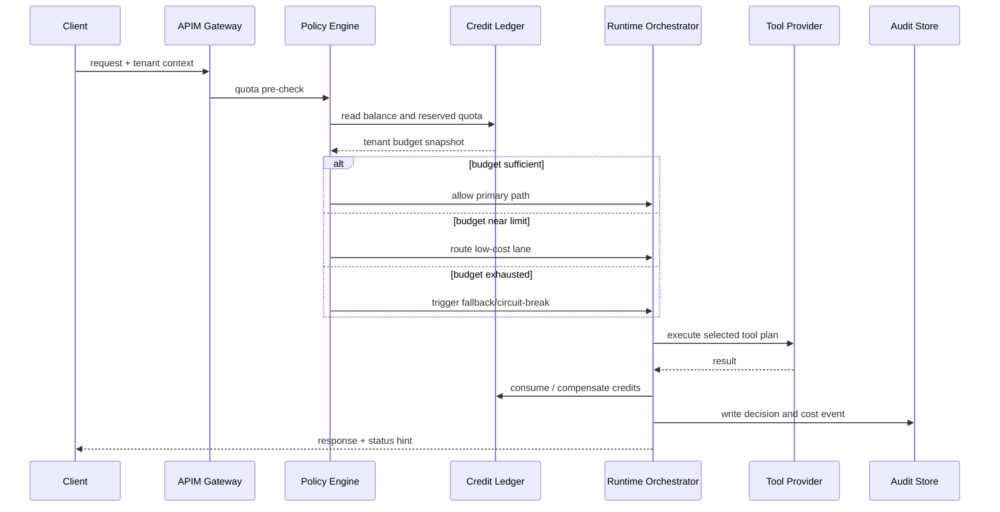

# Enterprise agent tool-budget governance selection FAQ: APIM token quota vs tenant credit ledger vs runtime circuit-breaker vs hybrid control loop

> **Audience**: enterprise Cloud & AI SA, platform engineering, FinOps, security governance, and business application architecture teams.  
> **Decision target**: prevent uncontrolled tool-call spend in multi-tenant agent platforms while preserving critical-path availability.

## 1. Problem framing: why tool-budget governance is a production primitive

When agents move from assistant mode to execution mode,
cost no longer comes from model inference alone.

A single workflow request may fan out into:

- retrieval calls,
- third-party SaaS API calls,
- SQL/reporting queries,
- browser automation steps,
- and writeback notifications.

Without budget governance,
autonomous retry behaviors amplify call volume,
and three risks rise together:

- cost overrun,
- cascading vendor throttling,
- and SLA starvation of high-value tenants.

Budget governance is therefore not optional FinOps decoration.

It is a first-class control plane for production agents.

## 2. Four enterprise patterns and boundary conditions

This guide compares four practical patterns:

- Pattern A: `APIM token/rate quota` hard gateway guardrails.
- Pattern B: `Tenant credit ledger` value-aware consumption control.
- Pattern C: `Runtime circuit-breaker + fallback` resilience guardrails.
- Pattern D: `Hybrid closed loop` combining A+B+C.

Selection should not optimize interception rate alone.

You also need:

- false-block impact on critical flows,
- quota recovery behavior,
- ledger auditability and consistency,
- peak-tail latency under pressure.

## 3. Pattern A: APIM quota and rate-limit hard controls

Pattern A enforces hard thresholds at gateway ingress.

Typical controls include:

- per-subscription `TPS/TPM` limiting,
- per-tenant quota pools,
- per-route daily/monthly call caps,
- deterministic `429 + Retry-After` responses.

Strengths:

- fast rollout,
- broad coverage,
- direct suppression of traffic spikes.

Trade-offs:

- weak expression of business-priority nuance,
- no intrinsic notion of request value,
- potential over-blocking if thresholds are too coarse.

Best-fit guidance:

- use as baseline guardrail across all tenants,
- add priority routing for critical APIs,
- tune limits with live cost telemetry feedback.

## 4. Pattern B: tenant credit ledger for fine-grained control

Pattern B treats budget as consumable credits.

Core mechanics:

- each tenant has total credits and sub-buckets,
- each tool type consumes weighted credits,
- high-value actions can reserve protected quota,
- overage routes to queueing or downgrade paths.

Strengths:

- expresses business value and contract tiers well,
- supports granular cost attribution and showback,
- aligns naturally with commercial packaging.

Trade-offs:

- ledger consistency is non-trivial,
- pricing factors require calibration and governance,
- compensation and rollback flows add complexity.

Best-fit guidance:

- prioritize for B2B multi-tenant monetized platforms,
- version all credit rules for replayability,
- enforce idempotent debit/compensation semantics.

## 5. Pattern C: runtime circuit-breaker and degradation policy

Pattern C focuses on survivability when budget or dependencies fail.

Typical mechanisms:

- trip breakers near budget exhaustion,
- switch to lower-cost tool chains,
- cap retry loops and suppress expensive recursion,
- preserve minimum viable service for critical transactions.

Strengths:

- reduces cascade-failure risk,
- preserves core capability during bursts,
- aligns well with SRE reliability practices.

Trade-offs:

- degradation policy design requires domain negotiation,
- business teams may perceive quality degradation negatively,
- poor observability makes incident triage difficult.

Best-fit guidance:

- co-design degradation tiers with product owners,
- validate thresholds in game-day drills,
- expose explicit user-facing degraded-status signals.

## 6. Pattern D: hybrid closed loop as enterprise end-state

Most mature platforms converge on a three-stage loop:

- front stage: APIM hard-rate safety rails,
- middle stage: credit-ledger value arbitration,
- runtime stage: circuit-breaker resilience execution.

This is not simple layering.

It is policy choreography:

- gateway blocks traffic shocks,
- ledger decides who gets priority,
- runtime decides how to degrade safely.

Benefits:

- controlled spend,
- protected SLA,
- accountable audit trail.

## 7. Reference architecture: budget-governance control plane

Architecture implications:

- gateway is the single ingress policy point,
- ledger injects tenant-value context into decisions,
- runtime executes safe fallback topology,
- every decision writes immutable audit events.

## 8. Request sequence from quota check to fallback execution

Sequence rules:

- debit/compensation must be idempotent,
- fallback path must be deterministic,
- all decisions must carry policy-version metadata.

## 9. 12-dimension enterprise comparison matrix

| Dimension | A APIM Quota | B Credit Ledger | C Runtime Circuit-Breaker | D Hybrid Closed Loop |
|---|---|---|---|---|
| Time to production | Very high | Medium | Medium | Medium |
| Cost precision | Low to medium | Very high | Medium | Very high |
| Peak traffic protection | High | Medium | Very high | Very high |
| Business-priority expression | Medium | Very high | Medium | Very high |
| Implementation complexity | Low | High | Medium to high | High |
| Audit traceability | Medium | High | High | Very high |
| False-block control | Medium | High | Medium | High |
| Multi-tenant isolation | High | High | Medium | Very high |
| Rollback operability | Medium | Medium | Very high | Very high |
| Billing/reconciliation fitness | Low | Very high | Low | Very high |
| Dependency failure resilience | Medium | Medium | Very high | Very high |
| Best-fit stage | Platform bootstrap | Monetized growth | Reliability hardening | Mature enterprise platform |

## 10. Quantitative benchmark: cost, latency, and protection breakpoints

| Metric | A Quota | B Ledger | C Circuit-Breaker | D Hybrid |
|---|---:|---:|---:|---:|
| Added decision P95 latency | 28 ms | 52 ms | 41 ms | 57 ms |
| Peak false-block rate | 3.8% | 1.9% | 2.4% | 1.2% |
| Governance cost per 1,000 requests (USD) | 0.9 | 1.6 | 1.2 | 1.5 |
| Monthly budget-overrun ratio | 6.2% | 2.7% | 3.4% | 1.5% |
| Critical-path SLA retention | 94.1% | 96.0% | 97.2% | 98.1% |

Assumptions:

- 1.2 million daily requests,
- average 3.4 tool-call fanout per request,
- peak burst multiplier of 4.2x.

Observed breakpoints:

- A-only model over-spends in monetized multi-tenant phases,
- B-only model lacks resilience under dependency turbulence,
- D yields best aggregate outcomes on cost plus availability.

## 11. Common anti-patterns and corrections

Anti-pattern 1:
one threshold profile for every tenant.

Correction:
tier quotas by contract, business criticality, and SLA class.

Anti-pattern 2:
non-idempotent ledger debits causing double charging.

Mitigation:
use global request IDs with deduplicated debit writes.

Anti-pattern 3:
silent degradation without explicit user signals.

Remedy:
return explainable degraded status and recovery guidance.

Anti-pattern 4:
full-scale policy changes without staged release.

Correction:
roll out at 5% and expand by domain health signals.

## 12. Governance operating model and responsibilities

Recommended operating split:

- platform team owns gateway policy and runtime fallback engine,
- FinOps team owns credit model and budget policy,
- domain teams own business-priority mappings and UX degradations.

Operating rules:

- every threshold change requires replay evidence,
- every credit rule is versioned and auditable,
- every breaker event maps to accountable ownership.

## 13. Five-step implementation roadmap

Step 1: build a tool-call cost dictionary.  
Assign weighted cost factors per tool class.

Step 2: deploy APIM baseline guardrails.  
Block catastrophic bursts first.

Step 3: introduce tenant credit ledger.  
Move from hard blocking to value-aware prioritization.

Step 4: implement runtime degradation flows.  
Preserve minimum viable service under budget stress.

Step 5: optimize the hybrid loop weekly.  
Tune interception, false-block, and cost drift continuously.

## 14. Production readiness checklist

- [ ] Tenant budget tiers and templates are fully defined.
- [ ] Gateway quota policy supports tenant-level overrides.
- [ ] Ledger debit/compensation is idempotent and replay-safe.
- [ ] Degradation paths expose explicit user-visible status.
- [ ] Decision events carry immutable policy version metadata.
- [ ] Load tests cover burst spikes and dependency jitter.
- [ ] Progressive rollout has automatic rollback gates.
- [ ] Cost reporting supports tenant and domain drill-down.

## 15. Field FAQ (8 questions)

**Q1: Should we start with quota controls or credit ledger first?**  
A1: Start with quota safety rails, then add credit-ledger precision.

**Q2: Does credit ledger always increase latency?**  
A2: It adds overhead, but caching and bounded async compensation reduce impact.

**Q3: Does circuit-breaking always degrade user experience?**  
A3: Not necessarily; good fallback design preserves critical outcomes.

**Q4: How do we prevent large tenants from monopolizing capacity?**  
A4: Use reserved quotas, burst caps, and priority queues together.

**Q5: How do we govern consistently across multi-cloud backends?**  
A5: Centralize budget decisions in gateway plus ledger, not in each backend.

**Q6: What should we do when false-block rates spike?**  
A6: Re-profile traffic patterns and retune threshold/degradation policy by domain.

**Q7: How do we explain auto-degradation to auditors?**  
A7: Export policy version, trigger conditions, fallback path, and cost snapshot.

**Q8: When is hybrid governance mandatory?**  
A8: When monetized multi-tenant growth introduces recurring budget volatility.

