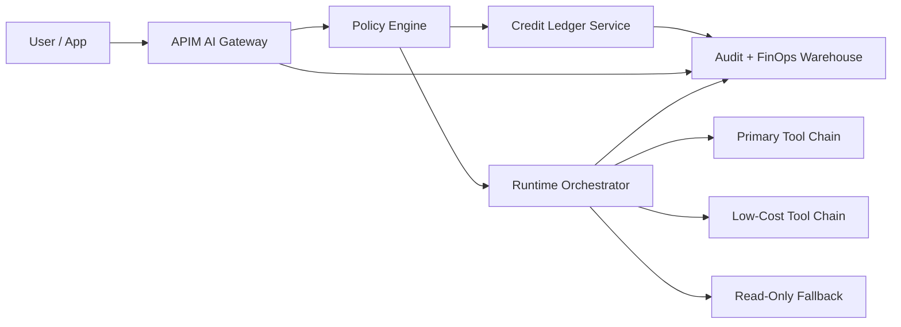
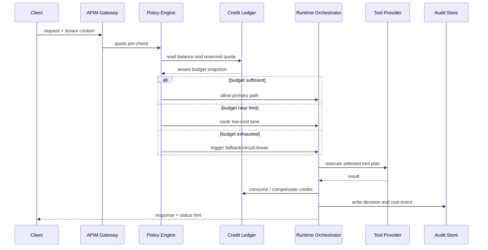

# 企业 Agent 工具调用预算治理选型 FAQ：APIM Token 配额 vs 租户信用账本 vs 运行时熔断护栏 vs 混合闭环

> **适用对象**：企业 Cloud & AI Solution Architect、平台工程、FinOps、安全治理、业务系统架构团队。  
> **目标问题**：在多租户 Agent 平台中，如何避免“工具调用失控烧穿预算”，并同时保证关键业务在高峰时段可用。

## 1. 问题定义：为什么工具调用预算治理是生产第一性问题

企业把 Agent 从问答扩展到可执行流程后，
成本结构会从“模型推理单项”演化为“工具链复合成本”。

一条复杂请求可能包含：

- 检索调用。
- 外部 SaaS API 调用。
- SQL/报表查询。
- 浏览器自动化步骤。
- 回写与通知动作。

如果没有预算治理，
模型的自动尝试行为会放大调用次数，
导致三类风险同步上升：

- 成本失控。
- 供应商限流触发雪崩。
- 核心租户 SLA 被低价值流量挤压。

因此预算治理不是 FinOps 附件能力，
而是 Agent 平台主路径控制面。

## 2. 四类企业方案概览与边界

本文比较四条常见路径：

- 方案 A：`APIM Token/Rate Quota` 网关硬阈值治理。
- 方案 B：`租户信用账本`（Credit Ledger）细粒度记账与配额。
- 方案 C：`运行时熔断与降级`（Circuit Breaker + Fallback）。
- 方案 D：`三段式混合闭环`（A+B+C 组合）。

选型时不要只看“拦截率”，
还要看：

- 误伤关键请求比例。
- 配额恢复时间。
- 账本一致性与审计性。
- 高峰期尾延迟。

## 3. 方案 A：APIM 配额与限速硬护栏

该方案在网关层直接实施硬阈值。

常见策略包括：

- 按订阅 `TPS/TPM` 限流。
- 按租户分级配额池。
- 按 API 路由设定日/月调用上限。
- 返回标准 `429 + Retry-After`。

优势：

- 实施快，覆盖面广。
- 可统一接入多后端服务。
- 对突发洪峰抑制效果直接。

短板：

- 难表达“同租户不同业务优先级”。
- 不能天然理解一次请求的业务价值。
- 阈值过紧容易误伤高价值链路。

适配建议：

- 先作为全平台基础护栏。
- 配合优先级路由区分关键接口。
- 结合实时成本遥测动态调整阈值。

## 4. 方案 B：租户信用账本精细化治理

该方案把调用预算货币化为“信用点数”。

核心思想：

- 每个租户有预算总额与子预算池。
- 不同工具调用消耗不同点数。
- 高价值动作可申请“保留额度”。
- 超额后进入队列或降级路径。

优势：

- 能表达复杂业务优先级。
- 易做成本归因与内部结算。
- 便于与合同条款联动。

短板：

- 账本一致性实现复杂。
- 需要精确计费因子模型。
- 异常回滚与补偿流程较重。

适配建议：

- 对 B2B 多租户商业化平台优先。
- 信用规则要版本化并可回放。
- 必须具备账本幂等写入保障。

## 5. 方案 C：运行时熔断与降级编排

该方案聚焦“在预算或依赖异常时仍能活着”。

关键机制：

- 上游超预算触发熔断。
- 自动切换到低成本工具链。
- 禁止高耗时循环重试。
- 保留关键交易最小可行路径。

优势：

- 能显著降低级联故障风险。
- 峰值时保持核心能力可用。
- 与 SRE 运维体系天然契合。

短板：

- 降级策略设计复杂。
- 业务方容易误解“质量下降”。
- 若缺少可观测性，排障困难。

适配建议：

- 与产品团队共定义“可降级功能清单”。
- 在演练中验证熔断阈值有效性。
- 通过用户提示透明化降级状态。

## 6. 方案 D：混合闭环（企业常态终局）

企业大规模平台通常采用三段式闭环：

- 前置：APIM 硬阈值兜底。
- 中置：信用账本做价值分层。
- 后置：运行时熔断保障可用性。

该方案并非三者简单叠加，
而是策略协同：

- 网关先挡异常洪峰。
- 账本决定“谁优先”。
- 熔断决定“降到哪”。

收益在于：

- 成本可控。
- SLA 可守。
- 审计可追。

## 7. 参考架构：预算治理控制平面

拓扑含义：

- 网关负责第一道统一流量入口。
- 策略引擎读取租户信用状态。
- 编排层根据策略选择工具路径。
- 所有决策事件回写审计仓。

## 8. 请求时序：配额判定到降级执行

时序治理要点：

- 信用扣减必须幂等。
- 补偿必须有超时兜底。
- 决策链路要带策略版本号。

## 9. 12 维企业级选型对比矩阵

| 维度 | A APIM 配额 | B 信用账本 | C 运行时熔断 | D 混合闭环 |
|---|---|---|---|---|
| 上线速度 | 很高 | 中 | 中 | 中 |
| 成本精细度 | 低到中 | 很高 | 中 | 很高 |
| 高峰保护能力 | 高 | 中 | 很高 | 很高 |
| 业务优先级表达 | 中 | 很高 | 中 | 很高 |
| 实施复杂度 | 低 | 高 | 中到高 | 高 |
| 审计可追溯性 | 中 | 高 | 高 | 很高 |
| 误伤控制能力 | 中 | 高 | 中 | 高 |
| 多租户隔离 | 高 | 高 | 中 | 很高 |
| 回退可操作性 | 中 | 中 | 很高 | 很高 |
| 计费对账能力 | 低 | 很高 | 低 | 很高 |
| 依赖故障韧性 | 中 | 中 | 很高 | 很高 |
| 推荐适配阶段 | 起步阶段 | 商业化阶段 | 稳态运行 | 成熟平台 |

## 10. 定量对比：成本与时延拐点

| 指标 | A 配额 | B 账本 | C 熔断 | D 混合 |
|---|---:|---:|---:|---:|
| 决策附加 P95 时延 | 28 ms | 52 ms | 41 ms | 57 ms |
| 峰值拦截误伤率 | 3.8% | 1.9% | 2.4% | 1.2% |
| 每千请求治理成本（美元） | 0.9 | 1.6 | 1.2 | 1.5 |
| 预算超支率（月） | 6.2% | 2.7% | 3.4% | 1.5% |
| 核心链路 SLA 保持率 | 94.1% | 96.0% | 97.2% | 98.1% |

测算假设：

- 日均请求 120 万。
- 工具调用平均扇出 3.4 次。
- 高峰突发倍率 4.2x。

拐点结论：

- 仅用 A 在商业化多租户阶段容易超支。
- 仅用 B 在依赖抖动时保护不足。
- D 在成本与可用性上综合最优。

## 11. 常见反模式与治理纠偏

反模式一：
把同一阈值套给全部租户。

纠偏动作：
按租户等级、业务关键性、合同 SLA 分层配额。

反模式二：
账本扣减非幂等，
导致重复扣费。

纠偏动作：
引入全局请求 ID 与去重写入。

反模式三：
熔断后无用户提示，
造成“系统看似成功”错觉。

纠偏动作：
返回可解释降级状态与补救建议。

反模式四：
策略改动直接全量发布。

修正步骤：
先灰度 5%，再分域放量。

## 12. 平台治理模型与职责分工

建议采用三层治理模型：

- 平台团队：维护网关策略与运行时降级引擎。
- FinOps 团队：维护信用规则与预算模型。
- 业务团队：定义关键动作优先级和兜底体验。

协作规则：

- 所有阈值变更必须附带回放报告。
- 所有账本规则必须版本化。
- 所有熔断事件必须可追溯到责任域。

## 13. 五步落地路线图

第一步：建立调用成本字典。  
为每类工具定义标准成本权重。

第二步：上线 APIM 基础护栏。  
先确保极端流量不击穿系统。

第三步：引入租户信用账本。  
把预算治理从“硬拦截”升级为“价值分层”。

第四步：构建运行时降级策略。  
保证预算异常时核心路径仍可用。

第五步：形成混合闭环优化。  
按周复盘拦截率、误伤率和成本曲线。

## 14. 生产就绪检查清单

- [ ] 所有租户都定义了预算等级与策略模板。
- [ ] 网关配额规则支持租户粒度覆盖。
- [ ] 账本扣减具备幂等与补偿机制。
- [ ] 熔断降级路径有明确用户反馈文本。
- [ ] 审计事件可追溯到策略版本。
- [ ] 压测覆盖高峰突发与依赖抖动。
- [ ] 灰度发布具备自动回滚门禁。
- [ ] 成本报表支持租户/业务域双视角。

## 15. 实战 FAQ（8 问）

**Q1：先做配额还是先做账本？**  
A1：应先做配额兜底，再做账本精细治理。

**Q2：账本会不会拖慢请求？**  
A2：会增加少量时延，但可通过缓存与异步补偿优化。

**Q3：熔断是否一定影响用户体验？**  
A3：不一定，设计得当可保留关键功能并提示降级状态。

**Q4：如何避免大客户挤占全部预算？**  
A4：使用保留额度 + 峰值上限 + 优先级队列联合控制。

**Q5：多云后端如何统一治理？**  
A5：把预算决策上收至网关与账本层，不依赖后端自带限流。

**Q6：误伤率过高怎么调？**  
A6：先分析请求画像，再按业务域调阈值与降级策略。

**Q7：如何向审计解释自动降级决策？**  
A7：输出策略版本、触发条件、替代路径与成本快照。

**Q8：什么时候必须升级到混合闭环？**  
A8：当平台进入多租户商业化并出现周期性预算波动时。

