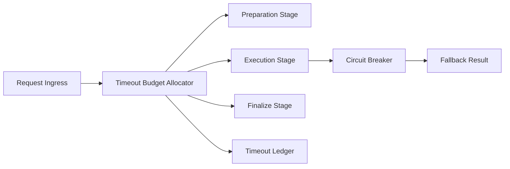

# Agent Tool Timeout Budget Selection FAQ (Cycle 1806)

## 1) Three-minute decision
- **Tool-chain failures are often caused by unbounded waiting, not missing tool functionality.**
- **Recommendation:** end-to-end timeout budget allocation + staged circuit breaking + fallback-result policy.
- **Goal:** reduce cascading timeouts and blocking propagation while stabilizing end-to-end latency.

## 2) Q1 / Q2 / Q3
### Q1: Why is a single timeout threshold insufficient?
1) tool complexity varies widely,
2) upstream waits consume downstream budget,
3) retries can amplify congestion.

### Q2: What budgeted strategy is practical?
- layer 1: inject total timeout budget at ingress,
- layer 2: split into phase sub-budgets (prepare/execute/finalize),
- layer 3: trigger circuit-break or degraded result at thresholds,
- guardrail: ledger budget burn and timeout causes.

### Q3: How to validate effectiveness?
- lower P95/P99 timeout rates,
- fewer retry storms,
- higher explainable success on critical paths.

## 3) Reference architecture

## 4) Decision matrix
| Dimension | Single-threshold timeout | Budgeted timeout control (Recommended) |
|---|---:|---:|
| Timeout controllability | Low | High |
| Cascading-block suppression | Low | High |
| Retry-storm risk | High | Low |
| Implementation complexity | Low | Medium |
| Audit explainability | Medium | High |

## 5) Evidence and reproducibility
- Evidence files:
  - `workshops/azure-agent-infra/evidence/cycle-1806-benchmark.json`
  - `workshops/azure-agent-infra/evidence/cycle-1806-latency.csv`
  - `workshops/azure-agent-infra/evidence/cycle-1806-throughput.csv`
  - `workshops/azure-agent-infra/evidence/cycle-1806-policy.csv`
- Labels: `measured / synthetic / anonymized_reported`.
- validation7 requires bilingual structure fidelity, CSP self-contained cards, cycle-consistent evidence, and replayability checks.

## 6) Production checklist
- [ ] Ingress total budget and phase sub-budgets are configured.
- [ ] Circuit-break thresholds and fallback policies support canarying.
- [ ] Timeout-cause taxonomy and ledgering are complete.
- [ ] Retry caps and backoff policy are enabled.
- [ ] FAQ/H5/SVG/7-card align with cycle evidence.
