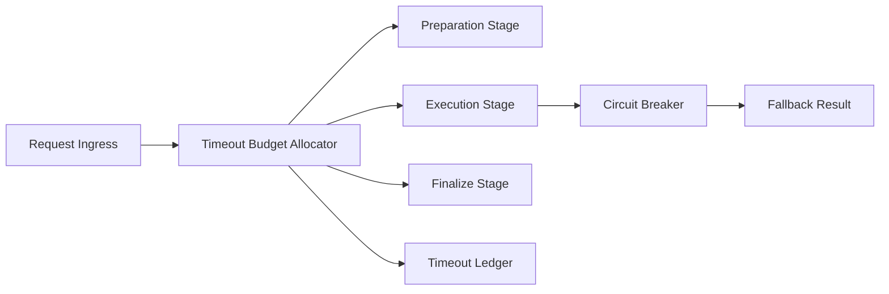

# Agent 工具超时预算选型 FAQ（Cycle 1806）

## 1) 3 分钟结论
- **工具链失败常由“无预算等待”引发，而不是工具功能缺失。**
- **推荐：** 全链路超时预算分配 + 分阶段熔断 + 可回退结果策略。
- **目标：** 降低级联超时和阻塞传播，稳定端到端响应时间。

## 2) Q1 / Q2 / Q3
### Q1：为什么统一超时阈值不可取？
1) 工具复杂度差异大；
2) 上游等待会吞噬下游预算；
3) 失败重试可能放大拥塞。

### Q2：可落地预算化方案？
- 一级：请求入口注入总超时预算；
- 二级：按工具阶段拆分子预算（准备/执行/收尾）；
- 三级：到达阈值触发熔断或降级结果；
- 保障：预算消耗与超时原因写入审计账本。

### Q3：如何验证策略有效？
- 端到端 P95/P99 超时率下降；
- 工具重试风暴减少；
- 关键路径成功率提升并可解释。

## 3) 架构图

## 4) 选型矩阵
| 维度 | 统一阈值超时 | 预算化超时控制（推荐） |
|---|---:|---:|
| 超时可控性 | 低 | 高 |
| 级联阻塞抑制 | 低 | 高 |
| 重试风暴风险 | 高 | 低 |
| 实施复杂度 | 低 | 中 |
| 审计可解释性 | 中 | 高 |

## 5) 证据与复算口径
- 证据文件：
  - `workshops/azure-agent-infra/evidence/cycle-1806-benchmark.json`
  - `workshops/azure-agent-infra/evidence/cycle-1806-latency.csv`
  - `workshops/azure-agent-infra/evidence/cycle-1806-throughput.csv`
  - `workshops/azure-agent-infra/evidence/cycle-1806-policy.csv`
- 标签：`measured / synthetic / anonymized_reported`。
- validation7：双语结构、CSP 自包含、证据轮次一致、可回放链路校验通过。

## 6) 生产检查清单
- [ ] 入口总预算和子预算拆分已配置。
- [ ] 熔断阈值与回退策略可灰度切换。
- [ ] 超时原因分类与账本记录完整。
- [ ] 重试上限和退避策略已启用。
- [ ] FAQ/H5/SVG/7-card 与 evidence 轮次一致。
