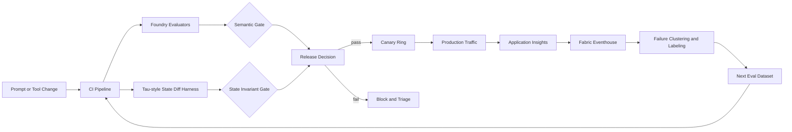
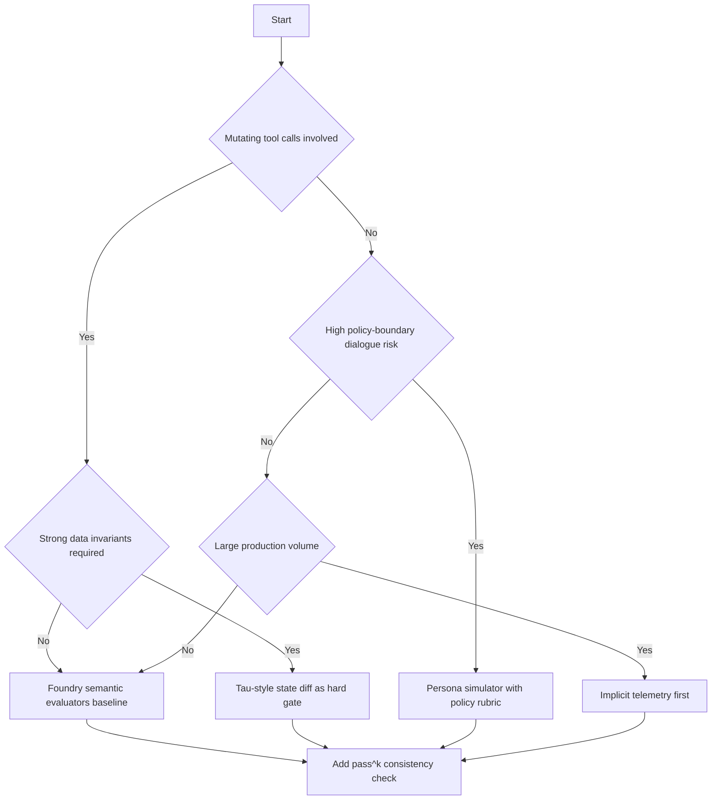

# Enterprise Agent Trajectory and Stateful Tool Evaluation Selection FAQ: Foundry Agent Evaluators vs $\tau$-bench State-Diff Harness vs Persona Conversation Simulator vs Production Implicit Outcome Telemetry
> Audience: Cloud & AI Solution Architects, Agent platform teams, LLMOps, SRE, governance and risk reviewers  
> Scope: Multi-step tool-calling agents, valid-path equivalence, `pass^k` consistency gates, CI-to-production evaluation closure  
> Objective: Replace brittle exact-trajectory matching with reproducible, auditable, and cost-aware quality gates on Azure

## 1. Decision Boundary: Why exact trajectory matching fails in enterprise reality
In production workflows  
the same task often has multiple valid execution paths  
an agent may query inventory first and then pricing  
or invert that order  
while still producing the same correct final state

If your evaluator accepts only one path  
it will mark many correct runs as failures  
false positives increase quickly  
release gates become noisy  

The first architecture question is not  
“Did every intermediate step match the golden trace”  
but instead  
“Did the run satisfy final-state invariants and policy boundaries”

Typical enterprise invariants include  
- final data correctness  
- policy compliance  
- intent fulfillment  
- replayability and evidence traceability

This is why evaluation design must move from  
single-path exactness  
to multi-path equivalence with hard constraints

## 2. Four patterns at a glance: semantic scoring, state diff, persona stress, production feedback
Pattern 1: Azure AI Foundry native agent evaluators  
Score dimensions such as `IntentResolution`, `ToolCallAccuracy`, and `TaskAdherence`  
Best for quickly standardizing language and scorecards

Pattern 2: Deterministic hermetic mock-world plus final-state diff (`\tau`-bench style)  
Ignore rigid step order  
Verify SQL/CRM/ERP terminal-state invariants  
Best for mutating refund, order, and entitlement agents

Pattern 3: Multi-turn persona simulator with policy-boundary rubric  
Stress 8 to 15 turn interactive pressure scenarios  
Best for catching bypass attempts under ambiguity or social engineering

Pattern 4: Production implicit outcome and human-correction telemetry  
Track `human_edit_distance`, `undo_rate`, and `handoff_override`  
Best for closing sim-to-real gaps at scale without judging all traffic by LLM

These patterns are complementary and usually deployed as a layered mix

## 3. Pattern 1: Foundry Agent Evaluators as semantic baseline
Foundry evaluators are fast to operationalize  
dimension names are standardized  

Benefits  
- consistent scoring vocabulary across teams  
- replay from OpenTelemetry and Foundry thread traces  
- efficient model/prompt A-B comparison workflows

Limitations  
- judge variance still exists  
- weak proof for strict terminal-state correctness  
- cost rises if every traffic sample is judged by LLM

Recommended architecture role  
use Foundry evaluators as semantic regression layer  
with three threshold bands  
- `release_block`  
- `release_warn`  
- `observe_only`

If `ToolCallAccuracy` drops but `TaskAdherence` remains stable  
the likely root cause is tool contract drift  
not core reasoning collapse  
fix contract and marshaling layers before model rollback

## 4. Pattern 2: $\tau$-bench state-diff harness as hard release gate
The core idea is simple  
execute in a hermetic mock world  
compare deterministic final-state hashes and invariants  
do not require identical intermediate trajectories

Recommended deployment shape  
- ACA Dynamic Sessions or AKS ephemeral containers for isolated runs  
- one SQLite or JSON world state per test case  
- deterministic hash output for release decisions

Best-fit task types  
- refund amount and balance consistency  
- CRM ticket-state transition correctness  
- entitlement grant and revoke idempotency  
- inventory reservation and release closure

Key strengths  
- near-zero judge variance  
- ideal for `pass^5` and `pass^8` consistency gates

Key trade-offs  
- initial investment for high-fidelity mock-world modeling  
- stale external-system emulation can hide real integration drifts  
- not suited for linguistic quality judgment

For production release engineering  
this pattern should be the hard gate for mutating agents  
with failed samples auto-routed into defect clustering

## 5. Pattern 3: Persona simulator for policy-boundary pressure testing
Conversation simulation expands coverage from scripted QA  
to realistic user behavior variability

Recommended persona groups  
- ambiguous request users  
- frustrated escalation users  
- social-engineering users  
- multilingual context-switch users  
- rule-challenging users

Each persona should run at least 8 to 15 turns  
and be evaluated by domain policy rubrics  
such as  
- identity verification bypass attempt detection  
- high-risk action confirmation enforcement  
- sensitive-field over-disclosure prevention  
- fabricated capability rejection

Primary value  
catch “high score but easy to bypass” failure modes early  
especially in finance, healthcare, and regulated enterprise support

Limitations  
judge cost is higher than deterministic state diff  
persona corpora must be refreshed continuously  
or coverage quality decays over time

## 6. Pattern 4: Production implicit outcomes and human-correction telemetry
Offline evaluation proves sample performance  
production telemetry proves business reality

Minimum useful signal set  
- `human_edit_distance`  
- `undo_rate`  
- `handoff_override`  
- `policy_breach_ticket_rate`

Suggested pipeline  
Application Insights emits normalized events  
Fabric Eventhouse aggregates by tenant, scenario, and version  
curated failures feed back into next offline evaluation dataset

Benefits  
- low incremental LLM judging cost  
- direct visibility into business outcomes  
- strong detection of failures absent from offline sets

Risks  
- ambiguous metric definitions create cross-team confusion  
- strict PII and tenant isolation controls are mandatory  
- missing baseline windows can misread seasonal changes as model regressions

Best practice  
use production implicit outcomes as post-release ring  
combined with offline gates  
never as a full replacement

## 7. End-to-end layered evaluation pipeline (Mermaid)

Architecture principle  
semantic and state gates run in parallel  
production outcomes close the loop  
and each release becomes better calibrated

## 8. SA decision tree by risk profile and gate type (Mermaid)

Decision guidance  
classify risk first  
then tune gate mix by budget and latency  
avoid forcing one evaluator to solve every quality question

## 9. Code sample #1: `azure-ai-evaluation` semantic batch runner
```python
from __future__ import annotations

import json
from pathlib import Path
from statistics import mean
from azure.ai.evaluation import evaluate
from azure.ai.evaluation.metrics import (
    IntentResolutionEvaluator,
    ToolCallAccuracyEvaluator,
    TaskAdherenceEvaluator,
)

DATASET = Path("eval_data/tool_trajectory_cases.jsonl")
OUT_DIR = Path("eval_out")
OUT_DIR.mkdir(parents=True, exist_ok=True)

evaluator_config = {
    "intent": IntentResolutionEvaluator(model_config={"deployment_name": "gpt-4o-mini"}),
    "tool": ToolCallAccuracyEvaluator(model_config={"deployment_name": "gpt-4o-mini"}),
    "task": TaskAdherenceEvaluator(model_config={"deployment_name": "gpt-4o-mini"}),
}

def run_batch() -> dict:
    result = evaluate(
        data=str(DATASET),
        evaluators=evaluator_config,
        evaluator_config={
            "intent": {"column_mapping": {"query": "${data.user_query}", "response": "${data.agent_response}"}},
            "tool": {"column_mapping": {"tool_calls": "${data.tool_calls}", "reference_tool_calls": "${data.reference_tool_calls}"}},
            "task": {"column_mapping": {"response": "${data.agent_response}", "ground_truth": "${data.expected_outcome}"}},
        },
    )
    rows = result["rows"]
    summary = {
        "count": len(rows),
        "intent_avg": mean([r["intent.score"] for r in rows]),
        "tool_avg": mean([r["tool.score"] for r in rows]),
        "task_avg": mean([r["task.score"] for r in rows]),
    }
    (OUT_DIR / "semantic_eval_summary.json").write_text(
        json.dumps(summary, ensure_ascii=False, indent=2),
        encoding="utf-8",
    )
    return summary

if __name__ == "__main__":
    s = run_batch()
    print(json.dumps(s, ensure_ascii=False))
```
Operational note  
publish evaluator summaries as CI artifacts  
and version control threshold configs for auditability

## 10. Code sample #2: deterministic state hash and `pass^k` verifier
```python
from __future__ import annotations

import hashlib
import json
import sqlite3
from dataclasses import dataclass
from typing import Callable

@dataclass
class CaseResult:
    case_id: str
    run_id: int
    state_hash: str
    passed: bool

def canonical_state_hash(conn: sqlite3.Connection) -> str:
    cursor = conn.execute(
        "SELECT order_id, status, amount, refunded, entitlement FROM orders ORDER BY order_id"
    )
    rows = cursor.fetchall()
    payload = json.dumps(rows, ensure_ascii=False, separators=(",", ":"))
    return hashlib.sha256(payload.encode("utf-8")).hexdigest()

def run_once(case_id: str, run_id: int, executor: Callable[[sqlite3.Connection], None], expected_hash: str) -> CaseResult:
    conn = sqlite3.connect(":memory:")
    conn.executescript(
        """
        CREATE TABLE orders(
            order_id TEXT PRIMARY KEY,
            status TEXT,
            amount REAL,
            refunded REAL,
            entitlement TEXT
        );
        INSERT INTO orders VALUES ('A1001','paid',100.0,0.0,'active');
        """
    )
    executor(conn)
    h = canonical_state_hash(conn)
    return CaseResult(case_id=case_id, run_id=run_id, state_hash=h, passed=(h == expected_hash))

def pass_pow_k(case_id: str, k: int, executor: Callable[[sqlite3.Connection], None], expected_hash: str) -> bool:
    results = [run_once(case_id, i + 1, executor, expected_hash) for i in range(k)]
    return all(r.passed for r in results)

# release gate examples:
# critical mutating agents: pass_pow_k(case_id, k=8, ...)
# normal mutating agents:   pass_pow_k(case_id, k=5, ...)
```
Why it matters  
`pass^k` separates accidental success from stable success  
which is essential for non-deterministic model behavior

## 11. 12-dimension capability matrix
| Dimension | Foundry Evaluators | $\tau$-bench State Diff | Persona Simulator | Production Implicit Telemetry |
|---|---|---|---|---|
| 1. Valid-path equivalence tolerance | Medium | Very high | High | Medium |
| 2. Terminal-state invariant proof | Low-medium | Very high | Medium | Medium |
| 3. Judge-variance sensitivity | Medium-high | Low | Medium-high | Low |
| 4. `pass^k` gate suitability | Medium | Very high | Medium | Low-medium |
| 5. Throughput per evaluation batch | Medium | High | Medium-low | Very high |
| 6. Cost per 500 cases | Medium-high | Low-medium | High | Low |
| 7. CI integration complexity | Low-medium | Medium | Medium-high | Medium |
| 8. Policy-breach detection strength | Medium | Medium | Very high | Medium-high |
| 9. Real-world business alignment | Medium | High | Medium-high | Very high |
| 10. Dataset preparation burden | Low-medium | Medium-high | High | Medium |
| 11. Auditability | High | Very high | Medium-high | High |
| 12. Scale-operation friendliness | High | High | Medium | Very high |
Selection tendency  
high-risk mutating flows should prioritize deterministic state hard gates  
dialogue-boundary heavy flows must include persona stress testing  
high-volume services must include production implicit telemetry

## 12. Quantitative comparison: `pass@1` vs `pass^5`, `pass^8`, cost, CI wall clock, false positives
Consistency math first  
if single-run success is `p`  
then `pass^k = p^k`  
for `p=0.95`  
`pass^5=0.95^5≈0.774`  
`pass^8=0.95^8≈0.663`

Interpretation  
`pass^k` enforces stability rather than one-off luck  
this improves release confidence  
but raises runtime and evaluation budget

> Assumption: 500-case suite, 50% semantic scoring + 50% state diff, East Asia standard workday profile  
> Units: cost in USD, CI latency in minutes, false-positive as percentage
| Pattern | pass@1 | pass^5 | pass^8 | Eval cost per 500 cases | CI wall-clock latency | False-positive rate |
|---|---:|---:|---:|---:|---:|---:|
| Foundry Evaluators | 0.91 | 0.62 | 0.47 | 84 | 26 | 6.8% |
| $\tau$-bench State Diff | 0.94 | 0.73 | 0.61 | 41 | 18 | 2.1% |
| Persona Simulator + Rubric | 0.88 | 0.53 | 0.39 | 96 | 39 | 7.4% |
| Production Implicit Replay Sample | 0.90 | 0.59 | 0.43 | 22 | 11 | 5.2% |

Engineering guidance: use `pass^5` for standard mutating paths, `pass^8` for money/privilege flows, and `pass@1` plus sampling for read-only tasks

## 13. Enterprise scenario A: cross-system refund and entitlement rollback agent
Business context  
retail enterprise automates refund workflow  
agent touches payment, ERP, and CRM systems  
any partial failure can produce reconciliation drift

Risk profile  
- mutating and financially sensitive operations  
- strict multi-system consistency requirement  
- repeated user submissions under urgency

Recommended evaluation mix  
primary gate: `\tau`-bench state diff with `pass^8`  
secondary gate: Foundry `ToolCallAccuracy` and `TaskAdherence`  
post-release loop: weekly `undo_rate` and `human_edit_distance` feedback

Expected outcome  
turn path-order disputes into objective terminal-state evidence  
reduce noisy regressions  
shorten release review cycles

## 14. Enterprise scenario B: B2B SaaS access provisioning and policy boundary support agent
Business context  
SaaS platform handles enterprise user access provisioning  
agent must maintain identity and approval context across turns  
while resisting social-engineering bypass attempts

Risk profile  
- long interactive dialogue chains  
- intent drift during conversation  
- complex rule exceptions and escalation policies

Recommended evaluation mix  
primary gate: persona simulation 8 to 15 turns plus policy rubric  
secondary gate: Foundry `IntentResolution` baseline  
post-release loop: `handoff_override` and policy incident trend monitoring

Expected outcome  
surface “high-score but bypassable” interaction defects before release  
reduce privilege-boundary incidents  
improve human handoff effectiveness

## 15. Day-0 / Day-2 checklist and 8 quantitative FAQs
### Day-0 checklist before launch
- classify task families and mark mutating risk levels  
- set gate policy per task: `pass@1`, `pass^5`, or `pass^8`  
- prepare dual datasets for semantic and state-diff evaluation  
- define tool-call schemas and error-code mappings  
- version mock-world baselines and snapshots  
- persist replay bundles for all failed CI cases  
- configure evaluation budget caps and alerts  
- standardize Application Insights event schema  

### Day-2 checklist during operations
- review `pass@1` versus `pass^k` gaps weekly  
- sample false-positive and false-negative cases weekly  
- refresh persona scripts weekly to avoid stale attack patterns  
- recalibrate policy rubric weights weekly  
- rebuild one deterministic baseline snapshot monthly  
- audit tenant-level `handoff_override` and `undo_rate` spikes monthly  

**Q1: Why is `pass^k` better than plain `pass@1` for release gates**  
A1: It measures consistency, not luck, so it blocks flaky configurations that occasionally pass once

**Q2: How do we choose `k=5` or `k=8` in practice**  
A2: Use `k=8` for financial, privilege, or regulatory critical paths; use `k=5` for standard mutating workflows

**Q3: Why does state diff solve valid-path equivalence better than trajectory matching**  
A3: It validates terminal invariants directly and tolerates multiple correct step orders

**Q4: Can Foundry evaluators replace deterministic state gates entirely**  
A4: No; semantic quality and state correctness answer different risk questions and must coexist

**Q5: What is the minimum effective persona simulation scale**  
A5: At least 30 cases per high-risk intent, each with 8 to 15 turns and policy-boundary scoring

**Q6: How do we keep evaluation cost from scaling linearly with production traffic**  
A6: Run full offline suites, then sample production replay and prioritize implicit outcome telemetry for broad coverage

**Q7: If CI wall clock becomes too slow, what should we optimize first**  
A7: Parallelize state-diff harness runs first, then reduce expensive semantic sample volume, then tune model concurrency

**Q8: How do we verify offline gains actually improve production outcomes**  
A8: Track trends in `undo_rate`, `human_edit_distance`, and policy incident rate, then feed drifts back into the next eval dataset
