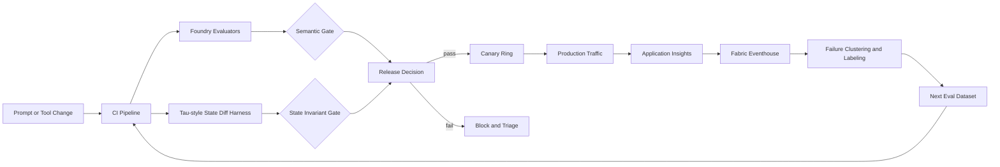
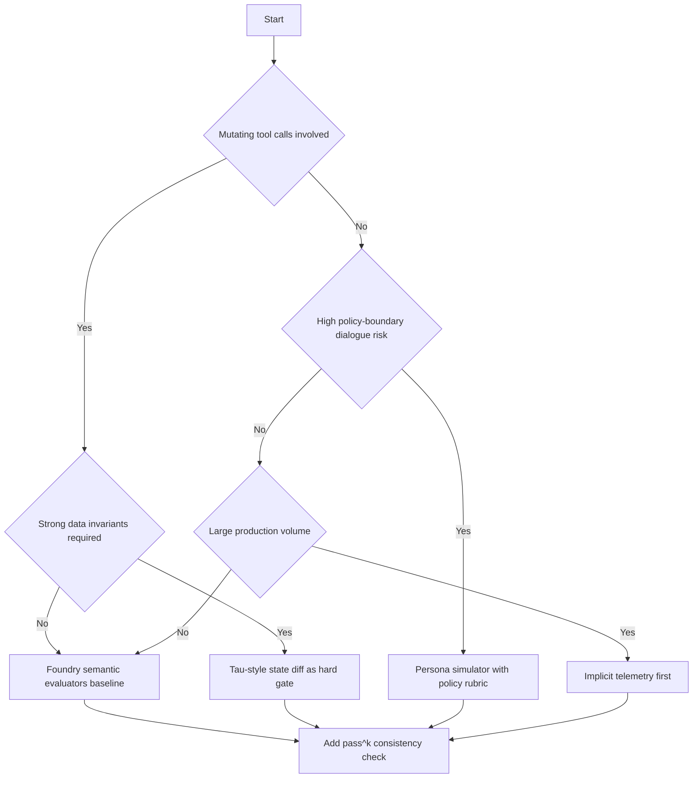

# 企业级 Agent 轨迹与状态化工具评测选型 FAQ：Foundry Agent Evaluators vs $\tau$-bench 状态差分 Harness vs Persona 对话模拟器 vs 生产隐式结果遥测
> 适用对象：Cloud & AI Solution Architect、Agent 平台团队、LLMOps、SRE、合规与内控评审  
> 场景边界：多步骤工具调用 Agent、可变执行路径等价判定、`pass^k` 一致性门禁、CI 到生产反馈闭环  
> 核心目标：避免把“唯一路径精确匹配”误当质量真相，并在 Azure 上构建可复现、可审计、可降本的评测体系

## 1. 决策起点：为什么“精确轨迹比对”会在企业生产中失真
在真实业务流程里  
同一个任务可以有多条合法执行路径  
Agent 先查库存再查价格  
或者先查价格再查库存  
最终状态都可能正确  

如果评测系统只接受单一路径  
就会把大量“正确但不同路径”的运行误判为失败  
这会抬高误报率  
导致发布门禁过严  

企业需要回答的第一个问题不是“轨迹是否逐 token 一致”  
而是“任务结果与关键约束是否一致”  
关键约束通常包含  
- 终态数据一致性  
- 合规策略未越界  
- 用户意图被满足  
- 可恢复与可追溯

因此评测架构必须从“路径唯一正确”转向“路径等价正确”

## 2. 四种评测模式总览：语义评分、状态差分、对话压测、生产回灌
模式一：Azure AI Foundry Native Agent Evaluators  
以语义维度给出 `IntentResolution`、`ToolCallAccuracy`、`TaskAdherence` 评分  
适合快速建立统一评测语言  

模式二：$\tau$-bench 风格 Deterministic Mock-World + Final-State Diff  
不要求中间步骤完全一致  
只验证最终数据库/工单/订单状态是否满足不变量  
适合退款、改签、权限开通这类变更型任务

模式三：Conversation Simulator + Domain Policy Rubric Judge  
以 8 到 15 轮复杂对话压测策略边界  
强调“被诱导越权”场景下的稳定性  
适合客服、财务审批、人机协作流程

模式四：Production Implicit Outcome + Human Correction Telemetry  
用 `human_edit_distance`、`undo_rate`、`handoff_override` 等真实信号闭环  
补齐“离线高分但线上失效”的盲点  
适合大规模持续运营平台

四种模式可以组合为分层评测闭环

## 3. 模式一：Foundry Agent Evaluators 作为语义层基线
Foundry 原生评测器的优点是上手快  
评测维度命名标准化  

架构收益  
- 评审维度可统一到组织级 scorecard  
- 能基于 OTel/Thread traces 回放批评测  
- 对多模型、多提示词版本对比友好

关键限制  
- 语义评分仍存在 judge 噪声  
- 对“数据终态正确性”证明能力不足  
- 如果 100% 流量都走 LLM 评测会产生显著 token 成本

建议做法  
把 Foundry Evaluator 定位为“语义回归层”  
把阈值划分为  
- release_block：硬阻断  
- release_warn：人工复核  
- observe_only：仅监控

当 `ToolCallAccuracy` 下滑但 `TaskAdherence` 稳定时  
通常意味着工具参数格式退化而业务逻辑仍在  
需要优先修工具契约层  
而不是盲目回滚模型版本

## 4. 模式二：$\tau$-bench 风格状态差分 Harness 作为硬门
该模式核心思想是  
通过 Hermetic Mock-World 重放任务  
比较最终状态哈希与不变量断言  
而非比较每一步调用顺序

推荐部署形态  
- ACA Dynamic Sessions 或 AKS Ephemeral Containers 作为一次性评测沙箱  
- 每个测试用例拥有独立 SQLite/JSON world state  
- 执行后产出 deterministic state hash

适用任务  
- 退款金额与账户余额一致性  
- CRM 工单状态机迁移  
- 权限开通与撤销幂等  
- 库存占用与释放闭环

关键优势  
- judge 方差近似为零  
- 非常适合 `pass^5` / `pass^8` 稳定性门禁

关键限制  
- 构建高保真 mock world 需要初期投入  
- 若不维护外部系统行为模型会出现“假阳性稳定”  
- 不适合评估语气、解释质量这类语义指标

在生产级发布中  
建议把此模式作为 mutating agent 的硬门  
并将失败样本自动进入缺陷聚类队列

## 5. 模式三：Persona 对话模拟器验证策略边界与抗诱导能力
Conversation Simulator 的价值在于  
让评测覆盖“用户行为复杂性”  
而不是只覆盖模板化问答

建议 persona 维度  
- 模糊需求型用户  
- 焦虑催促型用户  
- 社工诱导型用户  
- 多语言切换型用户  
- 规则挑战型用户

每个 persona 至少运行 8 到 15 轮对话  
并由领域策略 rubric 做判定  
常见 rubric 包括  
- 身份核验是否被跳过  
- 高风险操作是否要求二次确认  
- 敏感字段是否被越权披露  
- 是否出现“编造系统权限”行为

该模式的最大价值  
是提前暴露“看似高分但容易被绕过”的策略漏洞  
尤其适合金融、医疗、政企场景

其限制也要明确  
judge 成本高于状态差分  
且 persona 语料需要持续维护  
否则覆盖会迅速老化

## 6. 模式四：生产隐式结果与人工纠偏遥测闭环
离线评测只能证明“在样本集上通过”  
生产信号才能证明“在真实业务中有效”

推荐最小信号集  
- `human_edit_distance`：人工改写幅度  
- `undo_rate`：用户或坐席撤销比例  
- `handoff_override`：人工接管覆盖率  
- `policy_breach_ticket_rate`：策略违规工单率

数据路径建议  
Application Insights 采集事件  
Fabric Eventhouse 聚合与分层分析  
再回灌到评测数据集构成下一轮回归样本

优势  
- 低额外 LLM 评审成本  
- 可反映真实业务收益  
- 能识别离线集未覆盖的新型失败模式

风险点  
- 指标定义不清会造成跨团队误读  
- 需严格脱敏和租户边界治理  
- 若缺少基线窗口容易把季节波动误判成模型退化

最佳实践  
将生产隐式指标作为 release 后环  
与离线门禁共同构成双环控制  
而不是二选一

## 7. 多层评测架构：轨迹语义 + 终态差分 + 生产回灌（Mermaid）

架构要点  
语义门与状态门并行  
发布后再用真实反馈回灌  
形成闭环学习

## 8. SA 决策树：按风险类型选择评测主路径（Mermaid）

决策原则  
先按风险分层  
再按成本与时延定配比  
不要把所有问题都推给同一评测器

## 9. 代码示例一：`azure-ai-evaluation` 批量语义评测 Runner
```python
from __future__ import annotations

import json
from pathlib import Path
from statistics import mean
from azure.ai.evaluation import evaluate
from azure.ai.evaluation.metrics import (
    IntentResolutionEvaluator,
    ToolCallAccuracyEvaluator,
    TaskAdherenceEvaluator,
)

DATASET = Path("eval_data/tool_trajectory_cases.jsonl")
OUT_DIR = Path("eval_out")
OUT_DIR.mkdir(parents=True, exist_ok=True)

evaluator_config = {
    "intent": IntentResolutionEvaluator(model_config={"deployment_name": "gpt-4o-mini"}),
    "tool": ToolCallAccuracyEvaluator(model_config={"deployment_name": "gpt-4o-mini"}),
    "task": TaskAdherenceEvaluator(model_config={"deployment_name": "gpt-4o-mini"}),
}

def run_batch() -> dict:
    result = evaluate(
        data=str(DATASET),
        evaluators=evaluator_config,
        evaluator_config={
            "intent": {"column_mapping": {"query": "${data.user_query}", "response": "${data.agent_response}"}},
            "tool": {"column_mapping": {"tool_calls": "${data.tool_calls}", "reference_tool_calls": "${data.reference_tool_calls}"}},
            "task": {"column_mapping": {"response": "${data.agent_response}", "ground_truth": "${data.expected_outcome}"}},
        },
    )
    rows = result["rows"]
    summary = {
        "count": len(rows),
        "intent_avg": mean([r["intent.score"] for r in rows]),
        "tool_avg": mean([r["tool.score"] for r in rows]),
        "task_avg": mean([r["task.score"] for r in rows]),
    }
    (OUT_DIR / "semantic_eval_summary.json").write_text(
        json.dumps(summary, ensure_ascii=False, indent=2),
        encoding="utf-8",
    )
    return summary

if __name__ == "__main__":
    s = run_batch()
    print(json.dumps(s, ensure_ascii=False))
```
工程化建议  
把语义评测输出直接写入 CI artifact  
并把阈值配置放入版本库  
确保每次发布可追溯

## 10. 代码示例二：Deterministic 状态哈希与 `pass^k` 一致性校验
```python
from __future__ import annotations

import hashlib
import json
import sqlite3
from dataclasses import dataclass
from typing import Callable

@dataclass
class CaseResult:
    case_id: str
    run_id: int
    state_hash: str
    passed: bool

def canonical_state_hash(conn: sqlite3.Connection) -> str:
    cursor = conn.execute(
        "SELECT order_id, status, amount, refunded, entitlement FROM orders ORDER BY order_id"
    )
    rows = cursor.fetchall()
    payload = json.dumps(rows, ensure_ascii=False, separators=(",", ":"))
    return hashlib.sha256(payload.encode("utf-8")).hexdigest()

def run_once(case_id: str, run_id: int, executor: Callable[[sqlite3.Connection], None], expected_hash: str) -> CaseResult:
    conn = sqlite3.connect(":memory:")
    conn.executescript(
        """
        CREATE TABLE orders(
            order_id TEXT PRIMARY KEY,
            status TEXT,
            amount REAL,
            refunded REAL,
            entitlement TEXT
        );
        INSERT INTO orders VALUES ('A1001','paid',100.0,0.0,'active');
        """
    )
    executor(conn)
    h = canonical_state_hash(conn)
    return CaseResult(case_id=case_id, run_id=run_id, state_hash=h, passed=(h == expected_hash))

def pass_pow_k(case_id: str, k: int, executor: Callable[[sqlite3.Connection], None], expected_hash: str) -> bool:
    results = [run_once(case_id, i + 1, executor, expected_hash) for i in range(k)]
    return all(r.passed for r in results)

# release gate examples:
# critical mutating agents: pass_pow_k(case_id, k=8, ...)
# normal mutating agents:   pass_pow_k(case_id, k=5, ...)
```
为什么 `pass^k` 有价值  
它把“偶发成功”与“稳定成功”区分开来  
尤其适合非确定性模型和并发工具调用场景

## 11. 12 维选型矩阵：四种评测模式能力对照
| 维度 | Foundry Evaluators | $\tau$-bench 状态差分 | Persona Simulator | 生产隐式遥测 |
|---|---|---|---|---|
| 1. 对合法路径等价容忍 | 中 | 很高 | 高 | 中 |
| 2. 终态不变量验证能力 | 低中 | 很高 | 中 | 中 |
| 3. Judge 方差敏感度 | 中高 | 低 | 中高 | 低 |
| 4. `pass^k` 门禁适配度 | 中 | 很高 | 中 | 低中 |
| 5. 单批评测吞吐 | 中 | 高 | 中低 | 很高 |
| 6. 每 500 样本成本 | 中高 | 低中 | 高 | 低 |
| 7. CI 集成复杂度 | 低中 | 中 | 中高 | 中 |
| 8. 对策略越界检出 | 中 | 中 | 很高 | 中高 |
| 9. 对真实业务贴近度 | 中 | 高 | 中高 | 很高 |
| 10. 数据准备成本 | 低中 | 中高 | 高 | 中 |
| 11. 可审计性 | 高 | 很高 | 中高 | 高 |
| 12. 规模化运营友好度 | 高 | 高 | 中 | 很高 |
结论倾向  
高风险变更型 Agent 优先状态差分硬门  
高对话博弈风险 Agent 必须补 Persona 压测  
高流量业务必须引入生产隐式指标

## 12. 定量对比：`pass@1` vs `pass^5`、`pass^8`、评测成本与时延
先给出一致性门禁数学关系  
若单次通过率为 `p`  
则 `pass^k = p^k`  
当 `p=0.95`  
`pass^5=0.95^5≈0.774`  
`pass^8=0.95^8≈0.663`

该结果说明  
`pass^k` 会显著放大稳定性要求  
可以有效筛掉偶发成功配置  
但也会增加运行成本与 CI 时长

> 假设：500 个测试样本，50% 语义评测、50% 状态差分，东亚区域标准工作日负载  
> 单位：成本 USD，时延分钟，误报率为 false-positive
| 模式 | pass@1 | pass^5 | pass^8 | 500 样本评测成本 | CI 墙钟时延 | 误报率 |
|---|---:|---:|---:|---:|---:|---:|
| Foundry Evaluators | 0.91 | 0.62 | 0.47 | 84 | 26 | 6.8% |
| $\tau$-bench 状态差分 | 0.94 | 0.73 | 0.61 | 41 | 18 | 2.1% |
| Persona Simulator + Rubric | 0.88 | 0.53 | 0.39 | 96 | 39 | 7.4% |
| 生产隐式遥测抽样回放 | 0.90 | 0.59 | 0.43 | 22 | 11 | 5.2% |

实践建议：mutating 默认 `pass^5`，资金与权限流程用 `pass^8`，只读路径可保留 `pass@1` + 抽样复核

## 13. 企业场景 A：跨系统退款与权益回收 Agent
业务背景  
零售企业把退款流程自动化  
Agent 需要调用支付、ERP、CRM 三套系统  
任何一步异常都可能产生财务对账差异

风险特征  
- 操作可变更且不可逆风险高  
- 多系统最终一致性难题显著  
- 用户催促和重复提交并存

推荐评测组合  
主门：$\tau$-bench 状态差分 `pass^8`  
辅门：Foundry `ToolCallAccuracy` 与 `TaskAdherence`  
发布后：`undo_rate` 与 `human_edit_distance` 周级回灌

落地收益  
把“路径差异争议”转为“状态正确性证据”  
显著降低回归误报  
并缩短发布评审时间

## 14. 企业场景 B：B2B SaaS 权限开通与策略边界客服 Agent
业务背景  
SaaS 平台提供企业管理员工权限开通  
Agent 需在多轮对话中识别身份与审批上下文  
同时防止社工诱导越权

风险特征  
- 对话轮次长  
- 用户意图可能不断变化  
- 规则边界和例外处理复杂

推荐评测组合  
主门：Persona Simulator 8-15 轮对话 + Policy Rubric  
辅门：Foundry `IntentResolution`  
后环：`handoff_override` 与违规工单率监控

落地收益  
能提前识别“高分但可绕过”的交互缺陷  
减少线上越权事件  
并提升人工接管效率

## 15. Day-0 / Day-2 清单与 8 个定量 FAQ
### Day-0 上线前清单
- 定义任务族并标记是否 mutating  
- 为每类任务指定 `pass@1`、`pass^5` 或 `pass^8` 门槛  
- 建立语义评测与状态差分双数据集  
- 为关键工具调用定义 schema 契约与错误码映射  
- 为 mock world 定义版本号与基线快照  
- 在 CI 中固化失败样本留存与可重放包  
- 建立评测成本预算与上限告警  
- 接入 Application Insights 事件语义规范  

### Day-2 运营期清单
- 每周复盘 `pass@1` 与 `pass^k` 偏差  
- 每周检查 false-positive 与 false-negative 样本  
- 每周更新 persona 语料并淘汰过时诱导脚本  
- 每周校准 policy rubric 的权重与阈值  
- 每月重建一次状态基线快照并验证一致性  
- 每月审计 `handoff_override` 与 `undo_rate` 异常租户  

**Q1：为什么 `pass^k` 比单次 `pass@1` 更适合发布门禁**  
A1：它直接衡量稳定成功概率，能过滤偶发成功样本，尤其适合非确定性工具调用链

**Q2：`k` 取 5 还是 8 的经验界线是什么**  
A2：资金/权限/合规高风险流程用 `k=8`，一般 mutating 业务用 `k=5`，只读任务可降级

**Q3：状态差分为何能解决合法路径等价问题**  
A3：它只要求最终不变量满足，不要求中间步骤顺序一致，天然兼容多条正确路径

**Q4：Foundry Evaluator 会不会完全替代状态差分**  
A4：不会，前者偏语义质量，后者偏数据正确性，企业级发布应双轨并行

**Q5：Persona Simulator 的最小有效规模是多少**  
A5：建议每个高风险意图至少 30 个 persona 用例、每例 8 到 15 轮对话

**Q6：如何控制评测成本不随流量指数增长**  
A6：离线全量 + 线上抽样回放，生产侧优先收集隐式结果信号而非全量 LLM 评审

**Q7：CI 墙钟时延过长时先优化哪一层**  
A7：先并行化状态差分执行，再缩减高成本语义评测样本，最后优化模型并发配额

**Q8：如何判断离线高分是否真正转化为线上收益**  
A8：持续追踪 `undo_rate`、`human_edit_distance`、违规工单率三项趋势并回灌样本集
