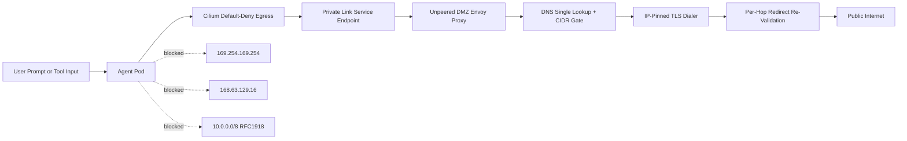
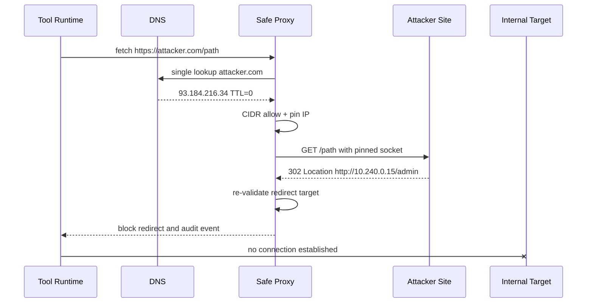

# Enterprise agent URL-tool SSRF and DNS-rebinding defense selection FAQ
> Topic ID: #477  
> Section: 3.3 AI Gateway, MCP governance, and cross-org A2A federation  
> Audience: enterprise AI platform architects, gateway and network security teams, MCP/OpenAPI tool engineers  
> Goal: allow external URL/OpenAPI/Webhook tool calls while blocking SSRF, IMDS token theft, DNS rebinding, and redirect-based bypass

## 1 Production problem: why outbound agent fetch is a high-risk surface
Research, procurement, support, and legal copilots frequently invoke `fetch_url`, OpenAPI connectors, webhook callbacks, and link-preview tools. These interfaces accept user-influenced URLs and are natural targets for indirect prompt injection. If tool runtimes execute inside trusted `AKS` or `ACA` VNets, attackers can pivot through the tool to internal targets. The highest-value target is often `169.254.169.254` IMDS or `168.63.129.16` WireServer. Research, procurement, support, and legal copilots frequently invoke `fetch_url`, OpenAPI connectors, webhook callbacks, and link-preview tools. These interfaces accept user-influenced URLs and are natural targets for indirect prompt injection. When managed identity is present, IMDS access can yield Entra access tokens. Another high-impact path is internal `*.privatelink.azure.net` or other RFC1918 administration endpoints. Research, procurement, support, and legal copilots frequently invoke `fetch_url`, OpenAPI connectors, webhook callbacks, and link-preview tools. These interfaces accept user-influenced URLs and are natural targets for indirect prompt injection. These addresses may be implicitly trusted by network design, so misuse through agent tools is materially worse than a normal web injection event. Therefore, URL tool egress must be designed as a dedicated zero-trust control plane, not as a generic HTTP helper. Research, procurement, support, and legal copilots frequently invoke `fetch_url`, OpenAPI connectors, webhook callbacks, and link-preview tools. These interfaces accept user-influenced URLs and are natural targets for indirect prompt injection.

## 2 Core attack chain: DNS rebinding and 3xx TOCTOU bypass
Many implementations validate a domain once and then delegate actual requests to a standard client library. The library may perform a second DNS lookup during connect time. With `TTL=0` or very short TTL, an attacker can switch the second resolution to internal addresses. This creates a classic `Time-of-Check to Time-of-Use` window. Many implementations validate a domain once and then delegate actual requests to a standard client library. The library may perform a second DNS lookup during connect time. Even if the first hop is public, `302/307` redirects can steer later hops to internal services. If automatic redirects remain enabled and each hop is not re-validated, control collapses at protocol level. Many implementations validate a domain once and then delegate actual requests to a standard client library. The library may perform a second DNS lookup during connect time. Hence string checks or first-hop-only validation are insufficient for production threat models. You need connect-time IP pinning, per-hop redirect re-validation, and enforced network egress paths together. Many implementations validate a domain once and then delegate actual requests to a standard client library. The library may perform a second DNS lookup during connect time.

## 3 Four architecture patterns
Pattern A uses an unpeered DMZ egress proxy (`Envoy` or `Smokescreen`) plus single-lookup IP pinning, per-hop redirect checks, and workload-side default-deny egress. Pattern B uses an identity-less isolated fetch sandbox (`ACA Dynamic Sessions` or `AKS Kata`) for browser-heavy untrusted retrieval jobs. Pattern C uses `Azure Firewall` Premium FQDN controls with centralized egress but without app-layer pinned fetch semantics. Pattern D anti pattern uses regex/hostname checks followed by `requests.get(..., allow_redirects=True)` inside managed-identity workloads. Pattern A uses an unpeered DMZ egress proxy (`Envoy` or `Smokescreen`) plus single-lookup IP pinning, per-hop redirect checks, and workload-side default-deny egress. Pattern B uses an identity-less isolated fetch sandbox (`ACA Dynamic Sessions` or `AKS Kata`) for browser-heavy untrusted retrieval jobs. For arbitrary URL tools, enterprises should default to Pattern A and add Pattern B where rendering or multi-asset fetch complexity justifies it. Pattern C is valuable for deterministic SaaS allowlists, but not a full substitute for A or B. Pattern A uses an unpeered DMZ egress proxy (`Envoy` or `Smokescreen`) plus single-lookup IP pinning, per-hop redirect checks, and workload-side default-deny egress. Pattern B uses an identity-less isolated fetch sandbox (`ACA Dynamic Sessions` or `AKS Kata`) for browser-heavy untrusted retrieval jobs. Pattern D should be explicitly disallowed in platform guardrails. Pattern A uses an unpeered DMZ egress proxy (`Envoy` or `Smokescreen`) plus single-lookup IP pinning, per-hop redirect checks, and workload-side default-deny egress. Pattern B uses an identity-less isolated fetch sandbox (`ACA Dynamic Sessions` or `AKS Kata`) for browser-heavy untrusted retrieval jobs.

## 4 Twelve-dimension quantified comparison matrix
| Dimension | Pattern A DMZ pinned proxy | Pattern B isolated fetch sandbox | Pattern C Firewall FQDN only | Pattern D anti pattern |
|---|---|---|---|---|
| DNS-rebinding TOCTOU immunity | strong | strong | weak to medium | weak |
| IMDS/WireServer block guarantee | strong | strong | medium | weak |
| RFC1918 and ULA block guarantee | strong | strong | medium | weak |
| Per-hop `3xx` re-validation | strong | strong | weak | weak |
| Private endpoint exposure risk | low | lowest | medium | high |
| Added `P95` latency | `+4` to `+9 ms` | `+120` to `+450 ms` | `+3` to `+12 ms` | `+0` to `+3 ms` |
| Large payload memory-bomb risk | low | low | medium | high |
| Auditability and trace quality | high | high | medium | low |
| Operational complexity | medium high | high | medium | low appearance high consequence |
| Isolation strength | high | very high | medium | very low |
| Three-year TCO | medium | medium high | medium | low short-term high incident cost |
| Recommendation | primary path | high-risk complement | deterministic-domain complement | prohibit |

## 5 Pattern A primary path: unpeered DMZ proxy with connect-time IP pinning
Pattern A removes direct internet sockets from agent pods. All URL fetches traverse a dedicated safe-egress proxy located in an internet-facing but unpeered DMZ segment.
The proxy resolves DNS once, validates returned `A/AAAA` addresses against deny CIDRs, and then pins the transport to that verified IP. `Host` and `SNI` are preserved so TLS verification remains correct.
Because no second DNS lookup occurs on connect, rebinding TOCTOU is eliminated. The proxy must disable automatic redirects and process `301/302/307/308` explicitly.
Each redirect hop must run full normalization, DNS evaluation, CIDR classification, and hop-limit checks again. A practical default is `max_hops <= 3` with hard fail and audit on overflow.
Responses should stream with strict byte caps, for example `5 MB`. `Content-Type`, compression ratio, and transfer-rate controls reduce zip-bomb and slow-drain availability risks.
This pattern provides the best security-performance balance for high-volume enterprise fetch workflows. In multi-tenant platforms, bucket logs by tenant and tool identity so incident responders can quickly answer who requested which URL and why a rule fired.
To prevent policy drift, keep CIDR deny ranges, protocol allowlists, and payload limits in a centralized policy repository, not service-local ad hoc code.

## 6 Pattern B: isolated fetch sandbox as high-risk augmentation
When workflows require browser rendering, script execution, or multi-asset traversal, Pattern A alone may be insufficient. Pattern B delegates those jobs to a zero-identity isolated execution plane.
`ACA Dynamic Sessions` or `AKS Kata` can host this plane with constrained blast radius. The sandbox VNet should expose internet egress only and avoid peering to enterprise internal networks.
No managed identity, long-lived secret, or sensitive business dataset should reside in sandbox workers. Results return through controlled queue or RPC channels with full trace metadata.
Even if a browser engine exploit occurs, compromise remains confined to low-trust boundaries. Tradeoff is startup and inter-plane latency overhead, so route by SLA and content class.
For JS-render-dependent extraction, Pattern B usually offers better risk economics than running browsers inside production VNets. Highly regulated environments can add signed-image verification, runtime-duration caps, and downloadable file-type allowlists.
At scale, combine A and B: keep standard REST/HTML fetch on A and reserve B for rendering-heavy jobs to avoid unnecessary latency and cost inflation.

## 7 Pattern C: where Azure Firewall FQDN controls help and where they do not
Pattern C is excellent for fixed partner APIs such as deterministic SaaS endpoints. It gives centralized policy, mature telemetry, and standard SecOps operating procedures.
For arbitrary user-supplied URLs, C alone is not enough against rebinding and redirect semantics. FQDN rules are not app-layer safe fetch engines and do not provide full per-hop intent validation.
Another frequent misunderstanding is assuming `0.0.0.0/0` UDR catches all paths. In practice, node-local and east-west paths may bypass the exact checks expected by architects.
Thus C should be treated as network foundation for A/B, not as an application-layer substitute. Architecture reviews should explicitly mark Firewall controls as necessary but not sufficient.
Correlating firewall hits with proxy-level decisions via shared event identifiers materially improves SOC triage speed. For multi-region estates, evaluate added RTT and egress economics from centralized exits so security centralization does not unintentionally degrade business SLOs.

## 8 Pattern D anti pattern and common incident forms
Anti pattern one uses superficial string checks such as `startswith("http")`. Anti pattern two validates once and then relies on automatic redirect behavior.
Anti pattern three runs fetchers in managed-identity workloads inside production VNets. Anti pattern four reads whole response bodies into memory without streaming caps.
These implementations can pass feature tests and still fail catastrophically under adversarial traffic. Typical outcomes include token theft, internal reconnaissance, cost spikes, and avoidable availability incidents.
Production guardrails should reject Pattern D by policy. Release gates should require answers for single-lookup pinning, hop-by-hop redirect validation, IMDS/WireServer blocks, and RFC1918 default deny.
If any answer is missing, outbound URL tooling should not be exposed to production tenants.

## 9 Mermaid: zero-SSRF outbound topology


## 10 Mermaid: rebinding and redirect bypass defeat sequence


## 11 Quantitative Q1 to Q6 worked examples
Q1 rebinding success probability.
With dual-lookup behavior, `P_rebind = 1 - (1 - p)^n`. If per-attempt success `p=0.45` and retries `n=3`, then `P_rebind≈0.83`.
With single-lookup plus pinned connect, `P_rebind≈0`.
Q2 streaming memory budget.
`B_max * Concurrency <= Memory_pod * 0.35`. For `B_max=5MB` and concurrency `40`, cache pressure is around `200MB`, suitable for a `2GB` pod.
Q3 redirect risk convergence.
Hop-wise re-validation reduces exploitability rapidly with each bounded hop. Use `max_hops<=3` then fail closed.
Q4 A-versus-B latency break-even.
If browser rendering raises extraction success by over `20%` and `+200ms` is acceptable, choose B for that route class. If workloads are mostly API/HTML and latency-sensitive, keep A as default.
Q5 cost decomposition.
`Cost_total = Cost_proxy + Cost_sandbox + Cost_egress + Cost_incident`. Short-term infra savings can be dominated by avoidable incident losses.
Q6 protection coverage score.
Track IMDS block, RFC1918 block, redirect block, and payload-cap block together. If any sustained metric drops below `99%`, trigger remediation.

## 12 Code block one: Python connect-time pinned safe fetcher
```python
import http.client
import ipaddress
import socket
import ssl
from urllib.parse import urlparse, urljoin

DENY = [ipaddress.ip_network(c) for c in [
    "10.0.0.0/8", "172.16.0.0/12", "192.168.0.0/16",
    "169.254.0.0/16", "127.0.0.0/8", "100.64.0.0/10",
    "fc00::/7", "::1/128", "::ffff:0:0/96"
]]

def _blocked(ip: str) -> bool:
    addr = ipaddress.ip_address(ip)
    if str(addr) in {"169.254.169.254", "168.63.129.16"}:
        return True
    return any(addr in net for net in DENY)

def safe_fetch(url: str, max_hops: int = 3, max_bytes: int = 5 * 1024 * 1024):
    current = url
    for _ in range(max_hops + 1):
        u = urlparse(current)
        if u.scheme != "https" or not u.hostname:
            raise RuntimeError("https_required")
        host = u.hostname
        port = u.port or 443
        infos = socket.getaddrinfo(host, port, type=socket.SOCK_STREAM)
        pinned_ip = None
        for fam, _, _, _, sockaddr in infos:
            ip = sockaddr[0]
            if _blocked(ip):
                raise RuntimeError(f"blocked_ip:{ip}")
            if pinned_ip is None:
                pinned_ip = ip
        if pinned_ip is None:
            raise RuntimeError("dns_resolution_failed")
        ctx = ssl.create_default_context()
        raw = socket.create_connection((pinned_ip, port), timeout=5.0)
        tls_sock = ctx.wrap_socket(raw, server_hostname=host)
        conn = http.client.HTTPSConnection(host=host, port=port, timeout=8.0, context=ctx)
        conn.sock = tls_sock
        path_q = (u.path or "/") + (f"?{u.query}" if u.query else "")
        conn.request("GET", path_q, headers={"Host": host, "Accept-Encoding": "identity"})
        resp = conn.getresponse()
        if resp.status in {301, 302, 303, 307, 308}:
            current = urljoin(current, resp.getheader("Location", ""))
            conn.close()
            continue
        total_bytes, chunks = 0, []
        while chunk := resp.read(65536):
            total_bytes += len(chunk)
            if total_bytes > max_bytes:
                conn.close()
                raise RuntimeError("payload_too_large")
            chunks.append(chunk)
        body = b"".join(chunks)
        ctype = resp.getheader("Content-Type", "")
        conn.close()
        return resp.status, ctype, body
    raise RuntimeError("redirect_hop_exceeded")
```

## 13 Code block two: CiliumNetworkPolicy forcing safe-proxy-only egress
```yaml
apiVersion: cilium.io/v2
kind: CiliumNetworkPolicy
metadata:
  name: agent-tool-egress-guard
  namespace: agent-runtime
spec:
  endpointSelector:
    matchLabels:
      app: agent-tool-runner
  egressDeny:
    - toCIDR:
        - 169.254.169.254/32
        - 168.63.129.16/32
        - 10.0.0.0/8
        - 172.16.0.0/12
        - 192.168.0.0/16
        - 100.64.0.0/10
  egress:
    - toCIDRSet:
        - cidr: 10.42.8.4/32
      toPorts:
        - ports:
            - port: "443"
              protocol: TCP
  ingress:
    - fromEndpoints:
        - matchLabels:
            app: agent-orchestrator
```

## 14 Code block three: Bicep for unpeered DMZ safe-egress with Private Link Service
```bicep
param location string = resourceGroup().location

resource dmzVnet 'Microsoft.Network/virtualNetworks@2023-09-01' = {
  name: 'vnet-agent-egress-dmz'
  location: location
  properties: {
    addressSpace: { addressPrefixes: ['10.90.0.0/16'] }
    subnets: [
      { name: 'proxy-subnet', properties: { addressPrefix: '10.90.1.0/24' } }
    ]
  }
}

resource pls 'Microsoft.Network/privateLinkServices@2023-09-01' = {
  name: 'pls-safe-egress-proxy'
  location: location
  properties: {
    ipConfigurations: [
      { name: 'primary', properties: { privateIPAddress: '10.90.1.10', privateIPAllocationMethod: 'Static', subnet: { id: dmzVnet.properties.subnets[0].id } } }
    ]
    visibility: { subscriptions: [] }
    autoApproval: { subscriptions: [] }
  }
}
```

## 15 Enterprise scenarios, three-year TCO, and D0/D1/D2 runbook
### 15.1 Scenario A: global investment research and M&A diligence copilot
This platform fetches roughly `180K` external filing and news URLs per day. Before remediation, app-layer-only checks allowed repeatable red-team IMDS and redirect bypass findings.
After moving to Pattern A, `42` rebinding and internal-scan attempts were blocked in live telemetry. Observed `P95` fetch latency increase was only `6.2ms`, preserving user-facing search responsiveness.
The team integrated block events into SIEM with tenant-level attribution and accelerated forensic closure. A risk-tier workflow now routes suspicious domains to manual approval, further reducing false allow probability.
The business can continue expanding external source coverage without reopening internal network exposure.

### 15.2 Scenario B: multi-tenant SaaS with webhook and browser-scraping tools
This platform allows customer-defined webhooks and page-capture workflows. REST callbacks run on Pattern A, while JavaScript-render-heavy jobs run on Pattern B.
Sandbox workers carry no managed identity and no private-route access, limiting lateral movement if browser code is exploited. Tenant-level concurrency and byte budgets prevent noisy-neighbor impact on shared infrastructure.
Queue isolation and layered retry controls improved reliability over a single mixed execution plane. Operations can tune A versus B routing ratio by tenant risk class to balance SLA and cost.
Quarterly governance reviews evaluate security incident rate, SLO adherence, and unit fetch cost together.

### 15.3 Three-tier three-year TCO guidance
Base tier (Pattern A only) is suitable for medium-scale URL and API fetch workloads. Enhanced tier (A+B hybrid) fits high browser-render share and stricter compliance obligations.
Premium tier (A+B plus SOC fusion and multi-region controls) targets cross-jurisdiction, high-audit environments. Include expected security-loss cost in financial models instead of comparing proxy compute cost in isolation.
Review assumptions at least every six months because traffic and attack mix evolve quickly. For managed service providers, include KPIs on block accuracy, false positive rate, forensic turnaround, and remediation lead time.

### 15.4 D0 D1 D2 eighteen-action runbook
- **D0-1** Inventory all URL/OpenAPI/Webhook entry points and call chains.
- **D0-2** Map managed-identity exposure and high-value token paths.
- **D0-3** Establish IMDS/WireServer/RFC1918/ULA deny baselines.
- **D0-4** Reproduce DNS rebinding and redirect bypass in pre-production.
- **D0-5** Define proxy logging schema and retention controls.
- **D0-6** Set default body, hop, and timeout caps.
- **D1-1** Deploy DMZ safe-egress proxy with Private Link ingress.
- **D1-2** Enable single-lookup pinning and per-hop redirect re-validation.
- **D1-3** Enforce default-deny Cilium or NetworkPolicy controls.
- **D1-4** Route high-risk rendering jobs to isolated sandbox plane.
- **D1-5** Integrate SIEM alerting and responder playbooks.
- **D1-6** Execute red-team regression and archive evidence.
- **D2-1** Review block-hit and false-positive rates weekly.
- **D2-2** Review tenant and domain risk drift weekly.
- **D2-3** Review sandbox cold-start and concurrency posture monthly.
- **D2-4** Review byte-budget and cost drift monthly.
- **D2-5** Review policy exceptions and stale allow rules quarterly.
- **D2-6** Run full-chain attack simulation and postmortem quarterly.

With this architecture, enterprises can transform outbound URL tools from convenient but fragile features into measurable security controls. The decisive factor is not a single product, but coherent integration across network isolation, protocol verification, runtime limits, and auditable telemetry.
Once standardized, the marginal risk and integration cost of adding new tools drops significantly. Embedding these controls into platform entry criteria and architecture review templates prevents recurring anti-pattern reintroduction.
The long-term objective is to expand external-tool capability while maintaining strict control over identity assets, internal boundaries, and compliance evidence.

Sources retrieved on 2026-11-27  
Azure API Management AI Gateway  
https://learn.microsoft.com/azure/api-management/ai-gateway-overview  
Azure Container Apps sessions  
https://learn.microsoft.com/azure/container-apps/sessions  
Azure Instance Metadata Service  
https://learn.microsoft.com/azure/virtual-machines/instance-metadata-service  
Azure WireServer and platform addresses  
https://learn.microsoft.com/azure/virtual-network/what-is-ip-address-168-63-129-16  
Azure Firewall documentation  
https://learn.microsoft.com/azure/firewall/overview  
Cilium network policy reference  
https://docs.cilium.io/en/stable/security/policy/  
