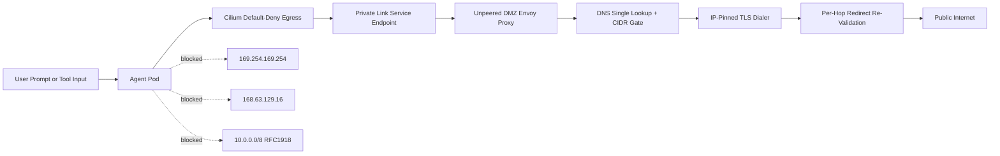
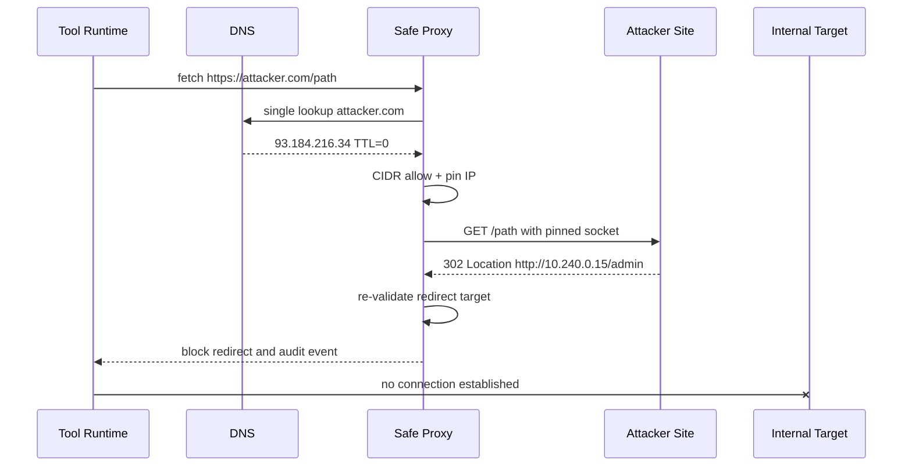

# 企业 Agent URL 工具 SSRF 与 DNS Rebinding 防御选型 FAQ
> Topic ID: #477  
> Section: 3.3 AI 网关、MCP 工具治理与跨组织 A2A 协议  
> Audience: 企业 AI 平台架构师、网关与网络安全团队、MCP/OpenAPI 工具工程团队  
> Goal: 在允许外部 URL/OpenAPI/Webhook 工具调用时，阻断 SSRF、IMDS 窃取、DNS Rebinding 与重定向绕过

## 1 生产问题：为什么 Agent 出站抓取是高危面
企业研究、采购、客服、法务智能体常调用 `fetch_url`、OpenAPI 连接器、Webhook 回调、链接预览工具。 这些入口天然接收用户可控 URL，极易被间接提示注入与恶意跳转利用。 一旦工具运行在 `AKS` 或 `ACA` 的受信任 VNet 内，攻击者就可能借代理触达内部地址。 最典型目标是 `169.254.169.254` IMDS 元数据端点和 `168.63.129.16` WireServer。 企业研究、采购、客服、法务智能体常调用 `fetch_url`、OpenAPI 连接器、Webhook 回调、链接预览工具。 这些入口天然接收用户可控 URL，极易被间接提示注入与恶意跳转利用。 如果应用持有托管身份，成功访问 IMDS 后可能直接换取 Entra 访问令牌。 另一类风险是访问 `*.privatelink.azure.net` 或企业 RFC1918 内网服务。 企业研究、采购、客服、法务智能体常调用 `fetch_url`、OpenAPI 连接器、Webhook 回调、链接预览工具。 这些入口天然接收用户可控 URL，极易被间接提示注入与恶意跳转利用。 这类内部端点常被网络边界默认信任，若被工具代访，后果通常大于普通 XSS。 因此“能访问公网”不等于“能安全访问任意 URL”。 企业研究、采购、客服、法务智能体常调用 `fetch_url`、OpenAPI 连接器、Webhook 回调、链接预览工具。 这些入口天然接收用户可控 URL，极易被间接提示注入与恶意跳转利用。 企业必须把 Agent 出站调用视为零信任高风险通道并独立治理。 企业研究、采购、客服、法务智能体常调用 `fetch_url`、OpenAPI 连接器、Webhook 回调、链接预览工具。 这些入口天然接收用户可控 URL，极易被间接提示注入与恶意跳转利用。  

## 2 关键攻击链：DNS Rebinding 与 3xx 跳转 TOCTOU
很多系统只在预检查阶段解析一次域名并判断“看起来是公网 IP”。 随后真正发起请求时，底层库会再次 DNS 解析并使用新地址。 当攻击者配置 `TTL=0` 或超短 TTL 时，第二次解析可切到内网地址。 这就是典型的 `Time-of-Check to Time-of-Use`（TOCTOU）窗口。 很多系统只在预检查阶段解析一次域名并判断“看起来是公网 IP”。 随后真正发起请求时，底层库会再次 DNS 解析并使用新地址。 即便初始域名安全，也可通过 `302/307` 跳转把后续请求导向内网。 如果客户端启用自动重定向且每跳不复核，防线会在协议层失效。 很多系统只在预检查阶段解析一次域名并判断“看起来是公网 IP”。 随后真正发起请求时，底层库会再次 DNS 解析并使用新地址。 因此单次字符串校验或仅做首跳域名校验都不足以防御生产攻击。 需要“连接时 IP 钉扎 + 每跳重定向复核 + 网络侧强制出站路径”三位一体。 很多系统只在预检查阶段解析一次域名并判断“看起来是公网 IP”。 随后真正发起请求时，底层库会再次 DNS 解析并使用新地址。  

## 3 四种架构路径总览
Pattern A：非对等 DMZ 出口代理（Envoy/Smokescreen）+ 单次解析 IP 钉扎 + 每跳重定向复核 + 工作负载侧默认拒绝出站。 Pattern B：身份最小化隔离抓取沙箱（`ACA Dynamic Sessions` 或 `AKS Kata`）承载不可信浏览器抓取任务。 Pattern C：`Azure Firewall` Premium FQDN 规则与统一出网，但不附加应用层钉扎抓取器。 Pattern D：应用内正则校验后直接 `requests.get(..., allow_redirects=True)`，且工具运行在有托管身份的 VNet 内。 Pattern A：非对等 DMZ 出口代理（Envoy/Smokescreen）+ 单次解析 IP 钉扎 + 每跳重定向复核 + 工作负载侧默认拒绝出站。 Pattern B：身份最小化隔离抓取沙箱（`ACA Dynamic Sessions` 或 `AKS Kata`）承载不可信浏览器抓取任务。 企业在开放 URL 工具能力时，应默认从 A 起步，再按业务复杂度叠加 B。 C 适合固定 SaaS allowlist，不适合任意公网 URL 抓取主路径。 Pattern A：非对等 DMZ 出口代理（Envoy/Smokescreen）+ 单次解析 IP 钉扎 + 每跳重定向复核 + 工作负载侧默认拒绝出站。 Pattern B：身份最小化隔离抓取沙箱（`ACA Dynamic Sessions` 或 `AKS Kata`）承载不可信浏览器抓取任务。 D 应列为反模式并强制整改。 Pattern A：非对等 DMZ 出口代理（Envoy/Smokescreen）+ 单次解析 IP 钉扎 + 每跳重定向复核 + 工作负载侧默认拒绝出站。 Pattern B：身份最小化隔离抓取沙箱（`ACA Dynamic Sessions` 或 `AKS Kata`）承载不可信浏览器抓取任务。  

## 4 十二维量化对比矩阵
| 维度 | Pattern A DMZ 钉扎代理 | Pattern B 隔离抓取沙箱 | Pattern C Firewall FQDN Only | Pattern D 反模式 |
|---|---|---|---|---|
| DNS Rebinding TOCTOU 免疫 | 强（单次解析后钉扎） | 强（隔离面内再控） | 弱到中 | 弱 |
| IMDS/WireServer 阻断 | 强 | 强 | 中（依赖路由与策略） | 弱 |
| RFC1918/ULA 阻断 | 强 | 强 | 中 | 弱 |
| 3xx 每跳复核 | 强（默认必做） | 强（可内建） | 弱 | 弱 |
| 私有端点误访风险 | 低 | 最低 | 中 | 高 |
| `P95` 额外时延 | `+4` 到 `+9 ms` | `+120` 到 `+450 ms` | `+3` 到 `+12 ms` | `+0` 到 `+3 ms` |
| 大响应体爆内存风险 | 低（流式上限） | 低（沙箱限额） | 中 | 高 |
| 审计可追溯性 | 高 | 高 | 中 | 低 |
| 运维复杂度 | 中高 | 高 | 中 | 低表象高后果 |
| 攻击面隔离强度 | 高 | 很高 | 中 | 很低 |
| 三年 TCO | 中 | 中高 | 中 | 低短期高事故成本 |
| 推荐结论 | 主路径 | 高风险补充 | 固定域名补充 | 禁用 |

## 5 Pattern A 主路径：非对等 DMZ 代理与连接时 IP 钉扎
Pattern A 的关键是让业务 Agent Pod 不直接建立公网 socket。 所有 URL 抓取必须通过 DMZ 安全代理，代理位于互联网可达但不与业务 VNet 对等互通的网络区。 代理执行单次 DNS 解析，拿到 `A/AAAA` 后逐个 IP 做 CIDR 风险校验。 校验通过后直接连接该 IP，并保留 `SNI/Host` 供 TLS 校验。 Pattern A 的关键是让业务 Agent Pod 不直接建立公网 socket。 所有 URL 抓取必须通过 DMZ 安全代理，代理位于互联网可达但不与业务 VNet 对等互通的网络区。  
这样后续请求不会再触发第二次 DNS，彻底关闭 Rebinding TOCTOU 窗口。 代理还必须关闭自动重定向并手工处理 `301/302/307/308`。  
每次跳转都要重新执行 URL 规范化、DNS 校验、CIDR 校验和 hop 上限判断。 建议 `max_hops <= 3`，超限直接拒绝并审计。  
响应体应使用流式读取并设置硬上限，如 `5 MB`。 对 `Content-Type`、压缩比、传输速率设置安全阈值，防止 zip bomb 与慢速拖垮。  
该模式在不显著牺牲延迟的前提下，提供最稳定的企业级防护闭环。 在多租户平台中，建议把代理访问日志按租户和工具标识分桶，便于快速回溯“谁请求了哪条 URL、命中了哪个拒绝规则、是否触发了重定向拦截”。  
为避免策略漂移，CIDR 拒绝列表、允许协议、端口与 body cap 应由集中策略仓统一发布，禁止每个服务自定义一套差异化实现。

## 6 Pattern B：隔离抓取沙箱作为高风险增强层
当业务必须执行浏览器渲染、脚本执行、多资源联动抓取时，Pattern A 可能不够。 此时建议将任务投递给零身份隔离抓取沙箱处理。  
沙箱可使用 `ACA Dynamic Sessions` 或 `AKS Kata` 作为执行平面。 沙箱所在 VNet 仅开放公网出站，不与企业内网、私有端点互通。  
沙箱不挂托管身份，不持久化高价值凭据，不落地业务主数据。 抓取结果通过受控 RPC/队列回传主平面，并附带完整审计元数据。  
这种模式即便浏览器引擎被利用，攻击也被限制在低信任隔离区。 代价是冷启动与跨平面通信时延上升，需按业务 SLA 分类启用。  
对“必须渲染 JS 才能读取内容”的场景，B 的风险收益比通常优于把浏览器直接跑在生产 VNet。 对于合规要求极高的行业，可进一步把沙箱镜像签名校验、执行时长上限、文件下载类型白名单纳入治理，降低通过浏览器链路进入恶意二进制载荷的概率。  
当采集任务峰值明显时，建议把 B 与 A 组合使用：A 处理普通 REST 抓取，B 只承接高复杂度渲染任务，避免整体成本被高延迟链路放大。

## 7 Pattern C：Azure Firewall FQDN 规则的边界与价值
Pattern C 对固定合作方 API 非常有效，尤其是 `api.partner.com` 这类确定域名。 它提供集中审计、统一策略与较成熟的网络治理体验。  
但对“任意用户 URL”型工具，C 单独使用不足以应对 Rebinding 与跳转链攻击。 原因在于 FQDN 规则不是应用层抓取器，不会自动完成每跳语义复核。  
另一个误区是以为 `0.0.0.0/0` UDR 覆盖了所有风险路径。 实际上节点本地链路地址与东西向私网路径不一定经过同一检查点。  
因此 C 更适合作为 A/B 的网络底座，而不是替代 A/B 的应用层安全逻辑。 在架构评审中，应明确“Firewall 是必要但不充分条件”，避免将网络边界能力误当为 URL 工具的完整防线。  
同时建议将 Firewall 命中日志与代理层审计事件做关联分析，用统一事件 ID 贯通请求全链路，方便 SOC 快速定位绕过尝试。 若企业存在多区域部署，需评估跨区出口集中化带来的额外 RTT 与费用，避免安全集中化方案反向放大业务延迟和带宽成本。

## 8 Pattern D 反模式与典型事故形态
反模式一：仅做 `startswith("http")` 或黑名单字符串匹配。 反模式二：预检查解析后直接交给标准 HTTP 客户端自动重定向。  
反模式三：抓取服务运行在挂托管身份的生产 VNet Pod。 反模式四：无流式上限，直接 `response.content` 整包读入内存。  
这类实现在功能测试阶段经常“看起来能用”。 但在对抗环境下会快速演化为令牌泄露、内网探测、成本失控和可用性事故。  
企业应在上线门禁中显式拒绝 Pattern D。 建议把“是否单次解析钉扎、是否每跳复核、是否阻断 IMDS/WireServer、是否默认拒绝 RFC1918”作为发布前必答题。  
凡一项缺失即不得开放到生产租户。

## 9 Mermaid：零 SSRF 出站拓扑


## 10 Mermaid：DNS Rebinding 与 302 绕过防御时序


## 11 量化推导 Q1 到 Q6
Q1 Rebinding 攻击成功概率。  
双重解析模型可近似 `P_rebind = 1 - (1 - p)^n`。 当单次命中概率 `p=0.45` 且 `n=3`，`P_rebind≈0.83`。  
单次解析且连接钉扎时，`P_rebind≈0`。  
Q2 流式内存预算。  
`B_max * Concurrency <= Memory_pod * 0.35`。 如 `B_max=5MB`、并发 `40`，峰值缓存约 `200MB`，适配 `2GB` Pod。  
Q3 3xx 跳转风险收敛。  
每跳复核后，风险近似随 hop 数指数下降。 建议 `max_hops<=3`，超过即拒绝并告警。  
Q4 A 与 B 时延分界。  
若需浏览器渲染成功率提升 `>20%` 且可接受 `+200ms`，优先 B。 若主要是 API/HTML 抽取且 SLA 紧，优先 A。  
Q5 成本分解。  
`Cost_total = Cost_proxy + Cost_sandbox + Cost_egress + Cost_incident`。 短期最便宜不代表长期最优，应计入事故期望成本。  
Q6 防护覆盖率。  
覆盖率应同时统计 IMDS 阻断、RFC1918 阻断、重定向拦截、payload 超限拦截。 任何单项长期低于 `99%` 都需进入治理整改。

## 12 代码块一：Python 连接时 IP 钉扎安全抓取器
```python
import http.client
import ipaddress
import socket
import ssl
from urllib.parse import urlparse, urljoin

DENY = [ipaddress.ip_network(c) for c in [
    "10.0.0.0/8", "172.16.0.0/12", "192.168.0.0/16",
    "169.254.0.0/16", "127.0.0.0/8", "100.64.0.0/10",
    "fc00::/7", "::1/128", "::ffff:0:0/96"
]]

def _blocked(ip: str) -> bool:
    addr = ipaddress.ip_address(ip)
    if str(addr) in {"169.254.169.254", "168.63.129.16"}:
        return True
    return any(addr in net for net in DENY)

def safe_fetch(url: str, max_hops: int = 3, max_bytes: int = 5 * 1024 * 1024):
    current = url
    for _ in range(max_hops + 1):
        u = urlparse(current)
        if u.scheme != "https" or not u.hostname:
            raise RuntimeError("https_required")
        host = u.hostname
        port = u.port or 443
        infos = socket.getaddrinfo(host, port, type=socket.SOCK_STREAM)
        pinned_ip = None
        for fam, _, _, _, sockaddr in infos:
            ip = sockaddr[0]
            if _blocked(ip):
                raise RuntimeError(f"blocked_ip:{ip}")
            if pinned_ip is None:
                pinned_ip = ip
        if pinned_ip is None:
            raise RuntimeError("dns_resolution_failed")
        ctx = ssl.create_default_context()
        raw = socket.create_connection((pinned_ip, port), timeout=5.0)
        tls_sock = ctx.wrap_socket(raw, server_hostname=host)
        conn = http.client.HTTPSConnection(host=host, port=port, timeout=8.0, context=ctx)
        conn.sock = tls_sock
        path_q = (u.path or "/") + (f"?{u.query}" if u.query else "")
        conn.request("GET", path_q, headers={"Host": host, "Accept-Encoding": "identity"})
        resp = conn.getresponse()
        if resp.status in {301, 302, 303, 307, 308}:
            current = urljoin(current, resp.getheader("Location", ""))
            conn.close()
            continue
        total_bytes, chunks = 0, []
        while chunk := resp.read(65536):
            total_bytes += len(chunk)
            if total_bytes > max_bytes:
                conn.close()
                raise RuntimeError("payload_too_large")
            chunks.append(chunk)
        body = b"".join(chunks)
        ctype = resp.getheader("Content-Type", "")
        conn.close()
        return resp.status, ctype, body
    raise RuntimeError("redirect_hop_exceeded")
```

## 13 代码块二：CiliumNetworkPolicy 强制仅能访问私链代理
```yaml
apiVersion: cilium.io/v2
kind: CiliumNetworkPolicy
metadata:
  name: agent-tool-egress-guard
  namespace: agent-runtime
spec:
  endpointSelector:
    matchLabels:
      app: agent-tool-runner
  egressDeny:
    - toCIDR:
        - 169.254.169.254/32
        - 168.63.129.16/32
        - 10.0.0.0/8
        - 172.16.0.0/12
        - 192.168.0.0/16
        - 100.64.0.0/10
  egress:
    - toCIDRSet:
        - cidr: 10.42.8.4/32
      toPorts:
        - ports:
            - port: "443"
              protocol: TCP
  ingress:
    - fromEndpoints:
        - matchLabels:
            app: agent-orchestrator
```

## 14 代码块三：Bicep 部署非对等 DMZ 代理与 Private Link Service
```bicep
param location string = resourceGroup().location

resource dmzVnet 'Microsoft.Network/virtualNetworks@2023-09-01' = {
  name: 'vnet-agent-egress-dmz'
  location: location
  properties: {
    addressSpace: { addressPrefixes: ['10.90.0.0/16'] }
    subnets: [
      { name: 'proxy-subnet', properties: { addressPrefix: '10.90.1.0/24' } }
    ]
  }
}

resource pls 'Microsoft.Network/privateLinkServices@2023-09-01' = {
  name: 'pls-safe-egress-proxy'
  location: location
  properties: {
    ipConfigurations: [
      { name: 'primary', properties: { privateIPAddress: '10.90.1.10', privateIPAllocationMethod: 'Static', subnet: { id: dmzVnet.properties.subnets[0].id } } }
    ]
    visibility: { subscriptions: [] }
    autoApproval: { subscriptions: [] }
  }
}
```

## 15 企业落地场景、三年 TCO 与 D0/D1/D2 行动清单
### 15.1 场景 A：投研与并购尽调智能体 URL 抓取平台
该平台每天抓取 `180K` 外部新闻、公告与披露页面。 改造前使用应用内 URL 校验，红队在 `3` 天内复现 IMDS 与重定向绕过。  
迁移 Pattern A 后，`42` 次 Rebinding/内网探测请求均被阻断。 线上 `P95` 抓取时延仅增加 `6.2ms`，未影响核心查询体验。  
平台把“阻断证据”与“租户追踪”接入统一 SIEM，审计闭环显著提升。 进一步引入分级策略后，高风险域名请求自动进入人工审批队列，降低误放行概率。  
业务团队可在不暴露内网面的前提下继续扩展外部数据源接入，兼顾创新效率与安全边界。

### 15.2 场景 B：多租户 SaaS 的 Webhook 与浏览器抓取工具
该平台允许租户自定义 Webhook 与页面采集任务。 REST 类回调走 Pattern A，浏览器渲染任务走 Pattern B。  
沙箱层不挂身份且无内网路由，即使渲染链被利用也难横向渗透。 平台在租户维度设置并发与字节预算，避免单租户拖垮共享资源。  
通过队列隔离与失败重试分层，整体可用性优于单平面混跑模式。 运营侧可根据租户风险等级自动调整“直连代理”与“沙箱渲染”比例，实现动态成本控制。  
在季度复盘中，平台将安全事件率、SLA、单位抓取成本三项指标并列评估，确保治理策略不偏向单一目标。

### 15.3 三档三年 TCO 参考
基础档（Pattern A 单路径）适合中等规模 URL 抓取。 增强档（A+B 混合）适合高比例浏览器渲染与高合规客户。  
旗舰档（A+B+集中 SOC 联动）适合跨区域、多法域与高审计频率企业。 评估时务必把安全事故期望损失纳入财务模型。  
仅比较代理资源费用会严重低估反模式总成本。 建议每半年复核一次成本与风险参数，避免流量增长后模型失真。  
对外包运营团队应设置明确 KPI：阻断准确率、误伤率、事件回溯时长与整改完成时效。

### 15.4 D0 D1 D2 十八项执行动作
- **D0-1** 盘点所有 URL/OpenAPI/Webhook 工具入口与调用链。  
- **D0-2** 列出托管身份使用面并识别高价值令牌路径。  
- **D0-3** 建立 IMDS/WireServer/RFC1918/ULA 拒绝基线。  
- **D0-4** 在测试环境复现 DNS Rebinding 与 302 绕过。  
- **D0-5** 明确代理日志字段与审计保留策略。  
- **D0-6** 定义 body cap、hop cap、超时 cap 默认值。  
- **D1-1** 落地 DMZ 代理与 Private Link 单向接入。  
- **D1-2** 上线单次解析 IP 钉扎与每跳重定向复核。  
- **D1-3** 下发 Cilium/NetworkPolicy 默认拒绝策略。  
- **D1-4** 将高风险抓取路由到隔离沙箱平面。  
- **D1-5** 接入 SIEM 告警并建立值班响应流程。  
- **D1-6** 进行红队回归并记录阻断证据。  
- **D2-1** 每周复核阻断命中率与误伤率。  
- **D2-2** 每周复核高风险域名与租户画像变化。  
- **D2-3** 每月复核沙箱冷启动与并发容量。  
- **D2-4** 每月复核字节预算与成本偏差。  
- **D2-5** 每季度复核策略版本与例外项清理。  
- **D2-6** 每季度执行全链路攻防演练与复盘。  

通过上述路径，企业可把“可用但危险”的出站工具能力升级为“可用且可证安全”的生产能力。 核心不是单点产品，而是网络隔离、协议验证、运行时控制和审计闭环的一致工程体系。  
当组织把这套体系标准化后，新增工具接入的边际风险与边际成本都会显著下降。 在跨团队协作中，建议将该标准纳入平台准入规范与架构评审模板，确保后续项目不再重复引入历史反模式。  
最终目标是在持续创新外部工具能力的同时，维持对身份资产、内网边界与合规证据的长期可控性。

来源抓取日期 2026 11 27  
Azure API Management AI Gateway  
https://learn.microsoft.com/azure/api-management/ai-gateway-overview  
Azure Container Apps sessions  
https://learn.microsoft.com/azure/container-apps/sessions  
Azure Instance Metadata Service  
https://learn.microsoft.com/azure/virtual-machines/instance-metadata-service  
Azure WireServer and platform addresses  
https://learn.microsoft.com/azure/virtual-network/what-is-ip-address-168-63-129-16  
Azure Firewall documentation  
https://learn.microsoft.com/azure/firewall/overview  
Cilium network policy reference  
https://docs.cilium.io/en/stable/security/policy/  
