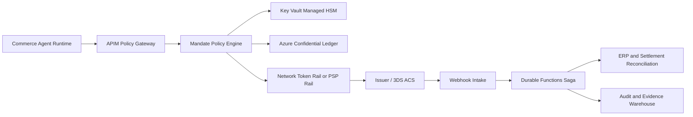
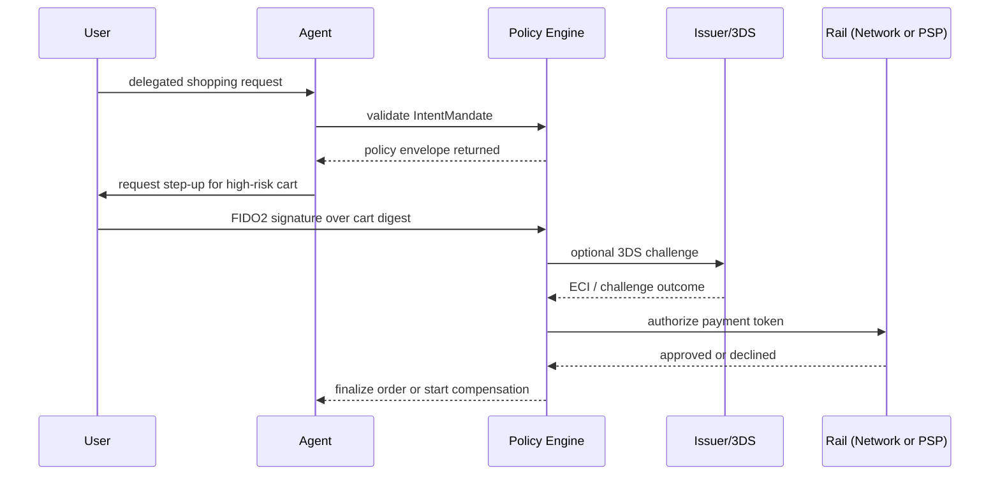

# Enterprise Agentic Commerce Delegated Payment Selection FAQ: Network Token Mandates, PSP Virtual-Card Sagas, and FIDO2/3DS Liability Controls
> 🌐 **Language Switch**: [中文](agentic-commerce-delegated-payment-mandate-network-token-vs-psp-mcp-vs-fido2-3ds-selection-faq.md) | **English (current)**  
> Audience: Cloud & AI Principal Architects, payment-risk leaders, compliance officers, and agent-platform engineering teams.  
> Scope: Enterprise agentic checkout architecture and delegated payment governance, distinct from #76 SaaS metering and #129 ISO20022 wire exception remediation.  
> Objective: Deliver autonomous checkout with cryptographic authorization, constrained PCI exposure, and dispute-ready non-repudiation on Azure.  

## 1. Executive finding: successful autonomous checkout is meaningless without verifiable authorization lineage
Autonomous ordering is not the hard part.
The hard part is payment accountability.
Enterprises need cryptographically provable intent.
They need constrained spending envelopes.
They need replayable audit evidence.
They also need PSD2 and PCI alignment.
If PAN enters LLM context, screenshots, or traces, compliance risk expands immediately.
A transaction can be commercially successful and still governance-failed.
This guide evaluates four architecture paths.
Path A is network-level tokenized agentic payment mandates.
Path B is PSP API orchestration with short-lived single-use virtual cards.
Path C is human-presence step-up using FIDO2 and EMV 3DS 2.3.
Path D is isolated browser checkout fallback via reverse-tokenization proxy.
The goal is controlled autonomy, not uncontrolled automation.
Policy and cryptography must lead orchestration.

## 2. Problem definition: three non-negotiable constraints for delegated agentic payments
Constraint one is non-repudiable authorization.
Every payment action must map to signed intent boundaries.
Constraint two is minimized card-data exposure.
Agent runtimes should not process raw PAN or CVV.
Constraint three is dispute-forensic replayability.
Risk and finance teams must reconstruct decision lineage deterministically.
Traditional bot-style checkout often violates all three constraints.
DOM automation alone cannot prove user authorization quality.
Raw card entry pipelines are difficult to defend under audit.
Prompt-injection side channels can alter cart parameters silently.
Therefore delegated commerce requires mandate models.
Mandate models require key-managed signing roots.
Mandate models require policy-aware orchestration.
These controls should be implemented before scale growth.

## 3. Four-path architecture model: network-first, PSP bridge, cryptographic step-up, isolated fallback
Path A should be the preferred route where available.
It combines network tokenization with signed constraints.
Path B provides broad merchant compatibility when AP2 rails are unavailable.
Path C adds explicit human-presence proof for high-risk carts.
Path D handles unavoidable browser-only merchant flows.
Path D must remain a constrained fallback.
No single path solves all merchant ecosystems.
Most enterprise programs run a weighted combination.
Routing should be policy-driven and auditable.
Routing should be region-aware and regulation-aware.
APIM and Durable Functions can provide centralized governance.
A unified policy engine should evaluate all paths with consistent evidence semantics.

## 4. Twelve-dimension comparison matrix across network rails, PSP rails, step-up controls, and browser fallback
| Dimension | Path A Network token mandates | Path B PSP virtual-card saga | Path C FIDO2 + 3DS step-up | Path D Isolated CUA fallback |
|---|---|---|---|---|
| PCI exposure surface | Lowest | Low | Low | Medium-high |
| SAQ-A feasibility | High | Medium-high | High | Low-medium |
| Authorization non-repudiation strength | High | Medium-high | Highest | Low-medium |
| Dispute evidence completeness | High | Medium-high | High | Medium |
| Merchant coverage breadth | Medium | High | High | Highest |
| Mean checkout latency | Low | Medium | Medium-high | High |
| Compensation complexity | Medium | High | Medium | High |
| Policy explainability | High | High | High | Medium |
| Multi-region operability | High | High | High | Medium |
| Incremental per-transaction cost | Low-medium | Medium | Medium | High |
| Platform operational complexity | Medium | Medium-high | Medium | High |
| Prompt-injection resilience | High | High | Highest | Low-medium |
This matrix is designed for architecture review boards.
It is not a legal substitute for regional regulation.
Selection should be validated against empirical workload traces.

## 5. Path A: AP2, Visa Intelligent Commerce, and Mastercard Agent Pay network-token mandates
Path A pushes trust constraints into payment rails.
DPAN issuance is network-governed.
Mandates can constrain merchant, amount, SKU class, and expiry.
Dynamic cryptograms reduce replay utility.
The agent runtime never needs raw PAN.
This sharply reduces sensitive-data blast radius.
Azure Key Vault Managed HSM can anchor signing roots.
Azure Confidential Ledger can anchor immutable evidence receipts.
Issuer fraud engines receive richer agent-identity signals.
Authorization rates can improve under lower risk ambiguity.
Friendly-fraud disputes are easier to defend.
Path A is strongest when merchant and acquirer ecosystems support network-native controls.
Fallback planning is still required for long-tail merchants.

## 6. Path B: PSP agentic APIs, APIM MCP tooling, and short-lived exact-amount virtual cards
Merchant ecosystems are heterogeneous.
Many endpoints still lack network-native mandate support.
Path B bridges this with PSP programmable controls.
Typical pattern is just-in-time virtual card issuance.
Cards are constrained by TTL and amount.
Cards are constrained by merchant category and one-time use.
A practical TTL range is often `10–20` minutes.
Durable Functions orchestrates reserve-confirm-void stages.
Idempotency keys prevent accidental double charges.
Webhook reconciliation closes ledger integrity loops.
This path is effective for autonomous B2B tail spend.
It is also effective for travel disruption rebooking flows.
Policy discipline remains critical to avoid leakage beyond spend envelopes.

## 7. Path C: cryptographic human-presence step-up with FIDO2 passkeys and EMV 3DS 2.3
Not every autonomous payment should auto-complete.
High-value and high-risk flows require explicit user presence.
Cart mandates should be signed over canonical digest payloads.
Digest inputs should include merchant identifier.
Digest inputs should include line items and total.
Digest inputs should include currency and mandate nonce.
FIDO2 private-key signatures provide hardware-backed proof.
3DS challenge outcomes strengthen liability posture.
ECI alignment enables clearer liability-shift handling where applicable.
Most importantly, digest-bound signing blocks silent cart tampering.
Prompt-injection payload edits fail verification if any protected field changes.
This separates convenience from uncontrolled delegation.

## 8. Path D: vault-proxied headless browser fallback and reverse tokenization constraints
Browser fallback offers broad compatibility.
It also introduces substantial risk and friction.
Anti-bot and CAPTCHA layers increase drop-offs.
3DS redirects are brittle in pure DOM automation.
Screenshot-based observability can leak sensitive context.
Prompt windows may accidentally include payment data.
Therefore this path should be tightly isolated.
ACA or AKS sandbox pools are recommended.
Detokenization should occur in a secure forward proxy.
PAN bytes should only exist on encrypted wire path boundaries.
UI, logs, and traces should only see token placeholders.
Without this architecture, PCI scope and audit burden can expand rapidly.

## 9. Quantitative Q&A: eight mandatory decision questions for architecture reviews
**Q1: What is the PCI scope impact if PAN appears in screenshots or telemetry.**  
A1: Exposure in logs, traces, or captures can shift control scope materially beyond SAQ-A posture, increasing audit controls and operational compliance cost by a large margin.  
**Q2: What authorization uplift is realistic for network-token paths versus raw bot checkout.**  
A2: Typical enterprise ranges are around `0.6%–2.3%` uplift where issuer risk signals improve and mandate evidence is structured.  
**Q3: What friendly-fraud reduction can be expected under stronger mandate evidence.**  
A3: Programs commonly report `8–35 bps` chargeback reduction when signed mandate lineage is complete and replayable.  
**Q4: How does reserve-confirm-void idempotency prevent duplicate charging under timeouts.**  
A4: Each phase binds to a deterministic idempotency key and timeout retries query status before any second authorization attempt.  
**Q5: How does cryptographic cart digest verification block prompt-injection substitutions.**  
A5: Any mutation to merchant, items, total, or currency changes `SHA-256` digest, causing signature verification failure before payment execution.  
**Q6: What conversion trade-off is typical for mandatory FIDO2/3DS step-up.**  
A6: Additional friction can introduce `2%–7%` conversion drop on stepped-up flows, but often offsets with lower dispute loss and stronger liability posture.  
**Q7: Why is virtual-card TTL tuning critical.**  
A7: TTL too short raises avoidable checkout failures; TTL too long raises abuse window, making policy ranges like `10–20` minutes a practical compromise.  
**Q8: How costly is heavy browser-fallback dependence in regulated markets.**  
A8: Anti-bot and challenge frictions can add `20%–35%` completion overhead and increase manual intervention compared with network-token-first designs.  
These questions should be codified in release gates.
Each answer should map to measured evidence sources.

## 10. Reference architecture diagram: delegated checkout control plane with cryptographic evidence

The architecture separates authorization proof from execution mechanics.
It allows deterministic replay of disputed transactions.
It also centralizes policy ownership for risk and compliance.

## 11. Sequence diagram: intent mandate, cart mandate, step-up, authorization, and compensation

The critical control is verify-before-pay.
Not pay-first-and-explain-later behavior.

## 12. Production code sample: JWS mandate verification with deterministic cart digest checks
```python
import hashlib
import json
from jose import jws


def canonical_cart_digest(merchant_id: str, items: list[dict], total_minor: int, currency: str) -> str:
    canonical = {
        "merchant_id": merchant_id,
        "items": sorted(items, key=lambda r: (r["sku"], r["qty"], r["unit_minor"])),
        "total_minor": total_minor,
        "currency": currency,
    }
    payload = json.dumps(canonical, separators=(",", ":"), ensure_ascii=False).encode("utf-8")
    return hashlib.sha256(payload).hexdigest()


def verify_cart_mandate_jws(token: str, pub_key_pem: str, expected_digest: str) -> dict:
    claims_raw = jws.verify(token, pub_key_pem, algorithms=["ES256"])
    claims = json.loads(claims_raw)
    if claims["cart_digest_sha256"] != expected_digest:
        raise ValueError("digest mismatch")
    if claims["actual_total_minor"] > claims["max_total_minor"]:
        raise ValueError("amount exceeds mandate")
    if claims["expires_epoch_ms"] <= claims["issued_epoch_ms"]:
        raise ValueError("invalid expiry")
    return claims
```
The decisive control is digest recomputation.
This prevents indirect cart mutations from bypassing policy intent.

## 13. Production orchestration sample: idempotent reserve-confirm-void saga for PSP rails
```python
import azure.durable_functions as df


def payment_saga(context: df.DurableOrchestrationContext):
    req = context.get_input()
    idem = f"{req['mandate_id']}:{req['attempt']}"

    reserve = yield context.call_activity("ReserveWithVirtualCard", {"idempotency_key": idem, **req})
    if reserve["status"] == "timeout":
        probe = yield context.call_activity("ProbeReserveStatus", {"idempotency_key": idem})
        if probe["status"] == "authorized":
            reserve = probe
        else:
            return {"status": "failed", "phase": "reserve"}

    capture = yield context.call_activity("CaptureAuthorization", {"idempotency_key": idem, "auth_id": reserve["auth_id"]})
    if capture["status"] != "captured":
        yield context.call_activity("VoidAuthorization", {"idempotency_key": idem, "auth_id": reserve["auth_id"]})
        return {"status": "compensated", "phase": "capture"}

    yield context.call_activity("WriteEvidenceRecord", {"idempotency_key": idem, "auth_id": reserve["auth_id"], "capture_id": capture["capture_id"]})
    return {"status": "succeeded", "auth_id": reserve["auth_id"], "capture_id": capture["capture_id"]}


main = df.Orchestrator.create(payment_saga)
```
This approach converts ambiguity into explicit states.
It limits duplicate-charge exposure under partial failures.

## 14. Enterprise scenarios: global travel platform and omnichannel retail marketplace
### Scenario A: global corporate travel and expense platform with `350,000` travelers
The platform auto-rebooks disruptions under policy mandates.
Low-value rebooking under `<= $600` proceeds autonomously.
Higher-value carts require FIDO2 step-up.
Network-token rails are used as primary routes.
PSP virtual cards handle long-tail merchant gaps.
Durable saga handles retries and compensation.
Finance receives deterministic reconciliation events.
Dispute teams can replay signed mandate lineage.
Operational overhead decreases compared with manual escalation workflows.
### Scenario B: Fortune 500 omnichannel retailer and marketplace
The business exposes agentic checkout APIs to partners.
EU traffic must satisfy PSD2 SCA obligations.
North America prioritizes approval uplift and fraud control.
Routing is regional and risk-tiered.
Path A serves low-risk high-scale flows.
Path C serves high-risk step-up flows.
Path D remains constrained fallback for browser-only lanes.
Fraud bps and conversion are jointly optimized via policy experiments.

### FinOps and payment economics table: interchange, token fees, and fraud bps impacts
| Metric | Path A network token | Path B PSP virtual card | Path C FIDO2 + 3DS | Path D CUA fallback |
|---|---:|---:|---:|---:|
| Authorization uplift vs baseline | +0.6% to +2.3% | +0.2% to +1.4% | -0.3% to +0.8% | -1.8% to +0.4% |
| Friendly-fraud reduction (bps) | 8 to 35 | 6 to 22 | 12 to 40 | 0 to 10 |
| Incremental processing cost (bps) | 4 to 12 | 12 to 35 | 10 to 28 | 18 to 45 |
| Step-up friction attrition | Low | Medium | Medium-high | High |
| Latency overhead | Low | Medium | Medium-high | High |
| Manual intervention share | Low | Low-medium | Medium | High |
| Audit evidence quality | High | Medium-high | High | Medium |
| Profit stability | High | Medium-high | Medium-high | Medium-low |
This table is intended for joint architecture and finance governance.
It should be calibrated with regional empirical data.

## 15. Day-0 and Day-2 checklist: production operating discipline for delegated commerce controls
- Define canonical JSON Schemas for IntentMandate and CartMandate.
- Recompute and verify cart digest before every payment authorization.
- Keep mandate-signing keys in Managed HSM with strict rotation controls.
- Enforce APIM policies that block PAN-bearing payload logs.
- Bind every saga phase to deterministic idempotency keys.
- Correlate webhooks and orchestration events with one trace identity.
- Require FIDO2 or 3DS step-up for high-risk policy bands.
- Run browser fallback only in isolated sandbox pools.
- Ensure detokenizer proxies never expose PAN to UI or logs.
- Replay sampled disputes weekly to validate evidence integrity.
- Review monthly authorization, fraud-bps, and friction metrics together.
- Exercise quarterly HSM rollover and regional failover scenarios.
Each checklist item must map to an accountable owner.
Each checklist item must produce auditable runtime evidence.
Additional governance recommendations support scale expansion.
Manage SCA policies by jurisdiction and payment product.
Map merchant-risk tiers to default route preferences.
Version-control virtual-card TTL policy profiles.
Version-control MCC allow and deny lists.
Apply dual-write integrity checks on refund compensations.
Archive signature-chain evidence in immutable stores.
Bucket 3DS failure reasons for model retraining loops.
Feed chargeback outcomes back to risk-policy tuning.
Use bounded retry budgets for timeout-heavy endpoints.
Freeze high-risk policy edits before accounting close.
Require manual approval for large overnight compensating batches.
Enable dedicated mandate templates for strategic enterprise accounts.
Set minimum-sample thresholds for policy A/B experiments.
Alert on fraud-model drift with explicit rollback plans.
Project payment observability into a shared SRE control dashboard.
Keep human override controls for all automated payment actions.
Generate downloadable dispute evidence bundles automatically.
Maintain replay sets for policy false-positive investigations.
Apply tighter step-up thresholds for high-risk geographies.
Lower autonomous spending ceilings during unattended night windows.
Force pre-signature repricing checks for volatile travel inventory.
Require re-signing when inventory substitutions alter cart economics.
Validate merchant-to-mandate binding at APIM ingress consistently.
Persist issuer reason codes into risk feature stores.
Feed manual-review outcomes into policy explanation layers.
Add extra approval chains for cross-entity settlement flows.
Enforce beneficiary-consistency checks for delegated payouts.
Trigger mandatory human presence on currency-switch events.
Trigger re-sign when tax or duty variance exceeds policy thresholds.
Differentiate soft-decline and hard-decline retry playbooks.
Route hard declines to manual handling and freeze auto-replay.
Review weekly failure cohorts in architecture governance forums.
Publish monthly change-impact reports for policy updates.
Submit quarterly KPI packs to joint audit and risk sign-off.
Include credential-theft and extortion drills in annual exercises.
Set rollback criteria for every payment-policy release.
Version mandate schemas and enforce backward-compatibility windows.
Store policy-decision snapshots with signed hash attestations.
Track evidence retrieval latency as an operational SLO.
Alert when dispute bundle generation exceeds response targets.
Require dual control for emergency policy overrides.
Link override tickets to immutable evidence records.
Monitor challenge-abandonment by market and issuer bin range.
Correlate abandonment spikes with UX and latency telemetry.
Publish merchant onboarding readiness scorecards before go-live.
Gate production activation on scorecard minimum thresholds.
Backtest risk-model changes against archived dispute datasets.
Document jurisdiction-specific legal review outcomes per route.
Keep one-click global kill-switch for autonomous checkout lanes.
Exercise kill-switch and recovery drills on a fixed cadence.
