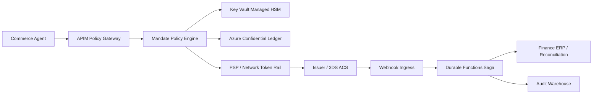
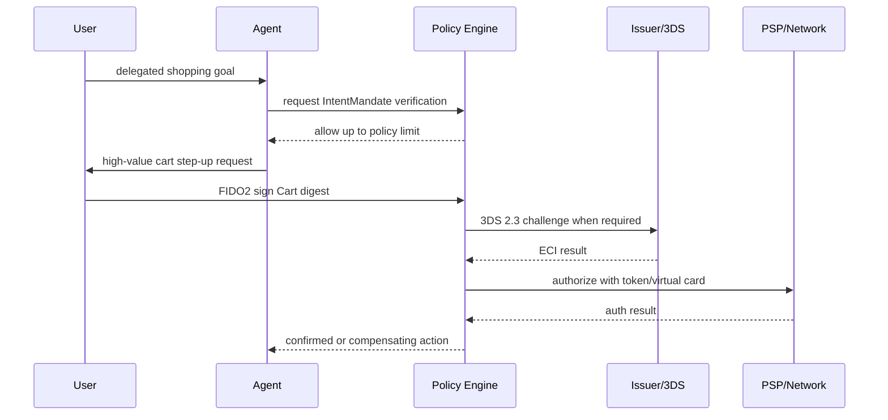

# 企业 Agentic Commerce 委托支付选型 FAQ：网络令牌授权、PSP 虚拟卡编排与 FIDO2/3DS 合规闭环
> 🌐 **Language Switch**: **中文（当前）** | [English](agentic-commerce-delegated-payment-mandate-network-token-vs-psp-mcp-vs-fido2-3ds-selection-faq.en.md)  
> 适用对象：Cloud & AI 首席架构师、支付风控负责人、合规与审计负责人、Agent 平台工程团队。  
> 主题边界：聚焦企业 Agentic Commerce 结算架构，不覆盖 #76 SaaS 计量变现，不替代 #129 ISO20022 跨境电汇异常修复。  
> 核心目标：在 Azure 上实现“可自治下单 + 可验证授权 + 可追责争议”的委托支付控制面。  

## 1. 执行摘要：Agentic Commerce 的关键不是“会买”，而是“谁授权、何时授权、如何追责”
Agent 会下单不是难点。  
难点是支付责任边界。  
企业需要可验证授权链。  
并需要最小化 PCI 范围。  
还要满足 PSD2 SCA。  
还要控制拒付与欺诈率。  
如果把 PAN 暴露给 LLM。  
或暴露在截图与日志。  
即使交易成功。  
合规也会失败。  
本指南给出四路径对比。  
路径 A：网络级 Agent 令牌与加密 Mandate。  
路径 B：PSP API + 单次虚拟卡 Saga。  
路径 C：FIDO2 + EMV 3DS 2.3 人在场升级。  
路径 D：隔离 CUA 兜底与反向代币化代理。  
目标是自治效率与监管约束并存。  

## 2. 问题定义：委托支付体系的三条硬约束
第一条是授权不可抵赖。  
支付动作必须绑定意图。  
并绑定金额与商户边界。  
第二条是数据最小暴露。  
Agent 编排上下文不应见 PAN。  
也不应见 CVV。  
第三条是争议可审计。  
每个支付决策需可重放。  
需能证明用户是否在场。  
需能证明策略是否命中。  
传统 bot 代填卡号流程。  
在这三条上都很脆弱。  
因此需要结构化 Mandate 模型。  
并配合密钥硬件根信任。  

## 3. 四路径总览：网络令牌优先、PSP 虚拟卡补位、人机共签兜底、浏览器隔离降险
路径 A 适合网络原生能力齐全商户。  
通过 DPAN + 动态密码学证明完成扣款。  
路径 B 适合缺少网络原生端点的商户。  
通过 PSP 虚拟卡完成可控支付。  
路径 C 用于高风险或高金额步骤。  
要求 FIDO2 签名与 3DS 升级。  
路径 D 只应作为最后兜底。  
用于必须走网页结账的场景。  
并需采用 detokenizer 代理。  
四路径应通过统一策略编排。  
并由 APIM + Durable Functions 统一审计。  

## 4. 十二维架构对比矩阵：安全边界、成本、时延与运维复杂度
| 维度 | 路径 A 网络令牌+Mandate | 路径 B PSP 虚拟卡 Saga | 路径 C FIDO2+3DS 升级 | 路径 D 隔离 CUA 兜底 |
|---|---|---|---|---|
| PCI 数据暴露面 | 最低 | 低 | 低 | 中高 |
| SAQ-A 可达性 | 高 | 中高 | 高 | 低中 |
| 授权不可抵赖强度 | 高 | 中高 | 最高 | 低中 |
| 拒付争议证据完整度 | 高 | 中高 | 高 | 中 |
| 商户兼容覆盖率 | 中 | 高 | 高 | 最高 |
| 平均结账时延 | 低 | 中 | 中高 | 高 |
| 失败补偿复杂度 | 中 | 高 | 中 | 高 |
| 风险策略可解释性 | 高 | 高 | 高 | 中 |
| 多区域容灾可行性 | 高 | 高 | 高 | 中 |
| 单笔附加成本 | 低中 | 中 | 中 | 高 |
| 平台运维复杂度 | 中 | 中高 | 中 | 高 |
| 对 LLM 提示注入抗性 | 高 | 高 | 最高 | 低中 |
矩阵结论不是单选。  
企业通常是 A 主路径。  
B 作为长尾覆盖。  
C 用于金额与风险门限升级。  
D 仅作为保守兜底。  

## 5. 路径 A：AP2 / Visa Intelligent Commerce / Mastercard Agent Pay 的网络级委托支付
路径 A 的优势在网络侧约束。  
授权令牌由网络侧签发。  
并绑定商户、SKU、金额。  
还绑定有效期 TTL。  
DPAN 仅在受控通道使用。  
动态密码学值每次变化。  
即使令牌泄露。  
复用成功率也受限。  
Azure Key Vault Managed HSM 可托管签名根。  
Azure Confidential Ledger 可记录授权证据。  
LLM 与编排器不触达 PAN。  
可显著收敛 PCI 审计范围。  
同时可向发卡行提供更强信号。  
提升授权通过率。  
并降低友好欺诈争议。  

## 6. 路径 B：PSP API + 单次虚拟卡 + Durable Functions Saga
很多商户尚未接入 AP2。  
路径 B 用于兼容现实长尾。  
核心是“精确金额、精确时窗、精确商编”。  
虚拟卡可设置 15 分钟 TTL。  
可设置 exact-cent 限额。  
可设置 MCC 白名单。  
可设置单次消费标记。  
Durable Functions 负责编排两阶段。  
先 reserve 再 confirm。  
若超时或失败则 void。  
所有步骤写入幂等键。  
Webhook 回调统一入账。  
可把自治采购风险限制在策略框内。  

## 7. 路径 C：FIDO2 Passkey + EMV 3DS 2.3 的人在场升级
不是所有交易都应自动放行。  
高金额需人在场确认。  
高风险商户需人在场确认。  
地址或收货人变更需确认。  
做法是对 Cart 摘要签名。  
摘要建议包含 merchant_id。  
还包含 cart_items 哈希。  
还包含 total 与 currency。  
还包含 mandate_id 与 nonce。  
用户用 WebAuthn 私钥签名。  
并触发 3DS 2.3 challenge。  
若达到 ECI 05 责任转移。  
争议责任可更清晰界定。  
同时防止间接提示注入改价。  

## 8. 路径 D：隔离 CUA 结账兜底与反向代币化代理
网页自动结账覆盖率高。  
但风险也最高。  
CAPTCHA 与反机器人拦截频繁。  
3DS 跳转不可预测。  
DOM 结构变化导致失败。  
更严重的是数据泄露面。  
截图、日志、VLM 提示都可能暴露敏感数据。  
因此 D 只能做兜底。  
且必须在隔离沙箱中运行。  
推荐 ACA/AKS 隔离 CUA 池。  
并在 TLS 线中注入 detokenize 结果。  
界面与日志只见 token 占位符。  
不见真实 PAN 字节。  

## 9. 定量问答：支付架构评审必须回答的八个硬问题
**Q1：若 PAN 出现在 agent telemetry，PCI 审计影响多大。**  
A1：一旦截图、日志或 trace 存在 PAN，常从 SAQ-A 滑向更重审计路径，控制项与审计工时显著上升，合规成本可能按倍数增长。  
**Q2：网络令牌相对原始 bot guest checkout 的授权率差异。**  
A2：在稳定商户类别中，网络令牌与更强身份信号常带来 `0.6%–2.3%` 授权率提升，且人工复核比例下降。  
**Q3：拒付率（bps）在四路径中的典型差异。**  
A3：A/C 路径在证据链完备时常比无签名 bot 流程低 `8–35 bps`，具体受品类与地区争议制度影响。  
**Q4：Durable Functions reserve-confirm-void 幂等如何落地。**  
A4：每阶段绑定 `idempotency_key=mandate_id+attempt`，超时仅可重放同键查询，不允许直接二次扣款请求。  
**Q5：提示注入改价如何被密码摘要阻断。**  
A5：结账前必须重算 `SHA-256(merchant_id||items||total||currency)` 并与签名载荷一致，任一字段篡改都会导致验签失败。  
**Q6：FIDO2 + 3DS 升级对完成率影响多大。**  
A6：高风险交易会出现 `2%–7%` 额外流失，但可换取责任转移与拒付下降，综合利润常优于无控制放行。  
**Q7：虚拟卡 TTL 与失败率的平衡点。**  
A7：TTL 过短会增加重试失败，过长会放大被盗刷窗口，`10–20` 分钟常是企业实时代理场景的可行折中区间。  
**Q8：CUA 兜底的摩擦成本。**  
A8：在反机器人严格站点，额外摩擦常见 `20%–35%`，且人工介入率显著高于网络令牌通道。  
以上问答应固化到评审模板。  
并与压测和审计证据绑定。  

## 10. 参考架构图：Agentic Commerce 授权控制平面

该图强调授权与执行解耦。  
也强调证据链先于扣款链。  

## 11. 时序图：Intent Mandate 到 Cart Mandate 再到支付确认

时序关键是“先验签，再扣款”。  
而不是“先扣款，再解释”。  

## 12. 生产代码：FIDO2/JWS Mandate 验签与摘要一致性校验
```python
import base64
import hashlib
import json
from jose import jws


def b64url(data: bytes) -> str:
    return base64.urlsafe_b64encode(data).rstrip(b"=").decode("ascii")


def cart_digest(merchant_id: str, items: list[dict], total_minor: int, currency: str) -> str:
    canonical = {
        "merchant_id": merchant_id,
        "items": sorted(items, key=lambda x: (x["sku"], x["qty"], x["unit_minor"])),
        "total_minor": total_minor,
        "currency": currency,
    }
    raw = json.dumps(canonical, separators=(",", ":"), ensure_ascii=False).encode("utf-8")
    return hashlib.sha256(raw).hexdigest()


def verify_cart_mandate(jws_token: str, public_key_pem: str, computed_digest: str) -> dict:
    payload = jws.verify(jws_token, public_key_pem, algorithms=["ES256"])
    data = json.loads(payload)
    if data["cart_digest_sha256"] != computed_digest:
        raise ValueError("cart digest mismatch")
    if data["max_total_minor"] < data["actual_total_minor"]:
        raise ValueError("amount exceeds signed mandate")
    if data["ttl_epoch_ms"] < data["issued_epoch_ms"]:
        raise ValueError("invalid ttl")
    return data
```
代码核心是“可重算摘要”。  
这样注入修改无法绕过。  

## 13. 生产编排：Durable Functions 幂等 reserve-confirm-void Saga
```python
import azure.durable_functions as df


def orchestrator_fn(context: df.DurableOrchestrationContext):
    cmd = context.get_input()
    idem = f"{cmd['mandate_id']}:{cmd['attempt']}"

    reserve = yield context.call_activity("ReservePayment", {"idem": idem, **cmd})
    if reserve["status"] == "timeout":
        check = yield context.call_activity("QueryReserveStatus", {"idem": idem})
        if check["status"] == "authorized":
            reserve = check
        else:
            return {"status": "failed", "stage": "reserve"}

    confirm = yield context.call_activity("ConfirmCapture", {"idem": idem, "auth_id": reserve["auth_id"]})
    if confirm["status"] != "captured":
        yield context.call_activity("VoidAuthorization", {"idem": idem, "auth_id": reserve["auth_id"]})
        return {"status": "compensated", "stage": "confirm"}

    yield context.call_activity("WriteLedger", {"idem": idem, "auth_id": reserve["auth_id"], "capture_id": confirm["capture_id"]})
    return {"status": "succeeded", "auth_id": reserve["auth_id"], "capture_id": confirm["capture_id"]}


main = df.Orchestrator.create(orchestrator_fn)
```
该编排将重复扣款风险前移控制。  
并把补偿动作变成显式步骤。  

## 14. 企业场景：全球差旅平台与全渠道零售市场
### 场景 A：全球企业差旅与费用平台（`350,000` 出行员工）
平台允许代理自动重订航班与酒店。  
政策上限为单单 `<= $600` 自动放行。  
超限触发 FIDO2 升级签名。  
受航变高峰时。  
路径 A 为主。  
路径 B 覆盖无 AP2 的商户。  
财务系统通过 Saga 自动对账。  
争议时可回放 Mandate 证据。  
降低人工追责成本。  
### 场景 B：财富 500 全渠道零售与第三方市场
平台提供 Agentic 购物入口。  
EU 站点必须满足 PSD2 SCA。  
北美站点强调低拒付与高授权。  
因此采用区域化策略。  
低风险低客单走网络令牌。  
高风险触发 C 路径升级。  
网页长尾走 D 路径兜底。  
并限定品类与金额。  
在增长与合规间取得平衡。  

### FinOps 与支付经济性：Interchange / Token / Fraud bps 对比
| 指标 | 路径 A 网络令牌 | 路径 B PSP 虚拟卡 | 路径 C FIDO2+3DS | 路径 D CUA 兜底 |
|---|---:|---:|---:|---:|
| 授权通过率提升（对基线） | +0.6%~2.3% | +0.2%~1.4% | -0.3%~+0.8% | -1.8%~+0.4% |
| 友好欺诈下降（bps） | 8~35 | 6~22 | 12~40 | 0~10 |
| 处理附加费（bps） | 4~12 | 12~35 | 10~28 | 18~45 |
| 3DS/挑战摩擦流失 | 低 | 中 | 中高 | 高 |
| 平均交易时延增量 | 低 | 中 | 中高 | 高 |
| 人工介入占比 | 低 | 低中 | 中 | 高 |
| 审计证据完备度 | 高 | 中高 | 高 | 中 |
| 总体利润稳定性 | 高 | 中高 | 中高 | 中低 |
该表用于 CFO 与风控联合评审。  
不用于替代地区监管要求。  

## 15. Day-0 / Day-2 十二项落地清单：从策略到审计的生产纪律
- 定义 IntentMandate 与 CartMandate 的统一 JSON Schema。  
- 所有支付前校验必须重算 cart digest。  
- Mandate 签名密钥必须托管在 Managed HSM。  
- APIM 必须阻断含 PAN 的请求日志落盘。  
- Saga 每一步都必须绑定幂等键。  
- 回调与主请求必须用同一关联 ID 对账。  
- 高风险交易必须触发 FIDO2 或 3DS 升级。  
- 兜底 CUA 通道必须运行在隔离沙箱。  
- Detokenizer 代理不得向截图与日志泄露 PAN。  
- 每周回放拒付样本并校验证据链完整度。  
- 每月复盘 bps、授权率与摩擦率三指标。  
- 每季度演练 HSM 轮换与区域故障切换。  
清单应绑定责任人。  
并写入变更流程。  
以下补充治理建议用于扩展规模。  
建议按国家与地区分别管理 SCA 规则。  
建议将商户风险分层映射到默认路径。  
建议把虚拟卡 TTL 配置纳入策略中心。  
建议把 MCC 黑白名单版本化发布。  
建议对退款补偿引入双写一致性校验。  
建议在审计仓库保留签名链路证据。  
建议将 3DS 失败原因分桶建模。  
建议将拒付工单回填模型训练集。  
建议对 API 超时设置分层重试预算。  
建议对跨境货币转换固定来源与汇率版本。  
建议对异常高客单设置二次审批路径。  
建议对礼品卡与代金券做独立策略域。  
建议在财务关账日前冻结高风险策略变更。  
建议对夜间批量补扣设置人工复核闸门。  
建议对企业大客户启用独立 Mandate 模板。  
建议对 A/B 策略实验设置样本下限。  
建议对反欺诈模型漂移设置阈值告警。  
建议将支付可观测指标接入统一 SRE 看板。  
建议对所有自动退款动作保留撤销窗口。  
建议对争议案件自动生成证据包下载链接。  
建议对策略误伤样本建立白名单回放集。  
建议对高风险国家设置更严格 step-up 阈值。  
建议对夜间无人值守窗口收紧自动放行额度。  
建议对旅行类高波动价格设置签名前二次报价校验。  
建议对库存变化引发的改价行为强制重新验签。  
建议在 APIM 强制校验 merchant 与 mandate 绑定关系。  
建议把 issuer 返回原因码纳入风险特征仓。  
建议把人工审核结论反哺策略解释层。  
建议对跨法人主体付款启用额外审批链。  
建议对代付场景增加受益人一致性校验。  
建议对币种切换触发强制人在场确认。  
建议对税费变动超过阈值触发重签。  
建议对支付失败重试策略区分软拒与硬拒。  
建议将硬拒路径默认转人工并冻结自动重放。  
建议将每周失败案例纳入架构评审例会。  
建议将每月规则变更输出影响评估报告。  
建议将季度关键指标提交审计与风控联合签字。  
建议将年度演练覆盖勒索与凭据泄露应急场景。  
