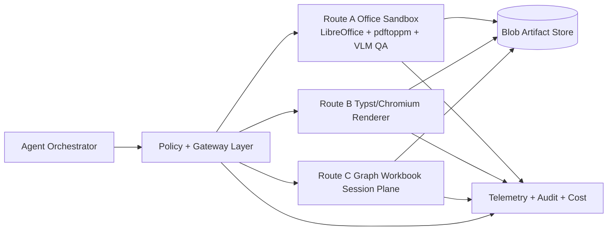
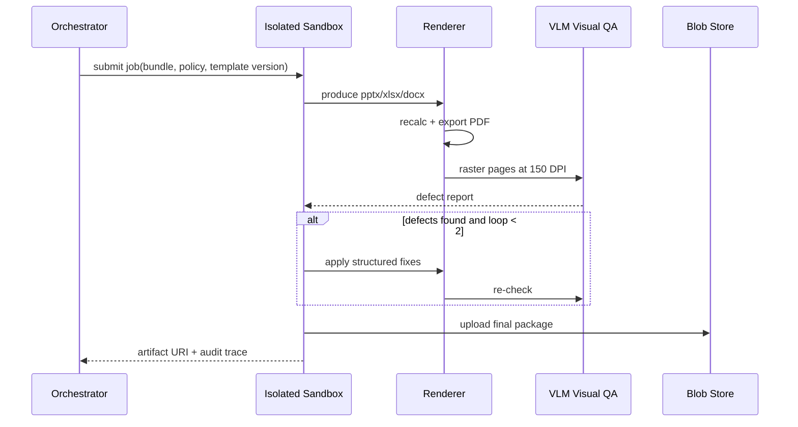

# Enterprise Agentic Office and PDF Artifact Rendering Sandbox Selection FAQ: Route A (ACA Sessions/Kata + LibreOffice + VLM visual QA loop) vs Route B (Typst + Chromium Print-CSS high-throughput rendering) vs Route C (Microsoft Graph Workbook live calculation and co-authoring plane) vs Route D (blind one-shot export without recalculation or isolation)

> Audience: Cloud & AI Solution Architects, enterprise automation platform owners, security/compliance teams, and document operations leaders.
> Primary objective: ship trustworthy `PPTX / XLSX / DOCX / print-ready PDF` artifacts with deterministic quality controls, formula correctness guarantees, typography fidelity, and hardened execution boundaries.

## 1. Executive Summary

Enterprise document-generation agents rarely fail because they cannot generate text.

They fail because generated artifacts are not production-safe:

- spreadsheet formulas are present but unresolved (`#REF!`, `#DIV/0!`, `#VALUE!`, `#NAME?`),
- slide text boxes overlap or clip after last-mile rendering,
- corporate and CJK glyphs are missing, producing visible placeholder boxes,
- untrusted HTML/SVG/OOXML inputs introduce SSRF or local file read risks,
- no reliable evidence trail exists for “who rendered what, with which policy, and which binary.”

This guide compares four architecture routes:

1. **Route A**: hypervisor-isolated closed-loop Office rendering and visual QA.
2. **Route B**: declarative typesetting and print-CSS high-throughput rendering.
3. **Route C**: Microsoft Graph Workbook authoritative calculation and collaboration plane.
4. **Route D**: blind one-shot output without recalculation/raster QA or hardened isolation.

Recommendation:

- use Route A for high-value executive and regulated deliverables,
- use Route B for high-volume deterministic statements where editable OOXML is not required,
- use Route C for M365-native live calculation and co-authoring workflows,
- explicitly prohibit Route D in critical production lanes.

## 2. Problem Definition and Architecture Boundary

Modern enterprise agents produce not only narratives, but **operational artifacts**:

- board slides,
- financial models,
- legal and compliance documentation,
- client-facing personalized reports,
- multilingual sales and delivery packs.

Therefore, architecture success criteria must include:

- render-time correctness,
- post-render visual integrity,
- formula and cross-sheet reconciliation,
- exploit containment for untrusted generated inputs,
- per-tenant cost and throughput governance,
- replayable audit evidence.

A “content-only” perspective is insufficient for production.

## 3. Route Definitions

### Route A — Hypervisor-Isolated Closed-Loop Office Sandbox

- Substrate: ACA Dynamic Sessions custom container or AKS Kata warm pool.
- Render path: `soffice --headless --convert-to pdf` with deterministic recalculation.
- Formula gate: explicit scan for spreadsheet error tokens.
- Visual gate: `pdftoppm` rasterization and bounded VLM defect detection (`N <= 2` repair loops).
- Typography gate: pre-baked corporate fonts + `Noto Sans CJK` with deterministic font cache priming.

Route A is optimized for trust, not raw docs-per-hour.

### Route B — Declarative Typesetting / Print-CSS Throughput Lane

- Toolchain: Typst, Playwright headless Chromium, Vega-Lite charting.
- Workload fit: statement-style outputs, regulatory briefs, research layouts, static packet generation.
- Characteristics: deterministic templates, low memory footprint, high throughput.

Route B is often the lowest cost route for very large deterministic print batches.

### Route C — Microsoft Graph Workbook and Co-Authoring Plane

- Calculation authority: cloud Excel engine (formulas, dynamic arrays, pivots).
- Access control: Entra OBO scope and M365 file ACL.
- Governance: sensitivity labels and collaboration semantics.
- Caveats: workbook lock serialization behavior and Graph `429` throttling patterns.

Route C is strong when “authoritative workbook semantics” are mandatory.

### Route D — Anti-Pattern

- Generate OOXML once and ship immediately.
- No deterministic recalculation.
- No raster-level visual validation.
- Unhardened render path for untrusted content.

Route D appears fast in short demos, then accumulates expensive escape defects and incidents.

## 4. 12-Dimension Comparison Matrix

| Dimension | Route A | Route B | Route C | Route D |
|---|---|---|---|---|
| Formula correctness guarantee | High | Low-Medium | High | Low |
| Visual-layout integrity | High | High (template constrained) | Medium | Low |
| Editable OOXML support | Strong | Limited | Strong | Superficial |
| Throughput ceiling | Medium | High | Medium | Unstable |
| Single-job latency | Medium | Low | Medium | Unpredictable |
| Isolation hardening | High | Medium-High | High (platform managed) | Low |
| Typography fidelity | High | High | Medium | Low |
| Multi-tenant governance | High | High | Medium-High | Low |
| Operational complexity | Medium-High | Medium | Medium | Hidden-High |
| Cost predictability | Medium | High | Medium | Low |
| Audit traceability | High | Medium-High | High | Low |
| Recommended role | Trust-first artifacts | Throughput-first artifacts | Collaborative calculation lane | Prohibited for critical paths |

## 5. Quantitative Q&A (Q1..Q6)

### Q1. How much can bounded visual-QA loops reduce defect escape rate?

Define:

- `E_0`: initial defect rate right after first render,
- `p_detect`: defect detection probability per visual QA pass,
- `N`: number of allowed repair loops (`N = 0..2`).

Then:

`E_escape = E_0 × (1 - p_detect)^N`

Interpretation:

- moving from `N=0` to `N=1` typically yields the largest defect-drop step,
- `N=2` often provides meaningful tail reduction for high-value outputs,
- additional loops beyond `2` usually degrade cost-latency efficiency.

Hence bounded loops are critical for executive deliverables.

### Q2. Why is formula string emission insufficient without authoritative recalculation?

In many automation paths, libraries write formula expressions but do not guarantee refreshed cached values in all workbook contexts.

Without an authoritative recalculation pass:

- formulas can remain syntactically present but semantically stale,
- cross-sheet references may drift silently,
- unresolved error tokens can propagate to exported PDFs.

Route A addresses this by forcing headless office recalculation and explicit token scans.

Route C addresses this by using the cloud Excel calculation engine in-session.

### Q3. How should capacity be estimated for Route A workers versus Route B workers?

Representative engineering ranges:

- `soffice.bin` worker RSS often lands in `450–900 MB` depending on document complexity,
- Typst workers frequently remain below `60 MB` with lower compile-time variance.

Implications:

- Route A must be right-sized with stronger per-worker isolation and process lifecycle controls,
- Route B is attractive for very large deterministic batches due to memory efficiency.

### Q4. How do we contain SSRF and local-file read risks in generated render assets?

Threat classes:

- external resource dereference from generated HTML/SVG links,
- local file URI probes,
- metadata and template indirection paths.

Containment principles:

- deny-by-default egress in render workers,
- read-only root filesystem,
- bounded temp profile directories per job,
- strict media/reference allowlists,
- renderer protocol controls where available.

Generated artifacts should never be rendered in privileged shared runtime contexts.

### Q5. How do we enforce corporate typography and CJK fidelity at scale?

Operational controls:

- mount licensed OpenType font packs read-only,
- run deterministic font-cache priming during worker startup,
- verify required families before rendering,
- perform preflight bounding-box checks before visual QA loops.

This reduces avoidable visual defects and prevents unnecessary repair iterations.

### Q6. What is a safe delivery pattern for downloadable artifacts?

Recommended flow:

1. render into isolated artifact container storage,
2. apply sensitivity/label policy metadata,
3. issue short-lived user-delegation download capability,
4. include immutable trace metadata: template hash, policy version, renderer image digest.

This balances usability, security, and auditability.

## 6. Layered Reference Architecture (Mermaid #1)



## 7. Closed-Loop Render Sequence (Mermaid #2)



## 8. Production Code Example #1 — Formula Audit + Raster Gate Harness

```python
import subprocess
from pathlib import Path

ERROR_TOKENS = ("#REF!", "#DIV/0!", "#VALUE!", "#NAME?")

def render_pdf_with_recalc(input_path: Path, out_dir: Path) -> Path:
    out_dir.mkdir(parents=True, exist_ok=True)
    subprocess.run(
        [
            "soffice",
            "--headless",
            "--norestore",
            "--convert-to",
            "pdf",
            "--outdir",
            str(out_dir),
            str(input_path),
        ],
        check=True,
    )
    return out_dir / f"{input_path.stem}.pdf"

def detect_formula_errors(serialized_cells: str) -> list[str]:
    return [token for token in ERROR_TOKENS if token in serialized_cells]

def rasterize_for_layout_gate(pdf_path: Path, output_prefix: Path) -> None:
    subprocess.run(
        ["pdftoppm", "-png", "-r", "150", str(pdf_path), str(output_prefix)],
        check=True,
    )
```

## 9. Production Config Example #2 — Hardened Kata Render Pool

```yaml
apiVersion: apps/v1
kind: Deployment
metadata:
  name: office-render-kata
  namespace: render
spec:
  replicas: 6
  selector:
    matchLabels:
      app: office-render-kata
  template:
    metadata:
      labels:
        app: office-render-kata
    spec:
      runtimeClassName: kata-remote
      containers:
        - name: render-worker
          image: ghcr.io/company/office-renderer:2026.11
          securityContext:
            runAsNonRoot: true
            readOnlyRootFilesystem: true
            allowPrivilegeEscalation: false
          volumeMounts:
            - name: profile-tmp
              mountPath: /tmp/profile
            - name: corp-fonts
              mountPath: /opt/fonts
              readOnly: true
      volumes:
        - name: profile-tmp
          emptyDir:
            medium: Memory
        - name: corp-fonts
          persistentVolumeClaim:
            claimName: corp-fonts-ro
---
apiVersion: networking.k8s.io/v1
kind: NetworkPolicy
metadata:
  name: render-zero-egress
  namespace: render
spec:
  podSelector:
    matchLabels:
      app: office-render-kata
  policyTypes: ["Egress"]
  egress: []
```

## 10. Enterprise Scenario A — Investment Banking Pitchbooks + DCF Workbooks

Requirements:

- bilingual board-ready decks,
- workbook-linked assumptions and valuation tabs,
- zero unresolved formula symbols in final investor package,
- no layout clipping in print-ready exports.

Recommended pattern:

- Route A as primary lane for high-fidelity executive material,
- Route C for authoritative workbook-session recalculation when collaboration is required,
- Route B for template-heavy annex generation at scale.

Outcome:

- reduced review-loop churn,
- lower late-stage correction risk,
- auditable evidence of render integrity.

## 11. Enterprise Scenario B — Wealth Management Statement Factory

Requirements:

- very high monthly personalized statement volume,
- strict template consistency and regulator-ready output,
- bounded overnight generation windows.

Recommended pattern:

- Route B as throughput backbone for deterministic statement classes,
- Route A as sampled or exception-based quality lane,
- Route C for selective advisor co-authoring and recalculation cases.

Outcome:

- better throughput-per-dollar,
- controlled quality escape rate,
- simpler incident triage through route-level observability.

## 12. Three-Year TCO Comparison (Illustrative)

| Route | Annual Platform/Compute | Annual Ops/Governance | 3-Year Total | Interpretation |
|---|---:|---:|---:|---|
| Route A | `$420k` | `$190k` | `$1.83M` | quality-first lane for critical deliverables |
| Route B | `$280k` | `$110k` | `$1.17M` | best economics for deterministic scale rendering |
| Route C | `$360k` | `$150k` | `$1.53M` | strongest when collaborative live calc is mandatory |
| Route D | `$230k` | `$320k` | `$1.65M` | hidden rework/incident burden dominates |

Notes:

- these are architecture-planning bands, not universal constants,
- real values depend on region, template complexity, tenant concurrency, and governance maturity.

## 13. Day-0 / Day-1 / Day-2 Checklist

### Day-0 (Architecture and Trust Baseline)

- classify artifact classes by trust requirement (executive, regulated, bulk template),
- define route eligibility and escalation policy,
- establish approved font inventory and versioning,
- define formula and visual defect acceptance criteria.

### Day-1 (Production Enablement)

- deploy route-aware gateway policy,
- enable isolated render workers and artifact storage boundaries,
- instrument route-level metrics: latency, defects, retries, cost per artifact,
- validate failure-mode behavior (retry, quarantine, fallback, handoff).

### Day-2 (Optimization and Governance)

- tune visual-loop threshold and sample rates by artifact class,
- optimize worker memory profiles and queue scaling windows,
- run periodic audit replay using retained trace metadata,
- enforce per-tenant budget and quality guardrails.

## 14. Good Fit vs Not For

### Good Fit

- artifact quality is business-critical and externally visible,
- compliance and legal defensibility require reproducible delivery paths,
- teams need both throughput and trust controls.

### Not For

- throwaway demos with no production audit requirements,
- environments unwilling to maintain route-level policy and observability,
- workflows where unresolved formula/layout defects are considered acceptable.

## 15. Final Recommendation

For enterprise agentic document delivery, architecture quality is achieved by **render-route discipline**:

- Route A for trust-critical Office deliverables with closed-loop QA,
- Route B for deterministic high-throughput print lanes,
- Route C for M365-native collaboration and authoritative workbook semantics,
- Route D excluded from critical production workflows.

This route-aware strategy is what turns “content generation” into “enterprise-grade artifact delivery” with measurable reliability, compliance, and cost control.

### 15.1 Monthly Governance Scorecard (Recommended)

Track at least the following metrics by tenant, region, and artifact class:

1. one-pass artifact acceptance rate,
2. formula-error escape rate,
3. visual-defect escape rate,
4. median render latency,
5. P95 end-to-end latency,
6. retries per artifact,
7. A-to-C escalation ratio,
8. cost per artifact,
9. human rework minutes,
10. audit-field completeness rate.

This scorecard prevents average-only reporting from hiding high-risk segments.

### 15.2 Two-Phase Rollout Pattern

Use a controlled rollout instead of big-bang replacement:

- **Phase 1 (shadow mode):** new pipeline generates non-customer-facing shadow artifacts for parity checks.
- **Phase 2 (progressive cutover):** traffic is increased by tenant and artifact type with automatic rollback triggers.

Example rollback triggers:

- formula escape rate exceeds threshold,
- P95 latency breach sustained over a fixed time window,
- repeated typography-fidelity alerts in critical templates.

### 15.3 Minimum Risk Register for Every Release

Maintain a compact but mandatory release risk register:

- risk ID and severity,
- trigger condition,
- blast radius (tenant/region/artifact class),
- detection method,
- mitigation action,
- rollback path,
- accountable owner and on-call fallback.

Combining scorecards, progressive rollout, and release risk registers is what keeps an agentic artifact platform reliable at scale.

