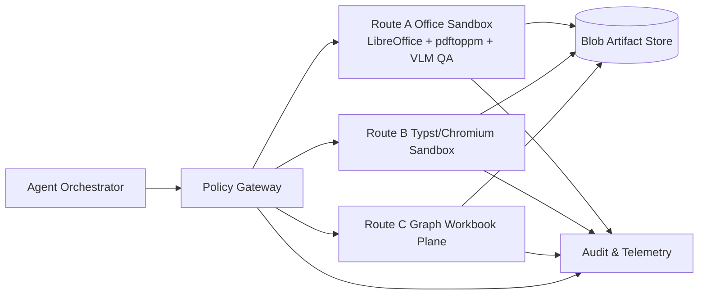
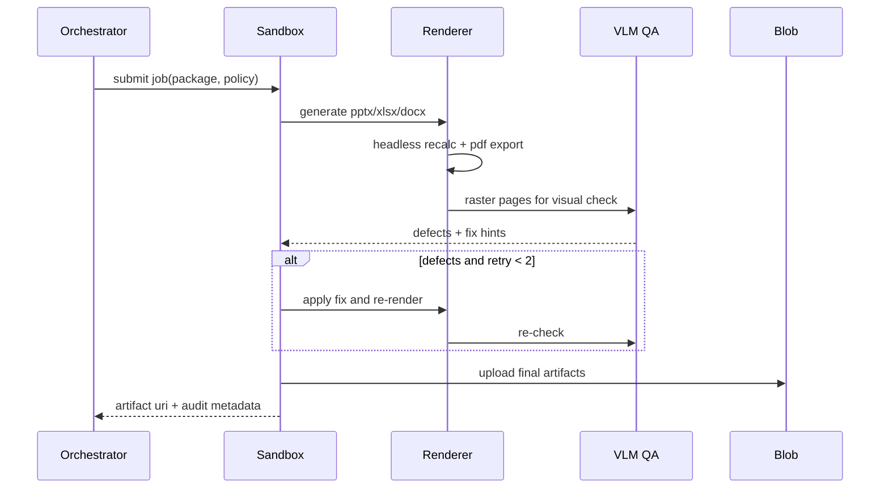

# 企业 Agentic Office 文档与 PDF 产物渲染沙箱选型 FAQ：Route A（ACA/Kata + LibreOffice + VLM 视觉质检闭环）vs Route B（Typst + Chromium Print-CSS 高吞吐渲染）vs Route C（Microsoft Graph Workbook 计算与协作平面）vs Route D（无重算无隔离单次导出反模式）

> 适用对象：企业文档自动化平台团队、Cloud & AI Solution Architect、内控合规与知识运营团队。
> 核心目标：在生成 `PPTX / XLSX / DOCX / PDF` 交付物时，确保“格式正确、公式可信、字体完整、链路可审计、运行可隔离”。

## 1. 执行摘要

企业级 Agent 文档生成的真实失败点不在“内容写不出来”，而在“内容能写出来但不能安全交付”。

高频缺陷包括：

- `#REF!` / `#DIV/0!` / `#VALUE!` 公式错误未被发现。
- 幻灯片文本框溢出、遮挡、截断。
- CJK 或品牌字体缺失导致 `□□□`。
- HTML/SVG/OOXML 输入触发 SSRF 或本地文件读取。

推荐策略是“分层渲染 + 闭环校验”：

1. **Route A** 作为高保真 Office 闭环沙箱主路径。
2. **Route B** 作为高吞吐声明式排版路径。
3. **Route C** 作为 M365 原生计算与协作路径。
4. **Route D** 明确标记为不可进入生产关键链路。

## 2. 问题定义与边界

目标交付物通常包含：

- 管理层演示文档（`PPTX` + 导出 `PDF`）
- 财务与运营模型（`XLSX`）
- 合同与合规附件（`DOCX/PDF`）
- 个性化报表与客户材料（海量批量）

系统不仅要生成内容，还要对“可印刷、可审计、可解释”负责。

平台约束：

- 严格隔离执行环境
- 禁止外部随意网络出站
- 支持品牌与多语字体包
- 支持可重试与可回滚
- 具备批量吞吐与成本可控能力

## 3. 四条路线定义

### Route A：Hypervisor 隔离闭环 Office 沙箱

- 载体：`ACA Dynamic Sessions` 自定义容器或 `AKS Kata` 暖池。
- 渲染：`soffice --headless --convert-to pdf` 强制重算。
- 检查：扫描 `#REF!/#NAME?/#VALUE!/#DIV/0!`。
- 视觉 QA：`pdftoppm` 栅格化 + VLM 缺陷识别，最多 `N ≤ 2` 修复迭代。
- 字体：预置企业字体与 `Noto Sans CJK`。

### Route B：声明式排版高吞吐路径

- 工具：`Typst` / `Playwright Headless Chromium` + `Vega-Lite`。
- 特点：编译快、内存占用低、批处理效率高。
- 适配：无需可编辑 OOXML 的大规模报表。

### Route C：Microsoft Graph Workbook 原生计算平面

- 能力：Excel 云端公式、动态数组、透视能力与协作。
- 权限：Entra OBO + 文件级 ACL + 标签治理。
- 风险：Graph `429` 与 workbook session 串行锁影响吞吐。

### Route D：单次导出无重算无隔离

- 常见做法：`python-pptx/openpyxl` 直接导出结果即交付。
- 问题：缺少重算、缺少视觉检查、缺少运行时隔离。
- 安全风险：不受控渲染链路可触发外部资源读取。

## 4. 12 维对比矩阵

| 维度 | Route A | Route B | Route C | Route D |
|---|---|---|---|---|
| 公式正确性保障 | 高 | 中低 | 高 | 低 |
| 视觉排版一致性 | 高 | 高（模板化） | 中 | 低 |
| 可编辑 OOXML 支持 | 强 | 弱 | 强 | 表面强、质量弱 |
| 吞吐能力 | 中 | 高 | 中 | 不稳定 |
| 单任务延迟 | 中 | 低 | 中 | 不可预测 |
| 隔离安全性 | 高 | 中高 | 高（平台侧） | 低 |
| 字体保真 | 高 | 高 | 中 | 低 |
| 多租户治理 | 高 | 高 | 中高 | 低 |
| 运维复杂度 | 中高 | 中 | 中 | 隐性高 |
| 成本可预测性 | 中 | 高 | 中 | 低 |
| 审计可追溯性 | 高 | 中高 | 高 | 低 |
| 适用边界 | 高保真交付 | 大规模模板报表 | 协作与实时计算 | 不建议 |

## 5. 定量问题 Q1..Q6

### Q1：闭环视觉质检能把缺陷逃逸率降到什么水平？

定义：

- `E_0`：一次生成后的初始缺陷率
- `p_detect`：单轮视觉检查检出率
- `N`：修复迭代轮数（上限 `2`）

缺陷逃逸率：

`E_escape = E_0 × (1 - p_detect)^N`

当 `p_detect` 稳定在较高区间且 `N=2` 时，逃逸率显著下降，但延迟与成本上升，需要阈值控制。

### Q2：为什么 openpyxl 直写公式后仍需要外部重算？

许多写入流程仅写入公式字符串，缓存值可能未更新。

如果不经过可靠计算引擎重算，就可能把“语法正确但值未更新”的表格直接交付。

Route A 通过 headless Calc 重算并扫描错误码，Route C 通过 Graph WorkbookSession 计算保障公式落地一致性。

### Q3：Route A 与 Route B 的并发与内存如何估算？

经验区间：

- `soffice.bin` 单 worker 常见 `450–900 MB` RSS。
- `Typst` 任务常见 `<60 MB`，编译时延更短。

因此 Route B 更适合极高吞吐模板报表，Route A 更适合复杂 Office 交付与闭环验收。

### Q4：如何约束 SSRF、外链与本地文件读取风险？

必须同时控制：

- 输入白名单（模板、变量、媒体源）
- 运行容器网络出站策略（默认拒绝）
- 渲染器禁用不必要协议
- 文件系统只读与临时目录最小化

对 LLM 产出的 HTML/SVG/OOXML，必须在受限沙箱中执行，不可直接在共享运行时打开。

### Q5：品牌字体与 CJK 保真如何工程化？

关键步骤：

- 将企业授权字体以只读卷挂载到渲染容器。
- 启动前执行 `fc-cache`。
- 在渲染前做字体可用性检查并记录版本。
- 对版式边界（文本框、页边距）做预检，减少视觉返工轮次。

### Q6：如何在安全交付中实现“可下载、可追溯、短时授权”？

建议：

1. 渲染产物写入 Blob 隔离容器。
2. 通过短时 User Delegation SAS 下发下载。
3. 输出元数据附带策略版本、模板版本、渲染镜像摘要。

这样既便于分发，也能满足审计链路需求。

## 6. 分层参考架构（Mermaid 图 1）



## 7. 闭环渲染序列（Mermaid 图 2）



## 8. 生产代码示例 1（公式审计 + 栅格化检查）

```python
import re
import subprocess
from pathlib import Path

ERROR_TOKENS = ["#REF!", "#DIV/0!", "#NAME?", "#VALUE!"]

def recalc_and_export(input_file: Path, out_dir: Path) -> Path:
    out_dir.mkdir(parents=True, exist_ok=True)
    subprocess.run(
        [
            "soffice",
            "--headless",
            "--norestore",
            "--convert-to",
            "pdf",
            "--outdir",
            str(out_dir),
            str(input_file),
        ],
        check=True,
    )
    return out_dir / (input_file.stem + ".pdf")

def scan_formula_errors(csv_text: str) -> list[str]:
    hits = []
    for token in ERROR_TOKENS:
        if token in csv_text:
            hits.append(token)
    return hits

def rasterize_pdf(pdf: Path, image_prefix: Path) -> None:
    subprocess.run(
        ["pdftoppm", "-png", "-r", "150", str(pdf), str(image_prefix)],
        check=True,
    )
```

## 9. 生产配置示例 2（Kata 渲染池安全清单）

```yaml
apiVersion: apps/v1
kind: Deployment
metadata:
  name: office-render-kata
  namespace: render
spec:
  replicas: 6
  selector:
    matchLabels:
      app: office-render-kata
  template:
    metadata:
      labels:
        app: office-render-kata
    spec:
      runtimeClassName: kata-remote
      containers:
        - name: worker
          image: ghcr.io/company/office-renderer:2026.11
          securityContext:
            readOnlyRootFilesystem: true
            allowPrivilegeEscalation: false
          volumeMounts:
            - name: tmp-profile
              mountPath: /tmp/profile
            - name: fonts
              mountPath: /opt/fonts
              readOnly: true
      volumes:
        - name: tmp-profile
          emptyDir:
            medium: Memory
        - name: fonts
          persistentVolumeClaim:
            claimName: corp-fonts-ro
---
apiVersion: networking.k8s.io/v1
kind: NetworkPolicy
metadata:
  name: office-render-deny-egress
  namespace: render
spec:
  podSelector:
    matchLabels:
      app: office-render-kata
  policyTypes: ["Egress"]
  egress: []
```

## 10. 企业场景 A：投行并购 Pitchbook + 财务模型联动

需求：

- 40 页双语演示文档
- 12 个工作表联动公式
- 零公式错误、零版式遮挡

路线建议：

- 主路径 Route A 做高保真交付
- 复杂计算通过 Route C 做权威校验
- 批量章节内容草拟可由 Route B 预渲染

收益：

- 减少人工终审反复修改
- 提升董事会材料交付稳定性

## 11. 企业场景 B：财富管理季度报表海量生成

需求：

- 月均 25 万份个性化 PDF
- 要求在数小时窗口内完成
- 品牌版式与监管披露必须一致

路线建议：

- Route B 作为主产线（模板化高吞吐）
- Route A 抽样闭环质检与疑难单修复
- Route C 处理需在线协作修订的少量文件

收益：

- 保持吞吐与单位成本平衡
- 对异常批次可快速回溯

## 12. 三年 TCO 对比（示例）

| 路线 | 年平台成本 | 年运维与治理 | 三年总计 | 说明 |
|---|---:|---:|---:|---|
| Route A | `$420k` | `$190k` | `$1.83M` | 高保真闭环成本较高但质量稳定 |
| Route B | `$280k` | `$110k` | `$1.17M` | 模板化批量最优 |
| Route C | `$360k` | `$150k` | `$1.53M` | 协作与计算权威路径 |
| Route D | `$230k` | `$320k` | `$1.65M` | 返工与事故成本高 |

## 13. Day-0 / Day-1 / Day-2 清单

### Day-0

- 定义文档类型分级（高保真 / 高吞吐 / 协作型）。
- 确认字体授权与分发方式。
- 建立公式错误码与视觉缺陷基线。

### Day-1

- 上线 Route A/B/C 路由策略。
- 打通 Blob 产物存储与短时分发。
- 建立审计字段：模板版本、策略版本、渲染镜像摘要。

### Day-2

- 优化闭环迭代阈值与抽样策略。
- 统计 defect escape 与人审返工率。
- 按租户维度建立成本归因与预算告警。

## 14. Good fit vs Not for

### Good fit

- 文档与报表是核心业务交付物。
- 对可审计与可追溯有明确合规要求。
- 需要兼顾质量稳定与吞吐规模。

### Not for

- 仅做一次性轻量 Demo。
- 不愿投入隔离与治理基础设施。
- 对公式、排版、字体错误容忍度高。

## 15. 结论

企业 Agentic 文档平台应先回答“如何安全交付”，再回答“如何更快生成”。

架构建议：

- **高价值交付**优先 Route A。
- **高吞吐模板**优先 Route B。
- **协作与权威计算**使用 Route C。
- **Route D 禁止入生产**。

通过分层路由与闭环质检，才能在大规模自动化下同时获得质量、效率与合规三者平衡。

### 15.1 建议纳入月度治理看板的 10 个核心指标

1. `Artifact Success Rate`：交付物一次通过率。
2. `Formula Error Escape`：公式错误逃逸率。
3. `Visual Defect Escape`：视觉缺陷逃逸率。
4. `Median Render Latency`：渲染中位耗时。
5. `P95 End-to-End Latency`：端到端尾延迟。
6. `Retry Per Artifact`：每份文档平均重试次数。
7. `Escalation Ratio A->C`：从 Route A 升级到 Route C 的比例。
8. `Cost Per Artifact`：单份产物成本。
9. `Human Rework Minutes`：人工返工时长。
10. `Audit Completeness`：审计字段完整率。

这些指标应按“租户、业务线、文档类型、区域”四个维度切片，避免平均值掩盖结构性风险。

### 15.2 两阶段发布策略（避免一次性全量替换）

建议采用双阶段：

- **阶段一（影子模式）**：新渲染链路只生成副本，不对外分发；与旧链路做差异比对。
- **阶段二（受控切流）**：按租户与文档类型逐步提升流量比例，并设置自动回切阈值。

回切触发条件示例：

- `Formula Error Escape` 超过阈值；
- `P95 End-to-End Latency` 连续 15 分钟超标；
- 字体缺失告警连续出现。

### 15.3 风险台账最小集合

为了让平台团队与业务团队共识一致，建议每轮版本发布维护统一风险台账，最少包含以下字段：

- 风险编号与级别（高/中/低）
- 触发条件
- 影响范围（租户/区域/文档类型）
- 侦测方式（指标或规则）
- 缓解动作（自动/人工）
- 回滚路径
- 责任人与值班人

通过“指标看板 + 两阶段发布 + 风险台账”三件套，文档智能体平台可以在高自动化规模下维持可解释、可回滚、可审计的生产纪律。

### 15.4 典型异常处置手册（建议纳入值班 Runbook）

为降低夜间批量任务事故恢复时间，建议提前固化以下处置流程：

**异常 A：公式错误集中爆发**

- 现象：同批次大量出现 `#REF!` 或 `#VALUE!`。
- 首步动作：暂停该模板版本进入生产队列，切换到上一个稳定模板。
- 排查重点：跨 sheet 引用范围、命名区域变更、隐藏 sheet 删除。
- 恢复标准：抽样 50 份文档零错误后再恢复切流。

**异常 B：字体回退导致品牌形变**

- 现象：标题字重异常、CJK 字形替换、图文对齐偏移。
- 首步动作：校验字体卷版本与哈希，确认 `fc-cache` 启动日志。
- 排查重点：镜像升级是否遗漏字体包、字体授权包是否被覆盖。
- 恢复标准：黄金样例比对通过后再放量。

**异常 C：视觉质检队列积压**

- 现象：VLM 质检耗时突增，任务在重试队列堆积。
- 首步动作：临时下调重试轮次上限，保护主链路吞吐。
- 排查重点：模板新增复杂图表、分辨率参数变更、批次峰值超阈。
- 恢复标准：P95 时延回落到目标范围并稳定 30 分钟。

将上述异常手册与 Day-2 治理动作绑定，可以把“单点专家经验”转为“团队可执行标准”，显著降低跨团队交接摩擦与夜间值守压力。

此外，建议每季度开展一次“全链路演练”：从模板升级、字体替换、策略变更到批量渲染回放，完整验证回滚路径、审计可读性与跨团队协同时效。只有把演练制度化，平台才能在组织扩张与文档规模增长时保持稳定交付能力。
同时建议把关键演练结果沉淀为标准化复盘模板，纳入平台年度治理考核。
这一步对规模化复制尤为关键。

