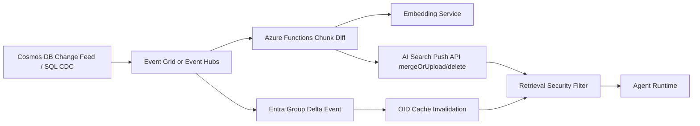
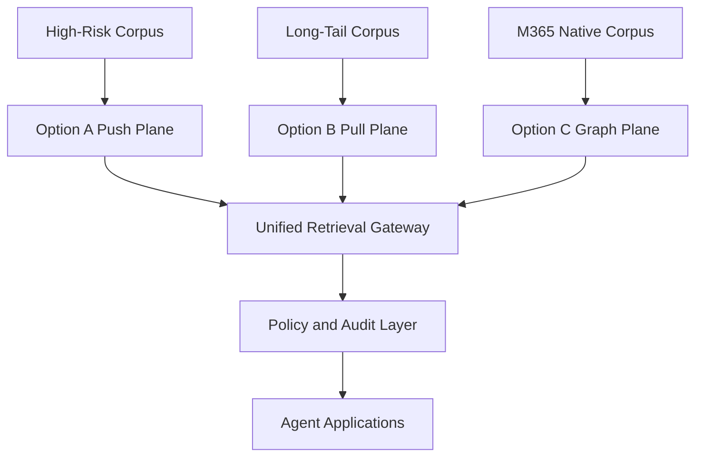

# Agentic RAG Freshness and ACL Convergence Selection FAQ: Cosmos/SQL CDC + Event Grid + Azure AI Search Push vs Fabric OneLake Shortcut Pull vs SharePoint/Graph ACL Sync

## 1. Problem statement: day-2 enterprise RAG failures are usually stale, orphaned, or over-permissive

In production, the most severe RAG incidents are often not low recall.

They are stale answers.

They are ghost chunks.

They are delayed ACL revocations.

A policy memo is updated at `10:00:00`.

The pull indexer runs at `10:08:00`.

For eight minutes, users can still receive obsolete policy text.

A removed M&A room member loses access at `10:00:00`.

Security filters refresh at `10:05:00`.

That five-minute exposure window is a governance event, not a minor delay.

A shortened parent document leaves old child chunks behind.

Search returns deleted clauses.

Users call it hallucination.

Architecturally, it is parent-child consistency debt.

This guide focuses on three outcomes:

- sub-minute freshness,
- near-real-time ACL revocation propagation,
- deterministic orphan-chunk tombstone cleanup.

## 2. Three architecture options

**Option A: event-driven push pipeline**

Cosmos DB Change Feed or Azure SQL CDC emits content and ACL deltas.

Event Grid or Event Hubs routes events to Functions.

Functions run chunk-diff fingerprinting.

Only changed paragraphs are re-embedded.

Azure AI Search Push API executes `mergeOrUpload` and `delete`.

OID security-group cache invalidation is triggered in the same control path.

**Option B: pull indexer over OneLake/ADLS shortcuts**

Integrated vectorization indexers pull on schedule.

High-water-mark and soft-delete policies provide operational simplicity.

This minimizes custom code.

Freshness and revocation timing are bounded by scheduler cadence.

**Option C: Graph/SharePoint semantic indexing**

Strong fit for M365-native knowledge estates.

Leverages Graph connectors and SharePoint ACL trimming semantics.

Cross-domain unification still needs additional data-plane integration.

## 3. 12-dimension production selection matrix

| Dimension | Option A: CDC Push | Option B: Pull Indexer | Option C: Graph/M365 |
|---|---|---|---|
| Freshness P95 | `< 5s` | `5–15min` | `30s–5min` |
| ACL revocation latency | seconds | minutes | seconds-to-minutes |
| Orphan cleanup control | strong parent-child tombstone support | policy-dependent | connector-dependent |
| Update granularity | paragraph-level | often document-level | document/object-level |
| Embedding spend | lowest with diffing | medium-high | medium |
| Platform complexity | highest | low | medium |
| Observability depth | highest | medium | medium |
| Audit traceability | strong event chain | medium | medium-high |
| Cross-source unification | strong | medium | low-medium |
| Team skill requirement | high | low | medium |
| Compliance window control | best | moderate | good in M365 scope |
| Typical fit | high-risk, high-frequency domains | low-code fast launch | M365-centric collaboration |

No option is universally best.

Selection should be driven by SLO and risk window targets, not preference.

## 4. Option A deep dive: CDC + event bus + push index

Option A is event-first.

It does not wait for the next scheduled crawl.

Reference flow:

1. CDC emits delta.
2. Event backbone routes and buffers.
3. Function retrieves prior fingerprints.
4. Paragraph-level diff decides changed chunks.
5. Re-embed changed segments only.
6. Push upsert/delete operations to AI Search.
7. Invalidate ACL/OID caches and emit audit event.

This design can maintain sub-5-second freshness P95 under controlled load.

Reliability depends on idempotency.

Replay safety is mandatory.

Use a composite idempotency key such as `(doc_id, version, chunk_id, event_id)`.

## 5. Option B deep dive: managed pull model with lower engineering overhead

Option B is attractive when teams optimize for implementation speed.

Minimal custom pipeline code.

Strong managed-service posture.

Useful for medium update-frequency workloads.

Primary benefits:

- rapid delivery,
- lower on-call burden,
- straightforward operator model.

Primary limitations:

- freshness bounded by pull cadence,
- ACL revocation propagation usually slower,
- orphan cleanup often requires explicit data-shaping policies.

## 6. Option C deep dive: M365 semantic plane and Graph-connected governance

Option C is often the best-first move in M365-heavy estates.

SharePoint and Teams document access semantics are naturally aligned with enterprise identity controls.

Governance stories are clear for collaboration content.

Limits emerge when the knowledge plane extends to ERP, CRM, IoT, and proprietary line-of-business stores.

In those cases, Option C is usually one layer in a broader architecture.

## 7. Freshness and ACL risk math: why minutes matter

Assume 30 retrieval requests per minute in a sensitive data room.

A 5-minute ACL revocation lag creates ~150 in-window requests.

Even with a 2% relevant-hit probability, the exposure expectation is non-trivial.

If Option A lowers the lag to 3 seconds:

window volume drops to roughly 1.5 requests at the same traffic level.

That is a two-order risk-window reduction.

Architecture choice directly changes compliance posture.

## 8. Parent-child tombstone pattern: executable reference snippet

```python
import hashlib
from typing import Dict, List, Tuple

def fp(text: str) -> str:
    return hashlib.sha256(text.encode("utf-8")).hexdigest()

def chunk_diff(old_map: Dict[str, str], new_map: Dict[str, str]) -> Tuple[List[str], List[str]]:
    upserts: List[str] = []
    deletes: List[str] = []
    for cid, new_hash in new_map.items():
        if old_map.get(cid) != new_hash:
            upserts.append(cid)
    for cid in old_map.keys():
        if cid not in new_map:
            deletes.append(cid)
    return upserts, deletes

def build_actions(doc_id: str, version: str, upserts: List[str], deletes: List[str]):
    actions = []
    for cid in upserts:
        actions.append({"@search.action": "mergeOrUpload", "id": f"{doc_id}:{version}:{cid}"})
    for cid in deletes:
        actions.append({"@search.action": "delete", "id": f"{doc_id}:{version}:{cid}"})
    return actions
```

This pattern provides:

- deterministic orphan cleanup,
- incremental embedding economics,
- replay-safe mutation behavior.

## 9. ACL propagation pattern: treat authorization deltas as first-class events

ACL deltas should not be handled as delayed maintenance tasks.

Store `acl_version` per chunk.

At retrieval time:

1. validate caller OID/group claims,
2. validate chunk `acl_version` against latest directory projection.

On Entra group membership change:

trigger active OID cache invalidation.

Do not rely only on passive TTL expiry for high-risk domains.

Recommended cache policies:

- high-risk domain: `ttl <= 5s`,
- standard domain: `ttl 30–120s`.

## 10. Azure sizing and 3-year TCO (`$k/month`)

### 10.1 Assumptions

- 240M indexed paragraphs,
- 0.8% daily content delta,
- 12k retrieval QPS peak,
- critical-tenant ACL revocation SLO `< 10s`.

### 10.2 Option A estimate

- Eventing + Functions: `$38k/month`
- Incremental embedding + search: `$121k/month`
- Platform ops: `$47k/month`
- Total: `$206k/month`
- 3-year: `$7.42M`

### 10.3 Option B estimate

- Pull index pipeline + OneLake/ADLS plane: `$54k/month`
- Higher re-embedding load: `$168k/month`
- Ops: `$22k/month`
- Total: `$244k/month`
- 3-year: `$8.78M`

### 10.4 Option C estimate

- Graph/M365 semantic integration: `$96k/month`
- Cross-domain extension work: `$74k/month`
- Governance and support: `$41k/month`
- Total: `$211k/month`
- 3-year: `$7.60M`

Diff-based re-embedding can reduce embedding spend by `82%+` versus frequent full-document refresh patterns.

## 11. Scenario A: global investment bank M&A data room with `< 3s` revocation target

Business requirement:

- instant revocation for removed deal-team members,
- deterministic cleanup of parent-child document deltas,
- replayable audit trail for every authorization and indexing mutation.

Recommended architecture:

Option A as primary control plane.

Directory-event-driven OID cache invalidation.

Mandatory tombstone sweep on parent shrink/delete events.

Expected outcomes:

- revocation exposure window collapses from minutes to seconds,
- measurable drop in over-permission alerts,
- stronger regulator-ready evidence chain.

## 12. Scenario B: global B2B distributor with `4M SKU` dynamic pricing and inventory updates

Business requirement:

- pricing/stock updates reflected in RAG within `< 10s` for critical SKUs,
- acceptable cost for long-tail catalog updates,
- predictable operator burden.

Recommended architecture:

Hybrid A+B.

Critical SKUs on Option A push path.

Long-tail catalogs on Option B scheduled indexers.

Expected outcomes:

- high-value price changes converge in seconds,
- long-tail total cost stays controlled,
- operational model remains manageable.

## 13. Migration blueprint: pull-first baseline to event-driven incrementality

**Step 1: baseline observability**

Measure current freshness lag, ACL lag, and orphan ratio before architecture change.

**Step 2: dual-run introduction**

Keep pull pipelines active.

Add event-driven pipeline for high-risk domains only.

**Step 3: parent-child model hardening**

Standardize `parent_id`, `chunk_id`, and version semantics.

Make tombstone sweep a mandatory path.

**Step 4: authorization eventization**

Ingest identity-group delta events into the same control plane.

Use active cache invalidation for sensitive tenants.

**Step 5: progressive expansion**

Expand scope only when SLO and audit metrics remain stable over consecutive review windows.

## 14. Deep quantitative Q&A

### 14.1 Q1: when should we avoid Option A?

When team capability for event reliability, idempotency, and distributed observability is insufficient.

When business can tolerate multi-minute freshness and ACL lag.

### 14.2 Q2: how can Option B reduce stale-answer risk without full re-architecture?

Use tighter pull schedules for critical indexes.

Apply high-water-mark validation and robust soft-delete semantics.

### 14.3 Q3: how do we prove the `82%+` embedding savings claim?

Track:

- changed-paragraph ratio,
- actual re-embedded tokens/day,
- embedding cost/day.

Compare against full-refresh benchmark.

### 14.4 Q4: what ACL cache TTL policy is practical?

Risk-tiered policy:

- high-risk legal/M&A/clinical indexes: `<= 5s`,
- standard enterprise knowledge indexes: `30–120s`.

### 14.5 Q5: what KPIs validate orphan-chunk governance?

- orphan ratio,
- tombstone propagation P95,
- ghost-reference incident count.

### 14.6 Q6: when is Option C the best strategic first move?

When most enterprise knowledge lives in M365 and cross-domain data-plane requirements are limited.

### 14.7 Q7: how do we prevent event storms from overwhelming indexing throughput?

Partition by document key.

Batch and coalesce near-simultaneous deltas.

Preserve ordering guarantees where required.

### 14.8 Q8: how should push retries be implemented safely?

Use deterministic idempotency keys.

Replay with identical keys and bounded retry backoff.

Emit explicit dead-letter telemetry for non-recoverable mutations.

## 15. Five-step implementation guide (Good fit vs Not for)

**Step 1: define hard SLOs for freshness and revocation**

Without explicit targets, architecture decisions drift toward convenience.

**Step 2: enforce parent-child content model discipline**

RAG quality and governance both depend on strict parent-child lifecycle control.

**Step 3: make ACL propagation event-native**

Treat authorization updates as first-class pipeline events.

**Step 4: combine options by risk tier**

Use A for high-risk/high-freshness domains.

Use B for lower-risk and cost-sensitive long-tail domains.

Use C for M365-centric collaboration knowledge surfaces.

**Step 5: accept only with dual success criteria**

Require both governance metrics and TCO metrics to pass.

**Good fit**

- regulated domains with strict revocation windows,
- high-change corpora where stale responses create material risk,
- enterprises that need auditable parent-child consistency.

**Not for**

- low-change, low-risk document sets with broad tolerance for minute-level lag,
- teams unwilling to operate event-driven reliability and observability controls.

Final recommendation:

If your target is sub-minute freshness, near-real-time revocation, and deterministic orphan cleanup, prioritize Option A.

If your target is low-code speed and operational simplicity with minute-level tolerance, prioritize Option B.

If your estate is M365-centric and cross-domain unification is limited, Option C can be the fastest compliant route with a future Option A expansion seam.

### 15.1 Reference topology A: event-driven incremental indexing with ACL revocation coupling



This topology treats content deltas and authorization deltas as parallel first-class flows.

ACL is not a delayed housekeeping task.

### 15.2 Reference topology B: layered A+B+C deployment model



This pattern is practical for large enterprises with heterogeneous domain risk profiles.

### 15.3 Q9: how should freshness SLO alert thresholds be defined?

Use both P95 and P99.

Example:

- P95 > 8s triggers warning,
- P99 > 20s triggers severe incident.

Tier thresholds by tenant risk class.

### 15.4 Q10: how do we handle chunk-boundary drift after local document edits?

Introduce stable paragraph anchors.

Avoid full-document re-chunking for localized edits.

This reduces accidental deletes and unnecessary re-embedding.

### 15.5 Q11: how do we preserve ordering under concurrent updates?

Partition by `parent_id` ordering key.

Apply monotonic version checks in function processors.

Buffer and reorder out-of-order events explicitly.

### 15.6 Q12: how do we measure ACL propagation completion correctly?

Do not measure only directory update time.

Measure retrieval-layer enforcement time as well.

Track:

- identity_event_time,
- cache_invalidation_time,
- first_denied_query_time.

### 15.7 Q13: how do we prevent tombstone logic from deleting newest chunks?

Bind deletes to explicit version predicates.

Delete only chunks missing in the latest version projection.

Never run unconstrained delete sweeps.

### 15.8 Q14: can pull indexers achieve near real-time behavior?

They can get closer by increasing schedule frequency.

However, cost and platform load rise rapidly.

In high-change corpora, event push is usually more economical.

### 15.9 Q15: how do we keep freshness SLOs during regional failover?

Replicate event streams to DR region.

Switch retrieval gateways by health checks.

Keep ACL version semantics globally comparable across regions.

### 15.10 Closing recommendation: govern freshness, authorization, and parent-child consistency as one objective

All three dimensions must pass together for enterprise-safe RAG at scale.

Optimizing one dimension in isolation typically creates risk debt in another dimension.
