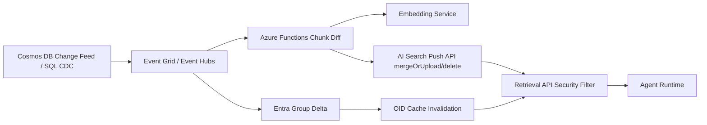
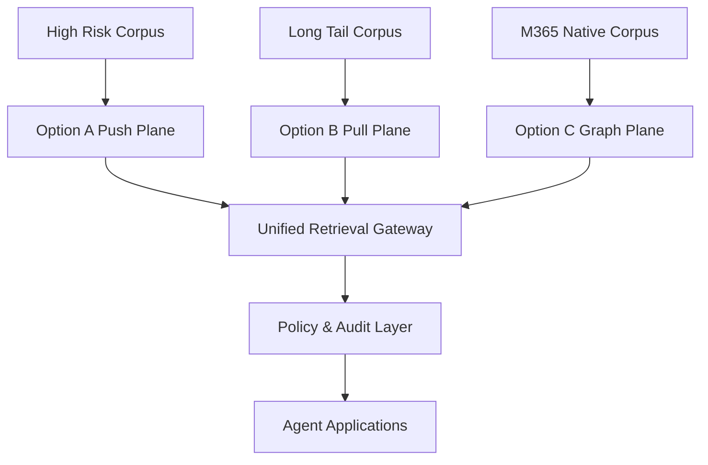

# Agentic RAG 新鲜度与 ACL 实时收敛选型 FAQ：Cosmos/SQL CDC + Event Grid + Azure AI Search Push vs Fabric OneLake Shortcuts Pull vs SharePoint/Graph ACL 同步

## 1. 问题定义：企业 RAG 的 day-2 故障不是“答不出来”，而是“答旧了、答漏了、答越权了”

在真实企业生产中，RAG 系统上线后最常见的严重事故并非召回率不足，而是知识新鲜度和权限裁剪滞后。

文档在 `10:00:00` 被更新。

索引器在 `10:08:00` 才拉取到更新。

在这 8 分钟窗口内，智能体可能引用旧条款。

更危险的是 ACL 变更。

用户在 `10:00:00` 被移出并购数据室权限组。

索引侧安全过滤在 `10:05:00` 才同步。

这 5 分钟是合规暴露窗口。

第三类高频故障是孤儿块。

父文档被删减后，旧 chunk 没被 tombstone 清理。

检索系统仍返回“幽灵段落”。

业务上看就是“文档里没有，回答却说有”。

因此本指南聚焦三个能力：

- 亚分钟级知识新鲜度。
- 秒级 ACL 撤权传播。
- 父子一致性的 orphan-chunk 清理。

## 2. 三条路线定义：A 事件驱动推送，B 拉取式托管索引，C M365 语义索引与图连接器

**Option A（事件驱动 Push）**

以 Cosmos DB Change Feed 或 Azure SQL CDC 作为增量事件源。

通过 Event Grid 或 Event Hubs 触发 Azure Functions。

函数层执行 chunk-diff 与指纹比对。

仅对变更段落重嵌入。

通过 Azure AI Search Push API 执行 `mergeOrUpload` 与 `delete`。

并触发 ACL OID 缓存失效。

**Option B（OneLake/Fabric Pull）**

数据落地 ADLS Gen2 或 OneLake Shortcut。

Azure AI Search Integrated Vectorization 定时拉取。

使用高水位线与软删除字段。

优势是低代码与托管运维。

代价是更新粒度和频率受限。

**Option C（M365 语义索引 + Graph Connector）**

适合 SharePoint/Exchange/Teams 原生内容平面。

依赖 Graph 与 SharePoint Embedded ACL trimming。

对 M365 内部协同文档权限一致性较好。

但跨业务系统统一编排能力有限。

## 3. 12 维度生产选型矩阵（主架构师评审版）

| 维度 | Option A：CDC Push | Option B：Pull Indexer | Option C：Graph/M365 |
|---|---|---|---|
| 新鲜度 P95 | `< 5s`（事件驱动） | `5–15min`（调度窗口） | `30s–5min`（连接器与语义索引链路） |
| ACL 撤权传播 | 秒级可达 | 分钟级 | 秒到分钟，取决于目录与站点缓存 |
| 孤儿块清理 | 可做父子原子 tombstone | 依赖软删除策略 | 依赖连接器行为与内容模型 |
| 变更粒度 | 段落级 diff | 文档级重建更常见 | 项目级或文档级为主 |
| Embedding 成本 | 最低（增量） | 中高（重建频繁） | 中等 |
| 平台复杂度 | 最高 | 低 | 中 |
| 可观测性 | 最高（全链路事件） | 中 | 中 |
| 审计可解释性 | 强（事件可追溯） | 中 | 中高（M365 审计） |
| 跨数据源能力 | 强 | 中 | 弱到中 |
| 运维团队要求 | 高 | 低 | 中 |
| 合规窗口控制 | 最优 | 一般 | 较好（M365 原生） |
| 典型适配场景 | 高时效高合规 | 预算敏感、快速上线 | 以 M365 为中心的知识协作 |

结论不是“唯一正确”。

结论是“按 SLO 与合规暴露窗口反推架构”。

## 4. Option A 深入：Cosmos/SQL CDC + Event Grid + Push API 的秒级路径

Option A 的核心是事件优先，而非批处理优先。

更新产生后立即触发。

不等待下一轮调度。

关键路径通常为：

1. CDC 事件产生。
2. 事件总线投递。
3. 函数层读取旧指纹。
4. 计算 paragraph hash diff。
5. 仅重算变化段 embedding。
6. Push 到 AI Search。
7. 清理旧 chunk 与 ACL 缓存。

该路径可稳定做到秒级收敛。

但需要严格幂等控制。

同一事件重放时不能重复写脏索引。

可通过 `(doc_id, version, chunk_id)` 复合键实现去重。

## 5. Option B 深入：OneLake Shortcut + Pull Indexer 的“低代码高可用”

Option B 最大价值是快速交付和运维简化。

无需自建复杂事件处理层。

对于知识更新频率中低的场景很友好。

典型优势：

- 平台托管。
- 配置化接入。
- 团队上手成本低。

典型短板：

- 新鲜度受拉取频率约束。
- ACL 撤权窗口更长。
- 孤儿块清理通常依赖附加策略。

如果业务可接受分钟级滞后，Option B 具备高性价比。

## 6. Option C 深入：Graph/SharePoint ACL 同步与 M365 语义平面

Option C 在 M365 原生内容场景里具备天然优势。

尤其在 SharePoint 文档、Teams 协作文档、邮件知识场景。

其强项是组织目录与内容权限模型的一致性。

其限制在于跨域业务数据整合。

例如 ERP、CRM、IoT、交易系统数据接入时仍需额外数据工程。

因此 Option C 常见定位是：

- M365 域内首选。
- 跨域统一平面中的一层，而非全部。

## 7. 新鲜度与权限窗口量化：为什么“几分钟”在某些行业不可接受

假设并购数据室中每分钟有 30 次检索请求。

撤权传播延迟 5 分钟。

潜在越权暴露机会窗口为 150 次检索。

即使真实命中率仅 2%。

也可能产生 3 次高风险泄露响应。

若采用 Option A 将窗口降至 3 秒。

同样请求速率下窗口请求约为 1.5 次。

风险暴露量级可下降约两个数量级。

这就是架构差异转化为治理价值的关键。

## 8. 父子一致性与孤儿块清理：生产可执行代码片段（Cosmos Change Feed -> AI Search）

```python
import hashlib
from typing import Dict, List

def chunk_fingerprint(text: str) -> str:
    return hashlib.sha256(text.encode("utf-8")).hexdigest()

def diff_chunks(old_chunks: Dict[str, str], new_chunks: Dict[str, str]):
    to_upsert = []
    to_delete = []
    for cid, new_fp in new_chunks.items():
        if old_chunks.get(cid) != new_fp:
            to_upsert.append(cid)
    for cid in old_chunks.keys():
        if cid not in new_chunks:
            to_delete.append(cid)
    return to_upsert, to_delete

def build_search_actions(doc_id: str, version: str, upserts: List[str], deletes: List[str]):
    actions = []
    for cid in upserts:
        actions.append({"@search.action": "mergeOrUpload", "id": f"{doc_id}:{version}:{cid}"})
    for cid in deletes:
        actions.append({"@search.action": "delete", "id": f"{doc_id}:{version}:{cid}"})
    return actions
```

该模式核心价值在于：

- 增量重嵌入。
- 父子同步删除。
- 幂等重放安全。

## 9. ACL 撤权传播与 OID 缓存失效：把权限作为第一类事件，而不是补丁任务

ACL 变化必须与内容变化同级处理。

建议将 `acl_version` 写入每个 chunk 元数据。

检索前执行两类校验：

1. 请求用户 OID 是否属于允许组。
2. chunk 的 `acl_version` 是否与当前目录快照一致。

当 Entra 组变更事件到达时，主动失效 OID 缓存。

禁止等待自然过期。

对高风险租户可配置 `cache_ttl <= 5s`。

对一般租户可放宽至 `30s` 以控成本。

## 10. Azure SKU 规模与 3 年 TCO（USD $k/month）对比

### 10.1 统一假设

- 文档规模：2.4 亿段落。
- 日增量：0.8%。
- 峰值请求：12k QPS（检索层）。
- 关键租户撤权 SLA：`< 10s`。

### 10.2 Option A 成本

- Event Grid/Event Hubs + Functions：`$38k/月`
- Embedding（增量）与搜索索引：`$121k/月`
- 运维与平台工程：`$47k/月`
- 合计：`$206k/月`
- 三年：`$7.42M`

### 10.3 Option B 成本

- Pull Indexer 与 OneLake 数据平面：`$54k/月`
- Embedding（重建比例更高）：`$168k/月`
- 运维：`$22k/月`
- 合计：`$244k/月`
- 三年：`$8.78M`

### 10.4 Option C 成本

- M365/Graph 连接器与语义平面：`$96k/月`
- 跨域扩展与集成：`$74k/月`
- 运营与治理：`$41k/月`
- 合计：`$211k/月`
- 三年：`$7.60M`

成本不是唯一指标。

但当 Option A 通过段落 diff 节省 `82%+` 重嵌入量时，TCO 优势会快速显现。

## 11. 场景一：全球投行并购数据室，撤权 `< 3s` 与 tombstone 即时清理

业务要求：

- 交易团队成员变更实时生效。
- 被移出成员不得继续访问旧文档 chunk。
- 所有撤权动作可审计回放。

推荐：

以 Option A 为主平面。

使用 Entra 组变更事件驱动 ACL 缓存失效。

对父文档删改执行强制 tombstone sweep。

收益：

- 撤权窗口从分钟级降到秒级。
- 合规事件审计粒度提升到事件级。
- 越权检索告警显著下降。

## 12. 场景二：全球 B2B 分销商 `4M SKU` 动态价格知识平面 `< 10s` 更新

业务特点：

- 价格与库存高频波动。
- 区域规则与客户级折扣复杂。
- 错误价格回答直接导致损失。

推荐：

Option A 或 A+B 混合。

核心 SKU 目录走事件推送。

长尾目录走拉取索引。

收益：

- 关键商品价格更新秒级可见。
- 长尾数据维持低成本运转。
- 平衡时效与预算。

## 13. 实施蓝图：从“定时索引”平滑迁移到“事件驱动增量”

**阶段 1：观测基线**

先量化当前 freshness lag、ACL lag、orphan ratio。

没有基线无法证明收益。

**阶段 2：双轨并行**

保留现有 pull 流程。

新增事件驱动链路只覆盖高风险数据域。

**阶段 3：父子模型重构**

引入 `parent_id` 与 `chunk_id` 强约束。

把 tombstone 变成一等公民流程。

**阶段 4：权限事件化**

把目录组变更接入事件总线。

实现 OID 缓存主动失效。

**阶段 5：全域推广与治理闭环**

以 SLO 达标与审计通过率作为扩面门槛。

## 14. 深度定量 Q&A（Principal CSA 评审问答）

### 14.1 Q1：什么时候不该选 Option A？

当团队缺少事件工程与可靠性治理能力。

当业务允许 `15min+` 新鲜度滞后。

### 14.2 Q2：Option B 怎样降低 stale-answer 风险？

提高拉取频率只是第一步。

更关键是软删除列、父子版本标记与高水位一致性检查。

### 14.3 Q3：如何验证 `82%` embedding 节省是否真实？

跟踪三个指标：

- 变更段落比例。
- 实际重嵌入 token 量。
- 每日 embedding 账单。

按周对比全量重建基线。

### 14.4 Q4：ACL 缓存 TTL 应如何定？

高风险域建议 `<= 5s`。

普通知识域可取 `30–120s`。

用风险分层而非单一全局配置。

### 14.5 Q5：如何衡量 orphan-chunk 治理成效？

关键指标：

- orphan ratio。
- tombstone propagation p95。
- 幽灵引用告警数。

### 14.6 Q6：Option C 在什么情况下最优？

当知识主要位于 M365。

且组织对 M365 原生治理与协作闭环要求最高。

### 14.7 Q7：如何避免事件风暴拖垮索引层？

引入按文档键的限流与批处理聚合。

同时确保最终一致性而非“每条都立即写”。

### 14.8 Q8：Push API 失败重试如何避免重复写？

使用幂等键与去重窗口。

失败重试必须携带相同操作键。

## 15. 五步落地指南（Good fit vs Not for）

**步骤一：先定业务风险窗口**

把“可接受新鲜度延迟”和“可接受撤权延迟”写成硬 SLO。

**步骤二：建立父子文档模型**

任何没有 `parent_id` 管理的 RAG 都难以长期治理。

**步骤三：权限事件化**

将 ACL 变更与内容变更同级处理。

**步骤四：分层架构组合**

高风险域选 A。

中低风险域选 B。

M365 原生协作域可叠加 C。

**步骤五：以审计与成本双指标验收**

只看性能或只看成本都不完整。

要同时看合规窗口、SLO 达标率与 TCO。

**Good fit：**

- 并购、法务、医疗、定价等高时效高合规域。
- 文档频繁变化且越权风险高的组织。

**Not for：**

- 文档月更、权限变化少且对分钟级延迟可容忍的小团队。
- 暂无事件工程能力且不愿建设可观测闭环的团队。

最终建议：

若目标是“亚分钟新鲜度 + 秒级撤权 + 孤儿块可证清理”，优先 Option A。

若目标是“低代码快速上线且接受分钟级滞后”，优先 Option B。

若核心知识平面在 M365 且跨域需求有限，可优先 Option C，并为跨域扩展预留 Option A 接口层。

### 15.1 参考拓扑图一：事件驱动增量索引与 ACL 撤权联动



该拓扑强调内容事件与权限事件并行处理。

不把 ACL 当作异步补丁任务。

### 15.2 参考拓扑图二：A+B+C 分层组合落地



该拓扑适用于大型集团多业务域并行治理。

### 15.3 Q9：如何定义 freshness SLO 违约告警阈值？

建议同时定义 P95 与 P99。

例如：

- P95 > 8s 告警。
- P99 > 20s 严重告警。

并按租户风险等级设置不同阈值。

### 15.4 Q10：如何处理大文档局部改动导致 chunk 边界漂移？

可引入稳定段落锚点。

避免每次局部修改都触发整文重切片。

这能显著降低误删与误重嵌入。

### 15.5 Q11：如何为并发写入场景保障顺序一致性？

对同一 `parent_id` 使用顺序键分区。

在函数层执行版本号单调检查。

发现乱序事件时进入缓冲重排。

### 15.6 Q12：如何度量权限传播“真实完成”？

不仅测目录变更时间。

还要测检索层生效时间。

建议记录：

- identity_event_time
- cache_invalidation_time
- first_denied_query_time

### 15.7 Q13：如何避免 tombstone 清理误删新版本 chunk？

删除动作必须携带 `version` 条件。

只删除旧版本且缺失于新版本的 chunk。

严禁无版本条件全表删除。

### 15.8 Q14：Pull 模式能否达到近实时？

可通过缩短调度间隔逼近。

但成本与系统负载会快速上升。

在高频变更域通常不如事件推送经济。

### 15.9 Q15：如何做跨区域容灾下的 freshness 保证？

主区域事件流复制到灾备区域。

检索网关按健康探测自动切换区域索引。

同时保持 ACL 版本全局可比对。

### 15.10 收官建议：把“新鲜度 + 权限 + 父子一致性”作为同一治理目标

三者必须一起达标，RAG 才能在高合规企业长期稳定运行。

只优化其中一项，最终都会在另一项暴露风险。
