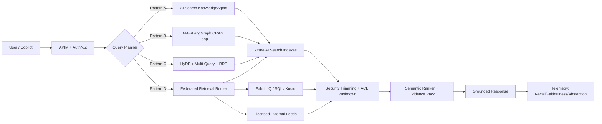
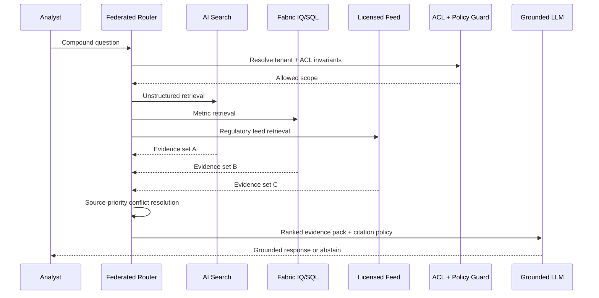

# Enterprise Agentic Retrieval Query-Planning Selection FAQ: AI Search KnowledgeAgent vs Custom CRAG Loop vs HyDE+RRF Fan-Out vs Federated Retrieval Router

> 🌐 **Language Switch**: [中文](./agentic-retrieval-query-planning-ai-search-knowledge-agent-vs-custom-crag-loop-vs-hyde-rrf-vs-federated-router-selection-faq.md) | **English (current)**
> **Audience**: Enterprise Cloud & AI Solution Architects, retrieval platform owners, RAG evaluation leads, governance architects, platform SRE, and FinOps stakeholders.
> **Scope**: Selecting a production architecture for multi-hop decomposition and corrective retrieval when one-shot hybrid search drops below `55%` recall on compound multi-entity, comparative, and conversational enterprise queries.

## 1. Problem definition: why one-shot hybrid retrieval degrades on compound enterprise questions
A common enterprise anti-pattern is to treat “good single-query retrieval” as proof that complex analytical questions are production-ready.  
In reality, when a prompt combines multi-entity joins, temporal comparisons, policy constraints, and follow-up conversational context, one-shot lexical+vector retrieval frequently loses critical evidence links even when top documents look superficially relevant.  

The operational danger is not always an empty result set.  
More often, the system returns partially relevant snippets that allow fluent generation while silently missing decisive constraints, which lowers faithfulness and increases business risk through plausible but unsupported conclusions.  

Production-grade agentic retrieval therefore requires a closed-loop architecture for decomposition, retrieval, evidence sufficiency grading, abstention policy, and ACL-invariant enforcement.  
The architectural decision is not about “which engine returns more passages,” but about “which control plane repeatedly returns the right evidence chain with bounded latency and auditable safety behavior.”  

## 2. Pattern landscape: managed decomposition, corrective loop, stateless fan-out, and federated routing
Pattern A uses Azure AI Search KnowledgeAgent for managed conversation-aware decomposition, parallel sub-query execution, and semantic merge in one server-side call.  
Pattern B uses an explicit CRAG/Self-RAG loop in Microsoft Agent Framework or LangGraph with deterministic hop budgets and evidence-grading gates.  

Pattern C uses a stateless fan-out strategy (`multi-query + HyDE + RRF`) to improve terminology coverage with predictable low-latency behavior and minimal orchestration overhead.  
Pattern D uses a federated router that combines unstructured AI Search evidence, structured Fabric IQ/SQL metrics, and licensed external feeds with source-priority conflict resolution.  

These patterns are composable and should be treated as lanes rather than mutually exclusive platform bets.  
Most mature teams run A as default, C as low-latency high-volume lane, B as corrective high-risk lane, and D as cross-domain escalation path for executive or compliance-critical prompts.  

## 3. Reference architecture: decomposition control plane separated from evidence data planes


The central design principle is isolation of responsibilities: decomposition policy should evolve independently from retrieval index operations, and both should remain independent from generation policy.  
If all logic is collapsed into one prompt turn, teams lose deterministic observability, making ACL drift, evidence loss, and regression attribution difficult to diagnose.  

With this layered topology, APIM and identity controls establish tenant scope first, planner policy selects the retrieval lane second, and response generation consumes a normalized evidence pack last.  
That architecture allows cross-lane metric comparability and prevents each lane from implementing security rules inconsistently.  

## 4. Pattern A deep dive: KnowledgeAgent managed decomposition as default enterprise path
Pattern A is strongest when teams need high-quality multi-hop decomposition without building a large orchestration runtime in phase one.  
Server-side decomposition, sub-query parallelization, and semantic merge significantly reduce implementation lead time and lower day-2 maintenance burden for product teams.  

In production, this lane often keeps complex-query `P95` around `1.1s–1.6s` with token amplification close to `1.4x`, which is typically acceptable for interactive assistant experiences.  
For many enterprises, that efficiency enables governance focus on index quality, ACL mapping, and evaluation rigor rather than first building bespoke orchestration infrastructure.  

Its boundary appears when teams need deeper deterministic policy hooks, such as domain-specific evidence-grade logic, mandatory abstention on sparse evidence, or hard-coded compliance branching.  
In those environments, Pattern A usually remains the front lane while Pattern B handles high-risk corrective loops.  

## 5. Pattern B deep dive: CRAG/Self-RAG state machine for evidence sufficiency and abstention precision
Pattern B provides explicit control over evidence validation and retry behavior, turning retrieval quality from a black box into a policy-governed workflow.  
A typical loop is `Retrieve -> Grade -> Rewrite/Widen -> Re-retrieve -> Verify/Abstain`, with `max_hops=3` to prevent runaway recursion and uncontrolled latency growth.  

This approach is critical in regulated settings where “correct abstention” is often safer than speculative completion.  
When internal evidence confidence falls below threshold (for example `<0.65`), the system should emit deterministic abstention or escalation rather than continue generating from incomplete context.  

The trade-off is measurable: higher orchestration complexity, higher token amplification, and longer tail latency.  
Without strict hop ceilings, cache policy, and exit conditions, the corrective loop can degrade into an expensive instability source rather than a quality safeguard.  

## 6. Pattern C deep dive: stateless Multi-Query + HyDE + RRF for predictable latency
Pattern C is highly effective for terminology-gap domains where acronym variants, naming drift, and synonym expansion dominate retrieval miss patterns.  
By generating `3–4` lexical/semantic variants and merging with reciprocal-rank fusion plus semantic reranking, it improves coverage with a single-stage architecture and no iterative loop.  

Teams commonly observe `P95 < 900ms` behavior under controlled index and reranker configurations, making this lane attractive for high-throughput user-facing workloads.  
The implementation profile is lean, and it fits well behind APIM with minimal control-plane overhead.  

However, this lane is not a substitute for complex cross-domain reasoning.  
When questions require policy-aware conflict arbitration across metrics, contracts, and external filings, Pattern C should hand off to federated routing rather than over-extending variant generation.  

## 7. Pattern D deep dive: cross-modal federated routing for compound executive analysis
Pattern D addresses enterprise prompts whose evidence does not live in one plane.  
Board-level or analyst prompts often span contracts, ERP metrics, legal clauses, and regulatory updates; any single-source retriever will produce structurally incomplete answers.  

A federated router should first classify intent and domain needs, then execute parallel retrieval across unstructured and structured planes, then reconcile conflicts using explicit source-priority rules.  
For example, audited finance records should outrank narrative market commentary, and primary regulatory text should outrank secondary summaries when conflicts appear.  

Pattern D has the highest latency and implementation complexity, but it is the only reliable path for high-stakes cross-domain synthesis.  
Its success depends on institutionalized routing policy and deterministic conflict resolution, not ad-hoc prompt heuristics.  



## 8. Security-trimming invariants: preventing planner rewrite from dropping ACL filters
The highest-severity retrieval failure is not low recall; it is silent privilege-boundary erosion during query rewriting.  
If a rewritten sub-query omits tenant, department, or sensitivity filters, the system may leak data without obvious runtime errors or user-visible warnings.  

To prevent this class of failure, teams should enforce ACL invariants at execution time, not at prompt-intent level.  
Every generated sub-query must inherit and validate the same immutable policy predicate before hitting the retrieval backend.  

In practice, persist `principal_id`, `tenant_id`, `policy_hash`, and `filter_ast_hash` per sub-query and compare rewrite lineage end-to-end.  
Any mismatch outside approved policy transitions should trigger hard-block plus security telemetry, not soft warning logs.  

Prompt-injection defense and ACL enforcement must remain independent layers.  
Even if injection detection misses a crafted instruction, ACL-invariant enforcement should still prevent unauthorized evidence retrieval.  

## 9. 12-dimension comparison matrix: quality, latency, token economics, and governance complexity
| Dimension | Pattern A KnowledgeAgent | Pattern B CRAG Loop | Pattern C HyDE+RRF | Pattern D Federated Router |
|---|---|---|---|---|
| 1. Recall@10 on compound queries | High | Highest | Medium-high | High |
| 2. Faithfulness | High | Highest | Medium-high | High |
| 3. Abstention precision | Medium-high | Highest | Medium | High |
| 4. P50 latency | 0.8s | 1.6s | 0.6s | 1.9s |
| 5. P95 latency | 1.1s | 2.4s | 0.9s | 4.8s |
| 6. Token amplification | 1.4x | 3.2x | 1.7x | 5.5x |
| 7. ACL-consistency governance effort | Low | Medium | Low | High |
| 8. Build complexity | Low | High | Medium | Highest |
| 9. Observability explainability | Medium-high | Highest | Medium | High |
| 10. Cross-domain retrieval power | Medium | Medium | Low | Highest |
| 11. Monthly cost predictability | High | Medium | High | Medium |
| 12. Recommended role | Default primary lane | High-risk corrective lane | High-volume low-latency lane | Strategic escalation lane |

The matrix supports a tiered strategy instead of a single universal lane.  
Using D as universal default usually overpays for capabilities only required by a minority of traffic, while using C everywhere under-serves high-risk analytical prompts.  

A practical policy stack is: default A, low-latency workloads on C, high-risk correctness escalation to B, and cross-domain executive prompts escalated to D.  
This keeps total economics controlled while preserving auditable quality in the flows that matter most.  

## 10. Enterprise scenario A: commercial banking underwriting assistant with compliance-first behavior
Underwriting analysts routinely ask questions that combine financial statements, covenant clauses, historical defaults, and regulatory constraints in one request.  
One-shot retrieval often returns plausible fragments while missing a decisive constraint, which is unacceptable in regulated credit decisions.  

An A+B composition is typically effective: KnowledgeAgent handles decomposition and broad retrieval, while CRAG performs evidence sufficiency grading and deterministic abstention policy.  
If confidence remains below policy threshold after bounded hops, the system returns abstention with a missing-evidence report and routes to human review.  

This model converts silent hallucination risk into explicit governance workflow.  
In audit-heavy environments, that shift from unsupported completion to explainable abstention materially improves control posture and post-incident defensibility.  

## 11. Enterprise scenario B: global software vendor executive cockpit across contracts and operating metrics
Executive questions frequently mix margin trends, customer obligations, and external policy updates in one conversational thread.  
A single retrieval plane can produce internally coherent but externally incomplete answers, especially when contract language and operational metrics diverge.  

An A+D layered architecture works well: default lane on KnowledgeAgent, federated escalation for prompts requiring synchronized document, metric, and external-source reasoning.  
The federated router applies source-priority conflict rules and emits citations with timestamps per key claim to preserve decision traceability.  

Teams usually observe fewer follow-up clarification loops and reduced manual “evidence chase” effort after meetings.  
More importantly, leadership receives conclusions that are linked to verifiable source chains instead of opaque generated narratives.  

## 12. Monthly TCO at `500K`, `5M`, and `25M` queries: economics by lane role
| Queries per month | Pattern A KnowledgeAgent | Pattern B CRAG | Pattern C HyDE+RRF | Pattern D Federated |
|---:|---:|---:|---:|---:|
| 500K | $7,800 | $11,600 | $6,900 | $13,400 |
| 5M | $58,000 | $92,000 | $53,000 | $111,000 |
| 25M | $246,000 | $421,000 | $231,000 | $515,000 |

C generally leads pure high-volume efficiency for straightforward retrieval workloads, while A offers a stronger quality-cost balance for mixed complexity.  
B and D are intentionally more expensive and should be reserved for risk-critical flows where correctness and governance value materially outweigh additional latency and token spend.  

Governance should track cost and quality together rather than independently.  
A “cheap but unfaithful” lane can create hidden downstream business cost through rework, escalation load, and trust erosion that exceeds direct infrastructure savings.  

## 13. Production configuration block A: KnowledgeAgent request contract and Python SDK usage
```python
from azure.identity import DefaultAzureCredential
from azure.search.documents.agent import KnowledgeAgentClient

endpoint = "https://contoso-search.search.windows.net"
index_name = "enterprise-knowledge-v3"

client = KnowledgeAgentClient(
    endpoint=endpoint,
    credential=DefaultAzureCredential(),
    index_name=index_name,
)

request = {
    "query": "Compare Q3 EMEA margin erosion root causes with churn clauses in top contracts",
    "conversationHistory": [
        {"role": "user", "content": "Use board-level summary style"},
        {"role": "assistant", "content": "Acknowledged"},
    ],
    "queryRewrites": {
        "maxSubQueries": 4,
        "enableSemanticVariants": True,
    },
    "securityContext": {
        "tenantId": "tenant-a",
        "principalId": "user-5321",
        "requiredFilters": "tenant_id eq 'tenant-a' and sensitivity le 3",
    },
    "retrieval": {
        "topK": 20,
        "semanticRerankTopN": 8,
        "includeActivityPlan": True,
    },
}

response = client.retrieve(request)
print(response["activityPlan"])
print(response["citations"][:3])
```

```json
{
  "query": "What changed in EMEA margin and how does it map to contract churn clauses?",
  "conversationHistory": [
    {"role": "user", "content": "Use CFO-ready framing"},
    {"role": "assistant", "content": "Context captured"}
  ],
  "securityContext": {
    "tenantId": "tenant-a",
    "principalId": "entra-oid-5521",
    "requiredFilters": "tenant_id eq 'tenant-a' and acl/any(x: x eq 'finance-emea')"
  },
  "queryRewrites": {
    "maxSubQueries": 4,
    "decompositionMode": "conversation-aware"
  },
  "retrieval": {
    "topK": 20,
    "semanticRerankTopN": 10,
    "includeActivityPlan": true
  }
}
```

The key implementation rule is to treat required security filters as immutable control-plane input, not optional model guidance.  
`includeActivityPlan` should remain enabled in production for post-hoc explainability and decomposition quality regression analysis.  

## 14. Production configuration block B: MAF CRAG grader loop with ACL invariants
```python
from dataclasses import dataclass
from typing import List, Dict

@dataclass
class RetrievalState:
    user_query: str
    rewritten_query: str
    hop: int
    max_hops: int
    acl_filter: str
    evidence: List[Dict]
    confidence: float
    abstain: bool = False


def retrieve(query: str, acl_filter: str) -> List[Dict]:
    # production hook: call AI Search with enforced filter
    return search_client.search(query=query, filter=acl_filter, top=12)


def relevance_grader(evidence: List[Dict]) -> float:
    if not evidence:
        return 0.0
    scored = [doc.get("score", 0.0) for doc in evidence]
    return sum(scored[:5]) / min(len(scored), 5)


def rewrite_query(original: str, hop: int) -> str:
    prompt = (
        "Rewrite for missing entities and constraints while preserving security scope. "
        f"Hop={hop}; Query={original}"
    )
    return planner_model.generate(prompt).strip()


def crag_loop(state: RetrievalState) -> RetrievalState:
    while state.hop < state.max_hops:
        docs = retrieve(state.rewritten_query, state.acl_filter)
        score = relevance_grader(docs)
        state.evidence = docs
        state.confidence = score

        if score >= 0.65:
            return state

        state.hop += 1
        if state.hop >= state.max_hops:
            state.abstain = True
            return state

        candidate = rewrite_query(state.user_query, state.hop)

        # ACL invariant: rewritten query must not mutate acl_filter semantics.
        if not policy_guard.verify_acl_invariant(
            principal_acl=state.acl_filter,
            rewritten_query=candidate,
        ):
            state.abstain = True
            return state

        state.rewritten_query = candidate

    state.abstain = True
    return state
```

This loop demonstrates bounded retries, explicit confidence gating, and policy-invariant enforcement in one deterministic flow.  
Any policy drift or insufficient evidence state exits through abstention or escalation instead of uncontrolled generation continuation.  

## 15. Quantitative FAQ and Day-0/Day-2 checklists (Good fit vs Not for)
1. **When should one-shot retrieval be retired for a query class?**  
When compound-query `Recall@10` remains below `55%` across representative workloads and faithfulness variance increases despite index tuning.  

2. **Why is `max_hops=3` a common practical ceiling for corrective loops?**  
Beyond three hops, marginal recall gains are usually dominated by latency and token expansion, while operational unpredictability rises sharply.  

3. **How should teams choose between Pattern A and Pattern C for default traffic?**  
Choose A when conversation-aware decomposition quality is the primary value; choose C when strict low-latency throughput and terminology expansion dominate.  

4. **Why does federated routing require explicit source-priority conflict policy?**  
Without deterministic precedence rules, answers can vary with retrieval timing and source arrival order, which breaks reproducibility and governance confidence.  

5. **Which ACL fields must remain invariant across rewrite hops?**  
At minimum: `tenant_id`, principal scope, sensitivity ceiling, and policy hash lineage recorded for each rewritten sub-query.  

6. **How should cost and correctness be budgeted together?**  
Run A/C as default lanes, route B and D by risk policy, and assign independent budget ceilings to escalation lanes with continuous quality-cost monitoring.  

### Day-0 go-live checklist
| Item | Target | Notes |
|---|---:|---|
| Recall@10 baseline | >= 0.72 | compound-query benchmark set |
| Faithfulness | >= 0.85 | citation-backed answer quality |
| Abstention precision | >= 0.90 | safe refusal correctness |
| ACL invariant blocking | 100% | all rewritten sub-queries validated |
| Plan observability completeness | 100% | replayable sub-query activity logs |

### Day-2 operations checklist
| Metric | Threshold | Response when breached |
|---|---:|---|
| P95 latency | < 2.5s | audit hop budget, fan-out width, and cache strategy |
| Token amplification | < 3.5x | tune rewrite policy and lane-routing thresholds |
| Abstention rate | 5%–18% | low may imply unsafe completion bias; high may imply retrieval quality debt |
| ACL alert leakage | 0 unblocked events | trigger security incident review and policy diff |
| Cost per 1K queries | within lane budget | rebalance default vs escalation lane distribution |

**Good fit**: enterprise environments requiring high-fidelity evidence chains, policy-auditable abstention, and cross-domain retrieval governance at scale.  
**Not for**: low-risk FAQ bots with narrow scope where single-source retrieval already meets quality and governance expectations.  
