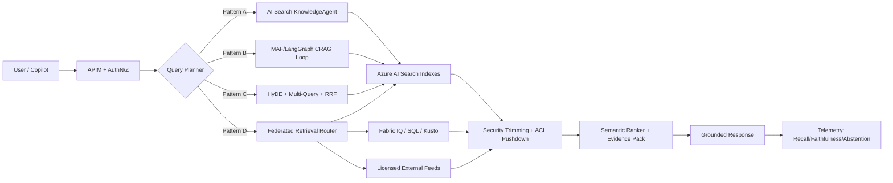
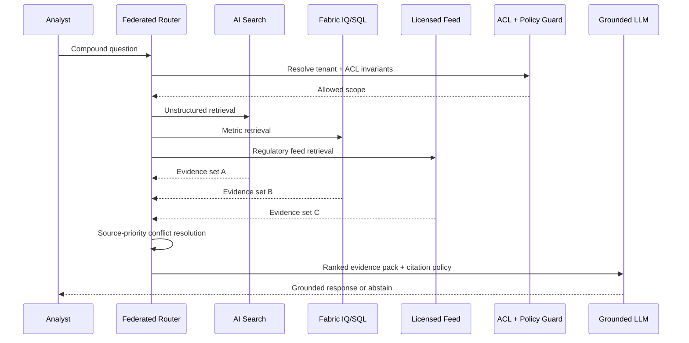

# 企业 Agentic Retrieval 查询规划与纠错检索选型 FAQ：AI Search Knowledge Agent vs Custom CRAG Loop vs HyDE+RRF 并行扇出 vs 联邦路由

> 🌐 **Language Switch**：**中文（当前）** | [English](./agentic-retrieval-query-planning-ai-search-knowledge-agent-vs-custom-crag-loop-vs-hyde-rrf-vs-federated-router-selection-faq.en.md)
> **受众**：企业 Cloud & AI Solution Architect、检索平台负责人、RAG/评测负责人、数据治理与安全架构师、FinOps 与平台 SRE。
> **范围**：聚焦复合多实体/比较型/会话追问查询在单次 Hybrid Search 召回率跌破 `55%` 时，如何在 Azure 上选择多跳查询分解、纠错检索回路、并行多查询融合与跨模态联邦路由架构。

## 1. 问题定义：为什么单次 Hybrid Search 在复杂问题上会失速
企业最常见的误判是把“单次检索可用”当成“复杂问题也可用”。  
当用户问题同时包含多时间维度、多业务实体、指标口径差异和政策语义冲突时，单次向量+关键词检索即使在静态 FAQ 上表现良好，也会在真实场景里出现召回断层。  

在复合查询里，检索失败通常不是完全无结果，而是“命中了部分片段却错过关键证据链”。  
这种失败最难排查，因为生成端仍然能输出流畅答案，但 Faithfulness 与可追溯性会显著下降，最终演变为“看似可信但证据断裂”的高风险输出。  

因此生产级 Agentic Retrieval 要求把查询理解、子查询分解、证据校验、拒答策略与 ACL 安全修剪作为一个闭环系统，而不是单一向量搜索 API。  
平台选型的关键不在“谁能返回最多文档”，而在“谁能在成本可控前提下稳定返回正确证据并可解释拒答”。  

## 2. 四类模式总览：托管式、回路式、并行扇出式、联邦路由式
Pattern A 采用 Azure AI Search KnowledgeAgent 托管式查询规划，优势是服务端一次调用内完成历史分解、并行子查询与语义合并，工程实现最短。  
Pattern B 采用 MAF/LangGraph 可编排 CRAG/Self-RAG 回路，优势是可以显式做证据充足性判定、重写和保守拒答，适合高合规和高可解释场景。  

Pattern C 采用 Multi-Query + HyDE + RRF 的无状态并行扇出，优势是延迟可预测、实现轻量，适合术语密集但无需长回路推理的场景。  
Pattern D 采用跨模态联邦路由，把 AI Search 非结构化文档、Fabric IQ/SQL 结构化指标与外部许可源统一到冲突消解平面，适合高层管理问询与跨域分析。  

这四类模式并非互斥。  
成熟企业往往采用 A 作为默认路径，B 处理高风险复杂问答，C 作为低延迟流量池，D 作为跨域升级通道。  

## 3. 参考架构：多跳查询规划、证据校验、联邦路由与治理护栏分层解耦


架构核心是把“查询分解控制面”和“证据检索数据面”拆开，以便分别优化延迟、召回和治理。  
如果把所有逻辑塞进单一提示词回合，任何一个环节失败都难以定位，且无法稳定执行 ACL 下推与拒答策略。  

在该架构中，APIM 与身份层先完成租户与权限约束，Planner 再选择最合适的检索模式，最后由统一 Evidence Pack 进入生成层。  
这样既能避免各模式重复实现安全逻辑，也能保证评测指标在同一观测面可比较。  

## 4. Pattern A：KnowledgeAgent 托管式多跳分解（低编排成本主路径）
Pattern A 的优势是服务端托管多跳分解与并行子查询，不需要团队先搭建完整编排框架即可上线。  
对于“多轮会话上下文 + 术语改写 + 子查询并发执行 + 语义合并”这一组能力，托管化可显著减少交付周期和维护负担。  

在企业实践中，Pattern A 常把复杂查询 `P95` 控制在 `1.1s–1.6s` 区间，且 token 放大相对可控。  
对平台团队而言，这意味着可以先把复杂度留在服务端能力，再把工程精力投入索引治理、权限映射和评测闭环。  

其边界在于可定制策略深度低于自编排回路。  
当组织需要强约束的行业规则判定、复核级证据门槛与差异化拒答逻辑时，Pattern A 往往要与 Pattern B 联合使用。  

## 5. Pattern B：CRAG/Self-RAG 状态机回路（高可解释纠错路径）
Pattern B 的价值在“可验证纠错”，而不是“更炫的多 Agent 流程”。  
典型回路是 `Retrieve -> Relevance Grader -> Rewrite/Widen -> Re-retrieve -> Verify/Abstain`，并设置 `max_hops=3` 防止回路失控。  

在高监管行业，Pattern B 可以把“证据不足拒答”变成可审计的确定性行为，避免模型硬答。  
当内部语料置信度低于阈值（如 `<0.65`）时，系统应触发显式拒答或升级到联邦路由，而不是继续堆叠生成。  

该模式的代价是延迟和 token 放大更高。  
如果没有严格 hop 预算、缓存策略和终止条件，回路很容易从“提升召回”退化为“拉高成本且放大不稳定性”。  

## 6. Pattern C：Multi-Query + HyDE + RRF 并行扇出（低延迟稳定路径）
Pattern C 适合“术语不统一、缩写多、同义表达复杂”的知识库。  
通过并行生成 `3–4` 个查询变体，再做 RRF 融合与语义重排，能够在不引入多轮回路的前提下显著提升召回覆盖。  

该模式通常可以把端到端 `P95` 控制在 `0.9s` 左右，且运维复杂度低。  
对于客服知识库、产品手册、运维 Runbook 等高频检索场景，Pattern C 是成本与性能平衡点。  

但 Pattern C 不是“通用万能替代”。  
当问题需要跨数据平面推理和冲突证据裁决时，仅靠并行变体检索仍可能遗漏关键结构化事实，必须升级至 Pattern D。  

## 7. Pattern D：跨模态联邦路由（文档+指标+外部源统一冲突裁决）
Pattern D 解决的是“答案不在一个库里”的企业现实。  
管理层问题往往同时涉及合同条款、财务指标、监管公告与市场事件，如果只查文档库或只查数仓都无法形成完整证据链。  

联邦路由要求先做数据域判定，再按优先级并发检索并合并冲突。  
例如“财务报表口径优先于市场解读，监管公告优先于新闻二次转载”，这些策略必须显式编码在路由器与证据合并层。  

Pattern D 延迟和实现复杂度最高，但在战略分析与高层决策问答里不可替代。  
其关键在于把路由策略、来源优先级和证据冲突规则制度化，而不是依赖提示词临场判断。  



## 8. 安全修剪不变量：防止查询规划被注入后“丢 ACL”
多跳查询最危险的失败不是召回不足，而是安全边界被悄悄绕过。  
如果 Planner 在重写子查询时丢失租户过滤、部门过滤或文档密级过滤，系统可能在无告警下返回越权证据。  

因此必须建立“安全修剪不变量”：每个重写子查询都继承并验证同一 ACL 谓词。  
在实现上，推荐把安全过滤放在不可变控制面，由检索执行层强制注入，而不是让 LLM 以自然语言“记住要过滤”。  

建议在每次子查询执行前后记录 `principal_id`、`tenant_id`、`policy_hash`、`filter_ast_hash`。  
只要发现重写前后哈希不一致且未经过授权变更流程，即触发阻断并记录安全事件。  

此外要把 Prompt Injection 检测与 ACL 验证解耦。  
即使注入检测漏报，ACL 不变量也应独立生效，从体系上把“内容层对抗”与“权限层防护”分层隔离。  

## 9. 12 维对比矩阵：召回、忠实度、拒答精度、时延与治理复杂度
| 维度 | Pattern A KnowledgeAgent | Pattern B CRAG Loop | Pattern C HyDE+RRF | Pattern D Federated Router |
|---|---|---|---|---|
| 1. Recall@10（复杂问答） | 高 | 最高 | 中高 | 高 |
| 2. Faithfulness | 高 | 最高 | 中高 | 高 |
| 3. Abstention Precision | 中高 | 最高 | 中 | 高 |
| 4. P50 延迟 | 0.8s | 1.6s | 0.6s | 1.9s |
| 5. P95 延迟 | 1.1s | 2.4s | 0.9s | 4.8s |
| 6. Token 放大倍数 | 1.4x | 3.2x | 1.7x | 5.5x |
| 7. ACL 一致性治理难度 | 低 | 中 | 低 | 高 |
| 8. 工程实现复杂度 | 低 | 高 | 中 | 最高 |
| 9. 可观测性可解释度 | 中高 | 最高 | 中 | 高 |
| 10. 跨域数据融合能力 | 中 | 中 | 低 | 最高 |
| 11. 月度成本可预测性 | 高 | 中 | 高 | 中 |
| 12. 适用阶段 | 默认主路径 | 高风险纠错路径 | 高频低延迟路径 | 战略跨域路径 |

量化结论是：A 和 C 更适合做高频主流量，B 用于高风险纠错，D 用于跨域升级。  
若把 D 直接作为全流量默认路径，虽然功能完整，但成本与延迟会快速失控。  

推荐采用分层路由：默认 A，低延迟场景直走 C，高风险问题升级 B，跨域复合问题升级 D。  
该策略能在不牺牲安全与可信度的前提下，把整体成本维持在可接受区间。  

## 10. 企业场景 A：商业银行授信分析台（多实体比较+合规拒答）
场景问题常同时涉及企业财报、授信条款、历史违约、监管限额与行业指数。  
单次检索容易返回部分片段并遗漏关键约束，导致答复在合规上不可用。  

推荐架构为 A+B 联合：KnowledgeAgent 负责主查询分解，CRAG 负责证据充分性复核与拒答判定。  
当评分器认定证据不足时，系统返回“可解释拒答 + 缺失证据列表”，并触发人工复核队列。  

该架构的业务收益是把“错误回答”转化为“可治理的不回答”。  
在银行审计语境下，拒答的正确性往往比盲目作答更有价值，也更符合风险控制原则。  

## 11. 企业场景 B：全球制造集团经营例会分析（合同+指标+外部监管）
典型问题会同时引用 ERP 指标、Top 客户合同条款和监管最新公告。  
若系统仅依赖单一知识库，极易发生“指标正确但条款错误”或“条款正确但口径错误”的冲突回答。  

推荐架构为 A+D 联合：常规问题走 KnowledgeAgent，跨域问题由联邦路由并行查文档、数仓与外部许可源。  
路由器以来源优先级规则做冲突裁决，并在答案中标注每条关键结论的证据来源与时间戳。  

上线后团队通常能把跨域问答的一次命中率显著提升，同时减少会后人工补证工作量。  
更重要的是，管理层能看到“结论从哪里来”，而不是只看到一个无法复盘的生成结果。  

## 12. 月度 TCO：`500K / 5M / 25M` 查询量下的成本与收益拐点
| 查询量/月 | Pattern A KnowledgeAgent | Pattern B CRAG | Pattern C HyDE+RRF | Pattern D Federated |
|---:|---:|---:|---:|---:|
| 500K | $7,800 | $11,600 | $6,900 | $13,400 |
| 5M | $58,000 | $92,000 | $53,000 | $111,000 |
| 25M | $246,000 | $421,000 | $231,000 | $515,000 |

成本上看，C 在高频标准问答最有优势，A 在复杂度与成本之间平衡最佳。  
B 与 D 成本更高，但它们提供的是“正确性和治理能力”，应按风险场景精确投放而非全量默认。  

建议将“每千次查询成本”与“有效回答率”联合监控。  
如果只压低成本而忽略忠实度与拒答精度，最终会在业务侧形成更大的返工与风险成本。  

## 13. 生产配置块 A：KnowledgeAgent 检索管道（Python SDK + 请求体）
```python
from azure.identity import DefaultAzureCredential
from azure.search.documents.agent import KnowledgeAgentClient

endpoint = "https://contoso-search.search.windows.net"
index_name = "enterprise-knowledge-v3"

client = KnowledgeAgentClient(
    endpoint=endpoint,
    credential=DefaultAzureCredential(),
    index_name=index_name,
)

request = {
    "query": "Compare Q3 EMEA margin erosion root causes with churn clauses in top contracts",
    "conversationHistory": [
        {"role": "user", "content": "Use board-level summary style"},
        {"role": "assistant", "content": "Acknowledged"},
    ],
    "queryRewrites": {
        "maxSubQueries": 4,
        "enableSemanticVariants": True,
    },
    "securityContext": {
        "tenantId": "tenant-a",
        "principalId": "user-5321",
        "requiredFilters": "tenant_id eq 'tenant-a' and sensitivity le 3",
    },
    "retrieval": {
        "topK": 20,
        "semanticRerankTopN": 8,
        "includeActivityPlan": True,
    },
}

response = client.retrieve(request)
print(response["activityPlan"])
print(response["citations"][:3])
```

```json
{
  "query": "What changed in EMEA margin and how does it map to contract churn clauses?",
  "conversationHistory": [
    {"role": "user", "content": "Use CFO-ready framing"},
    {"role": "assistant", "content": "Context captured"}
  ],
  "securityContext": {
    "tenantId": "tenant-a",
    "principalId": "entra-oid-5521",
    "requiredFilters": "tenant_id eq 'tenant-a' and acl/any(x: x eq 'finance-emea')"
  },
  "queryRewrites": {
    "maxSubQueries": 4,
    "decompositionMode": "conversation-aware"
  },
  "retrieval": {
    "topK": 20,
    "semanticRerankTopN": 10,
    "includeActivityPlan": true
  }
}
```

该配置关键点是把 `securityContext.requiredFilters` 明确放入请求契约，而不是依赖 LLM 口头遵循。  
同时 `includeActivityPlan` 让平台能观测每个子查询的产生与执行结果，便于做质量归因。  

## 14. 生产配置块 B：MAF CRAG 评分器与纠错回路（含 ACL 不变量）
```python
from dataclasses import dataclass
from typing import List, Dict

@dataclass
class RetrievalState:
    user_query: str
    rewritten_query: str
    hop: int
    max_hops: int
    acl_filter: str
    evidence: List[Dict]
    confidence: float
    abstain: bool = False


def retrieve(query: str, acl_filter: str) -> List[Dict]:
    # production hook: call AI Search with enforced filter
    return search_client.search(query=query, filter=acl_filter, top=12)


def relevance_grader(evidence: List[Dict]) -> float:
    if not evidence:
        return 0.0
    scored = [doc.get("score", 0.0) for doc in evidence]
    return sum(scored[:5]) / min(len(scored), 5)


def rewrite_query(original: str, hop: int) -> str:
    prompt = (
        "Rewrite for missing entities and constraints while preserving security scope. "
        f"Hop={hop}; Query={original}"
    )
    return planner_model.generate(prompt).strip()


def crag_loop(state: RetrievalState) -> RetrievalState:
    while state.hop < state.max_hops:
        docs = retrieve(state.rewritten_query, state.acl_filter)
        score = relevance_grader(docs)
        state.evidence = docs
        state.confidence = score

        if score >= 0.65:
            return state

        state.hop += 1
        if state.hop >= state.max_hops:
            state.abstain = True
            return state

        candidate = rewrite_query(state.user_query, state.hop)

        # ACL invariant: rewritten query must not mutate acl_filter semantics.
        if not policy_guard.verify_acl_invariant(
            principal_acl=state.acl_filter,
            rewritten_query=candidate,
        ):
            state.abstain = True
            return state

        state.rewritten_query = candidate

    state.abstain = True
    return state
```

这段代码体现三项生产要点：有界 hop、可解释置信度阈值、ACL 不变量校验。  
只要任一环节失败，系统立即进入拒答或人工升级路径，避免越权或幻觉扩散。  

## 15. 量化 FAQ 与 Day-0/Day-2 检查清单（Good fit vs Not for）
1. **什么时候判定单次检索已经不够？**  
当复合查询的 `Recall@10` 连续低于 `55%` 且 Faithfulness 波动明显时，应升级到多跳或联邦路径。  

2. **为什么 CRAG 的 `max_hops=3` 常被视作工程上限？**  
超过三跳后，边际召回收益通常小于延迟与 token 成本增幅，且失败路径更难治理。  

3. **Pattern A 与 Pattern C 的主要分界线是什么？**  
A 更适合会话语义分解，C 更适合低延迟术语扩展；若要最少编排先上 A，要极致低延迟先上 C。  

4. **联邦路由为什么必须做来源优先级？**  
没有优先级就无法稳定裁决冲突证据，最终答案会随检索返回顺序波动，缺乏审计一致性。  

5. **ACL 不变量最少要校验哪些字段？**  
至少要校验 `tenant_id`、`principal_scope`、`sensitivity_level` 与 `policy_hash`，并对每次重写做一致性比对。  

6. **如何在成本与正确性之间做预算分层？**  
默认流量走 A/C，高风险问题按规则升级 B，跨域复合问题升级 D，并对 B/D 设独立预算上限。  

### Day-0 上线核对
| 检查项 | 目标值 | 说明 |
|---|---:|---|
| Recall@10 基线 | >= 0.72 | 复合查询集验证 |
| Faithfulness | >= 0.85 | 引文可追溯 |
| Abstention Precision | >= 0.90 | 拒答正确优先 |
| ACL 不变量拦截 | 100% | 重写查询全校验 |
| 路由观测完整性 | 100% | 子查询活动计划可回放 |

### Day-2 运维核对
| 指标 | 阈值 | 超阈动作 |
|---|---:|---|
| P95 延迟 | < 2.5s | 检查回路 hop 与并发上限 |
| Token 放大倍数 | < 3.5x | 调整重写策略与缓存 |
| 拒答率 | 5%–18% | 过低查风险，过高查索引质量 |
| ACL 拦截告警 | 0 漏拦截 | 触发安全事件审查 |
| 每千次查询成本 | 目标带宽内 | 触发分层路由调优 |

在持续运营阶段，建议每周固定进行一次“复合查询回放回归”，覆盖跨实体比较、跨时间窗追问、跨数据平面冲突裁决三类高风险问题簇，并对每次回放记录保留检索轨迹与证据包快照。  
当回放发现同一问题在不同路由策略下出现结论漂移时，应优先回查来源优先级规则与 ACL 不变量执行日志，而不是先调整生成提示词，以避免把检索治理问题误诊为模型文风问题。  

**Good fit**：存在复杂复合查询、合规要求严格、且需要“证据可追溯 + 可解释拒答”的企业检索平台。  
**Not for**：单一 FAQ 场景、低风险轻问答、且无需跨域融合与严格安全修剪的轻量应用。  
