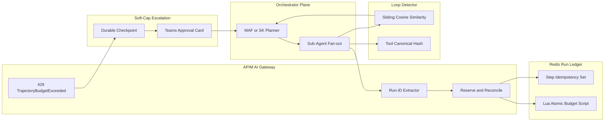
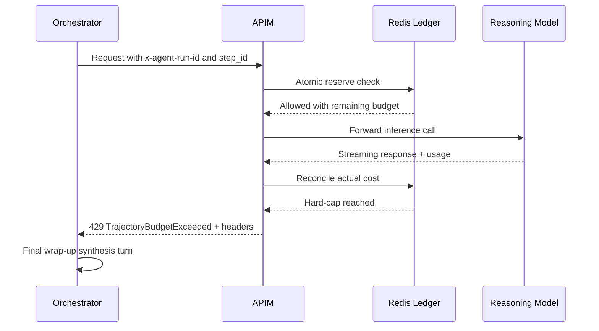

# Enterprise Agentic Trajectory Budget Governance FAQ: APIM+Redis Run Ledger Circuit Breakers vs Semantic Zero-Progress Detection vs Adaptive reasoning_effort vs Soft-Cap HITL Top-Up Saga
> 🌐 **Language Switch**: [中文](agentic-trajectory-budget-runaway-loop-circuit-breaker-apim-redis-vs-reasoning-effort-selection-faq.md) | **English (current)**  
> Audience: Enterprise Cloud & AI Solution Architects, platform governance boards, LLMOps/SRE, FinOps, and AI risk/compliance teams.  
> Core question: In multi-agent ReAct/A2A flows, how do we stop high-cost runaway trajectories that stay below tenant TPM limits while silently burning `$20–$80` per stuck run.  
> Scope boundary: This guide addresses trajectory-level cost and loop governance, not tenant-level RPM/TPM throttling baselines (complements #24/#25/#160).  
## 1. Executive summary: runaway spend is a trajectory-governance gap, not a traffic problem
Many teams assume that controlling TPM controls spend.  
In production, runaway cost often comes from long-lived trajectories.  
A single run can remain under rate limits and still consume large total dollars.  
Losses usually come from repeated reasoning, retry loops, and zero-progress tool chains.  
Request-level telemetry cannot fully expose this pattern.  
The governance unit must therefore shift from request to trajectory.  
A trajectory needs a stable global identity.  
`x-agent-run-id` is the practical cross-agent ledger key.  
With a unified run key, distributed fan-out can still share one budget state.  
Budget alone is still insufficient.  
You must detect semantic dead loops before hard caps are hit.  
You must tune reasoning intensity by step complexity.  
You must preserve partial outcomes when legitimate deep tasks hit soft ceilings.  
This guide proposes four coordinated planes.  
Plane A: APIM + Redis atomic run ledger and hard-cap circuit breaker.  
Plane B: orchestrator-native semantic zero-progress and ping-pong loop detector.  
Plane C: adaptive `reasoning_effort` and `max_completion_tokens` step allocation.  
Plane D: soft-cap pause, checkpointing, and HITL budget top-up saga.  
Applied together, these planes compress P99 cost per run while preserving outcome quality.  
## 2. Problem framing: move from request accounting to trajectory lifecycle accounting
Per-request accounting is fine for simple single-turn chat.  
It fails for distributed multi-agent orchestration.  
A single business run can span many sub-agents and model calls.  
The run can include cached and non-cached prompt segments.  
It can also include invisible reasoning-token spend.  
If only completion tokens are tracked, actual cost is systematically underestimated.  
A robust ledger should track at least four cost buckets.  
Bucket one is prompt input.  
Bucket two is cached prompt input.  
Bucket three is hidden reasoning tokens.  
Bucket four is completion output.  
A minimal schema should include key identity and financial fields.  
`run_id`, `tenant_id`, `step_id`, and `agent_id` are mandatory anchors.  
`reserved_usd`, `settled_usd`, and `remaining_usd` support lifecycle accounting.  
`reasoning_tokens`, `cached_prompt_tokens`, and `completion_tokens` support root-cause analysis.  
`loop_score`, `progress_score`, and `breaker_state` support governance explainability.  
Without this schema, postmortems devolve into guesswork.  
## 3. Four-way architecture: who detects, who enforces, who optimizes, who escalates
Path A enforces hard financial boundaries in real time.  
Path B detects no-progress behavior before budget exhaustion.  
Path C reduces per-step reasoning burn without blocking productive work.  
Path D enables controlled budget escalation for legitimate deep trajectories.  
A is the financial safety boundary.  
B is the behavioral safety boundary.  
C is the model-invocation efficiency boundary.  
D is the workflow governance boundary.  
If you deploy A only, you get abrupt stops and poor user closure.  
If you deploy B only, you detect loops but still leak cost.  
If you deploy C only, each step gets cheaper while step count still explodes.  
If you deploy D only, approvals become reactive firefighting.  
All four are required for enterprise-grade trajectory governance.  
A+B usually provide first measurable risk reduction.  
C then drives structural cost compression.  
D adds resilience for high-value deep research and migration tasks.  
## 4. Twelve-dimension decision matrix for governance reviews
| Dimension | A Gateway Ledger Breaker | B Semantic Loop Detector | C Adaptive Reasoning Allocation | D Soft-Cap Top-Up Saga |
|---|---|---|---|---|
| Immediate runaway interception | very high | high | medium | medium |
| False-positive controllability | medium | medium-high | high | high |
| Cross-agent consistency | high | medium-high | medium | high |
| Auditability and explainability | very high | high | medium-high | high |
| Implementation complexity | medium | medium-high | medium | medium-high |
| Model-vendor neutrality | high | high | medium | high |
| End-user experience quality | medium | medium-high | high | medium-high |
| Hidden reasoning reduction | medium | medium | very high | low |
| Partial-output preservation | low | medium | low | very high |
| Compatibility with tenant throttling | high | high | high | high |
| Operations overhead | medium | medium-high | medium | medium-high |
| Three-year TCO convergence | high | high | high | high |
Use this matrix after compliance hard constraints are applied.  
Regulated environments usually prioritize A and D.  
High-interactivity environments usually prioritize B and C.  
Low-maturity teams can phase in A first, then C, then B and D.  
## 5. Path A: gateway-level atomic run ledger and hard-cap circuit breaker
Path A accumulates cost at the gateway for every run step.  
The ledger key is `x-agent-run-id`.  
Each step reserves budget before model invocation.  
After response usage is known, settlement reconciles reserved versus actual spend.  
If remaining budget is insufficient, APIM returns `429 TrajectoryBudgetExceeded`.  
Structured headers should include run state and remaining budget.  
Example headers include `x-trajectory-budget-remaining-usd`.  
Another key header is `x-trajectory-breaker-state=hard-stop`.  
This design works across distributed sub-agent trees and worker nodes.  
Atomicity is non-negotiable.  
Redis Lua is the practical mechanism for reserve-and-check in one operation.  
Idempotency is equally critical.  
Replayed `step_id` calls must not double-charge.  
Streaming calls need staged reconciliation.  
Without staged reconciliation, reserve drift accumulates quickly.  
Path A is the platform brake pedal and should remain in shared control plane logic.  
## 6. Path B: semantic dead-loop and zero-progress detection in orchestrator
Path B handles behavior that is technically valid but economically pointless.  
Three loop classes are most common in production.  
Class one is ping-pong routing such as `A -> B -> A` repeatedly.  
Class two is identical tool-error retries without new evidence.  
Class three is low-entropy observation loops with no state advancement.  
A practical implementation combines two signals.  
Signal one is canonical tool-call hash.  
Signal two is sliding-window semantic similarity.  
If hash repetition and high similarity coincide with low progress score, trigger intervention.  
Intervention should be staged.  
First inject deterministic corrective guidance.  
If no improvement within bounded turns, terminate safely.  
This staged approach lowers false positives while preserving control.  
Path B often cuts no-value steps from double digits to single digits.  
It also improves user trust by making termination rationale explainable.  
## 7. Path C: adaptive reasoning_effort and max_completion_tokens per step
Path C targets hidden reasoning spend inflation.  
Many steps do not need deep reasoning.  
JSON formatting and tool dispatch are typical low-complexity examples.  
Using `high` reasoning effort on these steps is pure waste.  
A recommended policy is stepwise escalation.  
Default to `low`.  
Escalate to `medium` only after verifier failure or contradiction detection.  
Escalate to `high` only for critical synthesis or conflict-resolution steps.  
Tie escalation to dynamic `max_completion_tokens` ceilings.  
This prevents verbose over-generation on trivial steps.  
Path C needs verifier signals for safe automation.  
Useful signals include schema failures, factual consistency score, and tool confidence.  
Without verifiers, adaptive effort becomes guesswork.  
In practice, C often yields `55%–78%` reasoning-cost reduction with stable success rates.  
## 8. Path D: soft-cap pause and HITL budget top-up saga
Path D protects high-value trajectories from wasteful hard-stop collapse.  
Examples include M&A due diligence and code migration investigations.  
These tasks may legitimately exceed initial budget envelopes.  
A pure hard-stop policy discards expensive partial progress.  
Soft-cap governance solves this by introducing controlled pause.  
When soft cap is reached, workflow checkpoints intermediate artifacts.  
A Teams Adaptive Card is sent to the accountable approver.  
Approver selects top-up tier or rejects extension.  
Typical tiering is `$1 -> $5 -> $25` based on risk class.  
On approval, the same run resumes from checkpoint.  
On rejection, system returns structured partial synthesis and evidence links.  
Path D upgrades failure semantics from abrupt termination to governed decisioning.  
## 9. Reference architecture diagram: trajectory budget control plane

The diagram exposes three closed loops.  
Financial enforcement loop.  
Behavioral correction loop.  
Human-governed escalation loop.  
## 10. Sequence diagram: reserve, reconcile, break, and graceful synthesis

Reserve and reconcile must share one run ledger source of truth.  
This is what keeps distributed execution financially consistent.  
## 11. Quantitative Q&A for cost and false-positive governance
**Q1: Why can `N=40` ReAct turns produce near `O(N^2)` input cost growth?**  
A1: Each turn carries accumulated context from prior turns.  
Turn-`k` input is roughly proportional to `k`.  
Total input volume approximates `1+2+...+N = N(N+1)/2`.  
That growth pattern drives accelerated cost tails in long trajectories.  
**Q2: Why is reserve-before-call required in SSE streaming runs?**  
A2: Post-only settlement discovers budget breach too late.  
Reserve-only accounting overstates spend if actual usage is lower.  
Reserve then reconcile provides both safety and accuracy.  
**Q3: Why reserve budget for a graceful synthesis turn?**  
A3: Without reserved wrap-up budget, users receive only hard errors at cap hit.  
A dedicated `5%–10%` reserve enables partial-answer synthesis with next-step guidance.  
**Q4: How do hash and semantic detectors differ in false-positive profile?**  
A4: Hash detection is precise for exact repeats but misses paraphrased loops.  
Semantic detection catches paraphrased loops but needs calibrated thresholds.  
Production systems should combine both with dual-threshold gating.  
**Q5: How to estimate adaptive reasoning_effort savings?**  
A5: If `70%` of steps move from `high` to `low` and those steps were `60%` of reasoning spend,  
first-order savings exceed `36%`, often surpassing `55%` after output-cap tuning.  
**Q6: Why can run-level overspend happen with healthy tenant TPM metrics?**  
A6: TPM is a rate constraint, not a trajectory total-spend constraint.  
Slow but long trajectories can remain rate-compliant and still become expensive.  
**Q7: How to prevent soft-cap approvals from slowing routine work?**  
A7: Enable soft-cap saga only for tagged high-value workflows.  
Routine runs should follow deterministic hard-cap termination policy.  
**Q8: What is a realistic P99 cost/run compression target?**  
A8: Use a four-week baseline distribution first.  
Set phase-one target at `~35%` P99 reduction.  
Then target `50%+` once false-positive and completion-rate stability are validated.  
## 12. Production code sample: Redis Lua atomic run budget ledger
```lua
-- KEYS[1] = run ledger hash key
-- KEYS[2] = step idempotency set key
-- ARGV[1] = step_id
-- ARGV[2] = reserve_usd
-- ARGV[3] = hard_cap_usd
-- ARGV[4] = ttl_seconds
local step_id = ARGV[1]
local reserve = tonumber(ARGV[2])
local hard_cap = tonumber(ARGV[3])
local ttl = tonumber(ARGV[4])

if redis.call('SISMEMBER', KEYS[2], step_id) == 1 then
  local spent = tonumber(redis.call('HGET', KEYS[1], 'spent_usd') or '0')
  local remaining = hard_cap - spent
  return {1, spent, remaining, 'idempotent-replay'}
end

local spent = tonumber(redis.call('HGET', KEYS[1], 'spent_usd') or '0')
local projected = spent + reserve
if projected > hard_cap then
  local remaining = hard_cap - spent
  return {0, spent, remaining, 'hard-cap-hit'}
end

redis.call('SADD', KEYS[2], step_id)
redis.call('HSET', KEYS[1], 'spent_usd', projected)
redis.call('EXPIRE', KEYS[1], ttl)
redis.call('EXPIRE', KEYS[2], ttl)
local remaining = hard_cap - projected
return {1, projected, remaining, 'reserved'}
```
This script enforces idempotency, atomic reserve checks, and hard-cap preemption.  
## 13. Production code sample: semantic loop guard and graceful wrap-up middleware
```python
from dataclasses import dataclass
from collections import deque
import hashlib
from typing import Deque

@dataclass
class StepSignal:
    tool_hash: str
    cosine_similarity: float
    progress_score: float

class TrajectoryGuard:
    def __init__(self, max_window: int = 3):
        self.window: Deque[StepSignal] = deque(maxlen=max_window)

    def canonical_tool_hash(self, tool_name: str, args_json: str) -> str:
        raw = f"{tool_name}|{args_json}".encode("utf-8")
        return hashlib.sha256(raw).hexdigest()

    def should_break(self, signal: StepSignal) -> bool:
        self.window.append(signal)
        if len(self.window) < 3:
            return False
        same_hash = len({s.tool_hash for s in self.window}) == 1
        high_similarity = all(s.cosine_similarity > 0.95 for s in self.window)
        low_progress = all(s.progress_score < 0.1 for s in self.window)
        return same_hash and high_similarity and low_progress

def graceful_wrap_up(run_id: str, partial_artifacts: list[str]) -> dict:
    return {
        "run_id": run_id,
        "status": "budget_or_loop_stopped",
        "summary": "Trajectory stopped safely with partial results.",
        "artifacts": partial_artifacts[:8],
        "next_action": "request_budget_topup_or_refine_scope"
    }
```
The guard must be wired to gateway budget state to avoid detect-without-enforce gaps.  
## 14. Enterprise scenarios and FinOps ROI: compressing P99 cost/run
### Scenario A: autonomous coding and PR-fix fleet with retry storms
A large engineering org delegated flaky test remediation to multi-agent chains.  
Intermittent test instability triggered repetitive retries.  
Many failed trajectories stretched to `60` turns.  
Tenant TPM looked healthy while monthly waste reached around `$38K`.  
After implementing A+B+C, P99 cost/run dropped from `$14.2` to `$5.1`.  
Median no-value turns dropped from `17` to `4`.  
Failure responses also became more actionable for developers.  
### Scenario B: global M&A due-diligence platform with `$1/$5/$25` cap tiers
This platform had broad task heterogeneity with around `12%` deep trajectories.  
A universal hard cap frequently terminated high-value work too early.  
With Path D, runs pause at `$5` soft cap and checkpoint artifacts.  
Approvers can escalate to `$25` with accountability.  
Rejected escalations still return partial synthesis and evidence links.  
Completion rate for high-value runs improved while governance remained auditable.  
### FinOps and tail-cost reduction table
| Metric | Before | After (A+B+C+D) | Improvement |
|---|---:|---:|---:|
| P99 cost per trajectory | \$18.6 | \$7.9 | -57.5% |
| Mean no-value turns | 13.4 | 3.8 | -71.6% |
| Hard-stop without synthesis | 22% | 3% | -19pp |
| Reasoning-cost share | 48% | 21% | -27pp |
| Completion after approved top-up | 41% | 78% | +37pp |
| Monthly avoidable waste | \$96K | \$37K | -61.5% |
Values above are architecture-review exemplars.  
Production rollouts should recompute using enterprise billing and telemetry baselines.  
Another practical lesson is rollout sequencing.  
Teams that switched on all controls in one weekend often created avoidable confusion.  
A safer sequence is shadow-mode detection first.  
Then enforce hard caps on a low-risk tenant cohort.  
Then activate adaptive reasoning controls with verifier guardrails.  
Finally enable HITL top-up only for explicitly tagged workflows.  
This staged rollout keeps financial protection while reducing abrupt behavior changes.  
It also creates cleaner before/after evidence for governance committees.  
With phased rollout data, threshold tuning becomes evidence-based instead of opinion-driven.  
That evidence loop is usually what sustains long-term policy quality.  
## 15. Day-0 and Day-2 twelve-point governance checklist
1. Standardize `x-agent-run-id` generation and propagation across all sub-agents.  
2. Enforce run-id presence at APIM policy boundary.  
3. Define Redis ledger TTL and cleanup to avoid stale-key growth.  
4. Calibrate reserve estimation error weekly using settled usage data.  
5. Standardize `429 TrajectoryBudgetExceeded` response contract and headers.  
6. Enable hash+semantic detector with evidence logging for every break decision.  
7. Deploy stepwise `reasoning_effort` policies gated by verifier signals.  
8. Reserve explicit budget for final graceful synthesis turns.  
9. Define approver routing and SLA for soft-cap escalation paths.  
10. Bind checkpoints and approval events into one run-level audit chain.  
11. Review P95/P99 cost, false-positive rate, and completion rate weekly.  
12. Rebaseline cap tiers quarterly and run regression tests on detector thresholds.  
The target is not to reduce model thinking indiscriminately.  
The target is to make every unit of reasoning spend explainable, bounded, and auditable.  
