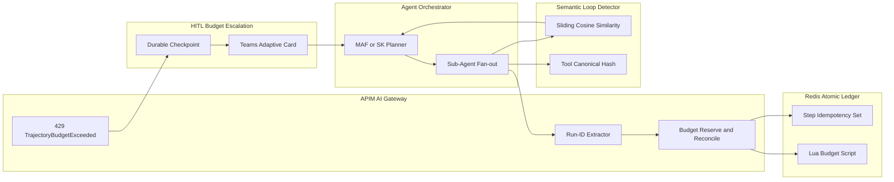
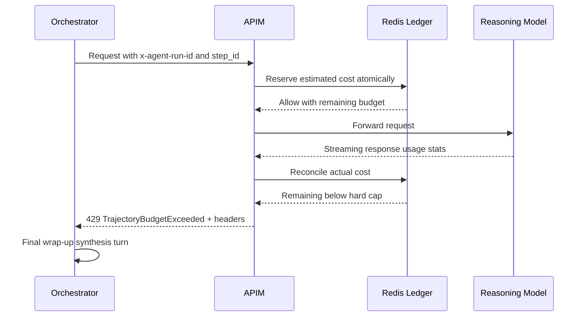

# 企业 Agent 轨迹预算与失控环路治理选型 FAQ：APIM+Redis 预算熔断 vs 语义零进展检测 vs reasoning_effort 自适应 vs 暂停补预算 Saga
> 🌐 **Language Switch**: **中文（当前）** | [English](agentic-trajectory-budget-runaway-loop-circuit-breaker-apim-redis-vs-reasoning-effort-selection-faq.en.md)  
> 适用对象：企业 Cloud & AI Solution Architect、平台治理委员会、LLMOps/SRE、FinOps、AI 安全与合规团队。  
> 核心问题：在多智能体 ReAct/A2A 任务中，如何阻断“低 RPM/TPM 但高成本失控”的轨迹级烧钱环路，并保留可恢复的部分成果。  
> 范围边界：本文聚焦轨迹级成本治理，不讨论租户级限流配额基线（与 #24/#25/#160 互补）。  
## 1. 执行摘要：失控成本不是流量问题，而是轨迹治理缺位
很多团队误以为控制了 TPM 就控制了成本。  
真实生产里，失控成本常来自长链路任务。  
单个 run 未触发租户限流，但会在 `40–80` 步内隐性烧掉 `$20–$80`。  
这类损耗来自重复推理、循环重试、无进展工具调用。  
如果平台只看请求级指标，就会低估风险。  
因此治理单位应从“请求”升级为“轨迹”。  
轨迹应具备统一身份。  
推荐以 `x-agent-run-id` 作为跨子代理与网关的账本键。  
统一账本后才能做跨调用累积预算。  
仅有预算还不够。  
还需要识别语义层面的零进展。  
还需要在命中预算时做优雅收尾。  
还需要给合法深任务提供可审计补预算通道。  
本指南给出四平面。  
平面 A：APIM + Redis 轨迹原子账本与硬上限熔断。  
平面 B：编排层语义环路与零进展检测。  
平面 C：`reasoning_effort` 与输出上限按步分配。  
平面 D：软上限暂停与 HITL 补预算 Saga。  
四平面联动后，平台可把 P99 单轨迹成本显著压缩。  
同时避免把真实高价值研究任务误杀。  
## 2. 问题建模：从请求计费转向轨迹生命周期计费
单请求计费模型适合简单问答。  
它不适合多代理协作。  
多代理任务会跨多个模型和工具。  
其中包含缓存命中与未命中的混合成本。  
其中还包含不可见 reasoning token。  
如果只看 completion token，会系统性低估。  
轨迹治理应覆盖四种成本桶。  
桶一：prompt 输入。  
桶二：cached prompt 折后输入。  
桶三：reasoning 隐性消耗。  
桶四：completion 输出。  
建议账本字段最少包含如下键。  
`run_id`、`tenant_id`、`step_id`、`agent_id`。  
`reserved_usd`、`settled_usd`、`remaining_usd`。  
`reasoning_tokens`、`cached_prompt_tokens`、`completion_tokens`。  
`loop_score`、`progress_score`、`breaker_state`。  
没有这些字段，后续归因会断裂。  
审计与优化都会失真。  
## 3. 四路径架构比较：谁负责发现，谁负责止损，谁负责收尾
路径 A 负责算清并及时刹车。  
路径 B 负责在“还没超预算前”识别无效循环。  
路径 C 负责降低每一步的推理燃烧率。  
路径 D 负责保留价值并引入人工审批。  
A 是财务硬边界。  
B 是语义行为边界。  
C 是推理配置边界。  
D 是流程治理边界。  
只做 A 会造成“硬切断但用户体验差”。  
只做 B 会导致“检测到但没预算约束”。  
只做 C 会导致“单步省钱但总步数失控”。  
只做 D 会导致“审批流程沦为救火”。  
四者缺一，都会形成治理盲区。  
正确顺序通常是 A+B 先落地。  
再用 C 做成本优化。  
最后引入 D 做高价值任务升级路径。  
## 4. 12 维选型矩阵（轨迹治理评审模板）
| 维度 | A 网关账本熔断 | B 语义环路检测 | C 推理强度自适应 | D 软上限补预算 Saga |
|---|---|---|---|---|
| 失控成本拦截即时性 | 极高 | 高 | 中 | 中 |
| 误杀率可控性 | 中 | 中高 | 高 | 高 |
| 跨代理一致性 | 高 | 中高 | 中 | 高 |
| 可审计性 | 极高 | 高 | 中高 | 高 |
| 实施复杂度 | 中 | 中高 | 中 | 中高 |
| 对模型无关性 | 高 | 高 | 中 | 高 |
| 对用户体验影响 | 中 | 中高 | 高 | 中高 |
| 隐性 reasoning 降幅 | 中 | 中 | 极高 | 低 |
| 部分成果保留能力 | 低 | 中 | 低 | 极高 |
| 与现有限流兼容性 | 高 | 高 | 高 | 高 |
| 运维观测成本 | 中 | 中高 | 中 | 中高 |
| 三年 TCO 收敛潜力 | 高 | 高 | 高 | 高 |
矩阵使用要点是先定义失败代价。  
若监管要求强审计，A 与 D 权重上升。  
若追求在线交互体验，B 与 C 权重上升。  
若团队成熟度有限，先做 A 再做 C。  
若已有强编排框架，可同步推进 B。  
## 5. 路径 A：APIM+Redis 原子轨迹账本与预算熔断
路径 A 在网关层累计每次调用成本。  
账本键为 `x-agent-run-id`。  
每次请求先做预留再放行。  
响应结束后做结算回写。  
若剩余额度不足，返回结构化 `429 TrajectoryBudgetExceeded`。  
响应头应包含剩余额度与建议动作。  
如 `x-trajectory-budget-remaining-usd`。  
如 `x-trajectory-breaker-state=hard-stop`。  
这种设计可覆盖分布式子代理树。  
即便子代理落在不同工作节点，预算仍一致。  
关键点是原子性。  
推荐 Redis Lua 保证扣减与校验同事务。  
关键点也是幂等性。  
`step_id` 重放不得重复扣费。  
关键点还是时序。  
SSE 流式输出需分阶段 reconcile。  
否则会出现预留高估或低估。  
A 路径是成本刹车踏板。  
不应被下沉到业务代码层。  
## 6. 路径 B：语义零进展检测与死循环提前终止
路径 B 解决“没超预算但明显无进展”。  
检测对象有三类。  
第一类是代理 ping-pong。  
如 `A -> B -> A` 在三轮内重复。  
第二类是相同工具错误重试。  
第三类是观察文本语义熵不变。  
技术实现可用双信号。  
信号一是工具调用 canonical hash。  
信号二是滑窗向量相似度。  
当 hash 重复且相似度高于阈值，可判定零进展。  
判定后不直接硬停。  
先注入纠偏提示。  
若连续两次仍无改善，再触发终止。  
这样可降低误报。  
B 路径常把无效步数从几十步降到个位数。  
也显著提升用户“系统在思考而非兜圈”的信任感。  
## 7. 路径 C：reasoning_effort 与 max_completion_tokens 分步预算
路径 C 面向隐性推理开销。  
许多步骤并不需要高推理深度。  
例如 JSON 格式化或工具路由。  
若仍给 `high` effort，会浪费大量 reasoning token。  
推荐按步骤复杂度梯度分配。  
默认 `low`。  
触发验证失败后升至 `medium`。  
仅在关键决策步升到 `high`。  
并同步调低 `max_completion_tokens` 上限。  
路径 C 需要验证器信号。  
如 schema 验证失败计数。  
如事实一致性检验分数。  
如工具结果置信度。  
没有验证器，动态升降将失去依据。  
实践中 C 路径可带来 `55%–78%` reasoning 费用下降。  
且不会显著牺牲任务成功率。  
## 8. 路径 D：软上限暂停与 HITL 补预算 Saga
路径 D 面向合法深任务。  
例如并购尽调与代码迁移审计。  
这些任务确实可能超过初始预算。  
若直接硬停，前序成果浪费。  
因此先设置软上限。  
命中软上限后，流程进入暂停态。  
中间产物写入 Durable checkpoint。  
系统向审批人发送 Teams Adaptive Card。  
审批人可选择补预算档位。  
如 `$1 -> $5 -> $25`。  
审批通过后恢复执行。  
审批拒绝则触发优雅收尾摘要。  
D 路径把“失败退出”改为“受控升级”。  
也让资金责任链条清晰可审计。  
## 9. 参考架构图：轨迹预算控制平面

该图体现预算、检测、审批三控制环。  
三环都应可观测且可回放。  
## 10. 时序图：预留、结算、熔断与优雅收尾

关键是预留与结算都在同一 run 账本。  
这样跨节点执行也不会出现预算漂移。  
## 11. 定量问答（轨迹成本与误报治理）
**Q1：`N=40` 回合 ReAct 时，为何成本可能接近 `O(N^2)`？**  
A1：每回合都会携带历史上下文。  
第 `k` 轮输入近似与 `k` 成正比。  
总输入规模约为 `1+2+...+N`。  
即 `N(N+1)/2`。  
所以在长回合任务里，输入成本会加速上升。  
**Q2：SSE 流式场景为什么要预留再结算？**  
A2：若只在结束后扣费，超预算发现过晚。  
若只做预留不结算，会长期高估成本。  
正确方式是先按估算预留，再按 usage 回写结算。  
**Q3：优雅收尾为何也要预留预算？**  
A3：命中硬上限后若无“最后一轮摘要预算”，用户只收到错误码。  
建议单独保留 `5%–10%` run 预算用于收尾。  
这样可返回部分答案与下一步建议。  
**Q4：hash 检测与语义检测的误报差异是什么？**  
A4：hash 检测对完全重复敏感，误报低但漏报高。  
语义检测召回高但阈值不当会误报。  
生产中应两者组合并设置双阈值门。  
**Q5：`reasoning_effort` 梯度策略的收益如何估算？**  
A5：若 `70%` 步骤由 `high` 降到 `low`。  
且这些步骤原本占 reasoning 成本的 `60%`。  
理论总体节省可达 `36%` 以上。  
叠加 token 上限压缩后常见总节省超过 `55%`。  
**Q6：为何租户级 TPM 健康仍会出现 run 级爆费？**  
A6：TPM 约束是速率控制，不是总额控制。  
慢速长链路同样可累积高总成本。  
所以必须引入 run 级总额预算。  
**Q7：软上限审批如何避免拖慢正常任务？**  
A7：只对高风险任务开启软上限。  
普通任务直接硬上限终止。  
审批路径应按任务标签动态启用。  
**Q8：P99 成本压缩目标如何设定更现实？**  
A8：先以 4 周历史分布定义基线。  
首阶段目标可设为 P99 降 `35%`。  
第二阶段再冲击 `50%+`。  
避免一次性激进阈值造成误杀。  
## 12. 生产代码示例：Redis Lua 原子预算账本
```lua
-- KEYS[1] = run ledger hash key
-- KEYS[2] = step idempotency set key
-- ARGV[1] = step_id
-- ARGV[2] = reserve_usd
-- ARGV[3] = hard_cap_usd
-- ARGV[4] = ttl_seconds
local step_id = ARGV[1]
local reserve = tonumber(ARGV[2])
local hard_cap = tonumber(ARGV[3])
local ttl = tonumber(ARGV[4])

if redis.call('SISMEMBER', KEYS[2], step_id) == 1 then
  local spent = tonumber(redis.call('HGET', KEYS[1], 'spent_usd') or '0')
  local remaining = hard_cap - spent
  return {1, spent, remaining, 'idempotent-replay'}
end

local spent = tonumber(redis.call('HGET', KEYS[1], 'spent_usd') or '0')
local projected = spent + reserve
if projected > hard_cap then
  local remaining = hard_cap - spent
  return {0, spent, remaining, 'hard-cap-hit'}
end

redis.call('SADD', KEYS[2], step_id)
redis.call('HSET', KEYS[1], 'spent_usd', projected)
redis.call('EXPIRE', KEYS[1], ttl)
redis.call('EXPIRE', KEYS[2], ttl)
local remaining = hard_cap - projected
return {1, projected, remaining, 'reserved'}
```
这个脚本实现三件事。  
幂等重放识别。  
原子预算预留。  
硬上限前置拦截。  
## 13. 生产代码示例：语义环路检测与优雅收尾中间件
```python
from dataclasses import dataclass
from collections import deque
import hashlib
from typing import Deque

@dataclass
class StepSignal:
    tool_hash: str
    cosine_similarity: float
    progress_score: float

class TrajectoryGuard:
    def __init__(self, max_window: int = 3):
        self.window: Deque[StepSignal] = deque(maxlen=max_window)

    def canonical_tool_hash(self, tool_name: str, args_json: str) -> str:
        raw = f"{tool_name}|{args_json}".encode("utf-8")
        return hashlib.sha256(raw).hexdigest()

    def should_break(self, signal: StepSignal) -> bool:
        self.window.append(signal)
        if len(self.window) < 3:
            return False
        same_hash = len({s.tool_hash for s in self.window}) == 1
        high_similarity = all(s.cosine_similarity > 0.95 for s in self.window)
        low_progress = all(s.progress_score < 0.1 for s in self.window)
        return same_hash and high_similarity and low_progress

def graceful_wrap_up(run_id: str, partial_artifacts: list[str]) -> dict:
    return {
        "run_id": run_id,
        "status": "budget_or_loop_stopped",
        "summary": "Trajectory stopped safely with partial results.",
        "artifacts": partial_artifacts[:8],
        "next_action": "request_budget_topup_or_refine_scope"
    }
```
该中间件应与账本信号联合使用。  
避免出现“检测到但无法执法”的空洞。  
## 14. 企业案例与 FinOps ROI：把 P99 成本拉回可经营区间
### 场景 A：自治 Coding & PR 修复集群（月度 `$38K` 失控重试）
某工程组织把单测修复委托给多代理链路。  
测试偶发波动触发重复重试。  
平均每次失败 run 会拉长到 `60` 回合。  
虽然 TPM 未越界，但月度多出约 `$38K`。  
引入 A+B+C 后，P99 成本从 `$14.2/run` 降到 `$5.1/run`。  
无效回合中位数由 `17` 降到 `4`。  
开发者收到的失败回执也更可解释。  
### 场景 B：全球并购尽调研究平台（分级 `$1/$5/$25` 预算）
该平台任务跨度大，深任务占比约 `12%`。  
过去统一硬上限导致高价值任务经常中断。  
引入 D 路径后，先在 `$5` 软上限暂停。  
审批通过可提升到 `$25`。  
未通过则输出部分结论与证据链接。  
最终高价值任务完成率提升，且审计链条完整。  
### ROI 与尾部成本压缩示例
| 指标 | 治理前 | 治理后（A+B+C+D） | 改善幅度 |
|---|---:|---:|---:|
| P99 成本/轨迹 | \$18.6 | \$7.9 | -57.5% |
| 平均无效步数 | 13.4 | 3.8 | -71.6% |
| 超预算硬停且无摘要占比 | 22% | 3% | -19pp |
| reasoning 成本占比 | 48% | 21% | -27pp |
| 人工升级审批通过后完成率 | 41% | 78% | +37pp |
| 月度额外浪费成本 | \$96K | \$37K | -61.5% |
这些数字用于架构评审示意。  
落地时应使用企业自有账单与埋点重算。  
## 15. Day-0 / Day-2 十二项治理清单
1. 统一 `x-agent-run-id` 生成与透传规范。  
2. 在 APIM 策略中强制缺失 run-id 请求降级或拒绝。  
3. 建立 Redis 账本 TTL 与清理策略，避免长尾键膨胀。  
4. 设定预留估算模型并每周校准误差。  
5. 为 `429 TrajectoryBudgetExceeded` 定义统一响应契约。  
6. 在编排层接入 hash+语义双检测并记录证据。  
7. 引入分步 `reasoning_effort` 策略和验证器门禁。  
8. 为收尾摘要预留独立预算池并验证可用性。  
9. 为软上限任务建立审批人路由与 SLA。  
10. 将 checkpoint 与审批记录绑定同一 run 审计链。  
11. 每周复盘 P95/P99 成本、误杀率、完成率三指标。  
12. 每季度重算预算档位并回归测试阈值稳定性。  
治理目标不是让模型“少想”。  
而是让每一单位思考成本都可解释、可控、可审计。  
