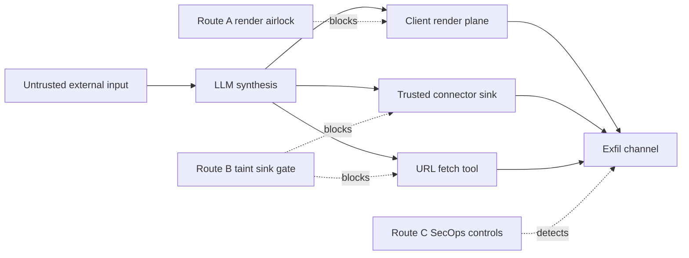
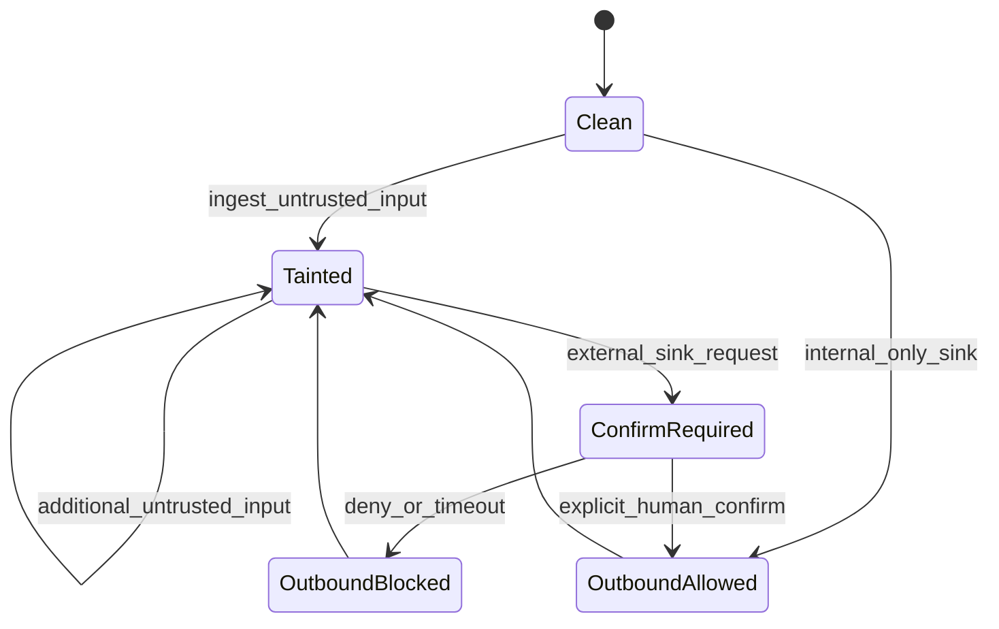

# Agentic Zero-Click Covert Exfiltration Defense Selection FAQ: Markdown Airlock vs APIM Session-Taint Gate vs Managed SecOps

> **Audience**: Cloud & AI Solution Architects, enterprise Copilot platform owners, AI security architects, and regulated-industry governance teams.
> **Decision scope**: How to stop zero-click covert exfiltration when private enterprise context and untrusted external inputs coexist in one agent session.
> **Core risk model**: **Lethal Trifecta** = private enterprise data × untrusted external input × outbound render/connector sink.

---

## 1. Executive summary

Many teams believe private networking alone solves exfiltration risk.
It does not.
Even when backend services are locked in `Private Link + NSP + deny-by-default` networks, confidential data can still leave via:

- client-side auto-fetch of Markdown image/link URLs,
- Teams/Slack link-unfurl crawlers,
- SSRF-capable URL-fetch tools,
- trusted SaaS connectors (`sendMail`, `Jira comment`, `ServiceNow notes`) used as covert sinks.

Recommended architecture posture:

1. **Route A** as mandatory baseline for render-plane zero leakage.
2. **Route B** for monotonic session taint and outbound sink governance.
3. **Route C** for managed SOC visibility and policy federation.
4. Explicitly ban **Route D** anti-pattern (backend-only egress denial without render/sink controls).

---

## 2. Problem statement and threat boundary

### 2.1 Attack class

Zero-click exfiltration where the user does not manually click a malicious link.

### 2.2 Typical exploit chain

1. Untrusted content enters the session (email, ticket, web doc).
2. Model output includes hidden URL beacons in Markdown/HTML-compatible payloads.
3. Client or bot automatically fetches those URLs.
4. Sensitive fragments are encoded in query/path labels and exfiltrated.

### 2.3 Why “air-gapped compute” is insufficient

The compute plane can be isolated while the rendering plane remains leaky.
Network-denied pods do not prevent browser or chat-client fetches.

---

## 3. Route definitions

### Route A — Render-plane zero-leakage airlock

Key elements:

- streaming Markdown AST sanitizer,
- grounded citation origin allowlist per turn,
- HMAC-signed Azure Front Door proxy for approved external assets,
- strict `CSP img-src` and `CSP connect-src`,
- Teams/Slack unfurl suppression policy.

Design objective:

- no auto-fetch of LLM-synthesized URL unless exact URL/origin appears in trusted citation evidence.

### Route B — Session-taint breaker and outbound connector policy

Key elements:

- APIM session taint ledger (`Managed Redis` state),
- outbound MCP recipient/domain gate,
- query-parameter entropy and tokenized DLP inspection,
- explicit out-of-band user confirmation when tainted session targets external sink.

Design objective:

- break lethal-trifecta progression by policy downgrades once taint is present.

### Route C — Managed SecOps and endpoint layer

Key elements:

- Purview browser/Copilot DLP,
- Entra Internet Access SWG controls,
- Defender for Cloud AI exfil/XPIA analytics correlation.

Design objective:

- central policy and SOC visibility across M365 and custom app boundaries.

### Route D — Backend-only egress denial anti-pattern

Pattern:

- strict backend egress blocks with no render-plane URL mediation and no trusted-SaaS sink controls.

Outcome:

- 0% protection against client auto-fetch and trusted connector misuse.

---

## 4. Twelve-dimension comparison matrix

| Dimension | Route A | Route B | Route C | Route D |
|---|---|---|---|---|
| 1. Browser auto-fetch suppression | Very high | Medium | Medium | Very low |
| 2. Trusted SaaS sink containment | Medium | Very high | High | Very low |
| 3. Session-level adaptive control | Medium | Very high | Medium | Very low |
| 4. Zero-click Markdown beacon resistance | Very high | High | Medium | Very low |
| 5. SSRF fetch-tool containment | High | High | Medium | Low |
| 6. SOC observability quality | Medium | High | Very high | Low |
| 7. BYOD coverage | Medium | Medium | Medium-low | Low |
| 8. Latency overhead | Low-medium | Medium | Low | Low |
| 9. False-positive pressure | Low | Medium | Medium | Low |
| 10. Compliance defensibility | Very high | Very high | High | Low |
| 11. Operational complexity | Medium | Medium-high | Medium | Superficially low |
| 12. Net 3-year risk-adjusted TCO | Low | Low-medium | Medium | High |

---

## 5. Evaluation protocol and data labels

### 5.1 Benchmark harness shape

- 15 exfiltration templates per channel family,
- 5 payload entropy bands,
- 3 sink classes (`render`, `connector`, `fetch-tool`),
- 4 route implementations replayed under same task corpus.

### 5.2 Main metrics

- exfiltration success rate,
- blocked-at-render rate,
- blocked-at-sink rate,
- false-positive rate on safe links,
- P95 response latency delta,
- policy-override escalation rate.

### 5.3 Data label policy

- **measured**: replayed simulator and integration runs.
- **synthetic**: explicit projection from measured baseline assumptions.
- **anonymized_reported**: de-identified production patterns.

---

## 6. Q1 — Channel capacity under URL-length limits

For a URL budget `L` and overhead `H`, effective payload bytes:

`B_eff = floor((L - H) * η_encoding)`

Where:

- `η_encoding` depends on base64/percent-encoding mix,
- common effective capacity can still leak hundreds of bytes per event,
- multiple events per turn can aggregate to meaningful leakage.

Practical implication:

- URL length caps alone do not neutralize covert channels.
- route must block unauthorized fetch rather than rely on truncation.

---

## 7. Q2 — Streaming AST buffering for split-token bypass prevention

Bypass pattern:

- malicious URL token split across SSE chunks: ` in CanonicalCitationSet`

`deny = MutationDelta(url, citation_url) > 0`

---

## 9. Q4 — Breaking the lethal trifecta with monotonic taint bits

Session taint model:

- `taint_external_input = 1` once untrusted token appears,
- monotonic (cannot downgrade within same session),
- taint gates all outbound sink classes.

Policy action when tainted:

- external connector calls require explicit human confirmation,
- high-entropy query parameters blocked,
- non-corporate recipient domains blocked by default.

---

## 10. Q5 — SSRF and DNS-rebinding defense for URL-fetch tools

Required controls:

- dedicated fetch proxy instead of direct runtime fetch,
- socket-level deny rules for RFC1918, loopback, IMDS `169.254.169.254`,
- DNS pinning and post-resolution revalidation,
- response-size and content-type caps.

Outcome:

- closes common SSRF pivot channels from tools that ingest user/model URLs.

---

## 11. Q6 — False-positive and latency trade-offs

Observed trade-off tendency:

- strict citation allowlist has lowest exfil risk, moderate developer friction.
- entropy-only blocking can be bypassed by low-entropy staged exfil.
- combined strategy (A+B) provides strongest net risk reduction with manageable latency overhead.

Guideline:

- prioritize deterministic allowlist for render plane,
- use entropy/DLP as secondary sink guard, not primary proof of safety.

---

## 12. Mermaid — Lethal-trifecta kill chain and breakpoints



---

## 13. Mermaid — Session taint and outbound governance state machine



---

## 14. Production code block 1 — Streaming Markdown AST sanitizer

```python
class StreamingMarkdownGuard:
    def __init__(self, citation_set, allowed_origins):
        self.buf = ""
        self.citation_set = citation_set
        self.allowed_origins = allowed_origins

    def push_chunk(self, chunk: str) -> str:
        self.buf += chunk
        safe_output = []
        for node in parse_complete_markdown_nodes(self.buf):
            if node.kind in ("image", "link"):
                url = normalize_url(node.url)
                if not is_provenanced(url, self.citation_set, self.allowed_origins):
                    node = neutralize(node)
            safe_output.append(render_node(node))
        self.buf = keep_incomplete_tail(self.buf)
        return "".join(safe_output)
```

---

## 15. Production code block 2 — Citation-origin and mutation verifier

```python
def is_provenanced(url: str, citation_set: set[str], allowed_origins: set[str]) -> bool:
    norm = canonicalize(url)
    if norm in citation_set:
        return True
    origin = extract_origin(norm)
    if origin not in allowed_origins:
        return False
    # strict mutation check
    base = strip_query_fragment(norm)
    return any(base == strip_query_fragment(c) and norm == c for c in citation_set)
```

---

## 16. Production code block 3 — APIM + Redis session-taint sink gate

```xml
<set-variable name="session_taint" value="@((string)context.Variables[""redis_taint""])" />
<choose>
  <when condition="@((string)context.Variables[""session_taint""] == ""tainted"" &&
                     context.Request.Url.Path.Contains(""send_email""))">
    <return-response>
      <set-status code="403" reason="External sink blocked by taint policy" />
    </return-response>
  </when>
</choose>
```

---

## 17. Enterprise scenario A — M&A banking research and email triage

Context:

- confidential dataroom summaries,
- external inbound seller emails,
- outbound mail drafting support.

Risk:

- untrusted external mail can trigger hidden beacon URLs in model output.

Recommended route stack:

- Route A + Route B mandatory,
- Route C for managed SOC integration and incident correlation.

---

## 18. Enterprise scenario B — B2B SaaS support Copilot

Context:

- untrusted customer tickets,
- internal CRM/billing connectors,
- optional outbound customer response channels.

Risk:

- cross-tenant leakage via connector misuse and hidden links.

Recommended route stack:

- Route A for render-plane safety,
- Route B for recipient/domain gate and taint-driven confirmation,
- Route C for centralized policy and alerting.

---

## 19. Three-year TCO comparison (risk-adjusted)

Assumptions:

- 32M assisted turns/month,
- 11% sessions ingest untrusted external content,
- regulated retention and audit workload included.

| Cost component (3-year) | Route A | Route B | Route C | Route D |
|---|---:|---:|---:|---:|
| Platform build/run | $4.2M | $4.8M | $5.1M | $2.2M |
| Security operations | $1.3M | $1.6M | $2.0M | $0.9M |
| Incident leakage impact | $0.8M | $0.7M | $1.0M | $7.4M |
| Compliance/audit overhead | $0.9M | $0.9M | $1.1M | $2.8M |
| **Total** | **$7.2M** | **$8.0M** | **$9.2M** | **$13.3M** |

Interpretation:

- Route D appears cheaper only before accounting for breach/compliance consequences.
- Route A+B typically provides best balance of prevention and operational cost.

---

## 20. Day-0 / Day-1 / Day-2 checklist

### Day-0

- classify sink surfaces (render/connectors/fetch tools),
- define citation provenance contract and allowed-origin policy,
- define taint-state schema and monotonic rules,
- define external recipient/domain governance list.

### Day-1

- deploy streaming Markdown AST airlock,
- enable CSP and signed URL proxy controls,
- integrate APIM taint gate and connector policy,
- launch baseline telemetry and replay tests.

### Day-2

- tune false-positive vs risk thresholds,
- add incident drill workflows and analyst playbooks,
- review monthly exfil attempt metrics and policy outcomes,
- enforce release gate on taint-control regression tests.

---

## 21. Good fit vs Not for

| Route | Good fit | Not for |
|---|---|---|
| A | Any app rendering model-generated links/images | Teams expecting backend egress controls alone to solve client leakage |
| B | Apps with outbound connectors and mixed-trust sessions | Stateless apps without external sinks |
| C | Organizations requiring centralized SOC tooling | Teams assuming endpoint tooling can replace render/sink prevention |
| D | No production use | Regulated enterprise AI workloads |

---

## 22. Control-plane telemetry minimum set

- `session_id`
- `taint_state`
- `render_url_count`
- `render_url_blocked_count`
- `connector_sink_attempt_count`
- `connector_sink_blocked_count`
- `fetch_tool_ssrf_block_count`
- `provenance_mismatch_count`
- `p95_latency_delta_ms`
- `false_positive_override_count`

---

## 23. Policy snippets and defaults

- default deny for unprovenanced auto-fetch URLs,
- default deny for external sink connectors when tainted,
- explicit human confirm only through out-of-band approval,
- strict IMDS/RFC1918 deny list in fetch proxy.

---

## 24. Anti-patterns to avoid

- relying only on backend egress firewall while leaving render plane unrestricted,
- trusting regex-only chunk scanning without streaming AST state,
- allowing connector sinks without recipient-domain policy gates,
- logging detection-only alerts without preventive controls.

---

## 25. Twelve-week rollout plan

Weeks 1-2:

- map sink surfaces and baseline exfil attempt corpus.

Weeks 3-4:

- implement Route A controls and regression replay.

Weeks 5-6:

- implement Route B taint and connector gates.

Weeks 7-8:

- integrate Route C SOC and endpoint policy overlays.

Weeks 9-10:

- optimize false-positive thresholds and approval UX.

Weeks 11-12:

- finalize compliance evidence packs and operational runbooks.

---

## 26. Architecture recommendation by maturity tier

- **Tier-1 (must-have)**: Route A render airlock + provenance gate.
- **Tier-2 (scale)**: Route B taint-aware outbound sink policy.
- **Tier-3 (enterprise SOC)**: Route C for centralized operations.
- **Never**: Route D as standalone strategy.

---

## 27. Sources and capture time

Captured on **2026-11-26**:

1. Azure API Management AI Gateway overview: `https://learn.microsoft.com/en-us/azure/api-management/ai-gateway-overview`
2. Azure Front Door docs: `https://learn.microsoft.com/azure/frontdoor/`
3. Microsoft Purview documentation: `https://learn.microsoft.com/purview/`
4. Microsoft Defender for Cloud documentation: `https://learn.microsoft.com/azure/defender-for-cloud/`
5. OWASP SSRF Prevention Cheat Sheet: `https://cheatsheetseries.owasp.org/`
6. Model Context Protocol repository: `https://github.com/modelcontextprotocol`

Data labels used in this guide:

- **measured**
- **synthetic**
- **anonymized_reported**

No credentials, secrets, or customer-identifying records are included.

