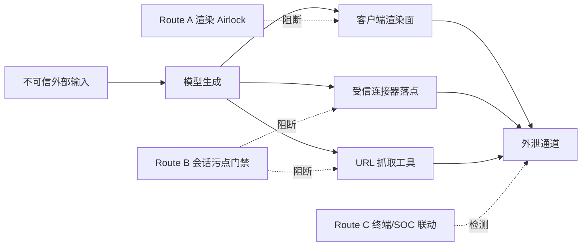
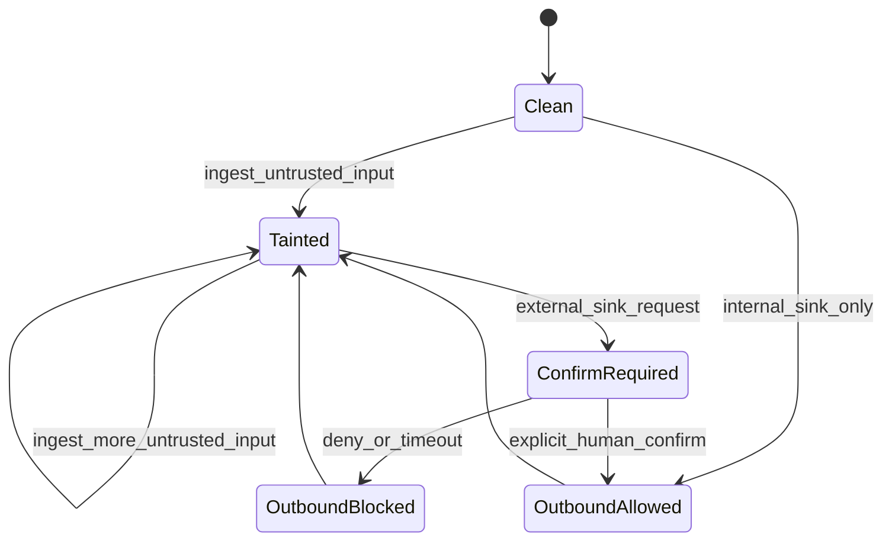

# Agentic 零点击隐蔽外泄防护选型 FAQ：Markdown Airlock vs APIM 会话污点门禁 vs 托管 SecOps

> **面向对象**：Cloud & AI Solution Architect、企业 Copilot 平台负责人、AI 安全与合规架构团队。
> **决策范围**：如何在“私有企业数据 + 不可信外部输入 + 出站渲染/连接器”同会话共存时，阻断零点击隐蔽外泄。
> **核心风险模型**：**Lethal Trifecta** = 私有企业数据 × 不可信外部输入 × 出站渲染或连接器落点。

---

## 1. 执行摘要

很多团队误以为“后端进私网 + 出站阻断”就足够安全。
这在 Agent 场景中并不成立。
即使后端已做到 `Private Link + NSP + 默认拒绝`，敏感信息仍可通过以下路径被动外泄：

- 客户端渲染 Markdown 图片/链接时的自动抓取，
- Teams/Slack 的链接预览爬虫（unfurl bot），
- URL 抓取型工具的 SSRF 跳转，
- 受信 SaaS 连接器（如 `sendMail`、Jira/ServiceNow 评论）被滥用为外送通道。

推荐基线：

1. **Route A** 必须落地，先把渲染面自动抓取风险清零。
2. **Route B** 实现会话污点单调状态与出站连接器门禁。
3. **Route C** 提供托管化终端与 SOC 联动可观测。
4. 明确禁用 **Route D** 反模式（只管后端，不管渲染与受信落点）。

---

## 2. 问题边界与威胁定义

### 2.1 攻击类别

零点击外泄：用户无须手工点击链接，客户端/机器人自动请求即可泄漏。

### 2.2 典型攻击链

1. 会话读入不可信内容（外部邮件、工单、网页文档）。
2. 模型输出中嵌入隐蔽 URL beacon。
3. 浏览器或聊天客户端自动请求该 URL。
4. 查询串、路径片段、DNS 标签中携带敏感片段外送。

### 2.3 “算力隔离不等于外泄防护”

计算平面可完全隔离，但渲染平面仍可能泄漏。
后端 Pod 无外网，不代表用户浏览器不会自动外联。

---

## 3. 四条路线定义

### Route A — 渲染面零泄漏 Airlock

组件：

- 流式 Markdown AST 清洗器，
- 基于 citation 的来源白名单，
- Azure Front Door HMAC 签名图片/链接代理，
- 严格 `CSP img-src` 与 `CSP connect-src`，
- Teams/Slack unfurl 抑制策略。

目标：

- 非可信引用来源的 URL 不得被客户端自动抓取。

### Route B — 会话污点状态机与受信连接器出站策略

组件：

- APIM 会话污点账本（`Managed Redis`），
- MCP 出站收件人/租户边界校验，
- Query 参数熵检测 + tokenized DLP 检查，
- tainted 会话对外落点工具触发强制确认。

目标：

- 一旦会话引入不可信输入，即主动打断 lethal trifecta 的第三步。

### Route C — 托管 SecOps 与终端层治理

组件：

- Purview 浏览器/Copilot DLP，
- Entra Internet Access SWG，
- Defender for Cloud AI 的 XPIA/外泄关联检测。

目标：

- 统一管控策略、终端访问与 SOC 告警关联。

### Route D — 仅后端出站阻断（反模式）

做法：

- 只做后端 NSP/防火墙出站拒绝，不治理渲染面和受信 SaaS 落点。

结果：

- 对客户端自动抓取与连接器外送几乎无防护价值。

---

## 4. 12 维度对比矩阵

| 维度 | Route A | Route B | Route C | Route D |
|---|---|---|---|---|
| 1. 浏览器自动抓取抑制 | 很高 | 中 | 中 | 很低 |
| 2. 受信连接器外送约束 | 中 | 很高 | 高 | 很低 |
| 3. 会话级动态防护 | 中 | 很高 | 中 | 很低 |
| 4. Markdown 零点击 Beacon 抵抗 | 很高 | 高 | 中 | 很低 |
| 5. SSRF 工具链抑制 | 高 | 高 | 中 | 低 |
| 6. SOC 可观测与关联 | 中 | 高 | 很高 | 低 |
| 7. BYOD 覆盖 | 中 | 中 | 中偏低 | 低 |
| 8. 时延开销 | 低-中 | 中 | 低 | 低 |
| 9. 误报压力 | 低 | 中 | 中 | 低 |
| 10. 合规可辩护性 | 很高 | 很高 | 高 | 低 |
| 11. 运维复杂度 | 中 | 中偏高 | 中 | 表面低 |
| 12. 三年风险调整 TCO | 低 | 低-中 | 中 | 高 |

---

## 5. 评测方法与数据标签

### 5.1 基准设计

- 每类通道 15 套外泄模板，
- 5 档参数熵分布，
- 3 类落点（`render`、`connector`、`fetch-tool`），
- 四条路线统一语料回放。

### 5.2 主指标

- 外泄成功率，
- 渲染面拦截率，
- 落点面拦截率，
- 安全链接误拦截率，
- P95 时延增量，
- 强制确认触发率。

### 5.3 数据标签

- **measured**：回放与联调实测数据。
- **synthetic**：由实测基线与明确假设推导。
- **anonymized_reported**：脱敏生产行为模式。

---

## 6. Q1：URL 长度限制下的外泄通道容量

设：

- `L` 为 URL 总长度上限，
- `H` 为固定开销（域名、路径、签名等），
- `η` 为编码效率。

有效泄露字节：

`B_eff = floor((L - H) * η)`

结论：

- 即便 URL 限制在 2,048 字符，也可能在多次请求中泄露可用敏感片段；
- 不能依赖“长度限制”作为主要安全策略，必须阻断未证实来源的自动抓取。

---

## 7. Q2：流式分块下 AST 缓冲为何必要

绕过手法：

- 将 `` 拆分到多个 SSE chunk，中间态规避 chunk 级正则。

防护要点：

1. 会话级保留解析上下文，
2. 完整节点重建后再进行 URL 判定，
3. 仅在 provenance 校验通过后释放可渲染节点，
4. 未通过则 neutralize。

结论：

- 仅按 chunk 正则扫描不可靠；
- 必须采用带状态的流式 AST 门禁。

---

## 8. Q3：Grounded-Citation URL Provenance 规则如何定义

建议规则：

- 自动抓取仅允许“本轮可信引用集中出现的 URL（或严格 canonical 等价）”；
- 若模型对 query/fragment 做了任何变异，则拒绝自动抓取。

形式化：

`allow = url in ExactCitationSet OR Canonical(url) in CanonicalCitationSet`

`deny = MutationDelta(url, citation_url) > 0`

---

## 9. Q4：如何用单调污点状态打断 Lethal Trifecta

污点位设计：

- `taint_external_input = 1` 一旦置位即单调保持，
- 同会话不可自动回退为 clean。

污点后策略：

- 对外连接器调用进入强制确认流程，
- 高熵参数 URL 默认阻断，
- 非企业白名单收件域拒绝。

结果：

- 在会话层面切断“私有数据 + 不可信输入 + 对外落点”联动。

---

## 10. Q5：URL 抓取型 MCP 工具如何防 SSRF / DNS 重绑定

必选控制：

- 所有 URL 抓取经专用 egress proxy，
- 套接字级拒绝 RFC1918、loopback、IMDS `169.254.169.254`，
- 解析后回连前再校验（anti-rebind），
- 响应大小与 MIME 白名单限制。

收益：

- 降低“工具代抓取”成为内网跳板或元数据窃取通道的风险。

---

## 11. Q6：CSP+Citation 与熵拦截的误报/时延权衡

实务观察：

- 单纯熵拦截容易被低熵分片外送规避；
- 单纯检测告警无法阻止首次泄露；
- Route A（证明型 allowlist）+ Route B（落点策略）组合通常是风险收益比最优。

建议：

- 渲染面以“证明型放行”作为主防线；
- 熵与 DLP 作为辅助防线而非唯一判定。

---

## 12. Mermaid：Lethal Trifecta 攻击链与拦截点



---

## 13. Mermaid：会话污点状态机



---

## 14. 生产代码块 1：流式 Markdown AST 清洗器

```python
class StreamingMarkdownGuard:
    def __init__(self, citation_set, allowed_origins):
        self.buf = ""
        self.citation_set = citation_set
        self.allowed_origins = allowed_origins

    def push_chunk(self, chunk: str) -> str:
        self.buf += chunk
        out = []
        for node in parse_complete_markdown_nodes(self.buf):
            if node.kind in ("image", "link"):
                url = normalize_url(node.url)
                if not is_provenanced(url, self.citation_set, self.allowed_origins):
                    node = neutralize(node)
            out.append(render_node(node))
        self.buf = keep_incomplete_tail(self.buf)
        return "".join(out)
```

---

## 15. 生产代码块 2：Citation 来源与变异校验

```python
def is_provenanced(url: str, citation_set: set[str], allowed_origins: set[str]) -> bool:
    norm = canonicalize(url)
    if norm in citation_set:
        return True
    origin = extract_origin(norm)
    if origin not in allowed_origins:
        return False
    base = strip_query_fragment(norm)
    return any(base == strip_query_fragment(c) and norm == c for c in citation_set)
```

---

## 16. 生产代码块 3：APIM + Redis 污点出站门禁

```xml
<set-variable name="session_taint" value="@((string)context.Variables[""redis_taint""])" />
<choose>
  <when condition="@((string)context.Variables[""session_taint""] == ""tainted"" &&
                     context.Request.Url.Path.Contains(""send_email""))">
    <return-response>
      <set-status code="403" reason="Blocked by taint outbound policy" />
    </return-response>
  </when>
</choose>
```

---

## 17. 企业场景 A：投行并购研究与邮件分拣 Agent

场景：

- 内部并购资料室（高敏） + 外部来邮并存，
- Agent 协助生成回复与风险摘要。

风险：

- 外部邮件注入内容可能诱导模型输出隐蔽 beacon URL。

推荐：

- Route A + Route B 作为硬基线，
- Route C 补足终端与 SOC 联动审计。

---

## 18. 企业场景 B：B2B SaaS 客服 Copilot

场景：

- 读取不可信客户工单，
- 同时可访问内部 CRM/计费 MCP 工具，
- 部分流程可对外回复客户。

风险：

- 工单注入内容导致连接器被用作跨租户隐蔽外送。

推荐：

- Route A 管渲染面，
- Route B 管落点与污点状态，
- Route C 提供组织级统一运维与告警闭环。

---

## 19. 三年风险调整 TCO 示例

假设：

- 每月 3,200 万辅助会话轮次，
- 11% 会话会读入不可信外部内容，
- 包含强监管审计成本。

| 三年成本项 | Route A | Route B | Route C | Route D |
|---|---:|---:|---:|---:|
| 平台建设与运行 | $4.2M | $4.8M | $5.1M | $2.2M |
| 安全运维 | $1.3M | $1.6M | $2.0M | $0.9M |
| 事故与外泄影响 | $0.8M | $0.7M | $1.0M | $7.4M |
| 合规与审计 | $0.9M | $0.9M | $1.1M | $2.8M |
| **总计** | **$7.2M** | **$8.0M** | **$9.2M** | **$13.3M** |

解读：

- Route D 仅看短期平台费似乎便宜，但风险成本最高；
- 大多数企业在 Route A + B 组合下取得最佳风险/成本平衡。

---

## 20. Day-0 / Day-1 / Day-2 清单

### Day-0

- 盘点三类落点面（render/connector/fetch-tool），
- 定义 citation provenance 契约，
- 定义污点状态与单调规则，
- 建立外部收件域与租户边界策略。

### Day-1

- 上线流式 Markdown AST Airlock，
- 接入 CSP 与签名代理，
- 上线 APIM 污点门禁与连接器策略，
- 开启回放基线与观测字段采集。

### Day-2

- 调整误报与风险阈值，
- 建立事件演练与分析手册，
- 月度复盘外泄尝试与拦截效果，
- 将污点门禁回归测试纳入发布门禁。

---

## 21. Good fit vs Not for

| 路线 | Good fit | Not for |
|---|---|---|
| Route A | 所有会渲染模型生成链接/图片的应用 | 仅依赖后端防火墙即可“自动安全”的假设 |
| Route B | 存在外部连接器与跨域落点的业务流程 | 无对外落点的纯内网只读任务 |
| Route C | 需要统一终端策略与 SOC 能力的组织 | 试图用检测代替预防的方案 |
| Route D | 无生产正当场景 | 任意监管级企业 AI 场景 |

---

## 22. 最小可观测字段

- `session_id`
- `taint_state`
- `render_url_count`
- `render_url_blocked_count`
- `connector_sink_attempt_count`
- `connector_sink_blocked_count`
- `fetch_tool_ssrf_block_count`
- `provenance_mismatch_count`
- `p95_latency_delta_ms`
- `false_positive_override_count`

---

## 23. 默认策略建议

- 未证明来源 URL 默认拒绝自动抓取，
- tainted 会话默认拒绝外部连接器落点，
- 对外发送仅允许 OOB 显式确认，
- URL 抓取工具强制 RFC1918/IMDS 拒绝策略。

---

## 24. 需要避免的反模式

- 只做后端 egress deny，不做渲染面门禁，
- 仅靠正则分块扫描，不做流式 AST 状态解析，
- 连接器不做收件域/租户边界控制，
- 仅做告警不上预防控制。

---

## 25. 12 周推进计划

第 1-2 周：

- 梳理落点面并建立攻击回放集。

第 3-4 周：

- 上线 Route A 与回归测试。

第 5-6 周：

- 上线 Route B 与污点策略。

第 7-8 周：

- 联动 Route C 终端与 SOC 告警。

第 9-10 周：

- 优化误报和确认流程体验。

第 11-12 周：

- 固化合规证据模板与运维手册。

---

## 26. 分层建议

- **Tier-1（必选）**：Route A 渲染面证明型放行。
- **Tier-2（规模化）**：Route B 会话污点 + 出站连接器门禁。
- **Tier-3（组织级）**：Route C 终端与 SOC 托管联动。
- **禁止**：Route D 作为单独方案。

---

## 27. 参考来源与抓取时间

抓取时间：**2026-11-26**

1. Azure API Management AI Gateway：`https://learn.microsoft.com/en-us/azure/api-management/ai-gateway-overview`
2. Azure Front Door：`https://learn.microsoft.com/azure/frontdoor/`
3. Microsoft Purview：`https://learn.microsoft.com/purview/`
4. Defender for Cloud：`https://learn.microsoft.com/azure/defender-for-cloud/`
5. OWASP SSRF Prevention Cheat Sheet：`https://cheatsheetseries.owasp.org/`
6. Model Context Protocol：`https://github.com/modelcontextprotocol`

本指南使用的数据标签：

- **measured**
- **synthetic**
- **anonymized_reported**

本文不包含客户可识别信息、凭据或密钥。

