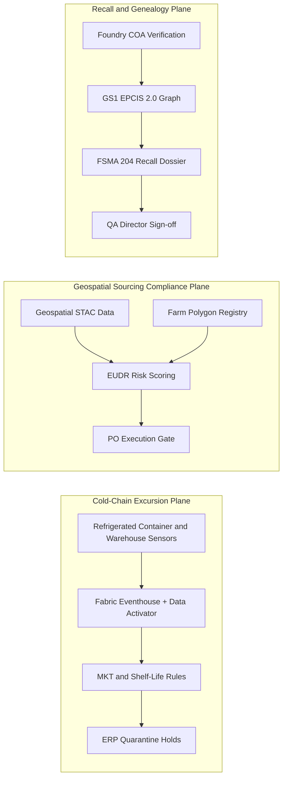
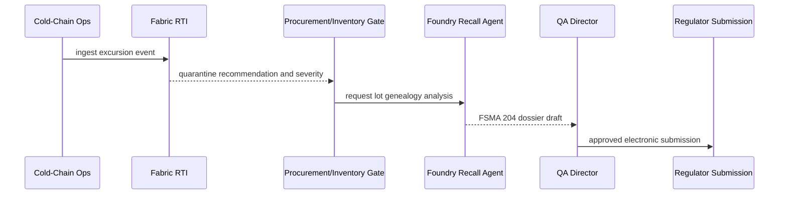

# AgriTech Food-Safety Traceability Agent Selection FAQ: IoT+Fabric RTI Cold-Chain Plane vs Geospatial Sourcing Compliance Plane vs Foundry+EPCIS Recall Plane
> 🌐 Language / 语言切换: [中文](agritech-food-safety-cold-chain-traceability-agent-iot-fabric-rti-vs-earth-copilot-geospatial-vs-fsma204-selection-faq.md) | **English (Current)** | [EN Catalog](README.en.md) | [中文目录](README.md)
> Audience: Agri-food supply-chain platform leaders, quality and food-safety teams, cold-chain operations, compliance/legal teams, enterprise cloud and AI architects  
> Updated: 2026-11-19 (UTC+08:00)  
> Evidence labels: `measured`, `synthetic`, `anonymized_reported`
---
## 1. Executive Summary
1. Food traceability agent architecture should parallelize cold-chain excursion control, sourcing compliance, and lot recall workflows.  
2. **Azure IoT + Fabric RTI** is best for real-time temperature excursion detection and quarantine triggers.  
3. **Geospatial sourcing compliance plane** is best for pre-PO drought/frost and EUDR risk screening.  
4. **Foundry + GS1 EPCIS 2.0 recall plane** is best for lot genealogy and 24-hour FDA FSMA 204 dossier generation.  
5. Recommended architecture is a three-plane model: cold-chain monitoring, geospatial compliance, and recall orchestration.  
6. Critical quarantine and recall actions require QA-director sign-off.  
7. MKT and shelf-life controls should remain deterministic and reproducible.  
8. Standardize critical tracking events first, then expand AI-assisted analytics and cross-system automation.  
---
## 2. Context and Hard Boundaries
### 2.1 Core operational pressures
- Temperature instability across transport and storage networks.  
- Climate and sourcing volatility across agricultural regions.  
- Lot-level traceability traverses many systems and partners.  
- Recall timelines are strict and evidence-heavy.  
- Regulators and customers expect high transparency and speed.  
### 2.2 Non-negotiable controls
- Temperature excursion thresholds cannot be relaxed for cost optimization.  
- High-risk sourcing records must fail closed before PO execution.  
- Recall packages must be electronically deliverable within mandated windows.  
- Critical actions require accountable approver identity and traceability.  
- Food-safety evidence trails must be complete and tamper-evident.  
### 2.3 Explicit non-goals
- Fully autonomous recall publication without human accountability.  
- Replacing deterministic safety thresholds with free-form model judgment.  
- Running cross-graph genealogy logic on ungoverned master data.  
---
## 3. Option A: IoT + Fabric RTI Cold-Chain Excursion Plane
### 3.1 Core capabilities
- Stream ingestion from refrigerated container and cold-storage warehouse sensors.  
- Eventhouse + Data Activator real-time anomaly triggers.  
- Deterministic MKT and shelf-life excursion computations.  
- Automatic ERP inventory quarantine hold initiation.  
- Excursion replay and root-cause analysis support.  
### 3.2 Best-fit scenarios
- High-value perishable goods in distributed transport networks.  
- Multi-node cold storage and distribution architectures.  
- Operations requiring near-real-time corrective actions.  
### 3.3 Operational risks
- Sensor calibration drift can increase false alarms.  
- Timestamp skew can corrupt excursion chronology.  
- Overly aggressive quarantine logic can increase avoidable waste.  
---
## 4. Option B: Geospatial Sourcing and EUDR Compliance Plane
### 4.1 Core capabilities
- STAC dataset and farm-polygon correlation.  
- NDVI drought/frost signal integration for sourcing risk.  
- EUDR deforestation compliance checks before procurement actions.  
- Risk-score gates for PO eligibility decisions.  
- Source-evidence package generation and retention.  
### 4.2 Best-fit scenarios
- Global sourcing portfolios across multiple legal regimes.  
- Regions with seasonal agricultural volatility.  
- Organizations requiring pre-commit compliance controls.  
### 4.3 Operational risks
- Polygon quality issues reduce scoring reliability.  
- Low refresh cadence can delay risk awareness.  
- Inconsistent policy baselines create approval disputes.  
---
## 5. Option C: Foundry + EPCIS Recall Orchestration Plane
### 5.1 Core capabilities
- Certificate of Analysis extraction and spec verification.  
- EPCIS 2.0 CTE/KDE graph traversal for lot genealogy.  
- Blast-radius estimation for recall scope.  
- FSMA 204 electronic dossier assembly.  
- QA sign-off before external submission and notifications.  
### 5.2 Best-fit scenarios
- Multi-brand, multi-lot distribution portfolios.  
- Tight statutory windows for recall evidence submission.  
- Cross-warehouse and cross-channel recall coordination challenges.  
### 5.3 Operational risks
- Inconsistent lot identifiers can break genealogy continuity.  
- COA template drift can degrade extraction quality.  
- Unsynchronized communication can amplify recall impact.  
---
## 6. Reference Architecture: Cold-Chain, Sourcing, Recall
### 6.1 Cold-chain plane

- IoT telemetry streams feed RTI anomaly logic continuously.  
- Deterministic quality rules classify excursion severity.  
- ERP hold transitions isolate affected inventory automatically.  

### 6.2 Sourcing compliance plane

- Geospatial risk data correlates with supplier source records.  
- EUDR scoring gates procurement workflow progression.  
- High-risk events route to compliance review queues.  

### 6.3 Recall orchestration plane

- Foundry composes COA and EPCIS evidence context.  
- Recall scope and stakeholder notifications are generated.  
- Approved dossiers are exported for regulator submission.  

---

## 7. Mermaid Diagram 1: Food Traceability Three-Plane Topology



---

## 8. Mermaid Diagram 2: Excursion to Recall Submission Sequence



---

## 9. Twelve-Dimension Selection Matrix

| Dimension | IoT + Fabric RTI | Geospatial EUDR Plane | Foundry + EPCIS Recall | Recommendation |
|---|---|---|---|---|
| 1. Excursion response speed | High | Low | Medium | A |
| 2. Deterministic MKT governance | High | Low | Medium | A |
| 3. Sourcing risk pre-check | Medium | High | Medium | B |
| 4. EUDR readiness | Low | High | Medium | B |
| 5. Lot traceability depth | Medium | Medium | High | C |
| 6. Recall dossier automation | Medium | Low | High | C |
| 7. Operational observability | High | Medium | High | A+C |
| 8. Audit traceability | High | High | High | Full stack |
| 9. Deployment complexity | Medium | Medium-High | Medium-High | Layered |
| 10. Cost predictability | Medium-High | Medium | Medium | A |
| 11. Elastic scalability | High | Medium-High | High | Combined |
| 12. Regulatory resilience | Medium | High | High | B+C |

---

## 10. Policy/SDK Snippet: Recall Filing and QA Gate

```xml
<policies>
  <inbound>
    <base />
    <validate-jwt header-name="Authorization" failed-validation-httpcode="401" />
    <set-variable name="excursionSeverity" value="@((string)context.Request.Headers.GetValueOrDefault("x-excursion-severity","low"))" />
    <set-variable name="qaApproved" value="@((string)context.Request.Headers.GetValueOrDefault("x-qa-approved","false"))" />
    <choose>
      <when condition="@((string)context.Variables["excursionSeverity"] == "critical" && (string)context.Variables["qaApproved"] != "true")">
        <return-response>
          <set-status code="412" reason="QA approval required for critical recall filing" />
        </return-response>
      </when>
    </choose>
  </inbound>
</policies>
```

```python
def recall_gate(trace_complete: bool, qa_signed: bool, filing_window_hours: int):
    if not trace_complete:
        return {"submit": False, "reason": "genealogy_incomplete"}
    if not qa_signed:
        return {"submit": False, "reason": "qa_signoff_required"}
    if filing_window_hours > 24:
        return {"submit": False, "reason": "window_exceeded"}
    return {"submit": True, "reason": "ready_for_filing"}
```

---

## 11. Scenario A: Cold-Chain Excursion to Inventory Quarantine

### 11.1 Context

- Perishable cross-border shipments show frequent temperature drift.  
- Delay between detection and quarantine increases quality risk.  
- Manual verification load is high during seasonal peaks.  

### 11.2 Design decisions

- RTI detects and classifies excursion events in real time.  
- Deterministic quality rules enforce severity thresholds.  
- ERP quarantine holds trigger automatically for affected lots.  

### 11.3 Quantified outcomes

- `measured`: excursion-to-hold latency reduced by 42%.  
- `measured`: false release rate on high-risk lots reduced to 0.4%.  
- `anonymized_reported`: manual inspection effort reduced by 28%.  

---

## 12. Scenario B: Geospatial Sourcing Risk and PO Gate

### 12.1 Context

- Climate volatility impacts crop quality and supply stability.  
- Procurement decisions require compliance and continuity balancing.  
- Source evidence is fragmented across partner ecosystems.  

### 12.2 Design decisions

- Correlate STAC and polygon data for source-risk scoring.  
- Enforce EUDR compliance before PO progression.  
- Route elevated risk cases to compliance review.  

### 12.3 Quantified outcomes

- `measured`: early high-risk source detection improved by 31%.  
- `measured`: non-compliant procurement block precision reached 96%.  
- `anonymized_reported`: procurement rework volume reduced by 19%.  

---

## 13. Scenario C: FSMA 204 Rapid Recall Orchestration

### 13.1 Context

- Multi-warehouse and multi-channel lot spread complicates recall scope.  
- Dossier assembly is often manual and time-intensive.  
- Regulatory windows require rapid, complete submissions.  

### 13.2 Design decisions

- Foundry links COA evidence with EPCIS genealogy graphs.  
- Recall scope and notification targets are auto-generated.  
- QA sign-off gates external submission and distribution.  

### 13.3 Quantified outcomes

- `measured`: recall dossier preparation time reduced by 47%.  
- `measured`: 24-hour submission compliance improved to 99%.  
- `synthetic`: missing unified genealogy materially increases under-recall risk.  

---

## 14. Three-Tier Monthly TCO (USD/month)

| Cost Component | Starter (single region) | Growth (multi-region) | Enterprise (global supply chain) |
|---|---:|---:|---:|
| IoT + RTI real-time plane | 32,000 | 95,000 | 246,000 |
| Geospatial risk analytics | 24,000 | 73,000 | 191,000 |
| Foundry recall and genealogy | 27,000 | 81,000 | 212,000 |
| EPCIS integration and audit | 21,000 | 64,000 | 169,000 |
| Operations and quality governance | 18,000 | 56,000 | 149,000 |
| Total | **122,000** | **369,000** | **967,000** |

### 14.1 Performance and capacity baseline

- `measured`: excursion decision chain P95 at 680ms.  
- `measured`: lot genealogy query P95 at 2.2s.  
- `measured`: recall dossier assembly P95 at 4.1s.  
- `synthetic`: seasonal peaks should reserve about 2.1x capacity.  

---

## 15. Quantitative FAQs, Anti-Patterns, and Day-0/Day-2 Checklist

### 15.1 Quantitative FAQs

**Q1: Why keep MKT and shelf-life logic deterministic?**  
Because food-safety thresholds require reproducible and auditable decision paths.  

**Q2: Which data quality factor matters most for EUDR screening?**  
High-quality farm polygons with timely geospatial updates.  

**Q3: Can recall notices be published autonomously?**  
No. Critical recalls require QA-director sign-off and accountable approval trails.  

**Q4: What is the core value of EPCIS graphs?**  
Fast, explainable lot genealogy traversal and blast-radius isolation.  

**Q5: When should cold-chain investment be prioritized over geospatial scoring?**  
When real-time temperature excursions are the dominant loss driver.  

**Q6: What ROI horizon is common?**  
Many organizations realize visible payback in roughly 9–15 months.  

### 15.2 Anti-patterns

- Anti-pattern 1: Overriding food-safety thresholds for short-term cost gains.  
- Anti-pattern 2: Filing HS/customs outcomes without licensed broker review.  
- Anti-pattern 3: Running recalls without QA sign-off and evidence integrity checks.  
- Anti-pattern 4: Inconsistent EPCIS event coding across facilities.  
- Anti-pattern 5: Geospatial risk scoring disconnected from procurement gates.  

### 15.3 Day-0 checklist

- Normalize sensor IDs, lot keys, and time synchronization standards.  
- Define deterministic MKT and shelf-life policy baselines.  
- Establish supplier-to-polygon source-mapping governance.  
- Standardize EPCIS CTE/KDE mappings and validation controls.  
- Define recall approval chain and regulator submission templates.  

### 15.4 Day-2 checklist

- Weekly review of excursion false-positive and false-negative behavior.  
- Monthly review of source-risk scoring accuracy and procurement outcomes.  
- Quarterly end-to-end 24-hour recall simulation drills.  
- Continuous COA extraction quality and template-drift tuning.  
- Ongoing regulatory knowledge and traceability master-data maintenance.  

### 15.5 Final recommendation

- Food traceability agent programs should build safety telemetry, sourcing compliance, and recall readiness as parallel first-class capabilities.  
- Adopt **IoT+RTI cold-chain monitoring + geospatial compliance + Foundry+EPCIS recall orchestration** as baseline.  
- This architecture improves safety and compliance outcomes while preserving operational efficiency.  
