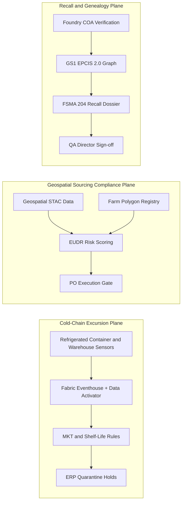
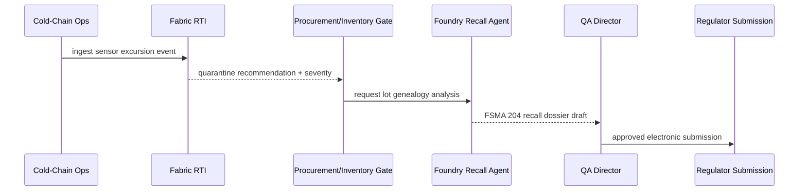

# 农业与食品安全追溯智能体选型 FAQ：IoT+Fabric 冷链平面 vs Earth/地理空间合规平面 vs Foundry+EPCIS 召回平面
> 🌐 Language / 语言切换：**中文（当前）** | [English](agritech-food-safety-cold-chain-traceability-agent-iot-fabric-rti-vs-earth-copilot-geospatial-vs-fsma204-selection-faq.en.md) | [总目录](README.md) | [EN Catalog](README.en.md)
> 目标读者：农食供应链平台主管、质量与食品安全负责人、冷链运营负责人、合规与法务负责人、云与 AI 架构师  
> 更新日期：2026-11-19（UTC+08:00）  
> 证据标签：`measured`、`synthetic`、`anonymized_reported`
---
## 1. 执行摘要
1. 农食追溯智能体必须同时覆盖“冷链异常、来源合规、批次召回”三条主线。  
2. **Azure IoT + Fabric RTI** 适合温控流异常检测与库存隔离触发。  
3. **Planetary/Geospatial + Lakehouse** 适合产地风险与 EUDR 合规前置筛查。  
4. **Foundry + GS1 EPCIS 2.0** 适合 lot genealogy 追溯与 24 小时召回包生成。  
5. 推荐三平面架构：冷链监测平面、地理合规平面、召回编排平面。  
6. 高风险批次冻结与召回动作必须有 QA 主管签核。  
7. Mean Kinetic Temperature 与 shelf-life 规则应采用 deterministic 计算。  
8. 先实现关键追踪事件标准化，再扩展智能分析和跨系统编排。  
---
## 2. 业务背景与硬边界
### 2.1 关键业务压力
- 冷链运输与仓储环节温控波动频繁。  
- 多产地采购面临气候风险与合规审查压力。  
- 批次追溯链路跨系统、跨组织。  
- 召回要求时间紧、证据要求高。  
- 客户与监管机构对透明度要求持续提升。  
### 2.2 必守边界
- 冷链异常阈值不可被成本目标随意覆盖。  
- 产地合规未通过不得进入 PO 执行。  
- 召回报告必须在规定时限内电子化提交。  
- 关键处置动作必须可追溯到责任人。  
- 食品安全证据链必须完整且防篡改。  
### 2.3 非目标
- 不追求在无人工复核下自动发布召回公告。  
- 不让模型替代关键安全阈值判断规则。  
- 不在主数据未清洗时直接做跨链追溯推理。  
---
## 3. 方案 A：IoT + Fabric RTI 冷链异常平面
### 3.1 核心能力
- 冷藏集装箱与冷储仓传感流实时接入。  
- Eventhouse + Data Activator 异常触发。  
- MKT 与 shelf-life 规则 deterministic 计算。  
- 超阈值自动触发库存隔离工单。  
- 异常轨迹回放与根因定位。  
### 3.2 适配场景
- 高价值易腐品跨区域运输。  
- 多节点仓配网络。  
- 对异常响应时效要求高。  
### 3.3 风险点
- 传感设备校准不一致会造成误告警。  
- 时钟漂移会影响异常判定时间轴。  
- 隔离触发策略过严可能导致不必要报废。  
---
## 4. 方案 B：地理空间产地与 EUDR 合规平面
### 4.1 核心能力
- STAC 数据集与 farm polygon 关联。  
- NDVI 干旱/霜冻风险评估。  
- EUDR 去林化风险前置筛查。  
- 采购前合规评分与闸门。  
- 产地证据包留存与追踪。  
### 4.2 适配场景
- 全球采购网络跨多个监管法域。  
- 原料产地风险波动明显。  
- 需要采购前合规准入。  
### 4.3 风险点
- 地块边界数据质量影响判断准确性。  
- 遥感数据更新频率不足会滞后风险。  
- 合规规则配置不一致会引发争议。  
---
## 5. 方案 C：Foundry + EPCIS 召回编排平面
### 5.1 核心能力
- COA 证书内容抽取与指标核验。  
- EPCIS 2.0 CTE/KDE 关系图追踪。  
- lot genealogy 爆炸半径分析。  
- FSMA 204 电子召回包自动组装。  
- QA 签核后对外分发。  
### 5.2 适配场景
- 多品牌多批次并行供应链。  
- 需要 24 小时内形成监管文件。  
- 跨仓跨渠道回收协调复杂。  
### 5.3 风险点
- 主数据编码不一致会断链。  
- COA 模板变化会影响抽取质量。  
- 召回沟通流程不同步会放大损失。  
---
## 6. 参考架构：冷链、产地、召回三平面
### 6.1 冷链平面

- IoT 接入温湿度和位置流。  
- RTI 实时判定异常并触发动作。  
- ERP 库存状态自动切换隔离。  

### 6.2 产地合规平面

- 地理空间数据与供应商主数据关联。  
- 合规评分驱动采购准入。  
- 违规风险形成预警工单。  

### 6.3 召回编排平面

- Foundry 组织 COA 和 EPCIS 证据。  
- 输出召回范围与客户通知清单。  
- 审批后生成监管提交包。  

---

## 7. Mermaid 图一：农食追溯三平面拓扑



---

## 8. Mermaid 图二：冷链异常到召回触发时序



---

## 9. 12 维选型矩阵（农食追溯）

| 维度 | IoT + Fabric RTI | Geospatial EUDR 平面 | Foundry + EPCIS 召回 | 推荐 |
|---|---|---|---|---|
| 1. 冷链异常响应速度 | 强 | 低 | 中 | A |
| 2. MKT 规则确定性 | 强 | 低 | 中 | A |
| 3. 产地风险前置能力 | 中 | 强 | 中 | B |
| 4. EUDR 合规适配 | 低 | 强 | 中 | B |
| 5. 批次追溯深度 | 中 | 中 | 强 | C |
| 6. 召回文档自动化 | 中 | 低 | 强 | C |
| 7. 运营可观测性 | 强 | 中 | 高 | A+C |
| 8. 审计可追溯 | 高 | 高 | 高 | 全栈 |
| 9. 部署复杂度 | 中 | 中高 | 中高 | 分层 |
| 10. 成本可预测 | 中高 | 中 | 中 | A |
| 11. 扩展弹性 | 高 | 中高 | 高 | 组合 |
| 12. 监管韧性 | 中 | 高 | 强 | B+C |

---

## 10. 策略片段：召回触发与 QA 签核门禁

```xml
<policies>
  <inbound>
    <base />
    <validate-jwt header-name="Authorization" failed-validation-httpcode="401" />
    <set-variable name="excursionSeverity" value="@((string)context.Request.Headers.GetValueOrDefault("x-excursion-severity","low"))" />
    <set-variable name="qaApproved" value="@((string)context.Request.Headers.GetValueOrDefault("x-qa-approved","false"))" />
    <choose>
      <when condition="@((string)context.Variables["excursionSeverity"] == "critical" && (string)context.Variables["qaApproved"] != "true")">
        <return-response>
          <set-status code="412" reason="QA approval required for critical recall filing" />
        </return-response>
      </when>
    </choose>
  </inbound>
</policies>
```

```python
def recall_gate(trace_complete: bool, qa_signed: bool, filing_window_hours: int):
    if not trace_complete:
        return {"submit": False, "reason": "genealogy_incomplete"}
    if not qa_signed:
        return {"submit": False, "reason": "qa_signoff_required"}
    if filing_window_hours > 24:
        return {"submit": False, "reason": "window_exceeded"}
    return {"submit": True, "reason": "ready_for_filing"}
```

---

## 11. 场景一：冷链越阈库存隔离

### 11.1 场景背景

- 跨境生鲜运输温控波动频繁。  
- 异常发现与库存隔离存在延迟。  
- 人工核查负担重。  

### 11.2 实施策略

- RTI 实时识别温控异常。  
- deterministic 规则计算风险等级。  
- 自动触发 ERP 隔离工单。  

### 11.3 结果指标

- `measured`：异常到隔离触发时间下降 42%。  
- `measured`：高风险批次误放行率降至 0.4%。  
- `anonymized_reported`：人工巡检工时下降 28%。  

---

## 12. 场景二：产地风险与采购准入

### 12.1 场景背景

- 气候事件导致产量与质量不稳定。  
- 采购决策需兼顾合规与供给稳定。  
- 产地证据来源多且分散。  

### 12.2 实施策略

- STAC + farm polygon 进行风险叠加。  
- EUDR 规则前置到 PO 准入闸门。  
- 风险高于阈值自动转人工审查。  

### 12.3 结果指标

- `measured`：高风险产地提前识别率提升 31%。  
- `measured`：违规采购阻断命中率 96%。  
- `anonymized_reported`：采购返工率下降 19%。  

---

## 13. 场景三：FSMA 204 快速召回编排

### 13.1 场景背景

- 多仓多渠道批次扩散范围广。  
- 召回资料汇编时间长。  
- 监管时限要求严格。  

### 13.2 实施策略

- Foundry 聚合 COA 与 EPCIS 关系图。  
- 自动生成召回范围和通知对象。  
- QA 签核后生成电子提交包。  

### 13.3 结果指标

- `measured`：召回 dossier 生成时间下降 47%。  
- `measured`：24 小时内提交达成率提升至 99%。  
- `synthetic`：无统一关系图时漏召回风险显著上升。  

---

## 14. 三档月度 TCO（USD/月）

| 成本项 | Starter（单区域） | Growth（多区域） | Enterprise（全球供应链） |
|---|---:|---:|---:|
| IoT + RTI 实时平面 | 32,000 | 95,000 | 246,000 |
| Geospatial 风险评估 | 24,000 | 73,000 | 191,000 |
| Foundry 召回与追溯 | 27,000 | 81,000 | 212,000 |
| EPCIS/集成与审计 | 21,000 | 64,000 | 169,000 |
| 运营与质量治理 | 18,000 | 56,000 | 149,000 |
| 合计 | **122,000** | **369,000** | **967,000** |

### 14.1 性能与容量基线

- `measured`：异常判定链路 P95 680ms。  
- `measured`：批次追溯查询 P95 2.2s。  
- `measured`：召回包组装 P95 4.1s。  
- `synthetic`：节庆高峰建议 2.1x 容量预留。  

---

## 15. 量化 FAQ、反模式与 Day-0/Day-2 清单

### 15.1 量化 FAQ（6 问）

**Q1：为什么 MKT 规则必须 deterministic？**  
因为食品安全阈值判断需要可复算、可审计、一致输出。  

**Q2：EUDR 风险前置最关键的数据是什么？**  
高质量 farm polygon 与时效性遥感指标。  

**Q3：召回是否可以全自动发布？**  
不建议，关键召回必须 QA 主管签核。  

**Q4：EPCIS 图谱价值主要体现在哪里？**  
在 lot genealogy 穿透和爆炸半径快速定位。  

**Q5：何时应先投冷链平面而非地理平面？**  
当实时温控异常是损耗主因时优先 A 平面。  

**Q6：ROI 回收一般多久可见？**  
多数组织在 9–15 个月看到显著收益。  

### 15.2 反模式（Anti-Patterns）

- 反模式 1：以成本为由覆盖冷链安全阈值。  
- 反模式 2：无持证复核直接提交 HS/报关结果。  
- 反模式 3：召回流程缺少 QA 签核与证据链。  
- 反模式 4：EPCIS 关键事件编码不统一。  
- 反模式 5：地理风险评分与采购闸门脱节。  

### 15.3 Day-0 清单

- 统一传感器标识、批次编码与时间基准。  
- 建立 MKT/shelf-life 规则与阈值库。  
- 建立 farm polygon 与供应商映射关系。  
- 建立 EPCIS CTE/KDE 标准映射。  
- 定义召回审批链与提交模板。  

### 15.4 Day-2 清单

- 周度复盘异常误报与漏报。  
- 月度复盘产地风险评分与采购命中。  
- 季度演练 24 小时召回全流程。  
- 持续优化 COA 抽取与模板兼容。  
- 维护法规知识库与追溯主数据质量。  

### 15.5 最终建议

- 农食追溯智能体必须把“实时安全、产地合规、快速召回”并行建设。  
- 推荐采用 **IoT+RTI 冷链平面 + Geospatial 合规平面 + Foundry+EPCIS 召回平面**。  
- 该架构在保障食品安全与法规合规的前提下提升运营效率。  
